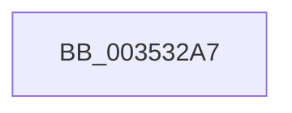

# sub_003532A7

- RVA: `0x003532A7`–`0x003532D3` (길이 `44` bytes)
- VA: `0x00000001403532A7`
- 실행 섹션: `.text`
- PDB 이름 있음: `아니요`; PDB Function 태그: `아니요`
- unwind 정보 RVA: `0x00079028`
- 디코드: `11`개 명령, `44/44` bytes 표시
- 미해석 바이트: `0` (있으면 어셈블리에 `.byte`로 보존)

> 이 문서는 커널 이미지의 기계어와 PDB 기호를 분석해 생성했습니다. 4번과 5번은 함수 원형과 자료형을 바이너리 사용 방식에서 추정한 C 해석이며 원본 소스 복구 결과는 아닙니다.

## 1. Dependencies

- 직접 호출 지점: **1**; 고유 호출 대상: **1**
- 직접 호출자로 확인된 함수: **0**
- RIP 상대 이미지 참조: **0**

### Outgoing calls
- `0x003532B1` → [ExAcquireSpinLockExclusiveAtDpcLevel](../24/ExAcquireSpinLockExclusiveAtDpcLevel_function_00248E80.md) (function, `0x00248E80`)

### Direct callers
- 이 함수 시작 RVA로 연결되는 직접 call은 확인되지 않았습니다. 간접 호출은 완전히 역산할 수 없습니다.

### Static image references
- 디코드된 RIP-relative 메모리 참조가 없습니다.

## 2. Other-region calls and transfers

- 다른 실행 섹션으로 향하는 call: **0**
- call이 아닌 외부 분기/꼬리 이동: **1**
  - `0x003532D1` → [sub_00353319](Unknown_function_00353319.md) (`tail-transfer`)

## 3. Assembly (complete function range)

```asm
003532A7  48 89 74 24 78                  mov qword ptr [rsp + 0x78], rsi
003532AC  4C 89 6C 24 30                  mov qword ptr [rsp + 0x30], r13
003532B1  E8 CA 5B EF FF                  call 0x140248e80
003532B6  49 8B C7                        mov rax, r15
003532B9  48 83 C8 01                     or rax, 1
003532BD  49 89 04 24                     mov qword ptr [r12], rax
003532C1  49 8B 87 58 8E 00 00            mov rax, qword ptr [r15 + 0x8e58]
003532C8  0F B6 08                        movzx ecx, byte ptr [rax]
003532CB  48 8D 70 08                     lea rsi, [rax + 8]
003532CF  84 C9                           test cl, cl
003532D1  74 46                           je 0x140353319
```

## 4. C-style interpretation (structured pseudocode)

```c
__int64 __fastcall sub_003532A7(void)
{
    __int64 result;
    unsigned __int64 v_stack_p30;
    unsigned __int64 v_stack_p78;

    v_stack_p78 = v_rsi;
    v_stack_p30 = v_r13;
    result = ExAcquireSpinLockExclusiveAtDpcLevel(a1, a2, a3, a4);
    result = (v_r15) | (1);
    *(unsigned __int64 *)(v_r12) = result;
}
```

## 5. (Beta) C Style

```c
void sub_003532A7(void)
{
    int64_t result;
    uint64_t v_stack_p30;
    uint64_t v_stack_p78;

    v_stack_p78 = local_rsi;
    v_stack_p30 = local_r13;
    result = ExAcquireSpinLockExclusiveAtDpcLevel(a1, a2, a3, a4);
    result = (local_r15) | (1);
    *(uint64_t *)(local_r12) = result;
}
```

## 6. Execution-region graph

[열기: 2D/3D 그래프와 함수 탐색 컨트롤 패널](../../../control-panel.html?section=text&rva=0x003532A7&view=graph)

- 2D 그래프는 위에서 아래로 흐르고, 3D 그래프는 빈 공간을 드래그해 회전합니다. Shift+드래그는 이동, 휠은 확대·축소, 함수 노드 선택은 대상 보고서 이동입니다.

### Static fallback


