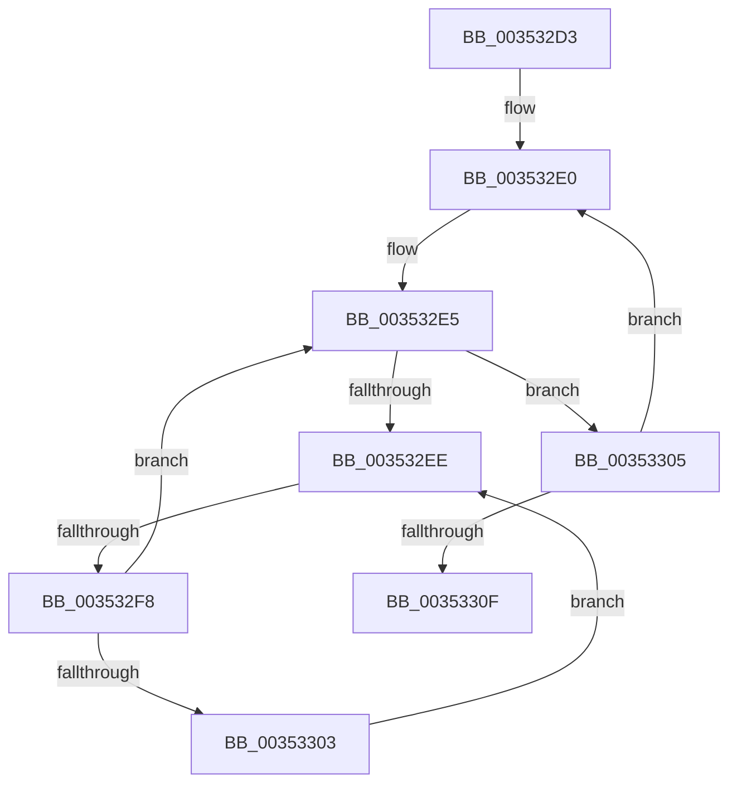

# sub_003532D3

- RVA: `0x003532D3`–`0x00353319` (길이 `70` bytes)
- VA: `0x00000001403532D3`
- 실행 섹션: `.text`
- PDB 이름 있음: `아니요`; PDB Function 태그: `아니요`
- unwind 정보 RVA: `0x00079040`
- 디코드: `21`개 명령, `70/70` bytes 표시
- 미해석 바이트: `0` (있으면 어셈블리에 `.byte`로 보존)

> 이 문서는 커널 이미지의 기계어와 PDB 기호를 분석해 생성했습니다. 4번과 5번은 함수 원형과 자료형을 바이너리 사용 방식에서 추정한 C 해석이며 원본 소스 복구 결과는 아닙니다.

## 1. Dependencies

- 직접 호출 지점: **0**; 고유 호출 대상: **0**
- 직접 호출자로 확인된 함수: **0**
- RIP 상대 이미지 참조: **1**

### Outgoing calls
- 직접 디코드된 call 명령이 없습니다.

### Direct callers
- 이 함수 시작 RVA로 연결되는 직접 call은 확인되지 않았습니다. 간접 호출은 완전히 역산할 수 없습니다.

### Static image references
- `0x003532F0` → RVA `0x00FC52AC` (`ALMOSTRO`; reference)

## 2. Other-region calls and transfers

- 다른 실행 섹션으로 향하는 call: **0**
- call이 아닌 외부 분기/꼬리 이동: **1**
  - `0x003532F6` → [sub_00353356](Unknown_function_00353356.md) (`tail-transfer`)

## 3. Assembly (complete function range)

```asm
003532D3  48 89 6C 24 70                  mov qword ptr [rsp + 0x70], rbp
003532D8  8B E9                           mov ebp, ecx
003532DA  48 89 7C 24 38                  mov qword ptr [rsp + 0x38], rdi
003532DF  90                              nop
003532E0  48 8B 1E                        mov rbx, qword ptr [rsi]
003532E3  33 FF                           xor edi, edi
003532E5  F0 48 0F BA 6B 30 00            lock bts qword ptr [rbx + 0x30], 0
003532EC  73 17                           jae 0x140353305
003532EE  FF C7                           inc edi
003532F0  85 3D B6 1F C7 00               test dword ptr [rip + 0xc71fb6], edi
003532F6  74 5E                           je 0x140353356
003532F8  F3 90                           pause
003532FA  48 8B 43 30                     mov rax, qword ptr [rbx + 0x30]
003532FE  48 85 C0                        test rax, rax
00353301  74 E2                           je 0x1403532e5
00353303  EB E9                           jmp 0x1403532ee
00353305  48 83 C6 08                     add rsi, 8
00353309  48 83 ED 01                     sub rbp, 1
0035330D  75 D1                           jne 0x1403532e0
0035330F  48 8B 7C 24 38                  mov rdi, qword ptr [rsp + 0x38]
00353314  48 8B 6C 24 70                  mov rbp, qword ptr [rsp + 0x70]
```

## 4. C-style interpretation (structured pseudocode)

```c
__int64 __fastcall sub_003532D3(int a1, __int64 a2, __int64 a3, __int64 a4, __int64 a5, __int64 a6, __int64 a7, __int64 a8, __int64 a9, __int64 a10, __int64 a11, __int64 a12, __int64 a13, __int64 a14)
{
    __int64 v_rbp;
    __int64 v_rdi;
    __int64 v_rsi;
    unsigned __int64 v_stack_p38;
    unsigned __int64 v_stack_p70;

    v_stack_p70 = v_rbp;
    v_stack_p38 = v_rdi;
loc_003532E0:
    v_rdi = 0;
loc_003532E5:
    if (condition_is_above_or_equal) goto loc_00353305;
loc_003532EE:
    v_rdi = (unsigned int)((v_rdi) + 1);
    if (*(unsigned __int64 *)(*(unsigned __int64 *)(v_rsi) + 48) == 0) goto loc_003532E5;
    goto loc_003532EE;
loc_00353305:
    v_rsi = (v_rsi) + (8);
    v_rbp = ((unsigned int)(a1)) - (1);
    if (condition_is_not_equal) goto loc_003532E0;
    return *(unsigned __int64 *)(*(unsigned __int64 *)(v_rsi) + 48);
}
```

## 5. (Beta) C Style

```c
int64_t sub_003532D3(int32_t Arg1, int64_t Arg2, int64_t Arg3, int64_t Arg4, uint64_t Arg5, uint64_t Arg6, int64_t Arg7, uint64_t Arg8, uint64_t Arg9, uint64_t Arg10, uint64_t Arg11, uint64_t Arg12, uint64_t Arg13, int64_t Arg14)
{
    int64_t local_rbp;
    int64_t local_rdi;
    int64_t local_rsi;
    uint64_t v_stack_p38;
    uint64_t v_stack_p70;

    v_stack_p70 = local_rbp;
    v_stack_p38 = local_rdi;
loc_003532E0:
    local_rdi = 0;
loc_003532E5:
    if (condition_is_above_or_equal) goto loc_00353305;
loc_003532EE:
    local_rdi = (uint32_t)((local_rdi) + 1);
    if (*(uint64_t *)(*(uint64_t *)(local_rsi) + 0x30) == 0) goto loc_003532E5;
    goto loc_003532EE;
loc_00353305:
    local_rsi = (local_rsi) + (8);
    local_rbp = ((uint32_t)(Arg1)) - (1);
    if (condition_is_not_equal) goto loc_003532E0;
    return *(uint64_t *)(*(uint64_t *)(local_rsi) + 0x30);
}
```

## 6. Execution-region graph

[열기: 2D/3D 그래프와 함수 탐색 컨트롤 패널](../../../control-panel.html?section=text&rva=0x003532D3&view=graph)

- 2D 그래프는 위에서 아래로 흐르고, 3D 그래프는 빈 공간을 드래그해 회전합니다. Shift+드래그는 이동, 휠은 확대·축소, 함수 노드 선택은 대상 보고서 이동입니다.

### Static fallback


