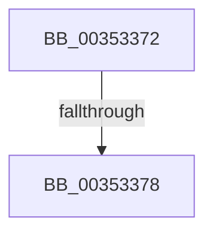

# sub_00353372

- RVA: `0x00353372`–`0x0035339D` (길이 `43` bytes)
- VA: `0x0000000140353372`
- 실행 섹션: `.text`
- PDB 이름 있음: `아니요`; PDB Function 태그: `아니요`
- unwind 정보 RVA: `0x000790A0`
- 디코드: `11`개 명령, `43/43` bytes 표시
- 미해석 바이트: `0` (있으면 어셈블리에 `.byte`로 보존)

> 이 문서는 커널 이미지의 기계어와 PDB 기호를 분석해 생성했습니다. 4번과 5번은 함수 원형과 자료형을 바이너리 사용 방식에서 추정한 C 해석이며 원본 소스 복구 결과는 아닙니다.

## 1. Dependencies

- 직접 호출 지점: **2**; 고유 호출 대상: **2**
- 직접 호출자로 확인된 함수: **0**
- RIP 상대 이미지 참조: **0**

### Outgoing calls
- `0x0035337D` → [KiDowngradeIsolationUnitLockHandle](KiDowngradeIsolationUnitLockHandle_function_00353FB0.md) (function, `0x00353FB0`)
- `0x00353386` → [ExReleaseSpinLockExclusiveFromDpcLevel](../24/ExReleaseSpinLockExclusiveFromDpcLevel_function_002497E0.md) (function, `0x002497E0`)

### Direct callers
- 이 함수 시작 RVA로 연결되는 직접 call은 확인되지 않았습니다. 간접 호출은 완전히 역산할 수 없습니다.

### Static image references
- 디코드된 RIP-relative 메모리 참조가 없습니다.

## 2. Other-region calls and transfers

- 다른 실행 섹션으로 향하는 call: **0**
- call이 아닌 외부 분기/꼬리 이동: **2**
  - `0x00353376` → [sub_00353327](Unknown_function_00353327.md) (`tail-transfer`)
  - `0x00353398` → [KiReparkIdlingProcessorIfNecessary + 0x32](KiReparkIdlingProcessorIfNecessary_function_00353260.md) (`tail-transfer`)

## 3. Assembly (complete function range)

```asm
00353372  49 3B 5F 18                     cmp rbx, qword ptr [r15 + 0x18]
00353376  74 AF                           je 0x140353327
00353378  33 D2                           xor edx, edx
0035337A  49 8B CC                        mov rcx, r12
0035337D  E8 2E 0C 00 00                  call 0x140353fb0
00353382  49 8D 4E 78                     lea rcx, [r14 + 0x78]
00353386  E8 55 64 EF FF                  call 0x1402497e0
0035338B  4C 8B 6C 24 30                  mov r13, qword ptr [rsp + 0x30]
00353390  48 8B C3                        mov rax, rbx
00353393  48 8B 5C 24 68                  mov rbx, qword ptr [rsp + 0x68]
00353398  E9 F5 FE FF FF                  jmp 0x140353292
```

## 4. C-style interpretation (structured pseudocode)

```c
__int64 __fastcall sub_00353372(__int64 a1, int a2, __int64 a3, __int64 a4, __int64 a5, __int64 a6, __int64 a7, __int64 a8, __int64 a9, __int64 a10, __int64 a11, __int64 a12, __int64 a13)
{
    __int64 result;

    a2 = 0;
    result = KiDowngradeIsolationUnitLockHandle(v_r12, a2, a3, a4);
    result = ExReleaseSpinLockExclusiveFromDpcLevel(v_r14 + 120, a2, a3, a4);
}
```

## 5. (Beta) C Style

```c
int64_t sub_00353372(int64_t Arg1, int32_t Arg2, int64_t Arg3, int64_t Arg4, uint64_t Arg5, int64_t Arg6, uint64_t Arg7, uint64_t Arg8, uint64_t Arg9, uint64_t Arg10, uint64_t Arg11, uint64_t Arg12, int64_t Arg13)
{
    int64_t result;

    Arg2 = 0;
    result = KiDowngradeIsolationUnitLockHandle(local_r12, Arg2, Arg3, Arg4);
    result = ExReleaseSpinLockExclusiveFromDpcLevel(local_r14 + 120, Arg2, Arg3, Arg4);
}
```

## 6. Execution-region graph

[열기: 2D/3D 그래프와 함수 탐색 컨트롤 패널](../../../control-panel.html?section=text&rva=0x00353372&view=graph)

- 2D 그래프는 위에서 아래로 흐르고, 3D 그래프는 빈 공간을 드래그해 회전합니다. Shift+드래그는 이동, 휠은 확대·축소, 함수 노드 선택은 대상 보고서 이동입니다.

### Static fallback


