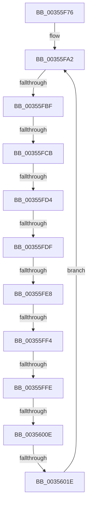

# sub_00355F76

- RVA: `0x00355F76`–`0x0035602F` (길이 `185` bytes)
- VA: `0x0000000140355F76`
- 실행 섹션: `.text`
- PDB 이름 있음: `아니요`; PDB Function 태그: `아니요`
- unwind 정보 RVA: `0x00079348`
- 디코드: `41`개 명령, `185/185` bytes 표시
- 미해석 바이트: `0` (있으면 어셈블리에 `.byte`로 보존)

> 이 문서는 커널 이미지의 기계어와 PDB 기호를 분석해 생성했습니다. 4번과 5번은 함수 원형과 자료형을 바이너리 사용 방식에서 추정한 C 해석이며 원본 소스 복구 결과는 아닙니다.

## 1. Dependencies

- 직접 호출 지점: **0**; 고유 호출 대상: **0**
- 직접 호출자로 확인된 함수: **0**
- RIP 상대 이미지 참조: **1**

### Outgoing calls
- 직접 디코드된 call 명령이 없습니다.

### Direct callers
- 이 함수 시작 RVA로 연결되는 직접 call은 확인되지 않았습니다. 간접 호출은 완전히 역산할 수 없습니다.

### Static image references
- `0x00355FFE` → RVA `0x00FC6B14` (`ALMOSTRO`; read)

## 2. Other-region calls and transfers

- 다른 실행 섹션으로 향하는 call: **0**
- call이 아닌 외부 분기/꼬리 이동: **9**
  - `0x00355FB9` → [sub_00356086 + 0xE0](Unknown_function_00356086.md) (`tail-transfer`)
  - `0x00355FC5` → [sub_00356086](Unknown_function_00356086.md) (`tail-transfer`)
  - `0x00355FCE` → [sub_00356086 + 0x53](Unknown_function_00356086.md) (`tail-transfer`)
  - `0x00355FD9` → [sub_00356086 + 0xD6](Unknown_function_00356086.md) (`tail-transfer`)
  - `0x00355FE2` → [sub_00356086 + 0x6F](Unknown_function_00356086.md) (`tail-transfer`)
  - `0x00355FEE` → [sub_00356086 + 0x11D](Unknown_function_00356086.md) (`tail-transfer`)
  - `0x00355FF8` → [sub_00356086 + 0x138](Unknown_function_00356086.md) (`tail-transfer`)
  - `0x00356008` → [sub_00356086 + 0x1D5](Unknown_function_00356086.md) (`tail-transfer`)
  - `0x0035601C` → [sub_0035606E](Unknown_function_0035606E.md) (`tail-transfer`)

## 3. Assembly (complete function range)

```asm
00355F76  48 89 5C 24 68                  mov qword ptr [rsp + 0x68], rbx
00355F7B  8B 9A D8 00 00 00               mov ebx, dword ptr [rdx + 0xd8]
00355F81  4C 89 64 24 30                  mov qword ptr [rsp + 0x30], r12
00355F86  48 03 DF                        add rbx, rdi
00355F89  4C 8B A4 24 80 00 00 00         mov r12, qword ptr [rsp + 0x80]
00355F91  4C 89 6C 24 28                  mov qword ptr [rsp + 0x28], r13
00355F96  4C 89 74 24 20                  mov qword ptr [rsp + 0x20], r14
00355F9B  45 33 F6                        xor r14d, r14d
00355F9E  45 8D 7E 0F                     lea r15d, [r14 + 0xf]
00355FA2  0F B7 4B 70                     movzx ecx, word ptr [rbx + 0x70]
00355FA6  8B 43 7C                        mov eax, dword ptr [rbx + 0x7c]
00355FA9  44 0F B7 E9                     movzx r13d, cx
00355FAD  66 41 83 E5 02                  and r13w, 2
00355FB2  89 44 24 60                     mov dword ptr [rsp + 0x60], eax
00355FB6  F6 C1 04                        test cl, 4
00355FB9  0F 85 A7 01 00 00               jne 0x140356166
00355FBF  45 32 C0                        xor r8b, r8b
00355FC2  F6 C1 12                        test cl, 0x12
00355FC5  0F 84 BB 00 00 00               je 0x140356086
00355FCB  F6 C1 24                        test cl, 0x24
00355FCE  0F 84 05 01 00 00               je 0x1403560d9
00355FD4  32 C0                           xor al, al
00355FD6  F6 C1 20                        test cl, 0x20
00355FD9  0F 84 7D 01 00 00               je 0x14035615c
00355FDF  F6 C1 10                        test cl, 0x10
00355FE2  0F 84 0D 01 00 00               je 0x1403560f5
00355FE8  0F B7 43 70                     movzx eax, word ptr [rbx + 0x70]
00355FEC  A8 01                           test al, 1
00355FEE  0F 85 AF 01 00 00               jne 0x1403561a3
00355FF4  F6 43 70 04                     test byte ptr [rbx + 0x70], 4
00355FF8  0F 85 C0 01 00 00               jne 0x1403561be
00355FFE  F7 05 0C 0B C7 00 00 40 00 00   test dword ptr [rip + 0xc70b0c], 0x4000
00356008  0F 85 4D 02 00 00               jne 0x14035625b
0035600E  44 03 73 7C                     add r14d, dword ptr [rbx + 0x7c]
00356012  48 8B 9B A0 01 00 00            mov rbx, qword ptr [rbx + 0x1a0]
00356019  48 85 DB                        test rbx, rbx
0035601C  74 50                           je 0x14035606e
0035601E  8B 85 D8 00 00 00               mov eax, dword ptr [rbp + 0xd8]
00356024  48 8B FB                        mov rdi, rbx
00356027  48 2B F8                        sub rdi, rax
0035602A  E9 73 FF FF FF                  jmp 0x140355fa2
```

## 4. C-style interpretation (structured pseudocode)

```c
__int64 __fastcall sub_00355F76(__int64 a1, __int64 a2, unsigned __int8 a3, __int64 a4, __int64 a5, __int64 a6, __int64 a7, __int64 a8, __int64 a9, __int64 a10, __int64 a11, __int64 a12, __int64 a13, __int64 a14, __int64 a15, __int64 a16)
{
    __int64 result;
    __int64 v_r13;
    __int64 v_r14;
    __int64 v_rbx;
    __int64 v_rdi;
    unsigned __int64 v_stack_p20;
    unsigned __int64 v_stack_p28;
    unsigned __int64 v_stack_p30;
    unsigned int v_stack_p60;
    unsigned __int64 v_stack_p68;

    v_stack_p68 = v_rbx;
    v_stack_p30 = v_r12;
    v_rbx = ((unsigned int)(*(unsigned int *)(a2 + 216))) + (v_rdi);
    v_stack_p28 = v_r13;
    v_stack_p20 = v_r14;
    v_r14 = 0;
loc_00355FA2:
    v_r13 = (unsigned __int16)(((unsigned __int16)(*(unsigned __int16 *)(v_rbx + 112))) & (2));
    v_stack_p60 = (unsigned int)((unsigned int)(*(unsigned int *)(v_rbx + 124)));
    a3 = 0;
    result = 0;
    v_r14 = (unsigned int)((v_r14) + (*(unsigned int *)(v_rbx + 124)));
    v_rdi = (*(unsigned __int64 *)(v_rbx + 416)) - ((unsigned int)(*(unsigned int *)(v_rbp + 216)));
    goto loc_00355FA2;
}
```

## 5. (Beta) C Style

```c
int64_t sub_00355F76(int64_t Arg1, void *Arg2, uint8_t Arg3, int64_t Arg4, uint64_t Arg5, uint64_t Arg6, uint64_t Arg7, uint64_t Arg8, uint64_t Arg9, uint64_t Arg10, uint64_t Arg11, uint64_t Arg12, uint64_t Arg13, uint64_t Arg14, uint64_t Arg15, int64_t Arg16)
{
    uint8_t *arg2 = (uint8_t *)Arg2;

    int64_t result;
    int64_t local_r13;
    int64_t local_r14;
    int64_t local_rbx;
    int64_t local_rdi;
    uint64_t v_stack_p20;
    uint64_t v_stack_p28;
    uint64_t v_stack_p30;
    uint32_t v_stack_p60;
    uint64_t v_stack_p68;

    v_stack_p68 = local_rbx;
    v_stack_p30 = local_r12;
    local_rbx = ((uint32_t)(*(uint32_t *)(arg2 + 0xD8))) + (local_rdi);
    v_stack_p28 = local_r13;
    v_stack_p20 = local_r14;
    local_r14 = 0;
loc_00355FA2:
    local_r13 = (uint16_t)(((uint16_t)(*(uint16_t *)(local_rbx + 0x70))) & (2));
    v_stack_p60 = (uint32_t)((uint32_t)(*(uint32_t *)(local_rbx + 0x7C)));
    Arg3 = 0;
    result = 0;
    local_r14 = (uint32_t)((local_r14) + (*(uint32_t *)(local_rbx + 0x7C)));
    local_rdi = (*(uint64_t *)(local_rbx + 0x1A0)) - ((uint32_t)(*(uint32_t *)(local_rbp + 0xD8)));
    goto loc_00355FA2;
}
```

### 관측된 메모리 오프셋

구조체 형식이 확인되지 않은 접근은 인자 기준의 오프셋으로만 기록했습니다.

| 기준 인자 | 오프셋 표현 | 폭 (bit) | 접근 |
|---|---:|---:|---|
| `Arg2` | `+ 0xD8` | `32` | `R` |

## 6. Execution-region graph

[열기: 2D/3D 그래프와 함수 탐색 컨트롤 패널](../../../control-panel.html?section=text&rva=0x00355F76&view=graph)

- 2D 그래프는 위에서 아래로 흐르고, 3D 그래프는 빈 공간을 드래그해 회전합니다. Shift+드래그는 이동, 휠은 확대·축소, 함수 노드 선택은 대상 보고서 이동입니다.

### Static fallback


