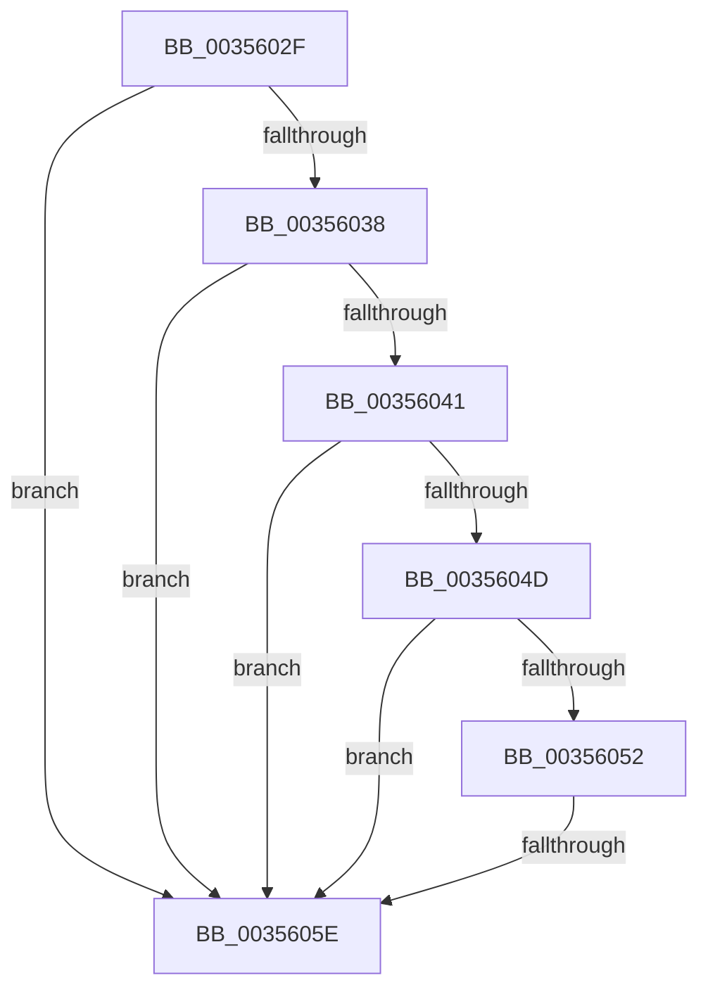

# sub_0035602F

- RVA: `0x0035602F`–`0x00356063` (길이 `52` bytes)
- VA: `0x000000014035602F`
- 실행 섹션: `.text`
- PDB 이름 있음: `아니요`; PDB Function 태그: `아니요`
- unwind 정보 RVA: `0x00079368`
- 디코드: `14`개 명령, `52/52` bytes 표시
- 미해석 바이트: `0` (있으면 어셈블리에 `.byte`로 보존)

> 이 문서는 커널 이미지의 기계어와 PDB 기호를 분석해 생성했습니다. 4번과 5번은 함수 원형과 자료형을 바이너리 사용 방식에서 추정한 C 해석이며 원본 소스 복구 결과는 아닙니다.

## 1. Dependencies

- 직접 호출 지점: **1**; 고유 호출 대상: **1**
- 직접 호출자로 확인된 함수: **0**
- RIP 상대 이미지 참조: **0**

### Outgoing calls
- `0x00356044` → [KiShouldPreemptionBeDeferred](KiShouldPreemptionBeDeferred_function_00356310.md) (function, `0x00356310`)

### Direct callers
- 이 함수 시작 RVA로 연결되는 직접 call은 확인되지 않았습니다. 간접 호출은 완전히 역산할 수 없습니다.

### Static image references
- 디코드된 RIP-relative 메모리 참조가 없습니다.

## 2. Other-region calls and transfers

- 다른 실행 섹션으로 향하는 call: **0**
- call이 아닌 외부 분기/꼬리 이동: **1**
  - `0x00356058` → [sub_003562FD](Unknown_function_003562FD.md) (`tail-transfer`)

## 3. Assembly (complete function range)

```asm
0035602F  80 BE C3 00 00 00 10            cmp byte ptr [rsi + 0xc3], 0x10
00356036  7D 26                           jge 0x14035605e
00356038  8B 56 78                        mov edx, dword ptr [rsi + 0x78]
0035603B  0F BA E2 09                     bt edx, 9
0035603F  72 1D                           jb 0x14035605e
00356041  48 8B CE                        mov rcx, rsi
00356044  E8 C7 02 00 00                  call 0x140356310
00356049  84 C0                           test al, al
0035604B  74 11                           je 0x14035605e
0035604D  45 85 F6                        test r14d, r14d
00356050  74 0C                           je 0x14035605e
00356052  F7 C2 00 0C 00 00               test edx, 0xc00
00356058  0F 84 9F 02 00 00               je 0x1403562fd
0035605E  4C 8B 74 24 20                  mov r14, qword ptr [rsp + 0x20]
```

## 4. C-style interpretation (structured pseudocode)

```c
__int64 __fastcall sub_0035602F(void)
{
    __int64 result;
    unsigned __int64 v_stack_p20;

    if ((*(unsigned __int8 *)(v_rsi + 195)) >= 16) goto loc_0035605E;
    if ((*(unsigned __int8 *)(v_rsi + 195)) < 16) goto loc_0035605E;
    result = KiShouldPreemptionBeDeferred(v_rsi, (unsigned int)(*(unsigned int *)(v_rsi + 120)), a3, a4);
    if ((unsigned __int8)(result) == 0) goto loc_0035605E;
    if ((unsigned int)(v_r14) == 0) goto loc_0035605E;
loc_0035605E:
    return result;
}
```

## 5. (Beta) C Style

```c
void sub_0035602F(void)
{
    int64_t result;
    uint64_t v_stack_p20;

    if ((*(uint8_t *)(local_rsi + 0xC3)) >= 16) goto loc_0035605E;
    if ((*(uint8_t *)(local_rsi + 0xC3)) < 16) goto loc_0035605E;
    result = KiShouldPreemptionBeDeferred(local_rsi, (uint32_t)(*(uint32_t *)(local_rsi + 0x78)), a3, a4);
    if ((uint8_t)(result) == 0) goto loc_0035605E;
    if ((uint32_t)(local_r14) == 0) goto loc_0035605E;
loc_0035605E:
    return result;
}
```

## 6. Execution-region graph

[열기: 2D/3D 그래프와 함수 탐색 컨트롤 패널](../../../control-panel.html?section=text&rva=0x0035602F&view=graph)

- 2D 그래프는 위에서 아래로 흐르고, 3D 그래프는 빈 공간을 드래그해 회전합니다. Shift+드래그는 이동, 휠은 확대·축소, 함수 노드 선택은 대상 보고서 이동입니다.

### Static fallback


