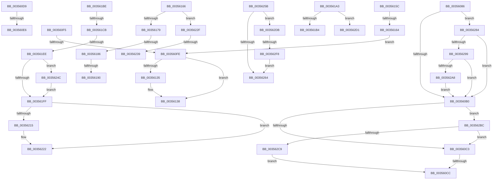

# sub_00356086

- RVA: `0x00356086`–`0x003562FD` (길이 `631` bytes)
- VA: `0x0000000140356086`
- 실행 섹션: `.text`
- PDB 이름 있음: `아니요`; PDB Function 태그: `아니요`
- unwind 정보 RVA: `0x000793C4`
- 디코드: `152`개 명령, `631/631` bytes 표시
- 미해석 바이트: `0` (있으면 어셈블리에 `.byte`로 보존)

> 이 문서는 커널 이미지의 기계어와 PDB 기호를 분석해 생성했습니다. 4번과 5번은 함수 원형과 자료형을 바이너리 사용 방식에서 추정한 C 해석이며 원본 소스 복구 결과는 아닙니다.

## 1. Dependencies

- 직접 호출 지점: **11**; 고유 호출 대상: **10**
- 직접 호출자로 확인된 함수: **0**
- RIP 상대 이미지 참조: **5**

### Outgoing calls
- `0x00356152` → [KiCheckForEffectivePriorityChange](../46/KiCheckForEffectivePriorityChange_function_0046DD94.md) (function, `0x0046DD94`)
- `0x0035616C` → [KiCheckMaxOverQuotaTransition](KiCheckMaxOverQuotaTransition_function_00354884.md) (function, `0x00354884`)
- `0x00356199` → [KiRecomputeGroupSchedulingRank](../45/KiRecomputeGroupSchedulingRank_function_00452FC8.md) (function, `0x00452FC8`)
- `0x003561B4` → [KiResortScbQueue](../20/KiResortScbQueue_function_002024CC.md) (function, `0x002024CC`)
- `0x003561D5` → [KeInterlockedSetProcessorAffinityEx](KeInterlockedSetProcessorAffinityEx_function_00352560.md) (function, `0x00352560`)
- `0x00356207` → [KiSetClockTimerDeadlineNoWake](../4B/KiSetClockTimerDeadlineNoWake_function_004B3DA4.md) (function, `0x004B3DA4`)
- `0x0035621D` → [KiLowerIrqlProcessIrqlFlags](../4F/KiLowerIrqlProcessIrqlFlags_function_004F5698.md) (function, `0x004F5698`)
- `0x00356242` → [KiRemoveSchedulingGroupQueue](../20/KiRemoveSchedulingGroupQueue_function_00202638.md) (function, `0x00202638`)
- `0x00356254` → [KiRaiseIrqlProcessIrqlFlags](../4F/KiRaiseIrqlProcessIrqlFlags_function_004F56FC.md) (function, `0x004F56FC`)
- `0x003562AD` → [KeInsertQueueDpc](../20/KeInsertQueueDpc_function_00207C50.md) (function, `0x00207C50`)
- `0x003562D1` → [KiRemoveSchedulingGroupQueue](../20/KiRemoveSchedulingGroupQueue_function_00202638.md) (function, `0x00202638`)

### Direct callers
- 이 함수 시작 RVA로 연결되는 직접 call은 확인되지 않았습니다. 간접 호출은 완전히 역산할 수 없습니다.

### Static image references
- `0x00356110` → RVA `0x00FC54D0` (`ALMOSTRO`; read)
- `0x00356138` → RVA `0x00FC52D0` (`ALMOSTRO`; read)
- `0x003561CE` → RVA `0x00E0AFD0` (`.data`; read)
- `0x003561DA` → RVA `0x00FC6A85` (`ALMOSTRO`; read)
- `0x003561F6` → RVA `0x00FC6D20` (`ALMOSTRO`; read)

## 2. Other-region calls and transfers

- 다른 실행 섹션으로 향하는 call: **0**
- call이 아닌 외부 분기/꼬리 이동: **19**
  - `0x003560C6` → [sub_00355F76 + 0x55](Unknown_function_00355F76.md) (`tail-transfer`)
  - `0x003560D4` → [sub_00355F76 + 0x55](Unknown_function_00355F76.md) (`tail-transfer`)
  - `0x003560E0` → [sub_00355F76 + 0x5E](Unknown_function_00355F76.md) (`tail-transfer`)
  - `0x003560F0` → [sub_00355F76 + 0x60](Unknown_function_00355F76.md) (`tail-transfer`)
  - `0x003560F8` → [sub_00355F76 + 0x72](Unknown_function_00355F76.md) (`tail-transfer`)
  - `0x00356157` → [sub_00355F76 + 0x72](Unknown_function_00355F76.md) (`tail-transfer`)
  - `0x0035615E` → [sub_00355F76 + 0x69](Unknown_function_00355F76.md) (`tail-transfer`)
  - `0x00356180` → [sub_00355F76 + 0x88](Unknown_function_00355F76.md) (`tail-transfer`)
  - `0x0035618A` → [sub_00355F76 + 0x88](Unknown_function_00355F76.md) (`tail-transfer`)
  - `0x0035619E` → [sub_00355F76 + 0x88](Unknown_function_00355F76.md) (`tail-transfer`)
  - `0x003561B9` → [sub_00355F76 + 0x7E](Unknown_function_00355F76.md) (`tail-transfer`)
  - `0x003561C5` → [sub_00355F76 + 0x88](Unknown_function_00355F76.md) (`tail-transfer`)
  - `0x003561E8` → [sub_00355F76 + 0x88](Unknown_function_00355F76.md) (`tail-transfer`)
  - `0x0035622A` → [sub_00355F76 + 0x88](Unknown_function_00355F76.md) (`tail-transfer`)
  - `0x00356233` → [sub_00355F76 + 0x88](Unknown_function_00355F76.md) (`tail-transfer`)
  - `0x00356247` → [sub_00355F76 + 0x88](Unknown_function_00355F76.md) (`tail-transfer`)
  - `0x0035627F` → [sub_00355F76 + 0x98](Unknown_function_00355F76.md) (`tail-transfer`)
  - `0x003562D6` → [sub_00355F76 + 0x7E](Unknown_function_00355F76.md) (`tail-transfer`)
  - `0x003562F2` → [sub_00355F76 + 0x98](Unknown_function_00355F76.md) (`tail-transfer`)

## 3. Assembly (complete function range)

```asm
00356086  48 8B 03                        mov rax, qword ptr [rbx]
00356089  48 8B 4B 28                     mov rcx, qword ptr [rbx + 0x28]
0035608D  48 2B C8                        sub rcx, rax
00356090  48 89 43 28                     mov qword ptr [rbx + 0x28], rax
00356094  48 8B D1                        mov rdx, rcx
00356097  F0 48 0F C1 57 30               lock xadd qword ptr [rdi + 0x30], rdx
0035609D  48 03 D1                        add rdx, rcx
003560A0  48 83 7F 20 00                  cmp qword ptr [rdi + 0x20], 0
003560A5  48 89 54 24 70                  mov qword ptr [rsp + 0x70], rdx
003560AA  0F 8F D4 01 00 00               jg 0x140356284
003560B0  0F B7 4B 70                     movzx ecx, word ptr [rbx + 0x70]
003560B4  48 85 D2                        test rdx, rdx
003560B7  41 0F 9E C0                     setle r8b
003560BB  84 C9                           test cl, cl
003560BD  0F 88 F9 01 00 00               js 0x1403562bc
003560C3  48 85 D2                        test rdx, rdx
003560C6  0F 8F FF FE FF FF               jg 0x140355fcb
003560CC  66 83 C9 02                     or cx, 2
003560D0  66 89 4B 70                     mov word ptr [rbx + 0x70], cx
003560D4  E9 F2 FE FF FF                  jmp 0x140355fcb
003560D9  48 8B 43 08                     mov rax, qword ptr [rbx + 8]
003560DD  48 39 03                        cmp qword ptr [rbx], rax
003560E0  0F 82 EE FE FF FF               jb 0x140355fd4
003560E6  66 83 C9 04                     or cx, 4
003560EA  B0 01                           mov al, 1
003560EC  66 89 4B 70                     mov word ptr [rbx + 0x70], cx
003560F0  E9 E1 FE FF FF                  jmp 0x140355fd6
003560F5  45 84 C0                        test r8b, r8b
003560F8  0F 84 EA FE FF FF               je 0x140355fe8
003560FE  66 83 C9 04                     or cx, 4
00356102  33 D2                           xor edx, edx
00356104  66 89 4B 70                     mov word ptr [rbx + 0x70], cx
00356108  8B 47 08                        mov eax, dword ptr [rdi + 8]
0035610B  8B C8                           mov ecx, eax
0035610D  44 8B C0                        mov r8d, eax
00356110  48 0F AF 0D B8 F3 C6 00         imul rcx, qword ptr [rip + 0xc6f3b8]
00356118  48 8B 43 20                     mov rax, qword ptr [rbx + 0x20]
0035611C  48 C1 E9 07                     shr rcx, 7
00356120  48 F7 F1                        div rcx
00356123  8D 48 01                        lea ecx, [rax + 1]
00356126  48 8B 83 80 00 00 00            mov rax, qword ptr [rbx + 0x80]
0035612D  89 4B 7C                        mov dword ptr [rbx + 0x7c], ecx
00356130  48 85 C0                        test rax, rax
00356133  74 03                           je 0x140356138
00356135  F0 01 08                        lock add dword ptr [rax], ecx
00356138  4C 0F AF 05 90 F1 C6 00         imul r8, qword ptr [rip + 0xc6f190]
00356140  48 8B CD                        mov rcx, rbp
00356143  49 C1 E8 07                     shr r8, 7
00356147  4C 03 43 08                     add r8, qword ptr [rbx + 8]
0035614B  4C 89 43 18                     mov qword ptr [rbx + 0x18], r8
0035614F  4C 8B C3                        mov r8, rbx
00356152  E8 3D 7C 11 00                  call 0x14046dd94
00356157  E9 8C FE FF FF                  jmp 0x140355fe8
0035615C  84 C0                           test al, al
0035615E  0F 84 7B FE FF FF               je 0x140355fdf
00356164  EB 98                           jmp 0x1403560fe
00356166  48 8B D7                        mov rdx, rdi
00356169  48 8B CB                        mov rcx, rbx
0035616C  E8 13 E7 FF FF                  call 0x140354884
00356171  84 C0                           test al, al
00356173  0F 85 B6 00 00 00               jne 0x14035622f
00356179  48 8B 43 18                     mov rax, qword ptr [rbx + 0x18]
0035617D  48 39 03                        cmp qword ptr [rbx], rax
00356180  0F 82 78 FE FF FF               jb 0x140355ffe
00356186  F6 43 70 02                     test byte ptr [rbx + 0x70], 2
0035618A  0F 85 6E FE FF FF               jne 0x140355ffe
00356190  4C 8B C5                        mov r8, rbp
00356193  48 8B D3                        mov rdx, rbx
00356196  48 8B CF                        mov rcx, rdi
00356199  E8 2A CE 0F 00                  call 0x140452fc8
0035619E  E9 5B FE FF FF                  jmp 0x140355ffe
003561A3  41 B0 01                        mov r8b, 1
003561A6  48 8B D3                        mov rdx, rbx
003561A9  48 8B CD                        mov rcx, rbp
003561AC  A8 02                           test al, 2
003561AE  0F 85 1D 01 00 00               jne 0x1403562d1
003561B4  E8 13 C3 EA FF                  call 0x1402024cc
003561B9  E9 36 FE FF FF                  jmp 0x140355ff4
003561BE  80 BD 59 86 00 00 00            cmp byte ptr [rbp + 0x8659], 0
003561C5  0F 85 33 FE FF FF               jne 0x140355ffe
003561CB  8B 55 24                        mov edx, dword ptr [rbp + 0x24]
003561CE  48 8D 0D FB 4D AB 00            lea rcx, [rip + 0xab4dfb]
003561D5  E8 86 C3 FF FF                  call 0x140352560
003561DA  80 3D A4 08 C7 00 00            cmp byte ptr [rip + 0xc708a4], 0
003561E1  C6 85 59 86 00 00 01            mov byte ptr [rbp + 0x8659], 1
003561E8  0F 84 10 FE FF FF               je 0x140355ffe
003561EE  44 0F 20 C7                     mov rdi, cr8
003561F2  45 0F 22 C7                     mov cr8, r15
003561F6  83 3D 23 0B C7 00 00            cmp dword ptr [rip + 0xc70b23], 0
003561FD  75 4D                           jne 0x14035624c
003561FF  BA 04 00 00 00                  mov edx, 4
00356204  48 8B CD                        mov rcx, rbp
00356207  E8 98 DB 15 00                  call 0x1404b3da4
0035620C  83 3D 0D 0B C7 00 00            cmp dword ptr [rip + 0xc70b0d], 0
00356213  74 0D                           je 0x140356222
00356215  44 0F 20 C1                     mov rcx, cr8
00356219  40 0F B6 D7                     movzx edx, dil
0035621D  E8 76 F4 19 00                  call 0x1404f5698
00356222  40 0F B6 C7                     movzx eax, dil
00356226  44 0F 22 C0                     mov cr8, rax
0035622A  E9 CF FD FF FF                  jmp 0x140355ffe
0035622F  F6 43 70 01                     test byte ptr [rbx + 0x70], 1
00356233  0F 84 C5 FD FF FF               je 0x140355ffe
00356239  41 B0 01                        mov r8b, 1
0035623C  48 8B D3                        mov rdx, rbx
0035623F  48 8B CD                        mov rcx, rbp
00356242  E8 F1 C3 EA FF                  call 0x140202638
00356247  E9 B2 FD FF FF                  jmp 0x140355ffe
0035624C  41 0F B6 D7                     movzx edx, r15b
00356250  40 0F B6 CF                     movzx ecx, dil
00356254  E8 A3 F4 19 00                  call 0x1404f56fc
00356259  EB A4                           jmp 0x1403561ff
0035625B  8B 44 24 60                     mov eax, dword ptr [rsp + 0x60]
0035625F  3B 43 7C                        cmp eax, dword ptr [rbx + 0x7c]
00356262  74 77                           je 0x1403562db
00356264  B8 00 01 00 00                  mov eax, 0x100
00356269  48 8D 8B B0 01 00 00            lea rcx, [rbx + 0x1b0]
00356270  66 09 43 70                     or word ptr [rbx + 0x70], ax
00356274  49 8B 04 24                     mov rax, qword ptr [r12]
00356278  48 89 01                        mov qword ptr [rcx], rax
0035627B  49 89 0C 24                     mov qword ptr [r12], rcx
0035627F  E9 8A FD FF FF                  jmp 0x14035600e
00356284  48 8B C1                        mov rax, rcx
00356287  F0 48 0F C1 47 20               lock xadd qword ptr [rdi + 0x20], rax
0035628D  48 03 C1                        add rax, rcx
00356290  48 85 C0                        test rax, rax
00356293  0F 8F 17 FE FF FF               jg 0x1403560b0
00356299  33 C9                           xor ecx, ecx
0035629B  48 87 4F 48                     xchg qword ptr [rdi + 0x48], rcx
0035629F  48 85 C9                        test rcx, rcx
003562A2  0F 84 08 FE FF FF               je 0x1403560b0
003562A8  45 33 C0                        xor r8d, r8d
003562AB  33 D2                           xor edx, edx
003562AD  E8 9E 19 EB FF                  call 0x140207c50
003562B2  48 8B 54 24 70                  mov rdx, qword ptr [rsp + 0x70]
003562B7  E9 F4 FD FF FF                  jmp 0x1403560b0
003562BC  48 8B 43 10                     mov rax, qword ptr [rbx + 0x10]
003562C0  48 39 03                        cmp qword ptr [rbx], rax
003562C3  0F 86 FA FD FF FF               jbe 0x1403560c3
003562C9  41 B0 01                        mov r8b, 1
003562CC  E9 FB FD FF FF                  jmp 0x1403560cc
003562D1  E8 62 C3 EA FF                  call 0x140202638
003562D6  E9 19 FD FF FF                  jmp 0x140355ff4
003562DB  0F B7 4B 70                     movzx ecx, word ptr [rbx + 0x70]
003562DF  33 C0                           xor eax, eax
003562E1  66 D1 E9                        shr cx, 1
003562E4  66 83 E1 01                     and cx, 1
003562E8  66 45 85 ED                     test r13w, r13w
003562EC  0F 95 C0                        setne al
003562EF  66 3B C1                        cmp ax, cx
003562F2  0F 84 16 FD FF FF               je 0x14035600e
003562F8  E9 67 FF FF FF                  jmp 0x140356264
```

## 4. C-style interpretation (structured pseudocode)

```c
__int64 __fastcall sub_00356086(__int64 a1, __int64 a2, __int64 a3, __int64 a4, __int64 a5, __int64 a6, __int64 a7, __int64 a8, __int64 a9, __int64 a10, __int64 a11, __int64 a12, __int64 a13, __int64 a14)
{
    __int64 result;
    unsigned int v_stack_p60;
    unsigned __int64 v_stack_p70;

    a1 = (*(unsigned __int64 *)(v_rbx + 40)) - (*(unsigned __int64 *)(v_rbx));
    *(unsigned __int64 *)(v_rbx + 40) = *(unsigned __int64 *)(v_rbx);
    a2 = (a1) + (a1);
    v_stack_p70 = a2;
    if ((*(unsigned __int64 *)(v_rdi + 32)) > 0) goto loc_00356284;
loc_003560B0:
    a3 = (condition_is_less_or_equal) ? 1 : 0;
    if (sign_flag) goto loc_003562BC;
loc_003560C3:
loc_003560CC:
    a1 = (unsigned __int16)((*(unsigned __int16 *)(v_rbx + 112)) | (2));
    *(unsigned __int16 *)(v_rbx + 112) = (unsigned __int16)(a1);
loc_00356284:
    result = (a1) + (a1);
    if (condition_is_greater) goto loc_003560B0;
    a1 = 0;
    if (0 == 0) goto loc_003560B0;
    a3 = 0;
    a2 = 0;
    result = KeInsertQueueDpc(a1, a2, a3, a4);
    goto loc_003560B0;
loc_003562BC:
    if ((*(unsigned __int64 *)(v_rbx)) <= (*(unsigned __int64 *)(v_rbx + 16))) goto loc_003560C3;
    goto loc_003560CC;
}
```

## 5. (Beta) C Style

```c
int64_t sub_00356086(int64_t Arg1, int64_t Arg2, int64_t Arg3, int64_t Arg4, uint64_t Arg5, uint64_t Arg6, uint64_t Arg7, uint64_t Arg8, uint64_t Arg9, uint64_t Arg10, uint64_t Arg11, uint64_t Arg12, uint64_t Arg13, int64_t Arg14)
{
    int64_t result;
    uint32_t v_stack_p60;
    uint64_t v_stack_p70;

    Arg1 = (*(uint64_t *)(local_rbx + 0x28)) - (*(uint64_t *)(local_rbx));
    *(uint64_t *)(local_rbx + 0x28) = *(uint64_t *)(local_rbx);
    Arg2 = (Arg1) + (Arg1);
    v_stack_p70 = Arg2;
    if ((*(uint64_t *)(local_rdi + 0x20)) > 0) goto loc_00356284;
loc_003560B0:
    Arg3 = (condition_is_less_or_equal) ? 1 : 0;
    if (sign_flag) goto loc_003562BC;
loc_003560C3:
loc_003560CC:
    Arg1 = (uint16_t)((*(uint16_t *)(local_rbx + 0x70)) | (2));
    *(uint16_t *)(local_rbx + 0x70) = (uint16_t)(Arg1);
loc_00356284:
    result = (Arg1) + (Arg1);
    if (condition_is_greater) goto loc_003560B0;
    Arg1 = 0;
    if (0 == 0) goto loc_003560B0;
    Arg3 = 0;
    Arg2 = 0;
    result = KeInsertQueueDpc(Arg1, Arg2, Arg3, Arg4);
    goto loc_003560B0;
loc_003562BC:
    if ((*(uint64_t *)(local_rbx)) <= (*(uint64_t *)(local_rbx + 0x10))) goto loc_003560C3;
    goto loc_003560CC;
}
```

## 6. Execution-region graph

[열기: 2D/3D 그래프와 함수 탐색 컨트롤 패널](../../../control-panel.html?section=text&rva=0x00356086&view=graph)

- 2D 그래프는 위에서 아래로 흐르고, 3D 그래프는 빈 공간을 드래그해 회전합니다. Shift+드래그는 이동, 휠은 확대·축소, 함수 노드 선택은 대상 보고서 이동입니다.

### Static fallback


