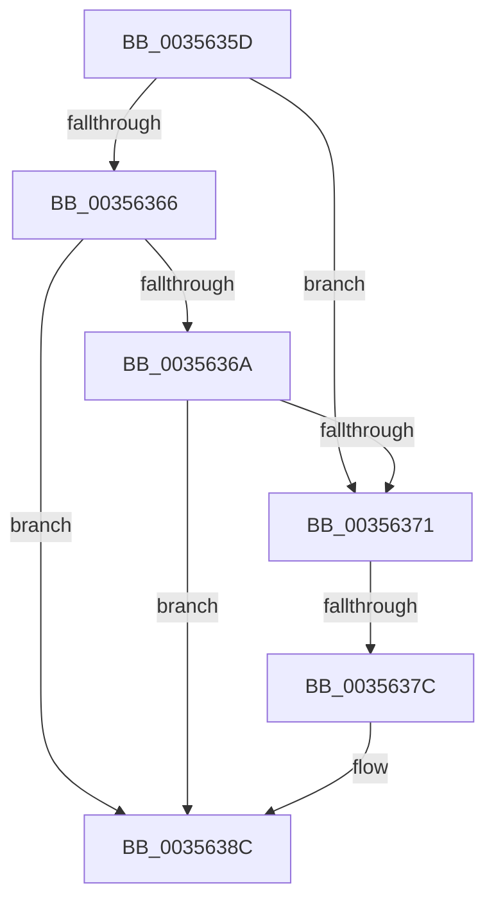

# sub_0035635D

- RVA: `0x0035635D`–`0x0035639B` (길이 `62` bytes)
- VA: `0x000000014035635D`
- 실행 섹션: `.text`
- PDB 이름 있음: `아니요`; PDB Function 태그: `아니요`
- unwind 정보 RVA: `0x00079420`
- 디코드: `17`개 명령, `62/62` bytes 표시
- 미해석 바이트: `0` (있으면 어셈블리에 `.byte`로 보존)

> 이 문서는 커널 이미지의 기계어와 PDB 기호를 분석해 생성했습니다. 4번과 5번은 함수 원형과 자료형을 바이너리 사용 방식에서 추정한 C 해석이며 원본 소스 복구 결과는 아닙니다.

## 1. Dependencies

- 직접 호출 지점: **0**; 고유 호출 대상: **0**
- 직접 호출자로 확인된 함수: **0**
- RIP 상대 이미지 참조: **0**

### Outgoing calls
- 직접 디코드된 call 명령이 없습니다.

### Direct callers
- 이 함수 시작 RVA로 연결되는 직접 call은 확인되지 않았습니다. 간접 호출은 완전히 역산할 수 없습니다.

### Static image references
- 디코드된 RIP-relative 메모리 참조가 없습니다.

## 2. Other-region calls and transfers

- 다른 실행 섹션으로 향하는 call: **0**
- call이 아닌 외부 분기/꼬리 이동: **2**
  - `0x0035637A` → [sub_003563DE](Unknown_function_003563DE.md) (`tail-transfer`)
  - `0x00356395` → [sub_003564B9](Unknown_function_003564B9.md) (`tail-transfer`)

## 3. Assembly (complete function range)

```asm
0035635D  4C 89 7C 24 20                  mov qword ptr [rsp + 0x20], r15
00356362  A8 10                           test al, 0x10
00356364  75 0B                           jne 0x140356371
00356366  A8 08                           test al, 8
00356368  74 22                           je 0x14035638c
0035636A  90                              nop
0035636B  80 7F 07 00                     cmp byte ptr [rdi + 7], 0
0035636F  74 1B                           je 0x14035638c
00356371  0F B6 82 D9 35 00 00            movzx eax, byte ptr [rdx + 0x35d9]
00356378  84 C0                           test al, al
0035637A  75 62                           jne 0x1403563de
0035637C  C6 82 D9 35 00 00 01            mov byte ptr [rdx + 0x35d9], 1
00356383  8B 47 24                        mov eax, dword ptr [rdi + 0x24]
00356386  89 82 DC 35 00 00               mov dword ptr [rdx + 0x35dc], eax
0035638C  F6 43 23 02                     test byte ptr [rbx + 0x23], 2
00356390  4C 8B 7C 24 20                  mov r15, qword ptr [rsp + 0x20]
00356395  0F 85 1E 01 00 00               jne 0x1403564b9
```

## 4. C-style interpretation (structured pseudocode)

```c
__int64 __fastcall sub_0035635D(__int64 a1, __int64 a2)
{
    unsigned __int64 v_stack_p20;

    v_stack_p20 = v_r15;
    if ((((unsigned __int8)(result)) & (16)) != 0) goto loc_00356371;
    if ((((unsigned __int8)(result)) & (8)) == 0) goto loc_0035638C;
    if ((*(unsigned __int8 *)(v_rdi + 7)) == 0) goto loc_0035638C;
loc_00356371:
    *(unsigned __int8 *)(a2 + 13785) = 1;
    *(unsigned int *)(a2 + 13788) = (unsigned int)((unsigned int)(*(unsigned int *)(v_rdi + 36)));
loc_0035638C:
}
```

## 5. (Beta) C Style

```c
int64_t sub_0035635D(int64_t Arg1, void *Arg2)
{
    uint8_t *arg2 = (uint8_t *)Arg2;

    uint64_t v_stack_p20;

    v_stack_p20 = local_r15;
    if ((((uint8_t)(result)) & (16)) != 0) goto loc_00356371;
    if ((((uint8_t)(result)) & (8)) == 0) goto loc_0035638C;
    if ((*(uint8_t *)(local_rdi + 0x7)) == 0) goto loc_0035638C;
loc_00356371:
    *(uint8_t *)(arg2 + 0x35D9) = 1;
    *(uint32_t *)(arg2 + 0x35DC) = (uint32_t)((uint32_t)(*(uint32_t *)(local_rdi + 0x24)));
loc_0035638C:
}
```

### 관측된 메모리 오프셋

구조체 형식이 확인되지 않은 접근은 인자 기준의 오프셋으로만 기록했습니다.

| 기준 인자 | 오프셋 표현 | 폭 (bit) | 접근 |
|---|---:|---:|---|
| `Arg2` | `+ 0x35D9` | `8` | `R` |
| `Arg2` | `+ 0x35D9` | `8` | `W` |
| `Arg2` | `+ 0x35DC` | `32` | `W` |

## 6. Execution-region graph

[열기: 2D/3D 그래프와 함수 탐색 컨트롤 패널](../../../control-panel.html?section=text&rva=0x0035635D&view=graph)

- 2D 그래프는 위에서 아래로 흐르고, 3D 그래프는 빈 공간을 드래그해 회전합니다. Shift+드래그는 이동, 휠은 확대·축소, 함수 노드 선택은 대상 보고서 이동입니다.

### Static fallback


