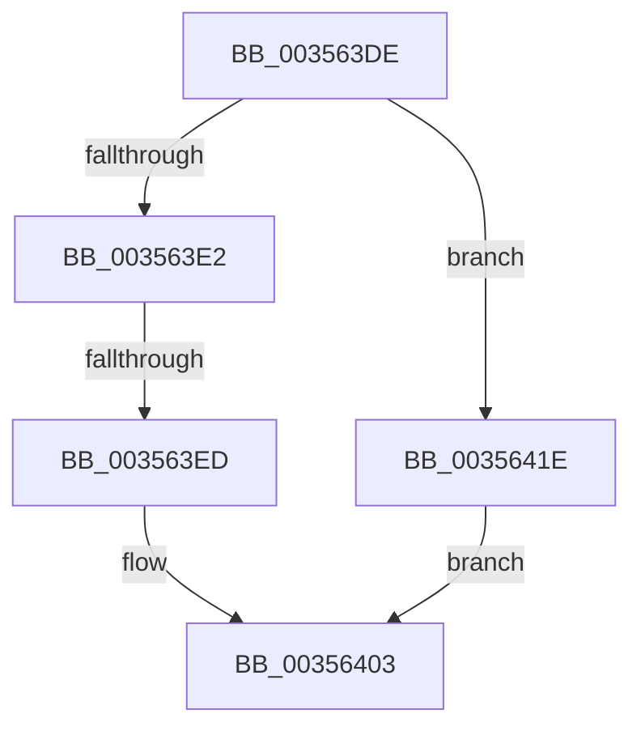

# sub_003563DE

- RVA: `0x003563DE`–`0x00356427` (길이 `73` bytes)
- VA: `0x00000001403563DE`
- 실행 섹션: `.text`
- PDB 이름 있음: `아니요`; PDB Function 태그: `아니요`
- unwind 정보 RVA: `0x00079470`
- 디코드: `16`개 명령, `73/73` bytes 표시
- 미해석 바이트: `0` (있으면 어셈블리에 `.byte`로 보존)

> 이 문서는 커널 이미지의 기계어와 PDB 기호를 분석해 생성했습니다. 4번과 5번은 함수 원형과 자료형을 바이너리 사용 방식에서 추정한 C 해석이며 원본 소스 복구 결과는 아닙니다.

## 1. Dependencies

- 직접 호출 지점: **2**; 고유 호출 대상: **2**
- 직접 호출자로 확인된 함수: **0**
- RIP 상대 이미지 참조: **0**

### Outgoing calls
- `0x003563FE` → [KeAddProcessorAffinityEx](../25/KeAddProcessorAffinityEx_function_0025B6F0.md) (function, `0x0025B6F0`)
- `0x00356414` → [KeAddGroupAffinityEx](../25/KeAddGroupAffinityEx_function_0025B6C0.md) (function, `0x0025B6C0`)

### Direct callers
- 이 함수 시작 RVA로 연결되는 직접 call은 확인되지 않았습니다. 간접 호출은 완전히 역산할 수 없습니다.

### Static image references
- 디코드된 RIP-relative 메모리 참조가 없습니다.

## 2. Other-region calls and transfers

- 다른 실행 섹션으로 향하는 call: **0**
- call이 아닌 외부 분기/꼬리 이동: **2**
  - `0x003563EB` → [sub_0035635D + 0x2F](Unknown_function_0035635D.md) (`tail-transfer`)
  - `0x00356419` → [sub_0035635D + 0x2F](Unknown_function_0035635D.md) (`tail-transfer`)

## 3. Assembly (complete function range)

```asm
003563DE  3C 01                           cmp al, 1
003563E0  75 3C                           jne 0x14035641e
003563E2  8B 92 DC 35 00 00               mov edx, dword ptr [rdx + 0x35dc]
003563E8  3B 57 24                        cmp edx, dword ptr [rdi + 0x24]
003563EB  74 9F                           je 0x14035638c
003563ED  4C 8D BE E0 35 00 00            lea r15, [rsi + 0x35e0]
003563F4  C6 86 D9 35 00 00 02            mov byte ptr [rsi + 0x35d9], 2
003563FB  49 8B CF                        mov rcx, r15
003563FE  E8 ED 52 F0 FF                  call 0x14025b6f0
00356403  4C 8B 87 C8 00 00 00            mov r8, qword ptr [rdi + 0xc8]
0035640A  49 8B CF                        mov rcx, r15
0035640D  0F B6 97 D0 00 00 00            movzx edx, byte ptr [rdi + 0xd0]
00356414  E8 A7 52 F0 FF                  call 0x14025b6c0
00356419  E9 6E FF FF FF                  jmp 0x14035638c
0035641E  4C 8D BA E0 35 00 00            lea r15, [rdx + 0x35e0]
00356425  EB DC                           jmp 0x140356403
```

## 4. C-style interpretation (structured pseudocode)

```c
__int64 __fastcall sub_003563DE(__int64 a1, __int64 a2)
{
    __int64 result;

    if (((unsigned __int8)(result)) != 1) goto loc_0035641E;
    *(unsigned __int8 *)(v_rsi + 13785) = 2;
    result = KeAddProcessorAffinityEx(v_rsi + 13792, (unsigned int)(*(unsigned int *)(a2 + 13788)), a3, a4);
loc_00356403:
    result = KeAddGroupAffinityEx(v_rsi + 13792, *(unsigned __int8 *)(v_rdi + 208), *(unsigned __int64 *)(v_rdi + 200), a4);
loc_0035641E:
    goto loc_00356403;
}
```

## 5. (Beta) C Style

```c
int64_t sub_003563DE(int64_t Arg1, void *Arg2)
{
    uint8_t *arg2 = (uint8_t *)Arg2;

    int64_t result;

    if (((uint8_t)(result)) != 1) goto loc_0035641E;
    *(uint8_t *)(local_rsi + 0x35D9) = 2;
    result = KeAddProcessorAffinityEx(local_rsi + 13792, (uint32_t)(*(uint32_t *)(arg2 + 0x35DC)), a3, a4);
loc_00356403:
    result = KeAddGroupAffinityEx(local_rsi + 13792, *(uint8_t *)(local_rdi + 0xD0), *(uint64_t *)(local_rdi + 0xC8), a4);
loc_0035641E:
    goto loc_00356403;
}
```

### 관측된 메모리 오프셋

구조체 형식이 확인되지 않은 접근은 인자 기준의 오프셋으로만 기록했습니다.

| 기준 인자 | 오프셋 표현 | 폭 (bit) | 접근 |
|---|---:|---:|---|
| `Arg2` | `+ 0x35DC` | `32` | `R` |
| `Arg2` | `+ 0x35E0` | `64` | `R` |

## 6. Execution-region graph

[열기: 2D/3D 그래프와 함수 탐색 컨트롤 패널](../../../control-panel.html?section=text&rva=0x003563DE&view=graph)

- 2D 그래프는 위에서 아래로 흐르고, 3D 그래프는 빈 공간을 드래그해 회전합니다. Shift+드래그는 이동, 휠은 확대·축소, 함수 노드 선택은 대상 보고서 이동입니다.

### Static fallback


