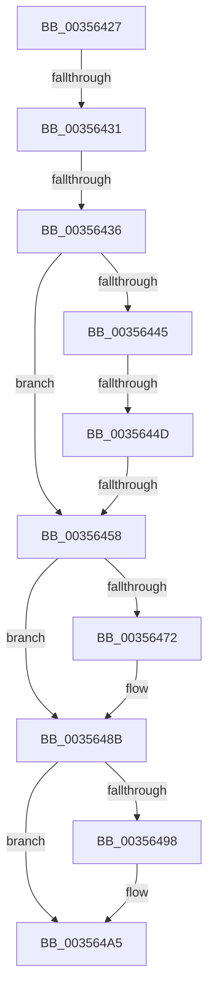

# sub_00356427

- RVA: `0x00356427`–`0x003564B9` (길이 `146` bytes)
- VA: `0x0000000140356427`
- 실행 섹션: `.text`
- PDB 이름 있음: `아니요`; PDB Function 태그: `아니요`
- unwind 정보 RVA: `0x00079494`
- 디코드: `38`개 명령, `146/146` bytes 표시
- 미해석 바이트: `0` (있으면 어셈블리에 `.byte`로 보존)

> 이 문서는 커널 이미지의 기계어와 PDB 기호를 분석해 생성했습니다. 4번과 5번은 함수 원형과 자료형을 바이너리 사용 방식에서 추정한 C 해석이며 원본 소스 복구 결과는 아닙니다.

## 1. Dependencies

- 직접 호출 지점: **1**; 고유 호출 대상: **1**
- 직접 호출자로 확인된 함수: **0**
- RIP 상대 이미지 참조: **3**

### Outgoing calls
- `0x003564A0` → [EtwTraceXSchedulerPriorityKickSend](../4F/EtwTraceXSchedulerPriorityKickSend_function_004FB2C0.md) (function, `0x004FB2C0`)

### Direct callers
- 이 함수 시작 RVA로 연결되는 직접 call은 확인되지 않았습니다. 간접 호출은 완전히 역산할 수 없습니다.

### Static image references
- `0x00356458` → RVA `0x00FC5007` (`ALMOSTRO`; read)
- `0x00356474` → RVA `0x00FCD260` (`ALMOSTRO`; read)
- `0x0035648E` → RVA `0x00FC6B14` (`ALMOSTRO`; read)

## 2. Other-region calls and transfers

- 다른 실행 섹션으로 향하는 call: **0**
- call이 아닌 외부 분기/꼬리 이동: **5**
  - `0x0035642F` → [sub_003563AB + 0x10](Unknown_function_003563AB.md) (`tail-transfer`)
  - `0x00356434` → [sub_003563AB + 0x10](Unknown_function_003563AB.md) (`tail-transfer`)
  - `0x00356447` → [sub_003563AB + 0x10](Unknown_function_003563AB.md) (`tail-transfer`)
  - `0x00356452` → [sub_003563AB + 0x10](Unknown_function_003563AB.md) (`tail-transfer`)
  - `0x003564B4` → [sub_003563AB + 0x10](Unknown_function_003563AB.md) (`tail-transfer`)

## 3. Assembly (complete function range)

```asm
00356427  48 83 BE B8 8E 00 00 00         cmp qword ptr [rsi + 0x8eb8], 0
0035642F  74 8A                           je 0x1403563bb
00356431  48 3B F7                        cmp rsi, rdi
00356434  74 85                           je 0x1403563bb
00356436  8B 10                           mov edx, dword ptr [rax]
00356438  8B C2                           mov eax, edx
0035643A  25 00 00 04 00                  and eax, 0x40000
0035643F  0F BA E2 14                     bt edx, 0x14
00356443  72 13                           jb 0x140356458
00356445  85 C0                           test eax, eax
00356447  0F 84 6E FF FF FF               je 0x1403563bb
0035644D  0F B6 C2                        movzx eax, dl
00356450  3B C1                           cmp eax, ecx
00356452  0F 8D 63 FF FF FF               jge 0x1403563bb
00356458  80 3D A8 EB C6 00 00            cmp byte ptr [rip + 0xc6eba8], 0
0035645F  48 8B 8E B8 8E 00 00            mov rcx, qword ptr [rsi + 0x8eb8]
00356466  C7 41 0C 02 00 00 00            mov dword ptr [rcx + 0xc], 2
0035646D  8B 77 24                        mov esi, dword ptr [rdi + 0x24]
00356470  75 19                           jne 0x14035648b
00356472  8B C6                           mov eax, esi
00356474  4C 8D 05 E5 6D C7 00            lea r8, [rip + 0xc76de5]
0035647B  41 0F B6 34 70                  movzx esi, byte ptr [r8 + rsi*2]
00356480  C1 E6 06                        shl esi, 6
00356483  41 0F B6 44 40 01               movzx eax, byte ptr [r8 + rax*2 + 1]
00356489  0B F0                           or esi, eax
0035648B  89 71 08                        mov dword ptr [rcx + 8], esi
0035648E  8B 05 80 06 C7 00               mov eax, dword ptr [rip + 0xc70680]
00356494  A8 20                           test al, 0x20
00356496  74 0D                           je 0x1403564a5
00356498  8B 4F 24                        mov ecx, dword ptr [rdi + 0x24]
0035649B  BA 02 00 00 00                  mov edx, 2
003564A0  E8 1B 4E 1A 00                  call 0x1404fb2c0
003564A5  8B D6                           mov edx, esi
003564A7  B9 C2 00 00 40                  mov ecx, 0x400000c2
003564AC  48 C1 EA 20                     shr rdx, 0x20
003564B0  8B C6                           mov eax, esi
003564B2  0F 30                           wrmsr
003564B4  E9 02 FF FF FF                  jmp 0x1403563bb
```

## 4. C-style interpretation (structured pseudocode)

```c
__int64 __fastcall sub_00356427(int a1)
{
    __int64 result;
    __int64 v_rsi;

    result = (unsigned int)(((unsigned int)((unsigned int)((unsigned int)(*(unsigned int *)(result))))) & (0x40000ULL));
    if (condition_is_below) goto loc_00356458;
loc_00356458:
    *(unsigned int *)(*(unsigned __int64 *)(v_rsi + 36536) + 12) = 2;
    result = (unsigned __int8)((unsigned int)(*(unsigned int *)(result)));
    v_rsi = (unsigned int)(*(unsigned int *)(v_rdi + 36));
    if ((*(unsigned __int8 *)(v_rip + 13036456)) == 0) {
        result = (unsigned int)((unsigned int)(*(unsigned int *)(v_rdi + 36)));
        a3 = v_rip + 13069797;
        v_rsi = *(unsigned __int8 *)(a3 + (unsigned int)(*(unsigned int *)(v_rdi + 36)) * 2);
        v_rsi = (unsigned int)((v_rsi) << (6));
        result = *(unsigned __int8 *)(a3 + result * 2 + 1);
        v_rsi = (unsigned int)((v_rsi) | ((unsigned int)(result)));
    }
    *(unsigned int *)(*(unsigned __int64 *)(v_rsi + 36536) + 8) = (unsigned int)(v_rsi);
    result = (unsigned int)(*(unsigned int *)(v_rip + 13043328));
    if ((((unsigned __int8)((unsigned int)(*(unsigned int *)(v_rip + 13043328)))) & (32)) != 0) {
        a1 = *(unsigned int *)(v_rdi + 36);
        a2 = 2;
        result = EtwTraceXSchedulerPriorityKickSend(a1, a2, a3, a4);
    }
    a2 = ((unsigned int)((unsigned int)(v_rsi))) >> (32);
}
```

## 5. (Beta) C Style

```c
int64_t sub_00356427(int32_t Arg1)
{
    int64_t result;
    int64_t local_rsi;

    result = (uint32_t)(((uint32_t)((uint32_t)((uint32_t)(*(uint32_t *)(result))))) & (0x40000ULL));
    if (condition_is_below) goto loc_00356458;
loc_00356458:
    *(uint32_t *)(*(uint64_t *)(local_rsi + 0x8EB8) + 0xC) = 2;
    result = (uint8_t)((uint32_t)(*(uint32_t *)(result)));
    local_rsi = (uint32_t)(*(uint32_t *)(local_rdi + 0x24));
    if ((*(uint8_t *)(v_rip + 0xC6EBA8)) == 0) {
        result = (uint32_t)((uint32_t)(*(uint32_t *)(local_rdi + 0x24)));
        a3 = v_rip + 13069797;
        local_rsi = *(uint8_t *)(a3 + (uint32_t)(*(uint32_t *)(local_rdi + 0x24)) * 2);
        local_rsi = (uint32_t)((local_rsi) << (6));
        result = *(uint8_t *)(a3 + result * 2 + 0x1);
        local_rsi = (uint32_t)((local_rsi) | ((uint32_t)(result)));
    }
    *(uint32_t *)(*(uint64_t *)(local_rsi + 0x8EB8) + 0x8) = (uint32_t)(local_rsi);
    result = (uint32_t)(*(uint32_t *)(v_rip + 0xC70680));
    if ((((uint8_t)((uint32_t)(*(uint32_t *)(v_rip + 0xC70680)))) & (32)) != 0) {
        Arg1 = *(uint32_t *)(local_rdi + 0x24);
        a2 = 2;
        result = EtwTraceXSchedulerPriorityKickSend(Arg1, a2, a3, a4);
    }
    a2 = ((uint32_t)((uint32_t)(local_rsi))) >> (32);
}
```

## 6. Execution-region graph

[열기: 2D/3D 그래프와 함수 탐색 컨트롤 패널](../../../control-panel.html?section=text&rva=0x00356427&view=graph)

- 2D 그래프는 위에서 아래로 흐르고, 3D 그래프는 빈 공간을 드래그해 회전합니다. Shift+드래그는 이동, 휠은 확대·축소, 함수 노드 선택은 대상 보고서 이동입니다.

### Static fallback


