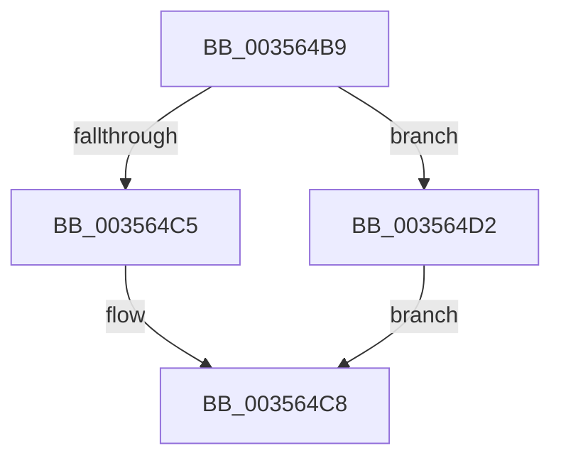

# sub_003564B9

- RVA: `0x003564B9`–`0x003564D7` (길이 `30` bytes)
- VA: `0x00000001403564B9`
- 실행 섹션: `.text`
- PDB 이름 있음: `아니요`; PDB Function 태그: `아니요`
- unwind 정보 RVA: `0x000794AC`
- 디코드: `9`개 명령, `30/30` bytes 표시
- 미해석 바이트: `0` (있으면 어셈블리에 `.byte`로 보존)

> 이 문서는 커널 이미지의 기계어와 PDB 기호를 분석해 생성했습니다. 4번과 5번은 함수 원형과 자료형을 바이너리 사용 방식에서 추정한 C 해석이며 원본 소스 복구 결과는 아닙니다.

## 1. Dependencies

- 직접 호출 지점: **1**; 고유 호출 대상: **1**
- 직접 호출자로 확인된 함수: **0**
- RIP 상대 이미지 참조: **0**

### Outgoing calls
- `0x003564C8` → [EtwTraceScheduleThread](../30/EtwTraceScheduleThread_function_0030B74C.md) (function, `0x0030B74C`)

### Direct callers
- 이 함수 시작 RVA로 연결되는 직접 call은 확인되지 않았습니다. 간접 호출은 완전히 역산할 수 없습니다.

### Static image references
- 디코드된 RIP-relative 메모리 참조가 없습니다.

## 2. Other-region calls and transfers

- 다른 실행 섹션으로 향하는 call: **0**
- call이 아닌 외부 분기/꼬리 이동: **1**
  - `0x003564CD` → [sub_0035639B](Unknown_function_0035639B.md) (`tail-transfer`)

## 3. Assembly (complete function range)

```asm
003564B9  48 8B 4B 18                     mov rcx, qword ptr [rbx + 0x18]
003564BD  48 8B D7                        mov rdx, rdi
003564C0  48 3B CD                        cmp rcx, rbp
003564C3  75 0D                           jne 0x1403564d2
003564C5  4D 8B C6                        mov r8, r14
003564C8  E8 7F 52 FB FF                  call 0x14030b74c
003564CD  E9 C9 FE FF FF                  jmp 0x14035639b
003564D2  45 33 C0                        xor r8d, r8d
003564D5  EB F1                           jmp 0x1403564c8
```

## 4. C-style interpretation (structured pseudocode)

```c
__int64 __fastcall sub_003564B9(void)
{
    __int64 result;

    if ((*(unsigned __int64 *)(v_rbx + 24)) != v_rbp) goto loc_003564D2;
loc_003564C8:
    result = EtwTraceScheduleThread(*(unsigned __int64 *)(v_rbx + 24), v_rdi, v_r14, a4);
loc_003564D2:
    a3 = 0;
    goto loc_003564C8;
}
```

## 5. (Beta) C Style

```c
void sub_003564B9(void)
{
    int64_t result;

    if ((*(uint64_t *)(local_rbx + 0x18)) != local_rbp) goto loc_003564D2;
loc_003564C8:
    result = EtwTraceScheduleThread(*(uint64_t *)(local_rbx + 0x18), local_rdi, local_r14, a4);
loc_003564D2:
    a3 = 0;
    goto loc_003564C8;
}
```

## 6. Execution-region graph

[열기: 2D/3D 그래프와 함수 탐색 컨트롤 패널](../../../control-panel.html?section=text&rva=0x003564B9&view=graph)

- 2D 그래프는 위에서 아래로 흐르고, 3D 그래프는 빈 공간을 드래그해 회전합니다. Shift+드래그는 이동, 휠은 확대·축소, 함수 노드 선택은 대상 보고서 이동입니다.

### Static fallback


