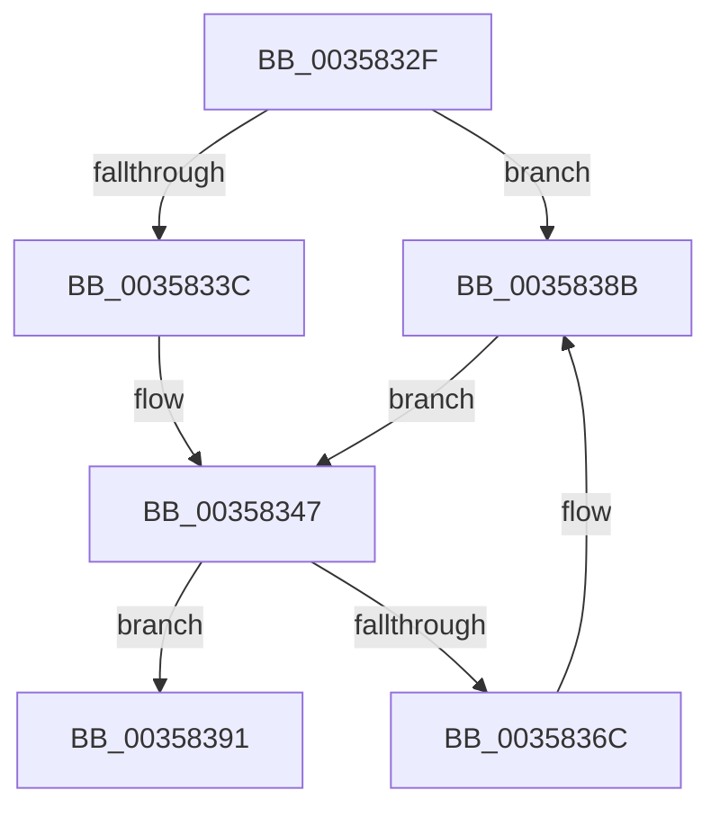

# sub_0035832F

- RVA: `0x0035832F`–`0x0035839C` (길이 `109` bytes)
- VA: `0x000000014035832F`
- 실행 섹션: `.text`
- PDB 이름 있음: `아니요`; PDB Function 태그: `아니요`
- unwind 정보 RVA: `0x000796EC`
- 디코드: `27`개 명령, `109/109` bytes 표시
- 미해석 바이트: `0` (있으면 어셈블리에 `.byte`로 보존)

> 이 문서는 커널 이미지의 기계어와 PDB 기호를 분석해 생성했습니다. 4번과 5번은 함수 원형과 자료형을 바이너리 사용 방식에서 추정한 C 해석이며 원본 소스 복구 결과는 아닙니다.

## 1. Dependencies

- 직접 호출 지점: **2**; 고유 호출 대상: **2**
- 직접 호출자로 확인된 함수: **0**
- RIP 상대 이미지 참조: **2**

### Outgoing calls
- `0x00358363` → [ExpQueueWorkItem](ExpQueueWorkItem_function_00358400.md) (function, `0x00358400`)
- `0x00358385` → [KeBugCheckEx](../4F/KeBugCheckEx_function_004FD660.md) (function, `0x004FD660`)

### Direct callers
- 이 함수 시작 RVA로 연결되는 직접 call은 확인되지 않았습니다. 간접 호출은 완전히 역산할 수 없습니다.

### Static image references
- `0x0035833C` → RVA `0x000110F8` (`.rdata`; read)
- `0x00358347` → RVA `0x00FC6EA0` (`ALMOSTRO`; read)

## 2. Other-region calls and transfers

- 다른 실행 섹션으로 향하는 call: **0**
- 별도 외부 분기/꼬리 이동을 확인하지 못했습니다.

## 3. Assembly (complete function range)

```asm
0035832F  48 89 7C 24 40                  mov qword ptr [rsp + 0x40], rdi
00358334  48 63 FA                        movsxd rdi, edx
00358337  83 FA 07                        cmp edx, 7
0035833A  73 4F                           jae 0x14035838b
0035833C  4C 8D 05 B5 8D CB FF            lea r8, [rip - 0x34724b]
00358343  45 8B 04 B8                     mov r8d, dword ptr [r8 + rdi*4]
00358347  48 8B 0D 52 EB C6 00            mov rcx, qword ptr [rip + 0xc6eb52]
0035834E  41 B9 FF FF FF FF               mov r9d, 0xffffffff
00358354  48 8B D3                        mov rdx, rbx
00358357  C7 44 24 20 01 00 00 00         mov dword ptr [rsp + 0x20], 1
0035835F  48 8B 49 10                     mov rcx, qword ptr [rcx + 0x10]
00358363  E8 98 00 00 00                  call 0x140358400
00358368  84 C0                           test al, al
0035836A  75 25                           jne 0x140358391
0035836C  4C 8B CF                        mov r9, rdi
0035836F  48 C7 44 24 20 FF FF FF FF      mov qword ptr [rsp + 0x20], 0xffffffffffffffff
00358378  4C 8B C3                        mov r8, rbx
0035837B  BA 05 00 00 00                  mov edx, 5
00358380  B9 E4 00 00 00                  mov ecx, 0xe4
00358385  E8 D6 52 1A 00                  call 0x1404fd660
0035838A  CC                              int3
0035838B  44 8D 42 E0                     lea r8d, [rdx - 0x20]
0035838F  EB B6                           jmp 0x140358347
00358391  48 8B 7C 24 40                  mov rdi, qword ptr [rsp + 0x40]
00358396  48 83 C4 30                     add rsp, 0x30
0035839A  5B                              pop rbx
0035839B  C3                              ret
```

## 4. C-style interpretation (structured pseudocode)

```c
__int64 __fastcall sub_0035832F(__int64 a1, int a2, __int64 a3, __int64 a4, __int64 a5, __int64 a6, __int64 a7, __int64 a8)
{
    __int64 result;
    __int64 v_rsp;
    unsigned int v_stack_p20;
    unsigned __int64 v_stack_p40;

    v_stack_p40 = v_rdi;
    if (a2 >= 7) goto loc_0035838B;
loc_00358347:
    v_stack_p20 = 1;
    result = ExpQueueWorkItem(*(unsigned __int64 *)(*(unsigned __int64 *)(v_rip + 13036370) + 16), v_rbx, (unsigned int)(*(unsigned int *)(v_rip - 3437131 + (int)(a2) * 4)), (unsigned int)(0xFFFFFFFFULL));
    if ((unsigned __int8)(result) != 0) goto loc_00358391;
    v_stack_p20 = -1;
    result = KeBugCheckEx(228, 5, v_rbx, (int)(a2));
loc_0035838B:
    goto loc_00358347;
loc_00358391:
    v_rsp = (v_rsp) + (48);
    return result;
}
```

## 5. (Beta) C Style

```c
int64_t sub_0035832F(int64_t Arg1, int32_t Arg2, int64_t Arg3, int64_t Arg4, uint64_t Arg5, uint64_t Arg6, uint64_t Arg7, int64_t Arg8)
{
    int64_t result;
    int64_t local_rsp;
    uint32_t v_stack_p20;
    uint64_t v_stack_p40;

    v_stack_p40 = local_rdi;
    if (Arg2 >= 7) goto loc_0035838B;
loc_00358347:
    v_stack_p20 = 1;
    result = ExpQueueWorkItem(*(uint64_t *)(*(uint64_t *)(v_rip + 0xC6EB52) + 0x10), local_rbx, (uint32_t)(*(uint32_t *)(v_rip - 0x34724B + (int32_t)(Arg2) * 4)), (uint32_t)(0xFFFFFFFFULL));
    if ((uint8_t)(result) != 0) goto loc_00358391;
    v_stack_p20 = -1;
    result = KeBugCheckEx(228, 5, local_rbx, (int32_t)(Arg2));
loc_0035838B:
    goto loc_00358347;
loc_00358391:
    local_rsp = (local_rsp) + (48);
    return result;
}
```

## 6. Execution-region graph

[열기: 2D/3D 그래프와 함수 탐색 컨트롤 패널](../../../control-panel.html?section=text&rva=0x0035832F&view=graph)

- 2D 그래프는 위에서 아래로 흐르고, 3D 그래프는 빈 공간을 드래그해 회전합니다. Shift+드래그는 이동, 휠은 확대·축소, 함수 노드 선택은 대상 보고서 이동입니다.

### Static fallback


