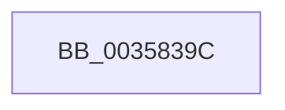

# sub_0035839C

- RVA: `0x0035839C`–`0x003583F7` (길이 `91` bytes)
- VA: `0x000000014035839C`
- 실행 섹션: `.text`
- PDB 이름 있음: `아니요`; PDB Function 태그: `아니요`
- unwind 정보 RVA: `0x00079704`
- 디코드: `21`개 명령, `91/91` bytes 표시
- 미해석 바이트: `0` (있으면 어셈블리에 `.byte`로 보존)

> 이 문서는 커널 이미지의 기계어와 PDB 기호를 분석해 생성했습니다. 4번과 5번은 함수 원형과 자료형을 바이너리 사용 방식에서 추정한 C 해석이며 원본 소스 복구 결과는 아닙니다.

## 1. Dependencies

- 직접 호출 지점: **3**; 고유 호출 대상: **1**
- 직접 호출자로 확인된 함수: **0**
- RIP 상대 이미지 참조: **0**

### Outgoing calls
- `0x003583B6` → [KeBugCheckEx](../4F/KeBugCheckEx_function_004FD660.md) (function, `0x004FD660`)
- `0x003583D2` → [KeBugCheckEx](../4F/KeBugCheckEx_function_004FD660.md) (function, `0x004FD660`)
- `0x003583F1` → [KeBugCheckEx](../4F/KeBugCheckEx_function_004FD660.md) (function, `0x004FD660`)

### Direct callers
- 이 함수 시작 RVA로 연결되는 직접 call은 확인되지 않았습니다. 간접 호출은 완전히 역산할 수 없습니다.

### Static image references
- 디코드된 RIP-relative 메모리 참조가 없습니다.

## 2. Other-region calls and transfers

- 다른 실행 섹션으로 향하는 call: **0**
- 별도 외부 분기/꼬리 이동을 확인하지 못했습니다.

## 3. Assembly (complete function range)

```asm
0035839C  CC                              int3
0035839D  4C 63 CA                        movsxd r9, edx
003583A0  4C 8B C3                        mov r8, rbx
003583A3  BA 01 00 00 00                  mov edx, 1
003583A8  48 C7 44 24 20 00 00 00 00      mov qword ptr [rsp + 0x20], 0
003583B1  B9 E4 00 00 00                  mov ecx, 0xe4
003583B6  E8 A5 52 1A 00                  call 0x1404fd660
003583BB  CC                              int3
003583BC  4C 8B C3                        mov r8, rbx
003583BF  48 C7 44 24 20 00 00 00 00      mov qword ptr [rsp + 0x20], 0
003583C8  BA 07 00 00 00                  mov edx, 7
003583CD  B9 E4 00 00 00                  mov ecx, 0xe4
003583D2  E8 89 52 1A 00                  call 0x1404fd660
003583D7  CC                              int3
003583D8  4C 63 CA                        movsxd r9, edx
003583DB  4C 8B C3                        mov r8, rbx
003583DE  BA 06 00 00 00                  mov edx, 6
003583E3  48 C7 44 24 20 00 00 00 00      mov qword ptr [rsp + 0x20], 0
003583EC  B9 E4 00 00 00                  mov ecx, 0xe4
003583F1  E8 6A 52 1A 00                  call 0x1404fd660
003583F6  CC                              int3
```

## 4. C-style interpretation (structured pseudocode)

```c
__int64 __fastcall sub_0035839C(__int64 a1, int a2)
{
    __int64 result;
    unsigned __int64 v_stack_p20;

    v_stack_p20 = 0;
    result = KeBugCheckEx(228, 1, v_rbx, (int)(a2));
    v_stack_p20 = 0;
    result = KeBugCheckEx(228, 7, v_rbx, (int)(a2));
    v_stack_p20 = 0;
    result = KeBugCheckEx(228, 6, v_rbx, (int)(7));
    return result;
}
```

## 5. (Beta) C Style

```c
int64_t sub_0035839C(int64_t Arg1, int32_t Arg2)
{
    int64_t result;
    uint64_t v_stack_p20;

    v_stack_p20 = 0;
    result = KeBugCheckEx(228, 1, local_rbx, (int32_t)(Arg2));
    v_stack_p20 = 0;
    result = KeBugCheckEx(228, 7, local_rbx, (int32_t)(Arg2));
    v_stack_p20 = 0;
    result = KeBugCheckEx(228, 6, local_rbx, (int32_t)(7));
    return result;
}
```

## 6. Execution-region graph

[열기: 2D/3D 그래프와 함수 탐색 컨트롤 패널](../../../control-panel.html?section=text&rva=0x0035839C&view=graph)

- 2D 그래프는 위에서 아래로 흐르고, 3D 그래프는 빈 공간을 드래그해 회전합니다. Shift+드래그는 이동, 휠은 확대·축소, 함수 노드 선택은 대상 보고서 이동입니다.

### Static fallback


