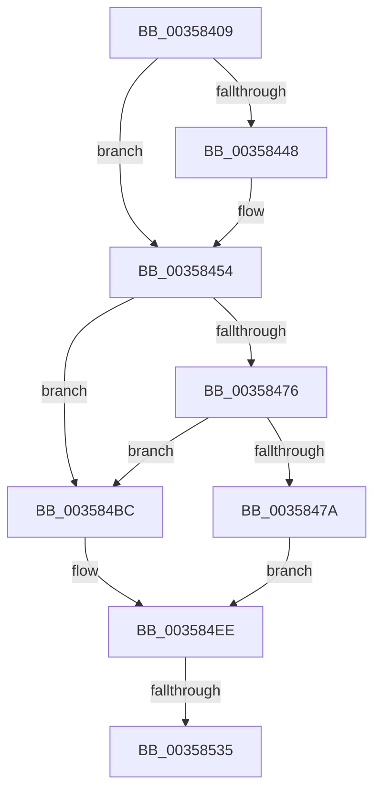

# sub_00358409

- RVA: `0x00358409`–`0x0035853D` (길이 `308` bytes)
- VA: `0x0000000140358409`
- 실행 섹션: `.text`
- PDB 이름 있음: `아니요`; PDB Function 태그: `아니요`
- unwind 정보 RVA: `0x00079720`
- 디코드: `66`개 명령, `308/308` bytes 표시
- 미해석 바이트: `0` (있으면 어셈블리에 `.byte`로 보존)

> 이 문서는 커널 이미지의 기계어와 PDB 기호를 분석해 생성했습니다. 4번과 5번은 함수 원형과 자료형을 바이너리 사용 방식에서 추정한 C 해석이며 원본 소스 복구 결과는 아닙니다.

## 1. Dependencies

- 직접 호출 지점: **2**; 고유 호출 대상: **2**
- 직접 호출자로 확인된 함수: **0**
- RIP 상대 이미지 참조: **4**

### Outgoing calls
- `0x0035844F` → [KiRaiseIrqlProcessIrqlFlags](../4F/KiRaiseIrqlProcessIrqlFlags_function_004F56FC.md) (function, `0x004F56FC`)
- `0x00358528` → [ExpEnumerateNextActiveWorkSubQueue](../65/ExpEnumerateNextActiveWorkSubQueue_function_0065A3B4.md) (function, `0x0065A3B4`)

### Direct callers
- 이 함수 시작 RVA로 연결되는 직접 call은 확인되지 않았습니다. 간접 호출은 완전히 역산할 수 없습니다.

### Static image references
- `0x0035843F` → RVA `0x00FC6D20` (`ALMOSTRO`; read)
- `0x00358464` → RVA `0x00FC5000` (`ALMOSTRO`; read)
- `0x0035847D` → RVA `0x00FCF6C0` (`CACHEALI`; read)
- `0x0035848F` → RVA `0x00FDAEC0` (`PAGEDATA`; read)

## 2. Other-region calls and transfers

- 다른 실행 섹션으로 향하는 call: **0**
- call이 아닌 외부 분기/꼬리 이동: **1**
  - `0x0035852F` → [sub_003585CB + 0x40](Unknown_function_003585CB.md) (`tail-transfer`)

## 3. Assembly (complete function range)

```asm
00358409  48 89 68 10                     mov qword ptr [rax + 0x10], rbp
0035840D  48 8B E9                        mov rbp, rcx
00358410  48 89 70 18                     mov qword ptr [rax + 0x18], rsi
00358414  4C 89 60 20                     mov qword ptr [rax + 0x20], r12
00358418  4C 8B E2                        mov r12, rdx
0035841B  4C 89 68 E8                     mov qword ptr [rax - 0x18], r13
0035841F  45 33 ED                        xor r13d, r13d
00358422  4C 89 78 D8                     mov qword ptr [rax - 0x28], r15
00358426  32 DB                           xor bl, bl
00358428  4C 89 68 08                     mov qword ptr [rax + 8], r13
0035842C  41 8B F1                        mov esi, r9d
0035842F  4D 63 F8                        movsxd r15, r8d
00358432  44 0F 20 C7                     mov rdi, cr8
00358436  B8 02 00 00 00                  mov eax, 2
0035843B  44 0F 22 C0                     mov cr8, rax
0035843F  44 39 2D DA E8 C6 00            cmp dword ptr [rip + 0xc6e8da], r13d
00358446  74 0C                           je 0x140358454
00358448  0F B6 D0                        movzx edx, al
0035844B  40 0F B6 CF                     movzx ecx, dil
0035844F  E8 A8 D2 19 00                  call 0x1404f56fc
00358454  65 48 8B 04 25 20 00 00 00      mov rax, qword ptr gs:[0x20]
0035845D  48 8B 88 C0 00 00 00            mov rcx, qword ptr [rax + 0xc0]
00358464  0F B7 05 95 CB C6 00            movzx eax, word ptr [rip + 0xc6cb95]
0035846B  0F B7 91 8A 00 00 00            movzx edx, word ptr [rcx + 0x8a]
00358472  3B F0                           cmp esi, eax
00358474  73 46                           jae 0x1403584bc
00358476  3B F2                           cmp esi, edx
00358478  74 42                           je 0x1403584bc
0035847A  0F B7 C6                        movzx eax, si
0035847D  4C 8D 05 3C 72 C7 00            lea r8, [rip + 0xc7723c]
00358484  48 69 C8 38 03 00 00            imul rcx, rax, 0x338
0035848B  4D 8B 04 C0                     mov r8, qword ptr [r8 + rax*8]
0035848F  48 8D 05 2A 2A C8 00            lea rax, [rip + 0xc82a2a]
00358496  48 03 C8                        add rcx, rax
00358499  4C 3B C1                        cmp r8, rcx
0035849C  4D 0F 44 C5                     cmove r8, r13
003584A0  33 D2                           xor edx, edx
003584A2  41 8B 88 5C 03 00 00            mov ecx, dword ptr [r8 + 0x35c]
003584A9  8D 41 01                        lea eax, [rcx + 1]
003584AC  41 F7 B0 58 03 00 00            div dword ptr [r8 + 0x358]
003584B3  41 89 90 5C 03 00 00            mov dword ptr [r8 + 0x35c], edx
003584BA  EB 32                           jmp 0x1403584ee
003584BC  48 69 CA 38 03 00 00            imul rcx, rdx, 0x338
003584C3  48 8D 05 F6 29 C8 00            lea rax, [rip + 0xc829f6]
003584CA  48 03 C8                        add rcx, rax
003584CD  4C 8D 05 EC 71 C7 00            lea r8, [rip + 0xc771ec]
003584D4  4D 8B 04 D0                     mov r8, qword ptr [r8 + rdx*8]
003584D8  65 48 8B 04 25 20 00 00 00      mov rax, qword ptr gs:[0x20]
003584E1  4C 3B C1                        cmp r8, rcx
003584E4  4D 0F 44 C5                     cmove r8, r13
003584E8  8B 88 28 83 00 00               mov ecx, dword ptr [rax + 0x8328]
003584EE  8B 84 24 B0 00 00 00            mov eax, dword ptr [rsp + 0xb0]
003584F5  48 8D 94 24 90 00 00 00         lea rdx, [rsp + 0x90]
003584FD  89 4C 24 54                     mov dword ptr [rsp + 0x54], ecx
00358501  48 8D 4C 24 30                  lea rcx, [rsp + 0x30]
00358506  44 89 6C 24 3C                  mov dword ptr [rsp + 0x3c], r13d
0035850B  4C 89 6C 24 58                  mov qword ptr [rsp + 0x58], r13
00358510  48 89 6C 24 30                  mov qword ptr [rsp + 0x30], rbp
00358515  89 44 24 38                     mov dword ptr [rsp + 0x38], eax
00358519  4C 89 44 24 40                  mov qword ptr [rsp + 0x40], r8
0035851E  4C 89 44 24 48                  mov qword ptr [rsp + 0x48], r8
00358523  44 89 6C 24 50                  mov dword ptr [rsp + 0x50], r13d
00358528  E8 87 1E 30 00                  call 0x14065a3b4
0035852D  85 C0                           test eax, eax
0035852F  0F 85 D6 00 00 00               jne 0x14035860b
00358535  48 8B 9C 24 90 00 00 00         mov rbx, qword ptr [rsp + 0x90]
```

## 4. C-style interpretation (structured pseudocode)

```c
__int64 __fastcall sub_00358409(__int64 a1, __int64 a2, int a3, int a4, __int64 a5, __int64 a6, __int64 a7, __int64 a8, __int64 a9, __int64 a10, __int64 a11, __int64 a12, __int64 a13, __int64 a14, __int64 a15, __int64 a16, __int64 a17, __int64 a18, __int64 a19, __int64 a20, __int64 a21, unsigned int a22)
{
    __int64 result;
    __int64 v_r13;
    __int64 v_rbx;
    unsigned __int64 v_stack_p30;
    unsigned int v_stack_p38;
    unsigned int v_stack_p3C;
    unsigned __int64 v_stack_p40;
    unsigned __int64 v_stack_p48;
    unsigned int v_stack_p50;
    unsigned int v_stack_p54;
    unsigned __int64 v_stack_p58;

    *(unsigned __int64 *)(result + 16) = v_rbp;
    *(unsigned __int64 *)(result + 24) = v_rsi;
    *(unsigned __int64 *)(result + 32) = v_r12;
    *(unsigned __int64 *)(result - 24) = v_r13;
    v_r13 = 0;
    *(unsigned __int64 *)(result - 40) = v_r15;
    v_rbx = 0;
    *(unsigned __int64 *)(result + 8) = 0;
    result = 2;
    if ((*(unsigned int *)(v_rip + 13035738)) != 0) {
        a2 = 2;
        a1 = (unsigned __int8)(v_cr8);
        result = KiRaiseIrqlProcessIrqlFlags(a1, a2, a3, a4);
    }
    if (((unsigned int)((unsigned int)(a4))) >= ((unsigned int)(*(unsigned __int16 *)(v_rip + 13028245)))) goto loc_003584BC;
    if (((unsigned int)((unsigned int)(a4))) == ((unsigned int)(*(unsigned __int16 *)(*(unsigned __int64 *)(*(unsigned __int64 *)(gs_base + (0 + 32)) + 192) + 138)))) goto loc_003584BC;
    a1 = (*(unsigned __int64 *)(*(unsigned __int64 *)(gs_base + (0 + 32)) + 192)) * ((unsigned __int16)((unsigned int)(a4)));
    a1 = (a1) + (v_rip + 13117994);
    a3 = *(unsigned __int64 *)(v_rip + 13070908 + (unsigned __int16)((unsigned int)(a4)) * 8);
    if ((*(unsigned __int64 *)(v_rip + 13070908 + (unsigned __int16)((unsigned int)(a4)) * 8)) == a1) { a3 = 0; }
    a2 = 0;
    *(unsigned int *)(a3 + 860) = 0;
    goto loc_003584EE;
loc_003584BC:
    a1 = ((unsigned int)(*(unsigned int *)(a3 + 860))) * (0);
    a1 = (a1) + (v_rip + 13117942);
    a3 = *(unsigned __int64 *)(v_rip + 13070828 + a2 * 8);
    if ((*(unsigned __int64 *)(v_rip + 13070828 + a2 * 8)) == a1) { a3 = 0; }
loc_003584EE:
    v_stack_p54 = (unsigned int)((unsigned int)(*(unsigned int *)(*(unsigned __int64 *)(gs_base + (0 + 32)) + 33576)));
    v_stack_p3C = 0;
    v_stack_p58 = 0;
    v_stack_p30 = a1;
    v_stack_p38 = (unsigned int)((unsigned int)(a22));
    v_stack_p40 = a3;
    v_stack_p48 = a3;
    v_stack_p50 = 0;
    result = ExpEnumerateNextActiveWorkSubQueue(a6, a18, a3, a4);
    return result;
}
```

## 5. (Beta) C Style

```c
int64_t sub_00358409(int64_t Arg1, int64_t Arg2, int32_t Arg3, int32_t Arg4, uint64_t Arg5, int64_t Arg6, uint64_t Arg7, uint64_t Arg8, uint64_t Arg9, uint64_t Arg10, uint64_t Arg11, uint64_t Arg12, uint64_t Arg13, uint64_t Arg14, uint64_t Arg15, uint64_t Arg16, uint64_t Arg17, int64_t Arg18, uint64_t Arg19, uint64_t Arg20, uint64_t Arg21, uint32_t Arg22)
{
    int64_t result;
    int64_t local_r13;
    int64_t local_rbx;
    uint64_t v_stack_p30;
    uint32_t v_stack_p38;
    uint32_t v_stack_p3C;
    uint64_t v_stack_p40;
    uint64_t v_stack_p48;
    uint32_t v_stack_p50;
    uint32_t v_stack_p54;
    uint64_t v_stack_p58;

    *(uint64_t *)(result + 0x10) = local_rbp;
    *(uint64_t *)(result + 0x18) = local_rsi;
    *(uint64_t *)(result + 0x20) = local_r12;
    *(uint64_t *)(result - 0x18) = local_r13;
    local_r13 = 0;
    *(uint64_t *)(result - 0x28) = local_r15;
    local_rbx = 0;
    *(uint64_t *)(result + 0x8) = 0;
    result = 2;
    if ((*(uint32_t *)(v_rip + 0xC6E8DA)) != 0) {
        Arg2 = 2;
        Arg1 = (uint8_t)(v_cr8);
        result = KiRaiseIrqlProcessIrqlFlags(Arg1, Arg2, Arg3, Arg4);
    }
    if (((uint32_t)((uint32_t)(Arg4))) >= ((uint32_t)(*(uint16_t *)(v_rip + 0xC6CB95)))) goto loc_003584BC;
    if (((uint32_t)((uint32_t)(Arg4))) == ((uint32_t)(*(uint16_t *)(*(uint64_t *)(*(uint64_t *)(gs_base + (0 + 0x20)) + 0xC0) + 0x8A)))) goto loc_003584BC;
    Arg1 = (*(uint64_t *)(*(uint64_t *)(gs_base + (0 + 0x20)) + 0xC0)) * ((uint16_t)((uint32_t)(Arg4)));
    Arg1 = (Arg1) + (v_rip + 13117994);
    Arg3 = *(uint64_t *)(v_rip + 0xC7723C + (uint16_t)((uint32_t)(Arg4)) * 8);
    if ((*(uint64_t *)(v_rip + 0xC7723C + (uint16_t)((uint32_t)(Arg4)) * 8)) == Arg1) { Arg3 = 0; }
    Arg2 = 0;
    *(uint32_t *)(Arg3 + 0x35C) = 0;
    goto loc_003584EE;
loc_003584BC:
    Arg1 = ((uint32_t)(*(uint32_t *)(Arg3 + 0x35C))) * (0);
    Arg1 = (Arg1) + (v_rip + 13117942);
    Arg3 = *(uint64_t *)(v_rip + 0xC771EC + Arg2 * 8);
    if ((*(uint64_t *)(v_rip + 0xC771EC + Arg2 * 8)) == Arg1) { Arg3 = 0; }
loc_003584EE:
    v_stack_p54 = (uint32_t)((uint32_t)(*(uint32_t *)(*(uint64_t *)(gs_base + (0 + 0x20)) + 0x8328)));
    v_stack_p3C = 0;
    v_stack_p58 = 0;
    v_stack_p30 = Arg1;
    v_stack_p38 = (uint32_t)((uint32_t)(Arg22));
    v_stack_p40 = Arg3;
    v_stack_p48 = Arg3;
    v_stack_p50 = 0;
    result = ExpEnumerateNextActiveWorkSubQueue(Arg6, Arg18, Arg3, Arg4);
    return result;
}
```

## 6. Execution-region graph

[열기: 2D/3D 그래프와 함수 탐색 컨트롤 패널](../../../control-panel.html?section=text&rva=0x00358409&view=graph)

- 2D 그래프는 위에서 아래로 흐르고, 3D 그래프는 빈 공간을 드래그해 회전합니다. Shift+드래그는 이동, 휠은 확대·축소, 함수 노드 선택은 대상 보고서 이동입니다.

### Static fallback


