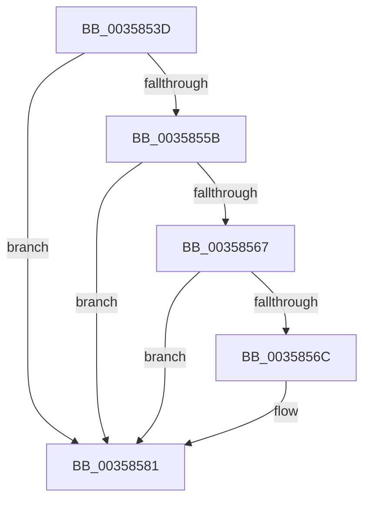

# sub_0035853D

- RVA: `0x0035853D`–`0x003585CB` (길이 `142` bytes)
- VA: `0x000000014035853D`
- 실행 섹션: `.text`
- PDB 이름 있음: `아니요`; PDB Function 태그: `아니요`
- unwind 정보 RVA: `0x00079744`
- 디코드: `30`개 명령, `142/142` bytes 표시
- 미해석 바이트: `0` (있으면 어셈블리에 `.byte`로 보존)

> 이 문서는 커널 이미지의 기계어와 PDB 기호를 분석해 생성했습니다. 4번과 5번은 함수 원형과 자료형을 바이너리 사용 방식에서 추정한 C 해석이며 원본 소스 복구 결과는 아닙니다.

## 1. Dependencies

- 직접 호출 지점: **2**; 고유 호출 대상: **2**
- 직접 호출자로 확인된 함수: **0**
- RIP 상대 이미지 참조: **1**

### Outgoing calls
- `0x00358552` → [Feature_WorkQueueShardingWithinNodes__private_IsEnabledNoReportingNoInline](../65/Feature_WorkQueueShardingWithinNodes__private_IsEnabledNoReportingNoInline_function_0065AA88.md) (function, `0x0065AA88`)
- `0x0035858F` → [KeInsertPriQueue](../21/KeInsertPriQueue_function_0021EDD0.md) (function, `0x0021EDD0`)

### Direct callers
- 이 함수 시작 RVA로 연결되는 직접 call은 확인되지 않았습니다. 간접 호출은 완전히 역산할 수 없습니다.

### Static image references
- `0x0035855B` → RVA `0x00FC6EA0` (`ALMOSTRO`; read)

## 2. Other-region calls and transfers

- 다른 실행 섹션으로 향하는 call: **0**
- call이 아닌 외부 분기/꼬리 이동: **1**
  - `0x003585C9` → [sub_003585CB + 0x24](Unknown_function_003585CB.md) (`tail-transfer`)

## 3. Assembly (complete function range)

```asm
0035853D  4C 89 74 24 68                  mov qword ptr [rsp + 0x68], r14
00358542  8B AB D8 02 00 00               mov ebp, dword ptr [rbx + 0x2d8]
00358548  48 8D B3 B0 02 00 00            lea rsi, [rbx + 0x2b0]
0035854F  4C 8B 36                        mov r14, qword ptr [rsi]
00358552  E8 31 25 30 00                  call 0x14065aa88
00358557  85 C0                           test eax, eax
00358559  74 26                           je 0x140358581
0035855B  48 8B 05 3E E9 C6 00            mov rax, qword ptr [rip + 0xc6e93e]
00358562  49 39 06                        cmp qword ptr [r14], rax
00358565  75 1A                           jne 0x140358581
00358567  83 FD 01                        cmp ebp, 1
0035856A  75 15                           jne 0x140358581
0035856C  48 8B 83 E8 02 00 00            mov rax, qword ptr [rbx + 0x2e8]
00358573  F0 4A FF 44 F8 10               lock inc qword ptr [rax + r15*8 + 0x10]
00358579  48 8B 9C 24 90 00 00 00         mov rbx, qword ptr [rsp + 0x90]
00358581  45 8B C7                        mov r8d, r15d
00358584  44 89 6C 24 20                  mov dword ptr [rsp + 0x20], r13d
00358589  49 8B D4                        mov rdx, r12
0035858C  48 8B CB                        mov rcx, rbx
0035858F  E8 3C 68 EC FF                  call 0x14021edd0
00358594  8B 8B CC 02 00 00               mov ecx, dword ptr [rbx + 0x2cc]
0035859A  48 8B 84 24 90 00 00 00         mov rax, qword ptr [rsp + 0x90]
003585A2  4C 8B 8B B8 02 00 00            mov r9, qword ptr [rbx + 0x2b8]
003585A9  4C 8B 16                        mov r10, qword ptr [rsi]
003585AC  4C 8B 74 24 68                  mov r14, qword ptr [rsp + 0x68]
003585B1  8B 90 C8 02 00 00               mov edx, dword ptr [rax + 0x2c8]
003585B7  48 8B 84 24 90 00 00 00         mov rax, qword ptr [rsp + 0x90]
003585BF  44 0F B6 80 D0 02 00 00         movzx r8d, byte ptr [rax + 0x2d0]
003585C7  3B D1                           cmp edx, ecx
003585C9  7C 24                           jl 0x1403585ef
```

## 4. C-style interpretation (structured pseudocode)

```c
__int64 __fastcall sub_0035853D(__int64 a1, __int64 a2, __int64 a3, __int64 a4, __int64 a5, __int64 a6, __int64 a7, __int64 a8, __int64 a9, __int64 a10, __int64 a11, __int64 a12, __int64 a13, __int64 a14, __int64 a15, __int64 a16, __int64 a17, __int64 a18)
{
    __int64 result;
    __int64 v_rbx;
    unsigned int v_stack_p20;
    unsigned __int64 v_stack_p68;

    v_stack_p68 = v_r14;
    result = Feature_WorkQueueShardingWithinNodes__private_IsEnabledNoReportingNoInline(a1, a2, a3, a4);
    if ((unsigned int)(result) == 0) goto loc_00358581;
    if ((*(unsigned __int64 *)(*(unsigned __int64 *)(v_rbx + 688))) != (*(unsigned __int64 *)(v_rip + 13035838))) goto loc_00358581;
    result = *(unsigned __int64 *)(v_rip + 13035838);
    if (((unsigned int)((unsigned int)(*(unsigned int *)(v_rbx + 728)))) == 1) {
        result = *(unsigned __int64 *)(v_rbx + 744);
        v_rbx = a18;
    }
    v_stack_p20 = (unsigned int)(v_r13);
    result = KeInsertPriQueue(v_rbx, v_r12, (unsigned int)((unsigned int)(v_r15)), a4);
}
```

## 5. (Beta) C Style

```c
int64_t sub_0035853D(int64_t Arg1, int64_t Arg2, int64_t Arg3, int64_t Arg4, uint64_t Arg5, uint64_t Arg6, uint64_t Arg7, uint64_t Arg8, uint64_t Arg9, uint64_t Arg10, uint64_t Arg11, uint64_t Arg12, int64_t Arg13, uint64_t Arg14, uint64_t Arg15, uint64_t Arg16, uint64_t Arg17, void *Arg18)
{
    uint8_t *arg18 = (uint8_t *)Arg18;

    int64_t result;
    int64_t local_rbx;
    uint32_t v_stack_p20;
    uint64_t v_stack_p68;

    v_stack_p68 = local_r14;
    result = Feature_WorkQueueShardingWithinNodes__private_IsEnabledNoReportingNoInline(Arg1, Arg2, Arg3, Arg4);
    if ((uint32_t)(result) == 0) goto loc_00358581;
    if ((*(uint64_t *)(*(uint64_t *)(local_rbx + 0x2B0))) != (*(uint64_t *)(v_rip + 0xC6E93E))) goto loc_00358581;
    result = *(uint64_t *)(v_rip + 0xC6E93E);
    if (((uint32_t)((uint32_t)(*(uint32_t *)(local_rbx + 0x2D8)))) == 1) {
        result = *(uint64_t *)(local_rbx + 0x2E8);
        local_rbx = Arg18;
    }
    v_stack_p20 = (uint32_t)(local_r13);
    result = KeInsertPriQueue(local_rbx, local_r12, (uint32_t)((uint32_t)(local_r15)), Arg4);
}
```

### 관측된 메모리 오프셋

구조체 형식이 확인되지 않은 접근은 인자 기준의 오프셋으로만 기록했습니다.

| 기준 인자 | 오프셋 표현 | 폭 (bit) | 접근 |
|---|---:|---:|---|
| `Arg18` | `+ 0x2C8` | `32` | `R` |
| `Arg18` | `+ 0x2D0` | `8` | `R` |

## 6. Execution-region graph

[열기: 2D/3D 그래프와 함수 탐색 컨트롤 패널](../../../control-panel.html?section=text&rva=0x0035853D&view=graph)

- 2D 그래프는 위에서 아래로 흐르고, 3D 그래프는 빈 공간을 드래그해 회전합니다. Shift+드래그는 이동, 휠은 확대·축소, 함수 노드 선택은 대상 보고서 이동입니다.

### Static fallback


