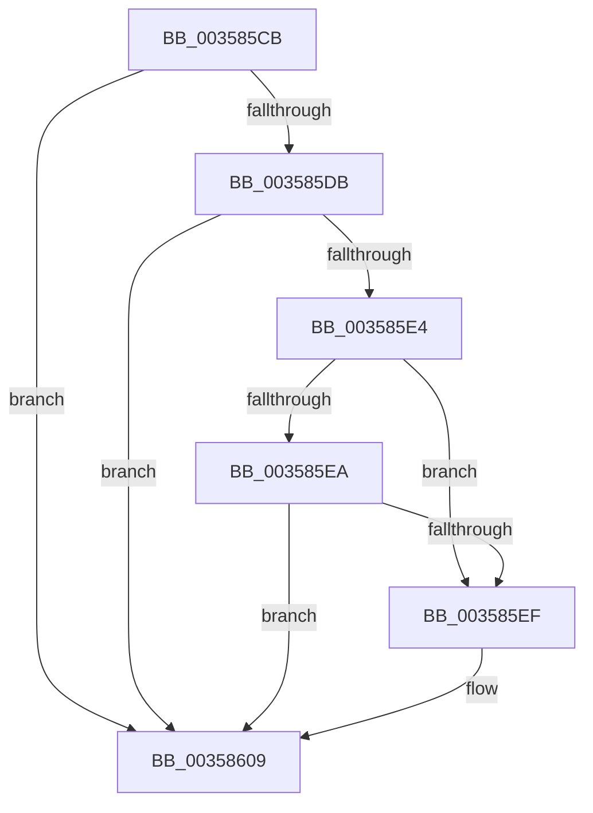

# sub_003585CB

- RVA: `0x003585CB`–`0x00358636` (길이 `107` bytes)
- VA: `0x00000001403585CB`
- 실행 섹션: `.text`
- PDB 이름 있음: `아니요`; PDB Function 태그: `아니요`
- unwind 정보 RVA: `0x00079758`
- 디코드: `25`개 명령, `107/107` bytes 표시
- 미해석 바이트: `0` (있으면 어셈블리에 `.byte`로 보존)

> 이 문서는 커널 이미지의 기계어와 PDB 기호를 분석해 생성했습니다. 4번과 5번은 함수 원형과 자료형을 바이너리 사용 방식에서 추정한 C 해석이며 원본 소스 복구 결과는 아닙니다.

## 1. Dependencies

- 직접 호출 지점: **1**; 고유 호출 대상: **1**
- 직접 호출자로 확인된 함수: **0**
- RIP 상대 이미지 참조: **1**

### Outgoing calls
- `0x00358604` → [KeSetEvent](../33/KeSetEvent_function_0033F310.md) (function, `0x0033F310`)

### Direct callers
- 이 함수 시작 RVA로 연결되는 직접 call은 확인되지 않았습니다. 간접 호출은 완전히 역산할 수 없습니다.

### Static image references
- `0x0035860B` → RVA `0x00FC6D20` (`ALMOSTRO`; read)

## 2. Other-region calls and transfers

- 다른 실행 섹션으로 향하는 call: **0**
- call이 아닌 외부 분기/꼬리 이동: **1**
  - `0x00358634` → [sub_00358636 + 0xD](Unknown_function_00358636.md) (`tail-transfer`)

## 3. Assembly (complete function range)

```asm
003585CB  48 8B 8C 24 90 00 00 00         mov rcx, qword ptr [rsp + 0x90]
003585D3  3B 91 D4 02 00 00               cmp edx, dword ptr [rcx + 0x2d4]
003585D9  7D 2E                           jge 0x140358609
003585DB  48 8D 41 08                     lea rax, [rcx + 8]
003585DF  48 39 00                        cmp qword ptr [rax], rax
003585E2  75 25                           jne 0x140358609
003585E4  44 39 69 04                     cmp dword ptr [rcx + 4], r13d
003585E8  75 05                           jne 0x1403585ef
003585EA  45 84 C0                        test r8b, r8b
003585ED  74 1A                           je 0x140358609
003585EF  41 0F B7 09                     movzx ecx, word ptr [r9]
003585F3  45 33 C0                        xor r8d, r8d
003585F6  49 8B 42 10                     mov rax, qword ptr [r10 + 0x10]
003585FA  33 D2                           xor edx, edx
003585FC  48 8B 0C C8                     mov rcx, qword ptr [rax + rcx*8]
00358600  48 83 C1 10                     add rcx, 0x10
00358604  E8 07 6D FE FF                  call 0x14033f310
00358609  B3 01                           mov bl, 1
0035860B  83 3D 0E E7 C6 00 00            cmp dword ptr [rip + 0xc6e70e], 0
00358612  4C 8B 7C 24 60                  mov r15, qword ptr [rsp + 0x60]
00358617  4C 8B 6C 24 70                  mov r13, qword ptr [rsp + 0x70]
0035861C  4C 8B A4 24 A8 00 00 00         mov r12, qword ptr [rsp + 0xa8]
00358624  48 8B B4 24 A0 00 00 00         mov rsi, qword ptr [rsp + 0xa0]
0035862C  48 8B AC 24 98 00 00 00         mov rbp, qword ptr [rsp + 0x98]
00358634  74 0D                           je 0x140358643
```

## 4. C-style interpretation (structured pseudocode)

```c
__int64 __fastcall sub_003585CB(__int64 a1, int a2, int a3, __int64 a4, __int64 a5, __int64 a6, __int64 a7, __int64 a8, __int64 a9, __int64 a10, __int64 a11, __int64 a12, __int64 a13, __int64 a14, __int64 a15, __int64 a16, __int64 a17, __int64 a18, __int64 a19, __int64 a20, __int64 a21)
{
    __int64 result;

    if (a2 >= (*(unsigned int *)(a18 + 724))) goto loc_00358609;
    if ((*(unsigned __int64 *)(a18 + 8)) != (a18 + 8)) goto loc_00358609;
    if ((*(unsigned int *)(a18 + 4)) != ((unsigned int)(v_r13))) goto loc_003585EF;
    result = a18 + 8;
    if ((unsigned __int8)(a3) != 0) {
        a1 = *(unsigned __int16 *)(a4);
        a3 = 0;
        result = *(unsigned __int64 *)(v_r10 + 16);
        a2 = 0;
        a1 = *(unsigned __int64 *)(result + a1 * 8);
        a1 = (a1) + (16);
        result = KeSetEvent(a1, a2, a3, a4);
    }
}
```

## 5. (Beta) C Style

```c
int64_t sub_003585CB(int64_t Arg1, int32_t Arg2, int32_t Arg3, void *Arg4, uint64_t Arg5, uint64_t Arg6, uint64_t Arg7, uint64_t Arg8, uint64_t Arg9, uint64_t Arg10, uint64_t Arg11, int64_t Arg12, uint64_t Arg13, int64_t Arg14, uint64_t Arg15, uint64_t Arg16, uint64_t Arg17, void *Arg18, int64_t Arg19, int64_t Arg20, int64_t Arg21)
{
    uint8_t *arg4 = (uint8_t *)Arg4;
    uint8_t *arg18 = (uint8_t *)Arg18;

    int64_t result;

    if (Arg2 >= (*(uint32_t *)(arg18 + 0x2D4))) goto loc_00358609;
    if ((*(uint64_t *)(arg18 + 0x8)) != (Arg18 + 8)) goto loc_00358609;
    if ((*(uint32_t *)(arg18 + 0x4)) != ((uint32_t)(local_r13))) goto loc_003585EF;
    result = Arg18 + 8;
    if ((uint8_t)(Arg3) != 0) {
        Arg1 = *(uint16_t *)(arg4);
        Arg3 = 0;
        result = *(uint64_t *)(local_r10 + 0x10);
        Arg2 = 0;
        Arg1 = *(uint64_t *)(result + Arg1 * 8);
        Arg1 = (Arg1) + (16);
        result = KeSetEvent(Arg1, Arg2, Arg3, Arg4);
    }
}
```

### 관측된 메모리 오프셋

구조체 형식이 확인되지 않은 접근은 인자 기준의 오프셋으로만 기록했습니다.

| 기준 인자 | 오프셋 표현 | 폭 (bit) | 접근 |
|---|---:|---:|---|
| `Arg4` | `+ 0x0` | `16` | `R` |
| `Arg18` | `+ 0x0` | `64` | `R` |
| `Arg18` | `+ 0x4` | `32` | `R` |
| `Arg18` | `+ 0x8` | `64` | `R` |
| `Arg18` | `+ 0x2D4` | `32` | `R` |

## 6. Execution-region graph

[열기: 2D/3D 그래프와 함수 탐색 컨트롤 패널](../../../control-panel.html?section=text&rva=0x003585CB&view=graph)

- 2D 그래프는 위에서 아래로 흐르고, 3D 그래프는 빈 공간을 드래그해 회전합니다. Shift+드래그는 이동, 휠은 확대·축소, 함수 노드 선택은 대상 보고서 이동입니다.

### Static fallback


