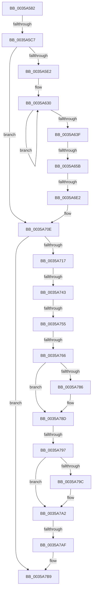

# sub_0035A582

- RVA: `0x0035A582`–`0x0035A7F0` (길이 `622` bytes)
- VA: `0x000000014035A582`
- 실행 섹션: `.text`
- PDB 이름 있음: `아니요`; PDB Function 태그: `아니요`
- unwind 정보 RVA: `0x00079974`
- 디코드: `131`개 명령, `622/622` bytes 표시
- 미해석 바이트: `0` (있으면 어셈블리에 `.byte`로 보존)

> 이 문서는 커널 이미지의 기계어와 PDB 기호를 분석해 생성했습니다. 4번과 5번은 함수 원형과 자료형을 바이너리 사용 방식에서 추정한 C 해석이며 원본 소스 복구 결과는 아닙니다.

## 1. Dependencies

- 직접 호출 지점: **1**; 고유 호출 대상: **1**
- 직접 호출자로 확인된 함수: **0**
- RIP 상대 이미지 참조: **4**

### Outgoing calls
- `0x0035A7B4` → [KeReleaseInStackQueuedSpinLock](../34/KeReleaseInStackQueuedSpinLock_function_00342CE0.md) (function, `0x00342CE0`)

### Direct callers
- 이 함수 시작 RVA로 연결되는 직접 call은 확인되지 않았습니다. 간접 호출은 완전히 역산할 수 없습니다.

### Static image references
- `0x0035A60F` → RVA `0x00F8F268` (`.data`; read)
- `0x0035A736` → RVA `0x00FC6D20` (`ALMOSTRO`; read)
- `0x0035A743` → RVA `0x00FC6B06` (`ALMOSTRO`; read)
- `0x0035A774` → RVA `0x00E65B88` (`.data`; read)

## 2. Other-region calls and transfers

- 다른 실행 섹션으로 향하는 call: **0**
- call이 아닌 외부 분기/꼬리 이동: **9**
  - `0x0035A5C1` → [sub_0035A818](Unknown_function_0035A818.md) (`tail-transfer`)
  - `0x0035A655` → [sub_0035A838 + 0xC2](Unknown_function_0035A838.md) (`tail-transfer`)
  - `0x0035A6DC` → [sub_0035A838 + 0xDC](Unknown_function_0035A838.md) (`tail-transfer`)
  - `0x0035A73D` → [sub_0035A838](Unknown_function_0035A838.md) (`tail-transfer`)
  - `0x0035A74F` → [sub_0035A7F8](Unknown_function_0035A7F8.md) (`tail-transfer`)
  - `0x0035A760` → [sub_0035A838 + 0x71](Unknown_function_0035A838.md) (`tail-transfer`)
  - `0x0035A791` → [sub_0035A838 + 0x11](Unknown_function_0035A838.md) (`tail-transfer`)
  - `0x0035A7A9` → [sub_0035A838 + 0x89](Unknown_function_0035A838.md) (`tail-transfer`)
  - `0x0035A7EA` → [sub_0035A934](Unknown_function_0035A934.md) (`tail-transfer`)

## 3. Assembly (complete function range)

```asm
0035A582  49 89 5B 10                     mov qword ptr [r11 + 0x10], rbx
0035A586  48 8B D9                        mov rbx, rcx
0035A589  49 89 73 20                     mov qword ptr [r11 + 0x20], rsi
0035A58D  48 8B 71 10                     mov rsi, qword ptr [rcx + 0x10]
0035A591  49 89 7B F0                     mov qword ptr [r11 - 0x10], rdi
0035A595  48 8B 79 08                     mov rdi, qword ptr [rcx + 8]
0035A599  4D 89 63 E8                     mov qword ptr [r11 - 0x18], r12
0035A59D  44 0F B6 A1 84 00 00 00         movzx r12d, byte ptr [rcx + 0x84]
0035A5A5  4D 89 6B E0                     mov qword ptr [r11 - 0x20], r13
0035A5A9  4C 8B 29                        mov r13, qword ptr [rcx]
0035A5AC  0F 11 44 24 20                  movups xmmword ptr [rsp + 0x20], xmm0
0035A5B1  4D 89 73 D8                     mov qword ptr [r11 - 0x28], r14
0035A5B5  49 89 43 C8                     mov qword ptr [r11 - 0x38], rax
0035A5B9  4C 89 7C 24 70                  mov qword ptr [rsp + 0x70], r15
0035A5BE  39 41 34                        cmp dword ptr [rcx + 0x34], eax
0035A5C1  0F 85 51 02 00 00               jne 0x14035a818
0035A5C7  48 8B 83 F0 00 00 00            mov rax, qword ptr [rbx + 0xf0]
0035A5CE  45 33 F6                        xor r14d, r14d
0035A5D1  48 89 AC 24 80 00 00 00         mov qword ptr [rsp + 0x80], rbp
0035A5D9  48 85 C0                        test rax, rax
0035A5DC  0F 84 2C 01 00 00               je 0x14035a70e
0035A5E2  48 2B 83 E8 00 00 00            sub rax, qword ptr [rbx + 0xe8]
0035A5E9  48 8D 8F 10 05 00 00            lea rcx, [rdi + 0x510]
0035A5F0  44 8B BB F8 00 00 00            mov r15d, dword ptr [rbx + 0xf8]
0035A5F7  41 BB 01 00 00 00               mov r11d, 1
0035A5FD  48 69 C0 40 42 0F 00            imul rax, rax, 0xf4240
0035A604  45 8B CE                        mov r9d, r14d
0035A607  41 B8 20 00 00 00               mov r8d, 0x20
0035A60D  48 99                           cqo
0035A60F  48 F7 3D 52 4C C3 00            idiv qword ptr [rip + 0xc34c52]
0035A616  48 85 C0                        test rax, rax
0035A619  4C 8B D0                        mov r10, rax
0035A61C  4D 0F 44 D3                     cmove r10, r11
0035A620  41 69 C7 40 42 0F 00            imul eax, r15d, 0xf4240
0035A627  33 D2                           xor edx, edx
0035A629  49 F7 F2                        div r10
0035A62C  48 8B E8                        mov rbp, rax
0035A62F  90                              nop
0035A630  48 8B 11                        mov rdx, qword ptr [rcx]
0035A633  48 8D 49 08                     lea rcx, [rcx + 8]
0035A637  4C 03 CA                        add r9, rdx
0035A63A  4D 2B C3                        sub r8, r11
0035A63D  75 F1                           jne 0x14035a630
0035A63F  48 8B 47 28                     mov rax, qword ptr [rdi + 0x28]
0035A643  49 C1 E9 05                     shr r9, 5
0035A647  48 8B 80 A8 01 00 00            mov rax, qword ptr [rax + 0x1a8]
0035A64E  4C 8B 47 28                     mov r8, qword ptr [rdi + 0x28]
0035A652  49 03 C2                        add rax, r10
0035A655  0F 84 9F 02 00 00               je 0x14035a8fa
0035A65B  4D 8B 80 B8 01 00 00            mov r8, qword ptr [r8 + 0x1b8]
0035A662  48 8B 47 28                     mov rax, qword ptr [rdi + 0x28]
0035A666  48 8B 80 A8 01 00 00            mov rax, qword ptr [rax + 0x1a8]
0035A66D  48 8B 4F 28                     mov rcx, qword ptr [rdi + 0x28]
0035A671  49 0F AF C0                     imul rax, r8
0035A675  48 8B 91 A8 01 00 00            mov rdx, qword ptr [rcx + 0x1a8]
0035A67C  49 8B CA                        mov rcx, r10
0035A67F  48 0F AF CD                     imul rcx, rbp
0035A683  48 03 C1                        add rax, rcx
0035A686  4A 8D 0C 12                     lea rcx, [rdx + r10]
0035A68A  33 D2                           xor edx, edx
0035A68C  48 F7 F1                        div rcx
0035A68F  48 8B 4F 28                     mov rcx, qword ptr [rdi + 0x28]
0035A693  48 89 81 B8 01 00 00            mov qword ptr [rcx + 0x1b8], rax
0035A69A  48 8B 4F 28                     mov rcx, qword ptr [rdi + 0x28]
0035A69E  48 8B 81 A0 01 00 00            mov rax, qword ptr [rcx + 0x1a0]
0035A6A5  48 FF C0                        inc rax
0035A6A8  48 89 81 A0 01 00 00            mov qword ptr [rcx + 0x1a0], rax
0035A6AF  48 8B 57 28                     mov rdx, qword ptr [rdi + 0x28]
0035A6B3  48 8B 8A A8 01 00 00            mov rcx, qword ptr [rdx + 0x1a8]
0035A6BA  49 03 CA                        add rcx, r10
0035A6BD  48 89 8A A8 01 00 00            mov qword ptr [rdx + 0x1a8], rcx
0035A6C4  48 8B 57 28                     mov rdx, qword ptr [rdi + 0x28]
0035A6C8  48 8B 8A B0 01 00 00            mov rcx, qword ptr [rdx + 0x1b0]
0035A6CF  49 03 CF                        add rcx, r15
0035A6D2  48 89 8A B0 01 00 00            mov qword ptr [rdx + 0x1b0], rcx
0035A6D9  48 85 ED                        test rbp, rbp
0035A6DC  0F 84 32 02 00 00               je 0x14035a914
0035A6E2  F0 44 0F C1 9F 00 05 00 00      lock xadd dword ptr [rdi + 0x500], r11d
0035A6EB  4C 8B 7C 24 70                  mov r15, qword ptr [rsp + 0x70]
0035A6F0  41 83 E3 1F                     and r11d, 0x1f
0035A6F4  49 6B C1 1F                     imul rax, r9, 0x1f
0035A6F8  4A 89 AC DF 10 05 00 00         mov qword ptr [rdi + r11*8 + 0x510], rbp
0035A700  48 03 C5                        add rax, rbp
0035A703  48 C1 E8 05                     shr rax, 5
0035A707  48 89 87 08 05 00 00            mov qword ptr [rdi + 0x508], rax
0035A70E  48 85 F6                        test rsi, rsi
0035A711  0F 84 A2 00 00 00               je 0x14035a7b9
0035A717  49 8D BD 00 03 00 00            lea rdi, [r13 + 0x300]
0035A71E  4C 89 74 24 20                  mov qword ptr [rsp + 0x20], r14
0035A723  48 89 7C 24 28                  mov qword ptr [rsp + 0x28], rdi
0035A728  90                              nop
0035A729  44 0F 20 C5                     mov rbp, cr8
0035A72D  B8 02 00 00 00                  mov eax, 2
0035A732  44 0F 22 C0                     mov cr8, rax
0035A736  44 39 35 E3 C5 C6 00            cmp dword ptr [rip + 0xc6c5e3], r14d
0035A73D  0F 85 F5 00 00 00               jne 0x14035a838
0035A743  F6 05 BC C3 C6 00 21            test byte ptr [rip + 0xc6c3bc], 0x21
0035A74A  40 88 6C 24 30                  mov byte ptr [rsp + 0x30], bpl
0035A74F  0F 85 A3 00 00 00               jne 0x14035a7f8
0035A755  48 8D 54 24 20                  lea rdx, [rsp + 0x20]
0035A75A  48 87 17                        xchg qword ptr [rdi], rdx
0035A75D  48 85 D2                        test rdx, rdx
0035A760  0F 85 43 01 00 00               jne 0x14035a8a9
0035A766  8B 46 04                        mov eax, dword ptr [rsi + 4]
0035A769  FF C8                           dec eax
0035A76B  89 46 04                        mov dword ptr [rsi + 4], eax
0035A76E  FF 8E 20 02 00 00               dec dword ptr [rsi + 0x220]
0035A774  0F B6 05 0D B4 B0 00            movzx eax, byte ptr [rip + 0xb0b40d]
0035A77B  48 8B BE 18 02 00 00            mov rdi, qword ptr [rsi + 0x218]
0035A782  84 C0                           test al, al
0035A784  74 07                           je 0x14035a78d
0035A786  4C 8B B6 58 02 00 00            mov r14, qword ptr [rsi + 0x258]
0035A78D  83 7E 04 00                     cmp dword ptr [rsi + 4], 0
0035A791  0F 84 B2 00 00 00               je 0x14035a849
0035A797  45 84 E4                        test r12b, r12b
0035A79A  75 06                           jne 0x14035a7a2
0035A79C  FF 8E 0C 02 00 00               dec dword ptr [rsi + 0x20c]
0035A7A2  80 BB 8A 00 00 00 00            cmp byte ptr [rbx + 0x8a], 0
0035A7A9  0F 85 12 01 00 00               jne 0x14035a8c1
0035A7AF  48 8D 4C 24 20                  lea rcx, [rsp + 0x20]
0035A7B4  E8 27 85 FE FF                  call 0x140342ce0
0035A7B9  8B 83 80 00 00 00               mov eax, dword ptr [rbx + 0x80]
0035A7BF  4C 8B 74 24 40                  mov r14, qword ptr [rsp + 0x40]
0035A7C4  4C 8B 6C 24 48                  mov r13, qword ptr [rsp + 0x48]
0035A7C9  4C 8B 64 24 50                  mov r12, qword ptr [rsp + 0x50]
0035A7CE  48 8B 7C 24 58                  mov rdi, qword ptr [rsp + 0x58]
0035A7D3  48 8B B4 24 88 00 00 00         mov rsi, qword ptr [rsp + 0x88]
0035A7DB  48 8B AC 24 80 00 00 00         mov rbp, qword ptr [rsp + 0x80]
0035A7E3  48 8B 5C 24 78                  mov rbx, qword ptr [rsp + 0x78]
0035A7E8  85 C0                           test eax, eax
0035A7EA  0F 88 44 01 00 00               js 0x14035a934
```

## 4. C-style interpretation (structured pseudocode)

```c
__int64 __fastcall sub_0035A582(__int64 a1, int a2, __int64 a3, __int64 a4, __int64 a5, __int64 a6, __int64 a7, __int64 a8, __int64 a9, __int64 a10, __int64 a11, __int64 a12, __int64 a13, __int64 a14, __int64 a15, __int64 a16, __int64 a17)
{
    __int64 result;
    __int64 v_r10;
    __int64 v_r11;
    __int64 v_r14;
    unsigned __int64 v_stack_p20;
    unsigned __int64 v_stack_p28;
    unsigned __int8 v_stack_p30;
    unsigned __int64 v_stack_p70;
    unsigned __int64 v_stack_p80;

    *(unsigned __int64 *)(v_r11 + 16) = v_rbx;
    *(unsigned __int64 *)(v_r11 + 32) = v_rsi;
    *(unsigned __int64 *)(v_r11 - 16) = v_rdi;
    *(unsigned __int64 *)(v_r11 - 24) = v_r12;
    *(unsigned __int64 *)(v_r11 - 32) = v_r13;
    v_stack_p20 = v_xmm0;
    *(unsigned __int64 *)(v_r11 - 40) = v_r14;
    *(unsigned __int64 *)(v_r11 - 56) = result;
    v_stack_p70 = v_r15;
    v_r14 = 0;
    v_stack_p80 = v_rbp;
    if (*(unsigned __int64 *)(a1 + 240) == 0) goto loc_0035A70E;
    result = (*(unsigned __int64 *)(a1 + 240)) - (*(unsigned __int64 *)(a1 + 232));
    result = (result) * (result);
    v_r10 = result;
    if (result == 0) { v_r10 = 1; }
    result = (unsigned int)((result) * ((unsigned int)((unsigned int)(*(unsigned int *)(a1 + 248)))));
    a2 = 0;
loc_0035A630:
    a4 = (0) + (*(unsigned __int64 *)(*(unsigned __int64 *)(a1 + 8) + 1296));
    a3 = (32) - (1);
    if (condition_is_not_equal) goto loc_0035A630;
    a4 = (a4) >> (5);
    result = (*(unsigned __int64 *)(*(unsigned __int64 *)(*(unsigned __int64 *)(a1 + 8) + 40) + 424)) + (v_r10);
    result = (*(unsigned __int64 *)(*(unsigned __int64 *)(*(unsigned __int64 *)(a1 + 8) + 40) + 424)) * (*(unsigned __int64 *)(*(unsigned __int64 *)(*(unsigned __int64 *)(a1 + 8) + 40) + 440));
    a1 = (v_r10) * (result);
    result = (result) + (a1);
    a2 = 0;
    *(unsigned __int64 *)(*(unsigned __int64 *)(*(unsigned __int64 *)(a1 + 8) + 40) + 440) = result;
    result = (*(unsigned __int64 *)(*(unsigned __int64 *)(*(unsigned __int64 *)(a1 + 8) + 40) + 416)) + 1;
    *(unsigned __int64 *)(*(unsigned __int64 *)(*(unsigned __int64 *)(a1 + 8) + 40) + 416) = result;
    a1 = (*(unsigned __int64 *)(*(unsigned __int64 *)(*(unsigned __int64 *)(a1 + 8) + 40) + 424)) + (v_r10);
    *(unsigned __int64 *)(*(unsigned __int64 *)(*(unsigned __int64 *)(a1 + 8) + 40) + 424) = a1;
    a1 = (*(unsigned __int64 *)(*(unsigned __int64 *)(*(unsigned __int64 *)(a1 + 8) + 40) + 432)) + ((unsigned int)(*(unsigned int *)(a1 + 248)));
    *(unsigned __int64 *)(*(unsigned __int64 *)(*(unsigned __int64 *)(a1 + 8) + 40) + 432) = a1;
    v_r11 = (unsigned int)((1) & (31));
    result = (result) * (a4);
    *(unsigned __int64 *)(*(unsigned __int64 *)(a1 + 8) + v_r11 * 8 + 1296) = result;
    result = (result) + (result);
    result = (result) >> (5);
    *(unsigned __int64 *)(*(unsigned __int64 *)(a1 + 8) + 1288) = result;
loc_0035A70E:
    if (*(unsigned __int64 *)(a1 + 16) == 0) goto loc_0035A7B9;
    v_stack_p20 = 0;
    v_stack_p28 = *(unsigned __int64 *)(a1) + 768;
    v_stack_p30 = (unsigned __int8)(v_cr8);
    result = (unsigned int)(((unsigned int)(*(unsigned int *)(*(unsigned __int64 *)(a1 + 16) + 4))) - 1);
    *(unsigned int *)(*(unsigned __int64 *)(a1 + 16) + 4) = (unsigned int)(result);
    if ((unsigned __int8)(*(unsigned __int8 *)(v_rip + 11580429)) != 0) {
        v_r14 = *(unsigned __int64 *)(*(unsigned __int64 *)(a1 + 16) + 600);
    }
    if ((unsigned __int8)(*(unsigned __int8 *)(a1 + 132)) == 0) {
    }
    result = KeReleaseInStackQueuedSpinLock(v_stack_p20, v_stack_p20, *(unsigned __int64 *)(*(unsigned __int64 *)(*(unsigned __int64 *)(a1 + 8) + 40) + 440), a4);
loc_0035A7B9:
}
```

## 5. (Beta) C Style

```c
int64_t sub_0035A582(void *Arg1, int32_t Arg2, int64_t Arg3, int64_t Arg4, uint64_t Arg5, uint64_t Arg6, uint64_t Arg7, int64_t Arg8, int64_t Arg9, int64_t Arg10, int64_t Arg11, uint64_t Arg12, uint64_t Arg13, int64_t Arg14, int64_t Arg15, int64_t Arg16, int64_t Arg17)
{
    uint8_t *arg1 = (uint8_t *)Arg1;

    int64_t result;
    int64_t local_r10;
    int64_t local_r11;
    int64_t local_r14;
    uint64_t v_stack_p20;
    uint64_t v_stack_p28;
    uint8_t v_stack_p30;
    uint64_t v_stack_p70;
    uint64_t v_stack_p80;

    *(uint64_t *)(local_r11 + 0x10) = local_rbx;
    *(uint64_t *)(local_r11 + 0x20) = local_rsi;
    *(uint64_t *)(local_r11 - 0x10) = local_rdi;
    *(uint64_t *)(local_r11 - 0x18) = local_r12;
    *(uint64_t *)(local_r11 - 0x20) = local_r13;
    v_stack_p20 = v_xmm0;
    *(uint64_t *)(local_r11 - 0x28) = local_r14;
    *(uint64_t *)(local_r11 - 0x38) = result;
    v_stack_p70 = local_r15;
    local_r14 = 0;
    v_stack_p80 = local_rbp;
    if (*(uint64_t *)(arg1 + 0xF0) == 0) goto loc_0035A70E;
    result = (*(uint64_t *)(arg1 + 0xF0)) - (*(uint64_t *)(arg1 + 0xE8));
    result = (result) * (result);
    local_r10 = result;
    if (result == 0) { local_r10 = 1; }
    result = (uint32_t)((result) * ((uint32_t)((uint32_t)(*(uint32_t *)(arg1 + 0xF8)))));
    Arg2 = 0;
loc_0035A630:
    Arg4 = (0) + (*(uint64_t *)(*(uint64_t *)(arg1 + 0x8) + 0x510));
    Arg3 = (32) - (1);
    if (condition_is_not_equal) goto loc_0035A630;
    Arg4 = (Arg4) >> (5);
    result = (*(uint64_t *)(*(uint64_t *)(*(uint64_t *)(arg1 + 0x8) + 0x28) + 0x1A8)) + (local_r10);
    result = (*(uint64_t *)(*(uint64_t *)(*(uint64_t *)(arg1 + 0x8) + 0x28) + 0x1A8)) * (*(uint64_t *)(*(uint64_t *)(*(uint64_t *)(arg1 + 0x8) + 0x28) + 0x1B8));
    Arg1 = (local_r10) * (result);
    result = (result) + (Arg1);
    Arg2 = 0;
    *(uint64_t *)(*(uint64_t *)(*(uint64_t *)(arg1 + 0x8) + 0x28) + 0x1B8) = result;
    result = (*(uint64_t *)(*(uint64_t *)(*(uint64_t *)(arg1 + 0x8) + 0x28) + 0x1A0)) + 1;
    *(uint64_t *)(*(uint64_t *)(*(uint64_t *)(arg1 + 0x8) + 0x28) + 0x1A0) = result;
    Arg1 = (*(uint64_t *)(*(uint64_t *)(*(uint64_t *)(arg1 + 0x8) + 0x28) + 0x1A8)) + (local_r10);
    *(void **)(*(uint64_t *)(*(uint64_t *)(arg1 + 0x8) + 0x28) + 0x1A8) = Arg1;
    Arg1 = (*(uint64_t *)(*(uint64_t *)(*(uint64_t *)(arg1 + 0x8) + 0x28) + 0x1B0)) + ((uint32_t)(*(uint32_t *)(arg1 + 0xF8)));
    *(void **)(*(uint64_t *)(*(uint64_t *)(arg1 + 0x8) + 0x28) + 0x1B0) = Arg1;
    local_r11 = (uint32_t)((1) & (31));
    result = (result) * (Arg4);
    *(uint64_t *)(*(uint64_t *)(arg1 + 0x8) + local_r11 * 8 + 0x510) = result;
    result = (result) + (result);
    result = (result) >> (5);
    *(uint64_t *)(*(uint64_t *)(arg1 + 0x8) + 0x508) = result;
loc_0035A70E:
    if (*(uint64_t *)(arg1 + 0x10) == 0) goto loc_0035A7B9;
    v_stack_p20 = 0;
    v_stack_p28 = *(uint64_t *)(arg1) + 768;
    v_stack_p30 = (uint8_t)(v_cr8);
    result = (uint32_t)(((uint32_t)(*(uint32_t *)(*(uint64_t *)(arg1 + 0x10) + 0x4))) - 1);
    *(uint32_t *)(*(uint64_t *)(arg1 + 0x10) + 0x4) = (uint32_t)(result);
    if ((uint8_t)(*(uint8_t *)(v_rip + 0xB0B40D)) != 0) {
        local_r14 = *(uint64_t *)(*(uint64_t *)(arg1 + 0x10) + 0x258);
    }
    if ((uint8_t)(*(uint8_t *)(arg1 + 0x84)) == 0) {
    }
    result = KeReleaseInStackQueuedSpinLock(v_stack_p20, v_stack_p20, *(uint64_t *)(*(uint64_t *)(*(uint64_t *)(arg1 + 0x8) + 0x28) + 0x1B8), Arg4);
loc_0035A7B9:
}
```

### 관측된 메모리 오프셋

구조체 형식이 확인되지 않은 접근은 인자 기준의 오프셋으로만 기록했습니다.

| 기준 인자 | 오프셋 표현 | 폭 (bit) | 접근 |
|---|---:|---:|---|
| `Arg1` | `+ 0x0` | `64` | `R` |
| `Arg1` | `+ 0x8` | `64` | `R` |
| `Arg1` | `+ 0x10` | `64` | `R` |
| `Arg1` | `+ 0x34` | `32` | `R` |
| `Arg1` | `+ 0x80` | `32` | `R` |
| `Arg1` | `+ 0x84` | `8` | `R` |
| `Arg1` | `+ 0x8A` | `8` | `R` |
| `Arg1` | `+ 0xE8` | `64` | `R` |
| `Arg1` | `+ 0xF0` | `64` | `R` |
| `Arg1` | `+ 0xF8` | `32` | `R` |

## 6. Execution-region graph

[열기: 2D/3D 그래프와 함수 탐색 컨트롤 패널](../../../control-panel.html?section=text&rva=0x0035A582&view=graph)

- 2D 그래프는 위에서 아래로 흐르고, 3D 그래프는 빈 공간을 드래그해 회전합니다. Shift+드래그는 이동, 휠은 확대·축소, 함수 노드 선택은 대상 보고서 이동입니다.

### Static fallback


