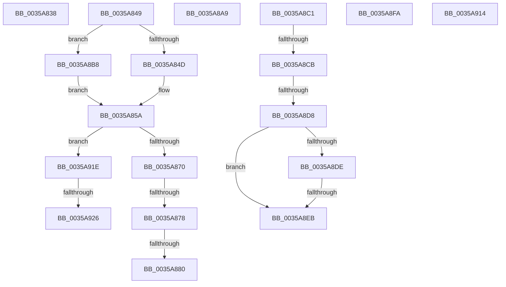

# sub_0035A838

- RVA: `0x0035A838`–`0x0035A934` (길이 `252` bytes)
- VA: `0x000000014035A838`
- 실행 섹션: `.text`
- PDB 이름 있음: `아니요`; PDB Function 태그: `아니요`
- unwind 정보 RVA: `0x00079A08`
- 디코드: `55`개 명령, `252/252` bytes 표시
- 미해석 바이트: `0` (있으면 어셈블리에 `.byte`로 보존)

> 이 문서는 커널 이미지의 기계어와 PDB 기호를 분석해 생성했습니다. 4번과 5번은 함수 원형과 자료형을 바이너리 사용 방식에서 추정한 C 해석이며 원본 소스 복구 결과는 아닙니다.

## 1. Dependencies

- 직접 호출 지점: **5**; 고유 호출 대상: **4**
- 직접 호출자로 확인된 함수: **0**
- RIP 상대 이미지 참조: **0**

### Outgoing calls
- `0x0035A83F` → [KiRaiseIrqlProcessIrqlFlags](../4F/KiRaiseIrqlProcessIrqlFlags_function_004F56FC.md) (function, `0x004F56FC`)
- `0x0035A88A` → [CcInsertIntoDirtySharedCacheMapList](../3C/CcInsertIntoDirtySharedCacheMapList_function_003CD9D8.md) (function, `0x003CD9D8`)
- `0x0035A89F` → [CcScheduleLazyWriteScan](../3C/CcScheduleLazyWriteScan_function_003CBD20.md) (function, `0x003CBD20`)
- `0x0035A8AE` → [KxWaitForLockOwnerShip](../25/KxWaitForLockOwnerShip_function_00257EB0.md) (function, `0x00257EB0`)
- `0x0035A929` → [CcInsertIntoDirtySharedCacheMapList](../3C/CcInsertIntoDirtySharedCacheMapList_function_003CD9D8.md) (function, `0x003CD9D8`)

### Direct callers
- 이 함수 시작 RVA로 연결되는 직접 call은 확인되지 않았습니다. 간접 호출은 완전히 역산할 수 없습니다.

### Static image references
- 디코드된 RIP-relative 메모리 참조가 없습니다.

## 2. Other-region calls and transfers

- 다른 실행 섹션으로 향하는 call: **0**
- call이 아닌 외부 분기/꼬리 이동: **13**
  - `0x0035A844` → [sub_0035A582 + 0x1C1](Unknown_function_0035A582.md) (`tail-transfer`)
  - `0x0035A872` → [sub_0035A582 + 0x215](Unknown_function_0035A582.md) (`tail-transfer`)
  - `0x0035A87A` → [sub_0035A582 + 0x215](Unknown_function_0035A582.md) (`tail-transfer`)
  - `0x0035A8A4` → [sub_0035A582 + 0x215](Unknown_function_0035A582.md) (`tail-transfer`)
  - `0x0035A8B3` → [sub_0035A582 + 0x1E4](Unknown_function_0035A582.md) (`tail-transfer`)
  - `0x0035A8C5` → [sub_0035A582 + 0x22D](Unknown_function_0035A582.md) (`tail-transfer`)
  - `0x0035A8D2` → [sub_0035A582 + 0x22D](Unknown_function_0035A582.md) (`tail-transfer`)
  - `0x0035A8E5` → [sub_0035A582 + 0x22D](Unknown_function_0035A582.md) (`tail-transfer`)
  - `0x0035A8F5` → [sub_0035A582 + 0x22D](Unknown_function_0035A582.md) (`tail-transfer`)
  - `0x0035A90F` → [sub_0035A582 + 0x118](Unknown_function_0035A582.md) (`tail-transfer`)
  - `0x0035A919` → [sub_0035A582 + 0x160](Unknown_function_0035A582.md) (`tail-transfer`)
  - `0x0035A920` → [sub_006E2C28](../6E/Unknown_function_006E2C28.md) (`tail-transfer`)
  - `0x0035A92F` → [sub_006E2C28](../6E/Unknown_function_006E2C28.md) (`tail-transfer`)

## 3. Assembly (complete function range)

```asm
0035A838  0F B6 D0                        movzx edx, al
0035A83B  40 0F B6 CD                     movzx ecx, bpl
0035A83F  E8 B8 AE 19 00                  call 0x1404f56fc
0035A844  E9 FA FE FF FF                  jmp 0x14035a743
0035A849  84 C0                           test al, al
0035A84B  74 6B                           je 0x14035a8b8
0035A84D  48 8B 86 58 02 00 00            mov rax, qword ptr [rsi + 0x258]
0035A854  48 05 DA 03 00 00               add rax, 0x3da
0035A85A  C6 00 01                        mov byte ptr [rax], 1
0035A85D  8B 86 98 00 00 00               mov eax, dword ptr [rsi + 0x98]
0035A863  8B 4E 70                        mov ecx, dword ptr [rsi + 0x70]
0035A866  0F BA E0 10                     bt eax, 0x10
0035A86A  0F 82 AE 00 00 00               jb 0x14035a91e
0035A870  85 C9                           test ecx, ecx
0035A872  0F 85 1F FF FF FF               jne 0x14035a797
0035A878  A8 20                           test al, 0x20
0035A87A  0F 85 17 FF FF FF               jne 0x14035a797
0035A880  4C 8B 9E 18 01 00 00            mov r11, qword ptr [rsi + 0x118]
0035A887  48 8B CE                        mov rcx, rsi
0035A88A  E8 49 31 07 00                  call 0x1403cd9d8
0035A88F  4D 85 DB                        test r11, r11
0035A892  41 0F 95 C0                     setne r8b
0035A896  45 33 C9                        xor r9d, r9d
0035A899  49 8B D6                        mov rdx, r14
0035A89C  48 8B CF                        mov rcx, rdi
0035A89F  E8 7C 14 07 00                  call 0x1403cbd20
0035A8A4  E9 EE FE FF FF                  jmp 0x14035a797
0035A8A9  48 8D 4C 24 20                  lea rcx, [rsp + 0x20]
0035A8AE  E8 FD D5 EF FF                  call 0x140257eb0
0035A8B3  E9 AE FE FF FF                  jmp 0x14035a766
0035A8B8  48 8D 87 1A 04 00 00            lea rax, [rdi + 0x41a]
0035A8BF  EB 99                           jmp 0x14035a85a
0035A8C1  41 83 3F 00                     cmp dword ptr [r15], 0
0035A8C5  0F 8C E4 FE FF FF               jl 0x14035a7af
0035A8CB  83 BB 80 00 00 00 00            cmp dword ptr [rbx + 0x80], 0
0035A8D2  0F 8C D7 FE FF FF               jl 0x14035a7af
0035A8D8  83 7E 70 00                     cmp dword ptr [rsi + 0x70], 0
0035A8DC  75 0D                           jne 0x14035a8eb
0035A8DE  83 BE 0C 02 00 00 00            cmp dword ptr [rsi + 0x20c], 0
0035A8E5  0F 84 C4 FE FF FF               je 0x14035a7af
0035A8EB  C7 83 80 00 00 00 54 00 00 C0   mov dword ptr [rbx + 0x80], 0xc0000054
0035A8F5  E9 B5 FE FF FF                  jmp 0x14035a7af
0035A8FA  49 8B 80 B8 01 00 00            mov rax, qword ptr [r8 + 0x1b8]
0035A901  48 3B E8                        cmp rbp, rax
0035A904  48 0F 47 C5                     cmova rax, rbp
0035A908  49 89 80 B8 01 00 00            mov qword ptr [r8 + 0x1b8], rax
0035A90F  E9 86 FD FF FF                  jmp 0x14035a69a
0035A914  BD 00 02 00 00                  mov ebp, 0x200
0035A919  E9 C4 FD FF FF                  jmp 0x14035a6e2
0035A91E  85 C9                           test ecx, ecx
0035A920  0F 85 02 83 38 00               jne 0x1406e2c28
0035A926  48 8B CE                        mov rcx, rsi
0035A929  E8 AA 30 07 00                  call 0x1403cd9d8
0035A92E  90                              nop
0035A92F  E9 F4 82 38 00                  jmp 0x1406e2c28
```

## 4. C-style interpretation (structured pseudocode)

```c
__int64 __fastcall sub_0035A838(__int64 a1, __int64 a2, __int64 a3, int a4)
{
    __int64 result;
    unsigned __int64 v_stack_p20;

    result = KiRaiseIrqlProcessIrqlFlags((unsigned __int8)(v_rbp), (unsigned __int8)(result), a3, a4);
}
```

## 5. (Beta) C Style

```c
int64_t sub_0035A838(int64_t Arg1, int64_t Arg2, int64_t Arg3, int32_t Arg4)
{
    int64_t result;
    uint64_t v_stack_p20;

    result = KiRaiseIrqlProcessIrqlFlags((uint8_t)(local_rbp), (uint8_t)(result), Arg3, Arg4);
}
```

## 6. Execution-region graph

[열기: 2D/3D 그래프와 함수 탐색 컨트롤 패널](../../../control-panel.html?section=text&rva=0x0035A838&view=graph)

- 2D 그래프는 위에서 아래로 흐르고, 3D 그래프는 빈 공간을 드래그해 회전합니다. Shift+드래그는 이동, 휠은 확대·축소, 함수 노드 선택은 대상 보고서 이동입니다.

### Static fallback


