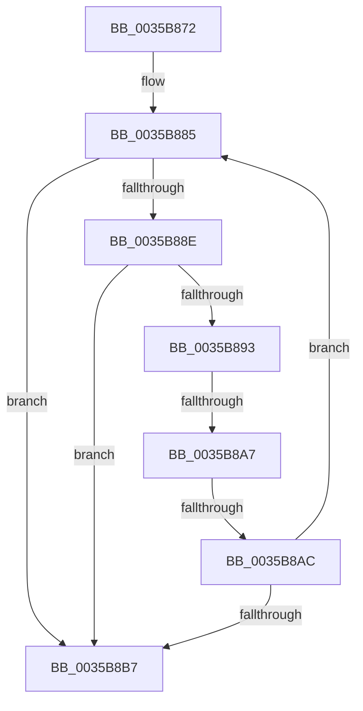

# sub_0035B872

- RVA: `0x0035B872`–`0x0035B8C5` (길이 `83` bytes)
- VA: `0x000000014035B872`
- 실행 섹션: `.text`
- PDB 이름 있음: `아니요`; PDB Function 태그: `아니요`
- unwind 정보 RVA: `0x00079B1C`
- 디코드: `24`개 명령, `83/83` bytes 표시
- 미해석 바이트: `0` (있으면 어셈블리에 `.byte`로 보존)

> 이 문서는 커널 이미지의 기계어와 PDB 기호를 분석해 생성했습니다. 4번과 5번은 함수 원형과 자료형을 바이너리 사용 방식에서 추정한 C 해석이며 원본 소스 복구 결과는 아닙니다.

## 1. Dependencies

- 직접 호출 지점: **1**; 고유 호출 대상: **1**
- 직접 호출자로 확인된 함수: **0**
- RIP 상대 이미지 참조: **0**

### Outgoing calls
- `0x0035B89D` → [ExpTrackTableGetMoreLimit](../2E/ExpTrackTableGetMoreLimit_function_002ECE40.md) (function, `0x002ECE40`)

### Direct callers
- 이 함수 시작 RVA로 연결되는 직접 call은 확인되지 않았습니다. 간접 호출은 완전히 역산할 수 없습니다.

### Static image references
- 디코드된 RIP-relative 메모리 참조가 없습니다.

## 2. Other-region calls and transfers

- 다른 실행 섹션으로 향하는 call: **0**
- call이 아닌 외부 분기/꼬리 이동: **3**
  - `0x0035B8A5` → [sub_0035B8C5 + 0xF](Unknown_function_0035B8C5.md) (`tail-transfer`)
  - `0x0035B8AA` → [sub_0035B8C5](Unknown_function_0035B8C5.md) (`tail-transfer`)
  - `0x0035B8C3` → [ExpPoolTrackerChargeEntry + 0x50](ExpPoolTrackerChargeEntry_function_0035B810.md) (`tail-transfer`)

## 3. Assembly (complete function range)

```asm
0035B872  4C 89 64 24 50                  mov qword ptr [rsp + 0x50], r12
0035B877  BB 01 00 00 00                  mov ebx, 1
0035B87C  4C 89 6C 24 58                  mov qword ptr [rsp + 0x58], r13
0035B881  4D 8D 2C F0                     lea r13, [r8 + rsi*8]
0035B885  4D 8B 65 38                     mov r12, qword ptr [r13 + 0x38]
0035B889  44 84 E3                        test bl, r12b
0035B88C  75 29                           jne 0x14035b8b7
0035B88E  4C 3B E5                        cmp r12, rbp
0035B891  7D 24                           jge 0x14035b8b7
0035B893  48 8B 4F 48                     mov rcx, qword ptr [rdi + 0x48]
0035B897  44 8B C6                        mov r8d, esi
0035B89A  49 8B D7                        mov rdx, r15
0035B89D  E8 9E 15 F9 FF                  call 0x1402ece40
0035B8A2  48 85 C0                        test rax, rax
0035B8A5  74 2D                           je 0x14035b8d4
0035B8A7  48 3B C3                        cmp rax, rbx
0035B8AA  75 19                           jne 0x14035b8c5
0035B8AC  49 8B C4                        mov rax, r12
0035B8AF  F0 49 0F B1 5D 38               lock cmpxchg qword ptr [r13 + 0x38], rbx
0035B8B5  75 CE                           jne 0x14035b885
0035B8B7  8B C3                           mov eax, ebx
0035B8B9  4C 8B 64 24 50                  mov r12, qword ptr [rsp + 0x50]
0035B8BE  4C 8B 6C 24 58                  mov r13, qword ptr [rsp + 0x58]
0035B8C3  EB 9B                           jmp 0x14035b860
```

## 4. C-style interpretation (structured pseudocode)

```c
__int64 __fastcall sub_0035B872(__int64 a1, __int64 a2, __int64 a3, __int64 a4, __int64 a5, __int64 a6, __int64 a7, __int64 a8, __int64 a9, __int64 a10, __int64 a11)
{
    __int64 result;
    unsigned __int64 v_stack_p50;
    unsigned __int64 v_stack_p58;

    v_stack_p50 = v_r12;
    v_stack_p58 = v_r13;
loc_0035B885:
    if (((1) & ((unsigned __int8)(*(unsigned __int64 *)(a3 + v_rsi * 8 + 56)))) != 0) goto loc_0035B8B7;
    if ((*(unsigned __int64 *)(a3 + v_rsi * 8 + 56)) >= v_rbp) goto loc_0035B8B7;
    result = ExpTrackTableGetMoreLimit(*(unsigned __int64 *)(v_rdi + 72), v_r15, (unsigned int)((unsigned int)(v_rsi)), a4);
    if (result != 1) goto loc_0035B885;
loc_0035B8B7:
}
```

## 5. (Beta) C Style

```c
int64_t sub_0035B872(int64_t Arg1, int64_t Arg2, void *Arg3, int64_t Arg4, uint64_t Arg5, uint64_t Arg6, uint64_t Arg7, uint64_t Arg8, uint64_t Arg9, int64_t Arg10, int64_t Arg11)
{
    uint8_t *arg3 = (uint8_t *)Arg3;

    int64_t result;
    uint64_t v_stack_p50;
    uint64_t v_stack_p58;

    v_stack_p50 = local_r12;
    v_stack_p58 = local_r13;
loc_0035B885:
    if (((1) & ((uint8_t)(*(uint64_t *)(arg3 + local_rsi * 8 + 0x38)))) != 0) goto loc_0035B8B7;
    if ((*(uint64_t *)(arg3 + local_rsi * 8 + 0x38)) >= local_rbp) goto loc_0035B8B7;
    result = ExpTrackTableGetMoreLimit(*(uint64_t *)(local_rdi + 0x48), local_r15, (uint32_t)((uint32_t)(local_rsi)), Arg4);
    if (result != 1) goto loc_0035B885;
loc_0035B8B7:
}
```

### 관측된 메모리 오프셋

구조체 형식이 확인되지 않은 접근은 인자 기준의 오프셋으로만 기록했습니다.

| 기준 인자 | 오프셋 표현 | 폭 (bit) | 접근 |
|---|---:|---:|---|
| `Arg3` | `+ 0x0 + rsi*8` | `64` | `R` |
| `Arg3` | `+ 0x38` | `64` | `R` |

## 6. Execution-region graph

[열기: 2D/3D 그래프와 함수 탐색 컨트롤 패널](../../../control-panel.html?section=text&rva=0x0035B872&view=graph)

- 2D 그래프는 위에서 아래로 흐르고, 3D 그래프는 빈 공간을 드래그해 회전합니다. Shift+드래그는 이동, 휠은 확대·축소, 함수 노드 선택은 대상 보고서 이동입니다.

### Static fallback


