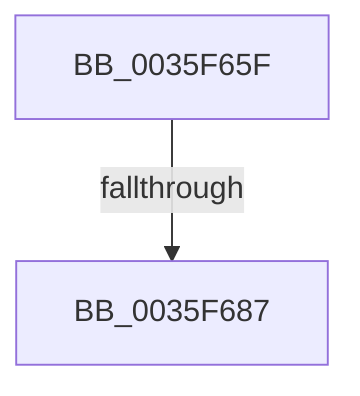

# sub_0035F65F

- RVA: `0x0035F65F`–`0x0035F6BE` (길이 `95` bytes)
- VA: `0x000000014035F65F`
- 실행 섹션: `.text`
- PDB 이름 있음: `아니요`; PDB Function 태그: `아니요`
- unwind 정보 RVA: `0x00079BB8`
- 디코드: `27`개 명령, `95/95` bytes 표시
- 미해석 바이트: `0` (있으면 어셈블리에 `.byte`로 보존)

> 이 문서는 커널 이미지의 기계어와 PDB 기호를 분석해 생성했습니다. 4번과 5번은 함수 원형과 자료형을 바이너리 사용 방식에서 추정한 C 해석이며 원본 소스 복구 결과는 아닙니다.

## 1. Dependencies

- 직접 호출 지점: **1**; 고유 호출 대상: **1**
- 직접 호출자로 확인된 함수: **0**
- RIP 상대 이미지 참조: **1**

### Outgoing calls
- `0x0035F6A0` → [RtlpLogHeapFailure](RtlpLogHeapFailure_function_0035B7BC.md) (function, `0x0035B7BC`)

### Direct callers
- 이 함수 시작 RVA로 연결되는 직접 call은 확인되지 않았습니다. 간접 호출은 완전히 역산할 수 없습니다.

### Static image references
- `0x0035F678` → RVA `0x00E28300` (`.data`; read)

## 2. Other-region calls and transfers

- 다른 실행 섹션으로 향하는 call: **0**
- call이 아닌 외부 분기/꼬리 이동: **1**
  - `0x0035F685` → [sub_0035F6BF](Unknown_function_0035F6BF.md) (`tail-transfer`)

## 3. Assembly (complete function range)

```asm
0035F65F  48 89 6C 24 70                  mov qword ptr [rsp + 0x70], rbp
0035F664  49 8B D0                        mov rdx, r8
0035F667  48 23 D7                        and rdx, rdi
0035F66A  4C 89 74 24 48                  mov qword ptr [rsp + 0x48], r14
0035F66F  4C 89 7C 24 40                  mov qword ptr [rsp + 0x40], r15
0035F674  48 8B 42 10                     mov rax, qword ptr [rdx + 0x10]
0035F678  48 33 05 81 8C AC 00            xor rax, qword ptr [rip + 0xac8c81]
0035F67F  48 33 C2                        xor rax, rdx
0035F682  48 3B C6                        cmp rax, rsi
0035F685  74 38                           je 0x14035f6bf
0035F687  48 8B 56 38                     mov rdx, qword ptr [rsi + 0x38]
0035F68B  33 DB                           xor ebx, ebx
0035F68D  48 89 5C 24 28                  mov qword ptr [rsp + 0x28], rbx
0035F692  45 33 C9                        xor r9d, r9d
0035F695  48 89 5C 24 20                  mov qword ptr [rsp + 0x20], rbx
0035F69A  8D 4B 09                        lea ecx, [rbx + 9]
0035F69D  4C 8B C7                        mov r8, rdi
0035F6A0  E8 17 C1 FF FF                  call 0x14035b7bc
0035F6A5  4C 8B 7C 24 40                  mov r15, qword ptr [rsp + 0x40]
0035F6AA  8B C3                           mov eax, ebx
0035F6AC  4C 8B 74 24 48                  mov r14, qword ptr [rsp + 0x48]
0035F6B1  48 8B 6C 24 70                  mov rbp, qword ptr [rsp + 0x70]
0035F6B6  48 83 C4 50                     add rsp, 0x50
0035F6BA  5F                              pop rdi
0035F6BB  5E                              pop rsi
0035F6BC  5B                              pop rbx
0035F6BD  C3                              ret
```

## 4. C-style interpretation (structured pseudocode)

```c
__int64 __fastcall sub_0035F65F(__int64 a1, __int64 a2, __int64 a3, int a4, __int64 a5, __int64 a6, __int64 a7, __int64 a8, __int64 a9, __int64 a10, __int64 a11, __int64 a12, __int64 a13, __int64 a14)
{
    __int64 result;
    __int64 v_rbx;
    __int64 v_rsp;
    unsigned __int64 v_stack_p20;
    unsigned __int64 v_stack_p28;
    unsigned __int64 v_stack_p40;
    unsigned __int64 v_stack_p48;
    unsigned __int64 v_stack_p70;

    v_stack_p70 = v_rbp;
    a2 = (a3) & (v_rdi);
    v_stack_p48 = v_r14;
    v_stack_p40 = v_r15;
    result = (*(unsigned __int64 *)(a2 + 16)) ^ (*(unsigned __int64 *)(v_rip + 11308161));
    result = (result) ^ (a2);
    v_rbx = 0;
    v_stack_p28 = 0;
    a4 = 0;
    v_stack_p20 = 0;
    result = RtlpLogHeapFailure(v_rbx + 9, *(unsigned __int64 *)(v_rsi + 56), v_rdi, a4);
    v_rsp = (v_rsp) + (80);
    return 0;
}
```

## 5. (Beta) C Style

```c
int64_t sub_0035F65F(int64_t Arg1, int64_t Arg2, void *Arg3, int32_t Arg4, uint64_t Arg5, uint64_t Arg6, uint64_t Arg7, int64_t Arg8, int64_t Arg9, uint64_t Arg10, uint64_t Arg11, uint64_t Arg12, uint64_t Arg13, int64_t Arg14)
{
    uint8_t *arg3 = (uint8_t *)Arg3;

    int64_t result;
    int64_t local_rbx;
    int64_t local_rsp;
    uint64_t v_stack_p20;
    uint64_t v_stack_p28;
    uint64_t v_stack_p40;
    uint64_t v_stack_p48;
    uint64_t v_stack_p70;

    v_stack_p70 = local_rbp;
    Arg2 = (Arg3) & (local_rdi);
    v_stack_p48 = local_r14;
    v_stack_p40 = local_r15;
    result = (*(uint64_t *)(Arg2 + 0x10)) ^ (*(uint64_t *)(v_rip + 0xAC8C81));
    result = (result) ^ (Arg2);
    local_rbx = 0;
    v_stack_p28 = 0;
    Arg4 = 0;
    v_stack_p20 = 0;
    result = RtlpLogHeapFailure(local_rbx + 9, *(uint64_t *)(local_rsi + 0x38), local_rdi, Arg4);
    local_rsp = (local_rsp) + (80);
    return 0;
}
```

### 관측된 메모리 오프셋

구조체 형식이 확인되지 않은 접근은 인자 기준의 오프셋으로만 기록했습니다.

| 기준 인자 | 오프셋 표현 | 폭 (bit) | 접근 |
|---|---:|---:|---|
| `Arg3` | `+ 0x10` | `64` | `R` |

## 6. Execution-region graph

[열기: 2D/3D 그래프와 함수 탐색 컨트롤 패널](../../../control-panel.html?section=text&rva=0x0035F65F&view=graph)

- 2D 그래프는 위에서 아래로 흐르고, 3D 그래프는 빈 공간을 드래그해 회전합니다. Shift+드래그는 이동, 휠은 확대·축소, 함수 노드 선택은 대상 보고서 이동입니다.

### Static fallback


