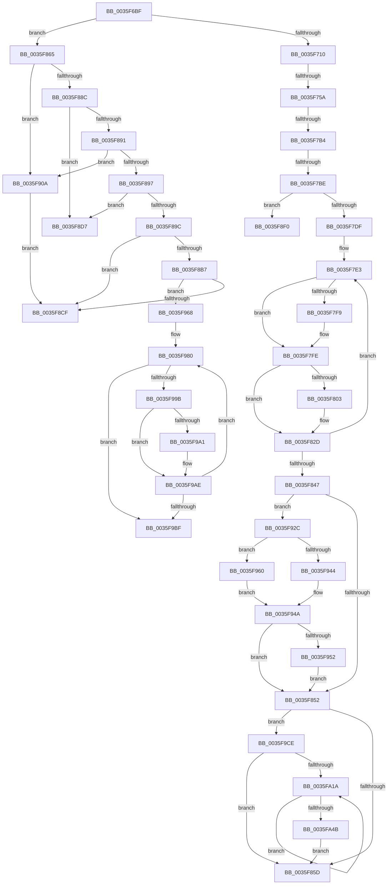

# sub_0035F6BF

- RVA: `0x0035F6BF`–`0x0035FA50` (길이 `913` bytes)
- VA: `0x000000014035F6BF`
- 실행 섹션: `.text`
- PDB 이름 있음: `아니요`; PDB Function 태그: `아니요`
- unwind 정보 RVA: `0x00079BE8`
- 디코드: `234`개 명령, `913/913` bytes 표시
- 미해석 바이트: `0` (있으면 어셈블리에 `.byte`로 보존)

> 이 문서는 커널 이미지의 기계어와 PDB 기호를 분석해 생성했습니다. 4번과 5번은 함수 원형과 자료형을 바이너리 사용 방식에서 추정한 C 해석이며 원본 소스 복구 결과는 아닙니다.

## 1. Dependencies

- 직접 호출 지점: **4**; 고유 호출 대상: **4**
- 직접 호출자로 확인된 함수: **0**
- RIP 상대 이미지 참조: **4**

### Outgoing calls
- `0x0035F8AB` → [RtlpHpVsContextFree](../36/RtlpHpVsContextFree_function_00361630.md) (function, `0x00361630`)
- `0x0035F8DD` → [RtlpHpSegPageRangeShrink](../2E/RtlpHpSegPageRangeShrink_function_002E2FA0.md) (function, `0x002E2FA0`)
- `0x0035F922` → [RtlpLogHeapFailure](RtlpLogHeapFailure_function_0035B7BC.md) (function, `0x0035B7BC`)
- `0x0035F956` → [RtlpHpEnvCompactionSchedule](../32/RtlpHpEnvCompactionSchedule_function_003264A0.md) (function, `0x003264A0`)

### Direct callers
- 이 함수 시작 RVA로 연결되는 직접 call은 확인되지 않았습니다. 간접 호출은 완전히 역산할 수 없습니다.

### Static image references
- `0x0035F725` → RVA `0x00E28308` (`.data`; read)
- `0x0035F944` → RVA `0x00EFA7BC` (`.data`; read)
- `0x0035F960` → RVA `0x00EFA7C0` (`.data`; read)
- `0x0035F96F` → RVA `0x00010B80` (`.rdata`; read)

## 2. Other-region calls and transfers

- 다른 실행 섹션으로 향하는 call: **0**
- call이 아닌 외부 분기/꼬리 이동: **8**
  - `0x0035F754` → [sub_0035F65F + 0x46](Unknown_function_0035F65F.md) (`tail-transfer`)
  - `0x0035F7AE` → [sub_0035FA7A + 0x53](Unknown_function_0035FA7A.md) (`tail-transfer`)
  - `0x0035F7B8` → [sub_0035FA7A](Unknown_function_0035FA7A.md) (`tail-transfer`)
  - `0x0035F860` → [sub_0035F65F + 0x46](Unknown_function_0035F65F.md) (`tail-transfer`)
  - `0x0035F8D2` → [sub_0035F65F + 0x46](Unknown_function_0035F65F.md) (`tail-transfer`)
  - `0x0035F8EB` → [sub_0035F65F + 0x46](Unknown_function_0035F65F.md) (`tail-transfer`)
  - `0x0035F905` → [sub_0035F65F + 0x3E](Unknown_function_0035F65F.md) (`tail-transfer`)
  - `0x0035F9C9` → [sub_0035F65F + 0x46](Unknown_function_0035F65F.md) (`tail-transfer`)

## 3. Assembly (complete function range)

```asm
0035F6BF  44 0F B6 5E 08                  movzx r11d, byte ptr [rsi + 8]
0035F6C4  44 8B CF                        mov r9d, edi
0035F6C7  44 2B CA                        sub r9d, edx
0035F6CA  41 8B CB                        mov ecx, r11d
0035F6CD  41 D3 E9                        shr r9d, cl
0035F6D0  49 C1 E1 05                     shl r9, 5
0035F6D4  4C 03 CA                        add r9, rdx
0035F6D7  41 0F B6 41 1A                  movzx eax, byte ptr [r9 + 0x1a]
0035F6DC  48 F7 D8                        neg rax
0035F6DF  48 C1 E0 05                     shl rax, 5
0035F6E3  4C 03 C8                        add r9, rax
0035F6E6  49 8B E9                        mov rbp, r9
0035F6E9  48 2B EA                        sub rbp, rdx
0035F6EC  48 C1 FD 05                     sar rbp, 5
0035F6F0  45 0F B6 51 18                  movzx r10d, byte ptr [r9 + 0x18]
0035F6F5  48 D3 E5                        shl rbp, cl
0035F6F8  48 03 EA                        add rbp, rdx
0035F6FB  48 3B EF                        cmp rbp, rdi
0035F6FE  0F 94 C0                        sete al
0035F701  33 DB                           xor ebx, ebx
0035F703  42 8D 0C 10                     lea ecx, [rax + r10]
0035F707  80 F9 0B                        cmp cl, 0xb
0035F70A  0F 85 55 01 00 00               jne 0x14035f865
0035F710  4C 8B 7E 18                     mov r15, qword ptr [rsi + 0x18]
0035F714  48 8B C5                        mov rax, rbp
0035F717  0F B7 55 2C                     movzx edx, word ptr [rbp + 0x2c]
0035F71B  44 8B C7                        mov r8d, edi
0035F71E  48 C1 E8 0C                     shr rax, 0xc
0035F722  33 45 28                        xor eax, dword ptr [rbp + 0x28]
0035F725  33 05 DD 8B AC 00               xor eax, dword ptr [rip + 0xac8bdd]
0035F72B  0F B7 C8                        movzx ecx, ax
0035F72E  48 C1 E8 10                     shr rax, 0x10
0035F732  48 03 C5                        add rax, rbp
0035F735  48 C1 E2 06                     shl rdx, 6
0035F739  44 2B C0                        sub r8d, eax
0035F73C  41 8B C0                        mov eax, r8d
0035F73F  42 8B 74 3A 48                  mov esi, dword ptr [rdx + r15 + 0x48]
0035F744  48 0F AF F0                     imul rsi, rax
0035F748  48 C1 EE 20                     shr rsi, 0x20
0035F74C  8B C6                           mov eax, esi
0035F74E  0F AF C1                        imul eax, ecx
0035F751  44 3B C0                        cmp r8d, eax
0035F754  0F 85 4B FF FF FF               jne 0x14035f6a5
0035F75A  65 4C 8B 04 25 20 00 00 00      mov r8, qword ptr gs:[0x20]
0035F763  41 BE 01 00 00 00               mov r14d, 1
0035F769  45 8B 4F 4C                     mov r9d, dword ptr [r15 + 0x4c]
0035F76D  41 8B D6                        mov edx, r14d
0035F770  41 8B C1                        mov eax, r9d
0035F773  49 C1 E9 04                     shr r9, 4
0035F777  C1 E8 0D                        shr eax, 0xd
0035F77A  41 81 E1 FF 01 00 00            and r9d, 0x1ff
0035F781  25 FF FF 03 00                  and eax, 0x3ffff
0035F786  0F BD C8                        bsr ecx, eax
0035F789  D3 E2                           shl edx, cl
0035F78B  83 C1 FE                        add ecx, -2
0035F78E  33 D0                           xor edx, eax
0035F790  89 8C 24 88 00 00 00            mov dword ptr [rsp + 0x88], ecx
0035F797  49 8B 80 B0 8B 00 00            mov rax, qword ptr [r8 + 0x8bb0]
0035F79E  48 8B 04 C8                     mov rax, qword ptr [rax + rcx*8]
0035F7A2  48 8B 44 D0 08                  mov rax, qword ptr [rax + rdx*8 + 8]
0035F7A7  4A 8B 04 C8                     mov rax, qword ptr [rax + r9*8]
0035F7AB  48 85 C0                        test rax, rax
0035F7AE  0F 84 19 03 00 00               je 0x14035facd
0035F7B4  66 3B 45 2E                     cmp ax, word ptr [rbp + 0x2e]
0035F7B8  0F 84 BC 02 00 00               je 0x14035fa7a
0035F7BE  8B C6                           mov eax, esi
0035F7C0  4C 8B CE                        mov r9, rsi
0035F7C3  83 E0 3F                        and eax, 0x3f
0035F7C6  0F B6 C8                        movzx ecx, al
0035F7C9  48 8B C6                        mov rax, rsi
0035F7CC  48 C1 E8 06                     shr rax, 6
0035F7D0  48 8B 44 C5 40                  mov rax, qword ptr [rbp + rax*8 + 0x40]
0035F7D5  48 0F A3 C8                     bt rax, rcx
0035F7D9  0F 83 11 01 00 00               jae 0x14035f8f0
0035F7DF  48 8B 45 10                     mov rax, qword ptr [rbp + 0x10]
0035F7E3  48 8B C8                        mov rcx, rax
0035F7E6  48 89 44 24 38                  mov qword ptr [rsp + 0x38], rax
0035F7EB  48 C1 E9 30                     shr rcx, 0x30
0035F7EF  48 89 44 24 30                  mov qword ptr [rsp + 0x30], rax
0035F7F4  41 3A CE                        cmp cl, r14b
0035F7F7  75 05                           jne 0x14035f7fe
0035F7F9  C6 44 24 36 02                  mov byte ptr [rsp + 0x36], 2
0035F7FE  48 85 FF                        test rdi, rdi
0035F801  74 2A                           je 0x14035f82d
0035F803  4D 8B 47 50                     mov r8, qword ptr [r15 + 0x50]
0035F807  0F B7 4C 24 30                  movzx ecx, word ptr [rsp + 0x30]
0035F80C  41 8B D0                        mov edx, r8d
0035F80F  66 89 0F                        mov word ptr [rdi], cx
0035F812  33 17                           xor edx, dword ptr [rdi]
0035F814  0F B6 C9                        movzx ecx, cl
0035F817  D3 C2                           rol edx, cl
0035F819  8D 4E 01                        lea ecx, [rsi + 1]
0035F81C  49 C1 E8 20                     shr r8, 0x20
0035F820  41 33 D0                        xor edx, r8d
0035F823  66 89 4C 24 30                  mov word ptr [rsp + 0x30], cx
0035F828  33 D7                           xor edx, edi
0035F82A  89 57 08                        mov dword ptr [rdi + 8], edx
0035F82D  66 FF 44 24 32                  inc word ptr [rsp + 0x32]
0035F832  0F B7 55 2C                     movzx edx, word ptr [rbp + 0x2c]
0035F836  48 8B 4C 24 30                  mov rcx, qword ptr [rsp + 0x30]
0035F83B  48 C1 E2 06                     shl rdx, 6
0035F83F  F0 48 0F B1 4D 10               lock cmpxchg qword ptr [rbp + 0x10], rcx
0035F845  75 9C                           jne 0x14035f7e3
0035F847  42 38 5C 3A 5C                  cmp byte ptr [rdx + r15 + 0x5c], bl
0035F84C  0F 84 DA 00 00 00               je 0x14035f92c
0035F852  44 38 74 24 3E                  cmp byte ptr [rsp + 0x3e], r14b
0035F857  0F 84 71 01 00 00               je 0x14035f9ce
0035F85D  41 8B DE                        mov ebx, r14d
0035F860  E9 40 FE FF FF                  jmp 0x14035f6a5
0035F865  4D 23 C1                        and r8, r9
0035F868  89 9C 24 80 00 00 00            mov dword ptr [rsp + 0x80], ebx
0035F86F  49 8B D1                        mov rdx, r9
0035F872  41 8B CB                        mov ecx, r11d
0035F875  49 2B D0                        sub rdx, r8
0035F878  41 0F B6 C2                     movzx eax, r10b
0035F87C  48 C1 FA 05                     sar rdx, 5
0035F880  24 03                           and al, 3
0035F882  48 D3 E2                        shl rdx, cl
0035F885  49 03 D0                        add rdx, r8
0035F888  3C 03                           cmp al, 3
0035F88A  75 7E                           jne 0x14035f90a
0035F88C  48 3B FA                        cmp rdi, rdx
0035F88F  74 46                           je 0x14035f8d7
0035F891  41 80 FA 0F                     cmp r10b, 0xf
0035F895  75 73                           jne 0x14035f90a
0035F897  48 3B FA                        cmp rdi, rdx
0035F89A  76 3B                           jbe 0x14035f8d7
0035F89C  48 8B 4E 20                     mov rcx, qword ptr [rsi + 0x20]
0035F8A0  4C 8D 8C 24 80 00 00 00         lea r9, [rsp + 0x80]
0035F8A8  4C 8B C7                        mov r8, rdi
0035F8AB  E8 80 1D 00 00                  call 0x140361630
0035F8B0  44 8B F0                        mov r14d, eax
0035F8B3  85 C0                           test eax, eax
0035F8B5  74 18                           je 0x14035f8cf
0035F8B7  4C 8B 46 18                     mov r8, qword ptr [rsi + 0x18]
0035F8BB  8B 84 24 80 00 00 00            mov eax, dword ptr [rsp + 0x80]
0035F8C2  41 0F B7 48 44                  movzx ecx, word ptr [r8 + 0x44]
0035F8C7  3B C1                           cmp eax, ecx
0035F8C9  0F 82 99 00 00 00               jb 0x14035f968
0035F8CF  41 8B DE                        mov ebx, r14d
0035F8D2  E9 CE FD FF FF                  jmp 0x14035f6a5
0035F8D7  49 8B D1                        mov rdx, r9
0035F8DA  48 8B CE                        mov rcx, rsi
0035F8DD  E8 BE 36 F8 FF                  call 0x1402e2fa0
0035F8E2  41 BE 01 00 00 00               mov r14d, 1
0035F8E8  41 8B DE                        mov ebx, r14d
0035F8EB  E9 B5 FD FF FF                  jmp 0x14035f6a5
0035F8F0  49 8B 17                        mov rdx, qword ptr [r15]
0035F8F3  B9 11 00 00 00                  mov ecx, 0x11
0035F8F8  48 89 5C 24 28                  mov qword ptr [rsp + 0x28], rbx
0035F8FD  4C 89 4C 24 20                  mov qword ptr [rsp + 0x20], r9
0035F902  4C 8B CD                        mov r9, rbp
0035F905  E9 93 FD FF FF                  jmp 0x14035f69d
0035F90A  48 8B 56 38                     mov rdx, qword ptr [rsi + 0x38]
0035F90E  45 33 C9                        xor r9d, r9d
0035F911  48 89 5C 24 28                  mov qword ptr [rsp + 0x28], rbx
0035F916  4C 8B C7                        mov r8, rdi
0035F919  48 89 5C 24 20                  mov qword ptr [rsp + 0x20], rbx
0035F91E  41 8D 49 09                     lea ecx, [r9 + 9]
0035F922  E8 95 BE FF FF                  call 0x14035b7bc
0035F927  44 8B F3                        mov r14d, ebx
0035F92A  EB A3                           jmp 0x14035f8cf
0035F92C  46 88 74 3A 5C                  mov byte ptr [rdx + r15 + 0x5c], r14b
0035F931  49 8B 0F                        mov rcx, qword ptr [r15]
0035F934  48 8B 41 38                     mov rax, qword ptr [rcx + 0x38]
0035F938  48 8B 00                        mov rax, qword ptr [rax]
0035F93B  48 C1 E8 08                     shr rax, 8
0035F93F  41 3A C6                        cmp al, r14b
0035F942  75 1C                           jne 0x14035f960
0035F944  8B 05 72 AE B9 00               mov eax, dword ptr [rip + 0xb9ae72]
0035F94A  85 C0                           test eax, eax
0035F94C  0F 85 00 FF FF FF               jne 0x14035f852
0035F952  48 8B 49 38                     mov rcx, qword ptr [rcx + 0x38]
0035F956  E8 45 6B FC FF                  call 0x1403264a0
0035F95B  E9 F2 FE FF FF                  jmp 0x14035f852
0035F960  8B 05 5A AE B9 00               mov eax, dword ptr [rip + 0xb9ae5a]
0035F966  EB E2                           jmp 0x14035f94a
0035F968  8D 50 0F                        lea edx, [rax + 0xf]
0035F96B  48 C1 EA 04                     shr rdx, 4
0035F96F  48 8D 05 0A 12 CB FF            lea rax, [rip - 0x34edf6]
0035F976  0F B6 04 02                     movzx eax, byte ptr [rdx + rax]
0035F97A  FF C8                           dec eax
0035F97C  4D 8D 0C C0                     lea r9, [r8 + rax*8]
0035F980  49 8B 89 C0 01 00 00            mov rcx, qword ptr [r9 + 0x1c0]
0035F987  48 8B C1                        mov rax, rcx
0035F98A  48 89 4C 24 38                  mov qword ptr [rsp + 0x38], rcx
0035F98F  48 C1 E8 10                     shr rax, 0x10
0035F993  48 8B D1                        mov rdx, rcx
0035F996  F6 C1 01                        test cl, 1
0035F999  74 24                           je 0x14035f9bf
0035F99B  66 83 F8 01                     cmp ax, 1
0035F99F  76 0D                           jbe 0x14035f9ae
0035F9A1  66 FF C8                        dec ax
0035F9A4  66 89 44 24 3A                  mov word ptr [rsp + 0x3a], ax
0035F9A9  48 8B 54 24 38                  mov rdx, qword ptr [rsp + 0x38]
0035F9AE  48 8B C1                        mov rax, rcx
0035F9B1  F0 49 0F B1 91 C0 01 00 00      lock cmpxchg qword ptr [r9 + 0x1c0], rdx
0035F9BA  48 3B C1                        cmp rax, rcx
0035F9BD  75 C1                           jne 0x14035f980
0035F9BF  49 8B 81 C0 01 00 00            mov rax, qword ptr [r9 + 0x1c0]
0035F9C6  41 8B DE                        mov ebx, r14d
0035F9C9  E9 D7 FC FF FF                  jmp 0x14035f6a5
0035F9CE  44 0F B7 4C 24 3C               movzx r9d, word ptr [rsp + 0x3c]
0035F9D4  41 C1 E1 06                     shl r9d, 6
0035F9D8  4D 03 CF                        add r9, r15
0035F9DB  41 0F 0D 49 08                  prefetchw byte ptr [r9 + 8]
0035F9E0  49 8B 41 08                     mov rax, qword ptr [r9 + 8]
0035F9E4  4C 8B 55 18                     mov r10, qword ptr [rbp + 0x18]
0035F9E8  48 8B D0                        mov rdx, rax
0035F9EB  81 E2 FF 0F 00 00               and edx, 0xfff
0035F9F1  4D 8B C2                        mov r8, r10
0035F9F4  41 81 E0 FF 0F 00 00            and r8d, 0xfff
0035F9FB  48 8B C8                        mov rcx, rax
0035F9FE  48 2B CA                        sub rcx, rdx
0035FA01  49 0B C8                        or rcx, r8
0035FA04  48 89 4D 18                     mov qword ptr [rbp + 0x18], rcx
0035FA08  48 8B CD                        mov rcx, rbp
0035FA0B  48 0B CA                        or rcx, rdx
0035FA0E  F0 49 0F B1 49 08               lock cmpxchg qword ptr [r9 + 8], rcx
0035FA14  0F 84 43 FE FF FF               je 0x14035f85d
0035FA1A  48 8B D0                        mov rdx, rax
0035FA1D  49 8B CA                        mov rcx, r10
0035FA20  48 33 C8                        xor rcx, rax
0035FA23  81 E2 FF 0F 00 00               and edx, 0xfff
0035FA29  48 81 E1 00 F0 FF FF            and rcx, 0xfffffffffffff000
0035FA30  4C 8B C0                        mov r8, rax
0035FA33  49 33 CA                        xor rcx, r10
0035FA36  48 89 4D 18                     mov qword ptr [rbp + 0x18], rcx
0035FA3A  48 8B CD                        mov rcx, rbp
0035FA3D  48 0B CA                        or rcx, rdx
0035FA40  F0 49 0F B1 49 08               lock cmpxchg qword ptr [r9 + 8], rcx
0035FA46  49 3B C0                        cmp rax, r8
0035FA49  75 CF                           jne 0x14035fa1a
0035FA4B  E9 0D FE FF FF                  jmp 0x14035f85d
```

## 4. C-style interpretation (structured pseudocode)

```c
__int64 __fastcall sub_0035F6BF(__int64 a1, __int64 a2, __int64 a3, __int64 a4, __int64 a5, unsigned __int16 a6, __int64 a7, __int64 a8, __int64 a9, __int64 a10, __int64 a11, __int64 a12, __int64 a13, __int64 a14, __int64 a15, unsigned int a16)
{
    __int64 result;
    __int64 v_rbp;
    __int64 v_rbx;
    __int64 v_rsi;
    unsigned __int64 v_stack_p20;
    unsigned __int64 v_stack_p28;
    unsigned __int64 v_stack_p30;
    unsigned __int16 v_stack_p32;
    unsigned __int8 v_stack_p36;
    unsigned __int64 v_stack_p38;
    unsigned __int16 v_stack_p3A;
    unsigned __int16 v_stack_p3C;
    unsigned __int8 v_stack_p3E;
    unsigned int v_stack_p80;
    unsigned int v_stack_p88;

    a4 = (unsigned int)(((unsigned int)((unsigned int)(v_rdi))) - ((unsigned int)(a2)));
    a4 = (unsigned int)((a4) >> ((unsigned __int8)((unsigned int)((unsigned int)(*(unsigned __int8 *)(v_rsi + 8))))));
    a4 = (a4) << (5);
    a4 = (a4) + (a2);
    result = -(*(unsigned __int8 *)(a4 + 26));
    result = (result) << (5);
    a4 = (a4) + (result);
    v_rbp = (a4) - (a2);
    v_rbp = (v_rbp) >> (5);
    v_rbp = (v_rbp) << ((unsigned __int8)((unsigned int)((unsigned int)(*(unsigned __int8 *)(v_rsi + 8)))));
    v_rbp = (v_rbp) + (a2);
    result = (v_rbp == v_rdi) ? 1 : 0;
    v_rbx = 0;
    if (((unsigned __int8)(result + *(unsigned __int8 *)(a4 + 24) * 1)) != 11) goto loc_0035F865;
    result = (v_rbp) >> (12);
    result = (unsigned int)((result) ^ (*(unsigned int *)(v_rbp + 40)));
    result = (unsigned int)((result) ^ (*(unsigned int *)(v_rip + 11307997)));
    result = (result) >> (16);
    result = (result) + (v_rbp);
    a2 = (*(unsigned __int16 *)(v_rbp + 44)) << (6);
    a3 = (unsigned int)(((unsigned int)((unsigned int)(v_rdi))) - ((unsigned int)(result)));
    v_rsi = ((unsigned int)(*(unsigned int *)(a2 + *(unsigned __int64 *)(v_rsi + 24) * 1 + 72))) * ((unsigned int)((unsigned int)(a3)));
    v_rsi = (v_rsi) >> (32);
    result = (unsigned int)(((unsigned int)((unsigned int)(v_rsi))) * ((unsigned int)((unsigned __int16)(result))));
    a4 = ((unsigned int)(*(unsigned int *)(*(unsigned __int64 *)(v_rsi + 24) + 76))) >> (4);
    result = (unsigned int)(((unsigned int)((unsigned int)((unsigned int)(*(unsigned int *)(*(unsigned __int64 *)(v_rsi + 24) + 76))))) >> (13));
    a4 = (unsigned int)((a4) & (511));
    result = (unsigned int)((result) & (0x3FFFFULL));
    a2 = (unsigned int)((1) << ((unsigned __int8)((unsigned __int16)(result))));
    a1 = (unsigned int)(((unsigned __int16)(result)) + (-2));
    a2 = (unsigned int)((a2) ^ ((unsigned int)(result)));
    v_stack_p88 = (unsigned int)(a1);
    result = (unsigned int)(((unsigned int)((unsigned int)(v_rsi))) & (63));
    result = (v_rsi) >> (6);
    if (condition_is_above_or_equal) goto loc_0035F8F0;
loc_0035F7E3:
    v_stack_p38 = *(unsigned __int64 *)(v_rbp + 16);
    a1 = (*(unsigned __int64 *)(v_rbp + 16)) >> (48);
    v_stack_p30 = *(unsigned __int64 *)(v_rbp + 16);
    if (((unsigned __int8)(a1)) == 1) {
        v_stack_p36 = 2;
    }
    if (v_rdi != 0) {
        a3 = *(unsigned __int64 *)(*(unsigned __int64 *)(v_rsi + 24) + 80);
        a1 = a6;
        a2 = (unsigned int)(a3);
        *(unsigned __int16 *)(v_rdi) = (unsigned __int16)(a1);
        a2 = (unsigned int)((a2) ^ (*(unsigned int *)(v_rdi)));
        a1 = (unsigned __int8)(a1);
        a1 = v_rsi + 1;
        a3 = (a3) >> (32);
        a2 = (unsigned int)((a2) ^ ((unsigned int)(a3)));
        v_stack_p30 = (unsigned __int16)(a1);
        a2 = (unsigned int)((a2) ^ ((unsigned int)(v_rdi)));
        *(unsigned int *)(v_rdi + 8) = (unsigned int)(a2);
    }
    a2 = (*(unsigned __int16 *)(v_rbp + 44)) << (6);
    if (condition_is_not_equal) goto loc_0035F7E3;
    if ((*(unsigned __int8 *)(a2 + *(unsigned __int64 *)(v_rsi + 24) * 1 + 92)) == 0) goto loc_0035F92C;
loc_0035F852:
    if (v_stack_p3E == 1) goto loc_0035F9CE;
loc_0035F85D:
loc_0035F865:
    a3 = (a3) & (v_rsi);
    v_stack_p80 = 1;
    a2 = (v_rsi) - (a3);
    a2 = (a2) >> (5);
    result = (unsigned __int8)(((unsigned __int8)(*(unsigned __int8 *)(a4 + 24))) & (3));
    a2 = (a2) << ((unsigned __int8)((unsigned int)((unsigned int)(*(unsigned __int8 *)(v_rsi + 8)))));
    a2 = (a2) + (a3);
    if (((unsigned __int8)(result)) != 3) goto loc_0035F90A;
    if (v_rdi == a2) goto loc_0035F8D7;
    if (((unsigned __int8)(*(unsigned __int8 *)(a4 + 24))) != 15) goto loc_0035F90A;
    if (v_rdi <= a2) goto loc_0035F8D7;
    result = RtlpHpVsContextFree(*(unsigned __int64 *)(v_rsi + 32), a2, v_rdi, a16);
    if ((unsigned int)(result) == 0) goto loc_0035F8CF;
    if (((unsigned int)((unsigned int)(a16))) < ((unsigned int)(*(unsigned __int16 *)(*(unsigned __int64 *)(v_rsi + 24) + 68)))) goto loc_0035F968;
loc_0035F8CF:
loc_0035F8D7:
    result = RtlpHpSegPageRangeShrink(v_rsi, a16, *(unsigned __int64 *)(v_rsi + 24), a16);
loc_0035F8F0:
    v_stack_p28 = 1;
    v_stack_p20 = a16;
loc_0035F90A:
    a4 = 0;
    v_stack_p28 = 1;
    v_stack_p20 = 1;
    result = RtlpLogHeapFailure(a4 + 9, *(unsigned __int64 *)(v_rsi + 56), v_rdi, a4);
    goto loc_0035F8CF;
loc_0035F92C:
    *(unsigned __int8 *)(*(unsigned __int64 *)(v_rsi + 56) + *(unsigned __int64 *)(v_rsi + 24) * 1 + 92) = 1;
    result = (*(unsigned __int64 *)(*(unsigned __int64 *)(*(unsigned __int64 *)(*(unsigned __int64 *)(v_rsi + 24)) + 56))) >> (8);
    if (((unsigned __int8)(result)) != 1) goto loc_0035F960;
loc_0035F94A:
    if ((unsigned int)((unsigned int)(*(unsigned int *)(v_rip + 12168818))) != 0) goto loc_0035F852;
    result = RtlpHpEnvCompactionSchedule(*(unsigned __int64 *)(*(unsigned __int64 *)(*(unsigned __int64 *)(v_rsi + 24)) + 56), *(unsigned __int64 *)(v_rsi + 56), v_rdi, a4);
    goto loc_0035F852;
loc_0035F960:
    goto loc_0035F94A;
loc_0035F968:
    a2 = ((unsigned int)(*(unsigned int *)(v_rip + 12168794)) + 15) >> (4);
    result = (unsigned int)((*(unsigned __int8 *)(a2 + v_rip - 3468790 * 1)) - 1);
loc_0035F980:
    v_stack_p38 = *(unsigned __int64 *)(v_rdi + result * 8 + 448);
    result = (*(unsigned __int64 *)(v_rdi + result * 8 + 448)) >> (16);
    if ((((unsigned __int8)(*(unsigned __int64 *)(v_rdi + result * 8 + 448))) & (1)) == 0) goto loc_0035F9BF;
    if (((unsigned __int16)(result)) >= = 1) {
        result = (unsigned __int16)((result) - 1);
        v_stack_p3A = (unsigned __int16)(result);
        a2 = a7;
    }
    if ((*(unsigned __int64 *)(v_rdi + result * 8 + 448)) != (*(unsigned __int64 *)(v_rdi + result * 8 + 448))) goto loc_0035F980;
loc_0035F9BF:
loc_0035F9CE:
    a4 = (unsigned int)((v_stack_p3C) << (6));
    a4 = (a4) + (*(unsigned __int64 *)(v_rsi + 24));
    a2 = (unsigned int)((*(unsigned __int64 *)(a4 + 8)) & (0xFFFULL));
    a3 = (unsigned int)((*(unsigned __int64 *)(v_rbp + 24)) & (0xFFFULL));
    a1 = (*(unsigned __int64 *)(a4 + 8)) - (a2);
    a1 = (a1) | (a3);
    *(unsigned __int64 *)(v_rbp + 24) = a1;
    a1 = (v_rbp) | (a2);
    if (condition_is_equal) goto loc_0035F85D;
loc_0035FA1A:
    a1 = (*(unsigned __int64 *)(v_rbp + 24)) ^ (*(unsigned __int64 *)(a4 + 8));
    a2 = (unsigned int)((*(unsigned __int64 *)(a4 + 8)) & (0xFFFULL));
    a1 = (a1) & (0xFFFFFFFFFFFFF000ULL);
    a1 = (a1) ^ (*(unsigned __int64 *)(v_rbp + 24));
    *(unsigned __int64 *)(v_rbp + 24) = a1;
    a1 = (v_rbp) | (a2);
    if ((*(unsigned __int64 *)(a4 + 8)) != (*(unsigned __int64 *)(a4 + 8))) goto loc_0035FA1A;
    goto loc_0035F85D;
}
```

## 5. (Beta) C Style

```c
int64_t sub_0035F6BF(int64_t Arg1, int64_t Arg2, int64_t Arg3, int64_t Arg4, uint64_t Arg5, uint16_t Arg6, int64_t Arg7, uint64_t Arg8, uint64_t Arg9, uint64_t Arg10, uint64_t Arg11, uint64_t Arg12, uint64_t Arg13, uint64_t Arg14, uint64_t Arg15, uint32_t Arg16)
{
    int64_t result;
    int64_t local_rbp;
    int64_t local_rbx;
    int64_t local_rsi;
    uint64_t v_stack_p20;
    uint64_t v_stack_p28;
    uint64_t v_stack_p30;
    uint16_t v_stack_p32;
    uint8_t v_stack_p36;
    uint64_t v_stack_p38;
    uint16_t v_stack_p3A;
    uint16_t v_stack_p3C;
    uint8_t v_stack_p3E;
    uint32_t v_stack_p80;
    uint32_t v_stack_p88;

    Arg4 = (uint32_t)(((uint32_t)((uint32_t)(local_rdi))) - ((uint32_t)(Arg2)));
    Arg4 = (uint32_t)((Arg4) >> ((uint8_t)((uint32_t)((uint32_t)(*(uint8_t *)(local_rsi + 0x8))))));
    Arg4 = (Arg4) << (5);
    Arg4 = (Arg4) + (Arg2);
    result = -(*(uint8_t *)(Arg4 + 0x1A));
    result = (result) << (5);
    Arg4 = (Arg4) + (result);
    local_rbp = (Arg4) - (Arg2);
    local_rbp = (local_rbp) >> (5);
    local_rbp = (local_rbp) << ((uint8_t)((uint32_t)((uint32_t)(*(uint8_t *)(local_rsi + 0x8)))));
    local_rbp = (local_rbp) + (Arg2);
    result = (local_rbp == local_rdi) ? 1 : 0;
    local_rbx = 0;
    if (((uint8_t)(result + *(uint8_t *)(Arg4 + 0x18) * 1)) != 11) goto loc_0035F865;
    result = (local_rbp) >> (12);
    result = (uint32_t)((result) ^ (*(uint32_t *)(local_rbp + 0x28)));
    result = (uint32_t)((result) ^ (*(uint32_t *)(v_rip + 0xAC8BDD)));
    result = (result) >> (16);
    result = (result) + (local_rbp);
    Arg2 = (*(uint16_t *)(local_rbp + 0x2C)) << (6);
    Arg3 = (uint32_t)(((uint32_t)((uint32_t)(local_rdi))) - ((uint32_t)(result)));
    local_rsi = ((uint32_t)(*(uint32_t *)(Arg2 + *(uint64_t *)(local_rsi + 0x18) * 1 + 0x48))) * ((uint32_t)((uint32_t)(Arg3)));
    local_rsi = (local_rsi) >> (32);
    result = (uint32_t)(((uint32_t)((uint32_t)(local_rsi))) * ((uint32_t)((uint16_t)(result))));
    Arg4 = ((uint32_t)(*(uint32_t *)(*(uint64_t *)(local_rsi + 0x18) + 0x4C))) >> (4);
    result = (uint32_t)(((uint32_t)((uint32_t)((uint32_t)(*(uint32_t *)(*(uint64_t *)(local_rsi + 0x18) + 0x4C))))) >> (13));
    Arg4 = (uint32_t)((Arg4) & (511));
    result = (uint32_t)((result) & (0x3FFFFULL));
    Arg2 = (uint32_t)((1) << ((uint8_t)((uint16_t)(result))));
    Arg1 = (uint32_t)(((uint16_t)(result)) + (-2));
    Arg2 = (uint32_t)((Arg2) ^ ((uint32_t)(result)));
    v_stack_p88 = (uint32_t)(Arg1);
    result = (uint32_t)(((uint32_t)((uint32_t)(local_rsi))) & (63));
    result = (local_rsi) >> (6);
    if (condition_is_above_or_equal) goto loc_0035F8F0;
loc_0035F7E3:
    v_stack_p38 = *(uint64_t *)(local_rbp + 0x10);
    Arg1 = (*(uint64_t *)(local_rbp + 0x10)) >> (48);
    v_stack_p30 = *(uint64_t *)(local_rbp + 0x10);
    if (((uint8_t)(Arg1)) == 1) {
        v_stack_p36 = 2;
    }
    if (local_rdi != 0) {
        Arg3 = *(uint64_t *)(*(uint64_t *)(local_rsi + 0x18) + 0x50);
        Arg1 = Arg6;
        Arg2 = (uint32_t)(Arg3);
        *(uint16_t *)(local_rdi) = (uint16_t)(Arg1);
        Arg2 = (uint32_t)((Arg2) ^ (*(uint32_t *)(local_rdi)));
        Arg1 = (uint8_t)(Arg1);
        Arg1 = local_rsi + 1;
        Arg3 = (Arg3) >> (32);
        Arg2 = (uint32_t)((Arg2) ^ ((uint32_t)(Arg3)));
        v_stack_p30 = (uint16_t)(Arg1);
        Arg2 = (uint32_t)((Arg2) ^ ((uint32_t)(local_rdi)));
        *(uint32_t *)(local_rdi + 0x8) = (uint32_t)(Arg2);
    }
    Arg2 = (*(uint16_t *)(local_rbp + 0x2C)) << (6);
    if (condition_is_not_equal) goto loc_0035F7E3;
    if ((*(uint8_t *)(Arg2 + *(uint64_t *)(local_rsi + 0x18) * 1 + 0x5C)) == 0) goto loc_0035F92C;
loc_0035F852:
    if (v_stack_p3E == 1) goto loc_0035F9CE;
loc_0035F85D:
loc_0035F865:
    Arg3 = (Arg3) & (local_rsi);
    v_stack_p80 = 1;
    Arg2 = (local_rsi) - (Arg3);
    Arg2 = (Arg2) >> (5);
    result = (uint8_t)(((uint8_t)(*(uint8_t *)(Arg4 + 0x18))) & (3));
    Arg2 = (Arg2) << ((uint8_t)((uint32_t)((uint32_t)(*(uint8_t *)(local_rsi + 0x8)))));
    Arg2 = (Arg2) + (Arg3);
    if (((uint8_t)(result)) != 3) goto loc_0035F90A;
    if (local_rdi == Arg2) goto loc_0035F8D7;
    if (((uint8_t)(*(uint8_t *)(Arg4 + 0x18))) != 15) goto loc_0035F90A;
    if (local_rdi <= Arg2) goto loc_0035F8D7;
    result = RtlpHpVsContextFree(*(uint64_t *)(local_rsi + 0x20), Arg2, local_rdi, Arg16);
    if ((uint32_t)(result) == 0) goto loc_0035F8CF;
    if (((uint32_t)((uint32_t)(Arg16))) < ((uint32_t)(*(uint16_t *)(*(uint64_t *)(local_rsi + 0x18) + 0x44)))) goto loc_0035F968;
loc_0035F8CF:
loc_0035F8D7:
    result = RtlpHpSegPageRangeShrink(local_rsi, Arg16, *(uint64_t *)(local_rsi + 0x18), Arg16);
loc_0035F8F0:
    v_stack_p28 = 1;
    v_stack_p20 = Arg16;
loc_0035F90A:
    Arg4 = 0;
    v_stack_p28 = 1;
    v_stack_p20 = 1;
    result = RtlpLogHeapFailure(Arg4 + 9, *(uint64_t *)(local_rsi + 0x38), local_rdi, Arg4);
    goto loc_0035F8CF;
loc_0035F92C:
    *(uint8_t *)(*(uint64_t *)(local_rsi + 0x38) + *(uint64_t *)(local_rsi + 0x18) * 1 + 0x5C) = 1;
    result = (*(uint64_t *)(*(uint64_t *)(*(uint64_t *)(*(uint64_t *)(local_rsi + 0x18)) + 0x38))) >> (8);
    if (((uint8_t)(result)) != 1) goto loc_0035F960;
loc_0035F94A:
    if ((uint32_t)((uint32_t)(*(uint32_t *)(v_rip + 0xB9AE72))) != 0) goto loc_0035F852;
    result = RtlpHpEnvCompactionSchedule(*(uint64_t *)(*(uint64_t *)(*(uint64_t *)(local_rsi + 0x18)) + 0x38), *(uint64_t *)(local_rsi + 0x38), local_rdi, Arg4);
    goto loc_0035F852;
loc_0035F960:
    goto loc_0035F94A;
loc_0035F968:
    Arg2 = ((uint32_t)(*(uint32_t *)(v_rip + 0xB9AE5A)) + 15) >> (4);
    result = (uint32_t)((*(uint8_t *)(Arg2 + v_rip - 0x34EDF6 * 1)) - 1);
loc_0035F980:
    v_stack_p38 = *(uint64_t *)(local_rdi + result * 8 + 0x1C0);
    result = (*(uint64_t *)(local_rdi + result * 8 + 0x1C0)) >> (16);
    if ((((uint8_t)(*(uint64_t *)(local_rdi + result * 8 + 0x1C0))) & (1)) == 0) goto loc_0035F9BF;
    if (((uint16_t)(result)) >= = 1) {
        result = (uint16_t)((result) - 1);
        v_stack_p3A = (uint16_t)(result);
        Arg2 = Arg7;
    }
    if ((*(uint64_t *)(local_rdi + result * 8 + 0x1C0)) != (*(uint64_t *)(local_rdi + result * 8 + 0x1C0))) goto loc_0035F980;
loc_0035F9BF:
loc_0035F9CE:
    Arg4 = (uint32_t)((v_stack_p3C) << (6));
    Arg4 = (Arg4) + (*(uint64_t *)(local_rsi + 0x18));
    Arg2 = (uint32_t)((*(uint64_t *)(Arg4 + 0x8)) & (0xFFFULL));
    Arg3 = (uint32_t)((*(uint64_t *)(local_rbp + 0x18)) & (0xFFFULL));
    Arg1 = (*(uint64_t *)(Arg4 + 0x8)) - (Arg2);
    Arg1 = (Arg1) | (Arg3);
    *(uint64_t *)(local_rbp + 0x18) = Arg1;
    Arg1 = (local_rbp) | (Arg2);
    if (condition_is_equal) goto loc_0035F85D;
loc_0035FA1A:
    Arg1 = (*(uint64_t *)(local_rbp + 0x18)) ^ (*(uint64_t *)(Arg4 + 0x8));
    Arg2 = (uint32_t)((*(uint64_t *)(Arg4 + 0x8)) & (0xFFFULL));
    Arg1 = (Arg1) & (0xFFFFFFFFFFFFF000ULL);
    Arg1 = (Arg1) ^ (*(uint64_t *)(local_rbp + 0x18));
    *(uint64_t *)(local_rbp + 0x18) = Arg1;
    Arg1 = (local_rbp) | (Arg2);
    if ((*(uint64_t *)(Arg4 + 0x8)) != (*(uint64_t *)(Arg4 + 0x8))) goto loc_0035FA1A;
    goto loc_0035F85D;
}
```

## 6. Execution-region graph

[열기: 2D/3D 그래프와 함수 탐색 컨트롤 패널](../../../control-panel.html?section=text&rva=0x0035F6BF&view=graph)

- 2D 그래프는 위에서 아래로 흐르고, 3D 그래프는 빈 공간을 드래그해 회전합니다. Shift+드래그는 이동, 휠은 확대·축소, 함수 노드 선택은 대상 보고서 이동입니다.

### Static fallback


