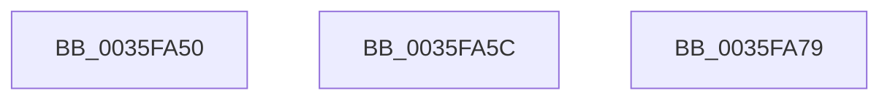

# sub_0035FA50

- RVA: `0x0035FA50`–`0x0035FA7A` (길이 `42` bytes)
- VA: `0x000000014035FA50`
- 실행 섹션: `.text`
- PDB 이름 있음: `아니요`; PDB Function 태그: `아니요`
- unwind 정보 RVA: `0x00079C04`
- 디코드: `15`개 명령, `42/42` bytes 표시
- 미해석 바이트: `0` (있으면 어셈블리에 `.byte`로 보존)

> 이 문서는 커널 이미지의 기계어와 PDB 기호를 분석해 생성했습니다. 4번과 5번은 함수 원형과 자료형을 바이너리 사용 방식에서 추정한 C 해석이며 원본 소스 복구 결과는 아닙니다.

## 1. Dependencies

- 직접 호출 지점: **1**; 고유 호출 대상: **1**
- 직접 호출자로 확인된 함수: **0**
- RIP 상대 이미지 참조: **0**

### Outgoing calls
- `0x0035FA62` → [RtlpHpLargeFree](../2E/RtlpHpLargeFree_function_002EC89C.md) (function, `0x002EC89C`)

### Direct callers
- 이 함수 시작 RVA로 연결되는 직접 call은 확인되지 않았습니다. 간접 호출은 완전히 역산할 수 없습니다.

### Static image references
- 디코드된 RIP-relative 메모리 참조가 없습니다.

## 2. Other-region calls and transfers

- 다른 실행 섹션으로 향하는 call: **0**
- call이 아닌 외부 분기/꼬리 이동: **1**
  - `0x0035FA57` → [RtlpHpFreeHeap + 0x5C](RtlpHpFreeHeap_function_0035F600.md) (`tail-transfer`)

## 3. Assembly (complete function range)

```asm
0035FA50  48 81 C6 C0 00 00 00            add rsi, 0xc0
0035FA57  E9 00 FC FF FF                  jmp 0x14035f65c
0035FA5C  48 8B D7                        mov rdx, rdi
0035FA5F  48 8B CE                        mov rcx, rsi
0035FA62  E8 35 CE F8 FF                  call 0x1402ec89c
0035FA67  33 DB                           xor ebx, ebx
0035FA69  48 85 C0                        test rax, rax
0035FA6C  0F 95 C3                        setne bl
0035FA6F  8B C3                           mov eax, ebx
0035FA71  48 83 C4 50                     add rsp, 0x50
0035FA75  5F                              pop rdi
0035FA76  5E                              pop rsi
0035FA77  5B                              pop rbx
0035FA78  C3                              ret
0035FA79  CC                              int3
```

## 4. C-style interpretation (structured pseudocode)

```c
__int64 __fastcall sub_0035FA50(void)
{
    __int64 v_rsi;

    v_rsi = (v_rsi) + (192);
}
```

## 5. (Beta) C Style

```c
void sub_0035FA50(void)
{
    int64_t local_rsi;

    local_rsi = (local_rsi) + (192);
}
```

## 6. Execution-region graph

[열기: 2D/3D 그래프와 함수 탐색 컨트롤 패널](../../../control-panel.html?section=text&rva=0x0035FA50&view=graph)

- 2D 그래프는 위에서 아래로 흐르고, 3D 그래프는 빈 공간을 드래그해 회전합니다. Shift+드래그는 이동, 휠은 확대·축소, 함수 노드 선택은 대상 보고서 이동입니다.

### Static fallback


