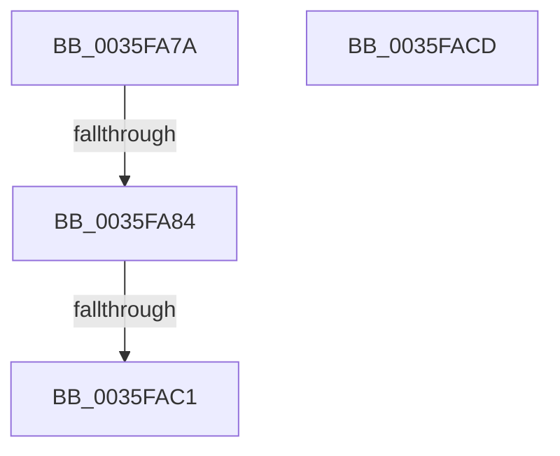

# sub_0035FA7A

- RVA: `0x0035FA7A`–`0x0035FADA` (길이 `96` bytes)
- VA: `0x000000014035FA7A`
- 실행 섹션: `.text`
- PDB 이름 있음: `아니요`; PDB Function 태그: `아니요`
- unwind 정보 RVA: `0x00079C18`
- 디코드: `23`개 명령, `96/96` bytes 표시
- 미해석 바이트: `0` (있으면 어셈블리에 `.byte`로 보존)

> 이 문서는 커널 이미지의 기계어와 PDB 기호를 분석해 생성했습니다. 4번과 5번은 함수 원형과 자료형을 바이너리 사용 방식에서 추정한 C 해석이며 원본 소스 복구 결과는 아닙니다.

## 1. Dependencies

- 직접 호출 지점: **1**; 고유 호출 대상: **1**
- 직접 호출자로 확인된 함수: **0**
- RIP 상대 이미지 참조: **0**

### Outgoing calls
- `0x0035FAD0` → [RtlpHpLfhThreadDataInitializeSet](../4F/RtlpHpLfhThreadDataInitializeSet_function_004F6334.md) (function, `0x004F6334`)

### Direct callers
- 이 함수 시작 RVA로 연결되는 직접 call은 확인되지 않았습니다. 간접 호출은 완전히 역산할 수 없습니다.

### Static image references
- 디코드된 RIP-relative 메모리 참조가 없습니다.

## 2. Other-region calls and transfers

- 다른 실행 섹션으로 향하는 call: **0**
- call이 아닌 외부 분기/꼬리 이동: **4**
  - `0x0035FA7E` → [sub_0035F6BF + 0xFF](Unknown_function_0035F6BF.md) (`tail-transfer`)
  - `0x0035FABB` → [sub_0035F6BF + 0x231](Unknown_function_0035F6BF.md) (`tail-transfer`)
  - `0x0035FAC8` → [sub_0035F65F + 0x46](Unknown_function_0035F65F.md) (`tail-transfer`)
  - `0x0035FAD5` → [sub_0035F6BF + 0xF5](Unknown_function_0035F6BF.md) (`tail-transfer`)

## 3. Assembly (complete function range)

```asm
0035FA7A  44 38 75 16                     cmp byte ptr [rbp + 0x16], r14b
0035FA7E  0F 84 3A FD FF FF               je 0x14035f7be
0035FA84  8B CE                           mov ecx, esi
0035FA86  48 8B C6                        mov rax, rsi
0035FA89  48 C1 E8 06                     shr rax, 6
0035FA8D  83 E1 3F                        and ecx, 0x3f
0035FA90  49 C7 C0 FE FF FF FF            mov r8, 0xfffffffffffffffe
0035FA97  4C 8B CE                        mov r9, rsi
0035FA9A  49 D3 C0                        rol r8, cl
0035FA9D  48 8D 0C C5 00 00 00 00         lea rcx, [rax*8]
0035FAA5  49 8B C0                        mov rax, r8
0035FAA8  48 8B 54 29 40                  mov rdx, qword ptr [rcx + rbp + 0x40]
0035FAAD  49 F7 D0                        not r8
0035FAB0  48 23 C2                        and rax, rdx
0035FAB3  48 89 44 29 40                  mov qword ptr [rcx + rbp + 0x40], rax
0035FAB8  4C 85 C2                        test rdx, r8
0035FABB  0F 84 2F FE FF FF               je 0x14035f8f0
0035FAC1  66 FF 45 20                     inc word ptr [rbp + 0x20]
0035FAC5  41 8B DE                        mov ebx, r14d
0035FAC8  E9 D8 FB FF FF                  jmp 0x14035f6a5
0035FACD  49 8B CF                        mov rcx, r15
0035FAD0  E8 5F 68 19 00                  call 0x1404f6334
0035FAD5  E9 DA FC FF FF                  jmp 0x14035f7b4
```

## 4. C-style interpretation (structured pseudocode)

```c
__int64 __fastcall sub_0035FA7A(void)
{
    __int64 result;

    result = (v_rsi) >> (6);
    a1 = (unsigned int)(((unsigned int)((unsigned int)(v_rsi))) & (63));
    a3 = ~(-2);
    result = (-2) & (*(unsigned __int64 *)(result * 8 + v_rbp * 1 + 64));
    *(unsigned __int64 *)(result * 8 + v_rbp * 1 + 64) = result;
}
```

## 5. (Beta) C Style

```c
void sub_0035FA7A(void)
{
    int64_t result;

    result = (local_rsi) >> (6);
    a1 = (uint32_t)(((uint32_t)((uint32_t)(local_rsi))) & (63));
    a3 = ~(-2);
    result = (-2) & (*(uint64_t *)(result * 8 + local_rbp * 1 + 0x40));
    *(uint64_t *)(result * 8 + local_rbp * 1 + 0x40) = result;
}
```

## 6. Execution-region graph

[열기: 2D/3D 그래프와 함수 탐색 컨트롤 패널](../../../control-panel.html?section=text&rva=0x0035FA7A&view=graph)

- 2D 그래프는 위에서 아래로 흐르고, 3D 그래프는 빈 공간을 드래그해 회전합니다. Shift+드래그는 이동, 휠은 확대·축소, 함수 노드 선택은 대상 보고서 이동입니다.

### Static fallback


