# vDbgPrintExWithPrefixInternalHelper

- RVA: `0x003593C0`–`0x00359700` (길이 `832` bytes)
- VA: `0x00000001403593C0`
- 실행 섹션: `.text`
- PDB 이름 있음: `예`; PDB Function 태그: `예`
- unwind 정보 RVA: `0x00079878`
- 디코드: `211`개 명령, `832/832` bytes 표시
- 미해석 바이트: `0` (있으면 어셈블리에 `.byte`로 보존)

> 이 문서는 커널 이미지의 기계어와 PDB 기호를 분석해 생성했습니다. 4번과 5번은 함수 원형과 자료형을 바이너리 사용 방식에서 추정한 C 해석이며 원본 소스 복구 결과는 아닙니다.

## 1. Dependencies

- 직접 호출 지점: **14**; 고유 호출 대상: **12**
- 직접 호출자로 확인된 함수: **4**
- RIP 상대 이미지 참조: **8**

### Outgoing calls
- `0x0035947E` → [_chkstk](../6B/_chkstk_function_006BA960.md) (function, `0x006BA960`)
- `0x003594B0` → [memcpy](../6C/memcpy_function_006C6840.md) (function, `0x006C6840`)
- `0x003594F1` → [vsnprintf](../4F/vsnprintf_function_004FF050.md) (function, `0x004FF050`)
- `0x003595B7` → [ExAcquireSpinLockSharedAtDpcLevel](../24/ExAcquireSpinLockSharedAtDpcLevel_function_00248E30.md) (function, `0x00248E30`)
- `0x003595DE` → [ExReleaseSpinLockSharedFromDpcLevel](../24/ExReleaseSpinLockSharedFromDpcLevel_function_0024A590.md) (function, `0x0024A590`)
- `0x00359601` → [KiLowerIrqlProcessIrqlFlags](../4F/KiLowerIrqlProcessIrqlFlags_function_004F5698.md) (function, `0x004F5698`)
- `0x00359617` → [DebugPrint](../4F/DebugPrint_function_004FE4F0.md) (function, `0x004FE4F0`)
- `0x00359630` → [_security_check_cookie](../6A/_security_check_cookie_function_006AC640.md) (function, `0x006AC640`)
- `0x0035965F` → [DbgBreakPointWithStatus](../4F/DbgBreakPointWithStatus_function_004FE4E0.md) (function, `0x004FE4E0`)
- `0x00359675` → [KiRaiseIrqlProcessIrqlFlags](../4F/KiRaiseIrqlProcessIrqlFlags_function_004F56FC.md) (function, `0x004F56FC`)
- `0x0035969B` → [ExAcquireRundownProtection](../21/ExAcquireRundownProtection_function_00216620.md) (function, `0x00216620`)
- `0x003596D1` → [ExReleaseSpinLockSharedFromDpcLevel](../24/ExReleaseSpinLockSharedFromDpcLevel_function_0024A590.md) (function, `0x0024A590`)
- `0x003596E7` → [ExReleaseRundownProtection](../34/ExReleaseRundownProtection_function_00349E80.md) (function, `0x00349E80`)
- `0x003596F6` → [ExReleaseRundownProtection](../34/ExReleaseRundownProtection_function_00349E80.md) (function, `0x00349E80`)

### Direct callers
- [vDbgPrintEx](vDbgPrintEx_function_00358C10.md) at `0x00358C64`
- [DbgPrint](DbgPrint_function_00358CB0.md) at `0x00358D05`
- [DbgPrintEx](DbgPrintEx_function_00359290.md) at `0x003592DF`
- [vDbgPrintExWithPrefixInternal](vDbgPrintExWithPrefixInternal_function_00359314.md) at `0x00359377`

### Static image references
- `0x003593E2` → RVA `0x00E0A740` (`.data`; read)
- `0x00359432` → RVA `0x00E0AA50` (`.data`; reference)
- `0x0035943F` → RVA `0x0000AC70` (`.rdata`; read)
- `0x00359571` → RVA `0x00F4754C` (`.data`; read)
- `0x0035957F` → RVA `0x00E67B4C` (`.data`; read)
- `0x003595A4` → RVA `0x00FC6D20` (`ALMOSTRO`; read)
- `0x003595B0` → RVA `0x00E67B48` (`.data`; read)
- `0x003595BC` → RVA `0x00E08810` (`.data`; read)

## 2. Other-region calls and transfers

- 다른 실행 섹션으로 향하는 call: **0**
- call이 아닌 외부 분기/꼬리 이동: **2**
  - `0x003596DD` → [sub_006E2BF8](../6E/Unknown_function_006E2BF8.md) (`tail-transfer`)
  - `0x003596ED` → [sub_006E2BF8](../6E/Unknown_function_006E2BF8.md) (`tail-transfer`)

## 3. Assembly (complete function range)

```asm
003593C0  40 55                           push rbp
003593C2  41 54                           push r12
003593C4  41 55                           push r13
003593C6  41 56                           push r14
003593C8  41 57                           push r15
003593CA  48 83 EC 60                     sub rsp, 0x60
003593CE  48 8D 6C 24 20                  lea rbp, [rsp + 0x20]
003593D3  48 89 5D 70                     mov qword ptr [rbp + 0x70], rbx
003593D7  48 89 75 78                     mov qword ptr [rbp + 0x78], rsi
003593DB  48 89 BD 80 00 00 00            mov qword ptr [rbp + 0x80], rdi
003593E2  48 8B 05 57 13 AB 00            mov rax, qword ptr [rip + 0xab1357]
003593E9  48 33 C5                        xor rax, rbp
003593EC  48 89 45 30                     mov qword ptr [rbp + 0x30], rax
003593F0  4C 89 4D 28                     mov qword ptr [rbp + 0x28], r9
003593F4  44 89 45 00                     mov dword ptr [rbp], r8d
003593F8  44 8B E2                        mov r12d, edx
003593FB  48 8B D1                        mov rdx, rcx
003593FE  0F 57 C0                        xorps xmm0, xmm0
00359401  0F 11 45 10                     movups xmmword ptr [rbp + 0x10], xmm0
00359405  41 BB 65 00 00 00               mov r11d, 0x65
0035940B  41 81 FC 9C 00 00 00            cmp r12d, 0x9c
00359412  45 0F 42 DC                     cmovb r11d, r12d
00359416  41 BA 03 00 00 00               mov r10d, 3
0035941C  45 0F 42 D0                     cmovb r10d, r8d
00359420  41 83 FA 1F                     cmp r10d, 0x1f
00359424  77 0C                           ja 0x140359432
00359426  41 8B CA                        mov ecx, r10d
00359429  41 BA 01 00 00 00               mov r10d, 1
0035942F  41 D3 E2                        shl r10d, cl
00359432  44 85 15 17 16 AB 00            test dword ptr [rip + 0xab1617], r10d
00359439  0F 85 29 02 00 00               jne 0x140359668
0035943F  48 8D 0D 2A 18 CB FF            lea rcx, [rip - 0x34e7d6]
00359446  4A 8B 04 D9                     mov rax, qword ptr [rcx + r11*8]
0035944A  44 85 10                        test dword ptr [rax], r10d
0035944D  0F 85 15 02 00 00               jne 0x140359668
00359453  33 C0                           xor eax, eax
00359455  85 C0                           test eax, eax
00359457  0F 84 28 02 00 00               je 0x140359685
0035945D  44 8B AD A0 00 00 00            mov r13d, dword ptr [rbp + 0xa0]
00359464  45 8B F5                        mov r14d, r13d
00359467  49 8D 45 0F                     lea rax, [r13 + 0xf]
0035946B  49 3B C5                        cmp rax, r13
0035946E  77 0A                           ja 0x14035947a
00359470  48 B8 F0 FF FF FF FF FF FF 0F   movabs rax, 0xffffffffffffff0
0035947A  48 83 E0 F0                     and rax, 0xfffffffffffffff0
0035947E  E8 DD 14 36 00                  call 0x1406ba960
00359483  48 2B E0                        sub rsp, rax
00359486  48 8D 74 24 20                  lea rsi, [rsp + 0x20]
0035948B  48 C7 C1 FF FF FF FF            mov rcx, 0xffffffffffffffff
00359492  48 FF C1                        inc rcx
00359495  80 3C 0A 00                     cmp byte ptr [rdx + rcx], 0
00359499  75 F7                           jne 0x140359492
0035949B  41 8D 45 FF                     lea eax, [r13 - 1]
0035949F  8B D8                           mov ebx, eax
003594A1  8B F8                           mov edi, eax
003594A3  48 3B CB                        cmp rcx, rbx
003594A6  48 0F 46 F9                     cmovbe rdi, rcx
003594AA  4C 8B C7                        mov r8, rdi
003594AD  48 8B CE                        mov rcx, rsi
003594B0  E8 8B D3 36 00                  call 0x1406c6840
003594B5  4C 8D 3C 37                     lea r15, [rdi + rsi]
003594B9  C7 45 04 00 00 00 00            mov dword ptr [rbp + 4], 0
003594C0  4C 2B F7                        sub r14, rdi
003594C3  33 FF                           xor edi, edi
003594C5  49 8D 46 FF                     lea rax, [r14 - 1]
003594C9  48 3D FE FF FF 7F               cmp rax, 0x7ffffffe
003594CF  77 4E                           ja 0x14035951f
003594D1  89 7D 04                        mov dword ptr [rbp + 4], edi
003594D4  85 FF                           test edi, edi
003594D6  78 4E                           js 0x140359526
003594D8  33 FF                           xor edi, edi
003594DA  89 7D 08                        mov dword ptr [rbp + 8], edi
003594DD  49 FF CE                        dec r14
003594E0  4C 8B 8D 90 00 00 00            mov r9, qword ptr [rbp + 0x90]
003594E7  4C 8B 45 28                     mov r8, qword ptr [rbp + 0x28]
003594EB  49 8B D6                        mov rdx, r14
003594EE  49 8B CF                        mov rcx, r15
003594F1  E8 5A 5B 1A 00                  call 0x1404ff050
003594F6  85 C0                           test eax, eax
003594F8  78 0E                           js 0x140359508
003594FA  48 98                           cdqe
003594FC  49 3B C6                        cmp rax, r14
003594FF  77 07                           ja 0x140359508
00359501  74 13                           je 0x140359516
00359503  89 7D 04                        mov dword ptr [rbp + 4], edi
00359506  EB 27                           jmp 0x14035952f
00359508  43 88 3C 3E                     mov byte ptr [r14 + r15], dil
0035950C  BF 05 00 00 80                  mov edi, 0x80000005
00359511  89 7D 08                        mov dword ptr [rbp + 8], edi
00359514  EB ED                           jmp 0x140359503
00359516  43 88 3C 3E                     mov byte ptr [r14 + r15], dil
0035951A  89 7D 04                        mov dword ptr [rbp + 4], edi
0035951D  EB 10                           jmp 0x14035952f
0035951F  BF 0D 00 00 C0                  mov edi, 0xc000000d
00359524  EB AB                           jmp 0x1403594d1
00359526  4D 85 F6                        test r14, r14
00359529  74 04                           je 0x14035952f
0035952B  41 C6 07 00                     mov byte ptr [r15], 0
0035952F  89 7D 20                        mov dword ptr [rbp + 0x20], edi
00359532  EB 05                           jmp 0x140359539
00359534  E9 F0 00 00 00                  jmp 0x140359629
00359539  80 BD A8 00 00 00 00            cmp byte ptr [rbp + 0xa8], 0
00359540  0F 85 43 01 00 00               jne 0x140359689
00359546  81 FF 05 00 00 80               cmp edi, 0x80000005
0035954C  0F 84 67 01 00 00               je 0x1403596b9
00359552  48 C7 C3 FF FF FF FF            mov rbx, 0xffffffffffffffff
00359559  0F 1F 80 00 00 00 00            nop dword ptr [rax]
00359560  48 FF C3                        inc rbx
00359563  80 3C 1E 00                     cmp byte ptr [rsi + rbx], 0
00359567  75 F7                           jne 0x140359560
00359569  48 89 75 18                     mov qword ptr [rbp + 0x18], rsi
0035956D  66 89 5D 10                     mov word ptr [rbp + 0x10], bx
00359571  8B 05 D5 DF BE 00               mov eax, dword ptr [rip + 0xbedfd5]
00359577  A8 03                           test al, 3
00359579  0F 85 00 01 00 00               jne 0x14035967f
0035957F  80 3D C6 E5 B0 00 01            cmp byte ptr [rip + 0xb0e5c6], 1
00359586  0F 85 F3 00 00 00               jne 0x14035967f
0035958C  33 FF                           xor edi, edi
0035958E  44 0F 20 C3                     mov rbx, cr8
00359592  80 FB 0C                        cmp bl, 0xc
00359595  73 19                           jae 0x1403595b0
00359597  44 0F 20 C1                     mov rcx, cr8
0035959B  B8 0C 00 00 00                  mov eax, 0xc
003595A0  44 0F 22 C0                     mov cr8, rax
003595A4  39 3D 76 D7 C6 00               cmp dword ptr [rip + 0xc6d776], edi
003595AA  0F 85 C2 00 00 00               jne 0x140359672
003595B0  48 8D 0D 91 E5 B0 00            lea rcx, [rip + 0xb0e591]
003595B7  E8 74 F8 EE FF                  call 0x140248e30
003595BC  48 8B 35 4D F2 AA 00            mov rsi, qword ptr [rip + 0xaaf24d]
003595C3  48 8D 05 46 F2 AA 00            lea rax, [rip + 0xaaf246]
003595CA  44 8B 6D 00                     mov r13d, dword ptr [rbp]
003595CE  48 3B F0                        cmp rsi, rax
003595D1  0F 85 C0 00 00 00               jne 0x140359697
003595D7  48 8D 0D 6A E5 B0 00            lea rcx, [rip + 0xb0e56a]
003595DE  E8 AD 0F EF FF                  call 0x14024a590
003595E3  48 85 FF                        test rdi, rdi
003595E6  0F 85 06 01 00 00               jne 0x1403596f2
003595EC  80 FB 0C                        cmp bl, 0xc
003595EF  73 1C                           jae 0x14035960d
003595F1  83 3D 28 D7 C6 00 00            cmp dword ptr [rip + 0xc6d728], 0
003595F8  74 0C                           je 0x140359606
003595FA  44 0F 20 C1                     mov rcx, cr8
003595FE  0F B6 D3                        movzx edx, bl
00359601  E8 92 C0 19 00                  call 0x1404f5698
00359606  0F B6 C3                        movzx eax, bl
00359609  44 0F 22 C0                     mov cr8, rax
0035960D  45 8B C5                        mov r8d, r13d
00359610  41 8B D4                        mov edx, r12d
00359613  48 8D 4D 10                     lea rcx, [rbp + 0x10]
00359617  E8 D4 4E 1A 00                  call 0x1404fe4f0
0035961C  8B F8                           mov edi, eax
0035961E  80 BD 98 00 00 00 01            cmp byte ptr [rbp + 0x98], 1
00359625  74 2C                           je 0x140359653
00359627  8B C7                           mov eax, edi
00359629  48 8B 4D 30                     mov rcx, qword ptr [rbp + 0x30]
0035962D  48 33 CD                        xor rcx, rbp
00359630  E8 0B 30 35 00                  call 0x1406ac640
00359635  48 8B 5D 70                     mov rbx, qword ptr [rbp + 0x70]
00359639  48 8B 75 78                     mov rsi, qword ptr [rbp + 0x78]
0035963D  48 8B BD 80 00 00 00            mov rdi, qword ptr [rbp + 0x80]
00359644  48 8D 65 40                     lea rsp, [rbp + 0x40]
00359648  41 5F                           pop r15
0035964A  41 5E                           pop r14
0035964C  41 5D                           pop r13
0035964E  41 5C                           pop r12
00359650  5D                              pop rbp
00359651  C3                              ret
00359652  CC                              int3
00359653  3D 03 00 00 80                  cmp eax, 0x80000003
00359658  75 CD                           jne 0x140359627
0035965A  B9 01 00 00 00                  mov ecx, 1
0035965F  E8 7C 4E 1A 00                  call 0x1404fe4e0
00359664  33 FF                           xor edi, edi
00359666  EB BF                           jmp 0x140359627
00359668  B8 01 00 00 00                  mov eax, 1
0035966D  E9 E3 FD FF FF                  jmp 0x140359455
00359672  0F B6 D0                        movzx edx, al
00359675  E8 82 C0 19 00                  call 0x1404f56fc
0035967A  E9 31 FF FF FF                  jmp 0x1403595b0
0035967F  44 8B 6D 00                     mov r13d, dword ptr [rbp]
00359683  EB 88                           jmp 0x14035960d
00359685  33 C0                           xor eax, eax
00359687  EB A0                           jmp 0x140359629
00359689  81 FF 05 00 00 80               cmp edi, 0x80000005
0035968F  0F 85 B1 FE FF FF               jne 0x140359546
00359695  EB 90                           jmp 0x140359627
00359697  48 8D 4E F0                     lea rcx, [rsi - 0x10]
0035969B  E8 80 CF EB FF                  call 0x140216620
003596A0  84 C0                           test al, al
003596A2  75 26                           jne 0x1403596ca
003596A4  48 8B 36                        mov rsi, qword ptr [rsi]
003596A7  48 8D 05 62 F1 AA 00            lea rax, [rip + 0xaaf162]
003596AE  48 3B F0                        cmp rsi, rax
003596B1  0F 84 20 FF FF FF               je 0x1403595d7
003596B7  EB DE                           jmp 0x140359697
003596B9  41 8D 45 FE                     lea eax, [r13 - 2]
003596BD  C6 04 30 0A                     mov byte ptr [rax + rsi], 0xa
003596C1  C6 04 33 00                     mov byte ptr [rbx + rsi], 0
003596C5  E9 9F FE FF FF                  jmp 0x140359569
003596CA  48 8D 0D 77 E4 B0 00            lea rcx, [rip + 0xb0e477]
003596D1  E8 BA 0E EF FF                  call 0x14024a590
003596D6  4C 8B 7E F8                     mov r15, qword ptr [rsi - 8]
003596DA  48 85 FF                        test rdi, rdi
003596DD  0F 84 15 95 38 00               je 0x1406e2bf8
003596E3  48 8D 4F 08                     lea rcx, [rdi + 8]
003596E7  E8 94 07 FF FF                  call 0x140349e80
003596EC  90                              nop
003596ED  E9 06 95 38 00                  jmp 0x1406e2bf8
003596F2  48 8D 4F 08                     lea rcx, [rdi + 8]
003596F6  E8 85 07 FF FF                  call 0x140349e80
003596FB  E9 EC FE FF FF                  jmp 0x1403595ec
```

## 4. C-style interpretation (structured pseudocode)

```c
__int64 __fastcall vDbgPrintExWithPrefixInternalHelper(__int64 a1, int a2, int a3, __int64 a4, __int64 a5, unsigned __int8 a6, unsigned int a7, unsigned __int8 a8)
{
    __int64 result;
    __int64 v_r10;
    __int64 v_r11;
    __int64 v_r14;
    __int64 v_rbx;
    __int64 v_rdi;
    __int64 v_rsp;
    unsigned __int64 v_stack_m28;
    unsigned __int64 v_stack_m38;
    unsigned __int64 v_stack_m40;
    unsigned int v_stack_m48;
    unsigned __int64 v_stack_m50;
    unsigned __int64 v_stack_m58;
    unsigned int v_stack_m60;
    unsigned int v_stack_m64;
    unsigned __int64 v_stack_m68;
    unsigned __int64 v_stack_p10;
    unsigned __int64 v_stack_p18;
    unsigned __int64 v_stack_p8;

    v_rsp = (v_rsp) - (96);
    v_stack_p8 = v_rbx;
    v_stack_p10 = v_rsi;
    v_stack_p18 = v_rdi;
    result = (*(unsigned __int64 *)(v_rip + 11211607)) ^ (v_stack_m68);
    v_stack_m38 = result;
    v_stack_m40 = a4;
    v_stack_m68 = a3;
    v_stack_m58 = v_xmm0;
    v_r11 = 101;
    if (((unsigned int)((unsigned int)(a2))) < 156) { v_r11 = (unsigned int)((unsigned int)(a2)); }
    v_r10 = 3;
    if (((unsigned int)((unsigned int)(a2))) < 156) { v_r10 = a3; }
    if (((unsigned int)(v_r10)) <= 31) {
        a1 = (unsigned int)(v_r10);
        v_r10 = 1;
        v_r10 = (unsigned int)((v_r10) << ((unsigned __int8)(a1)));
    }
    if (((*(unsigned int *)(v_rip + 11212311)) & ((unsigned int)(v_r10))) != 0) goto loc_00359668;
    if (((*(unsigned int *)(*(unsigned __int64 *)(v_rip - 3467222 + v_r11 * 8))) & ((unsigned int)(v_r10))) != 0) goto loc_00359668;
    result = 0;
loc_00359455:
    if (0 == 0) goto loc_00359685;
    if (((unsigned int)(a7) + 15) <= ((unsigned int)(a7))) {
    }
    result = ((unsigned int)(a7) + 15) & (-16);
    result = _chkstk(v_rip - 3467222, a1, a3, a4);
    v_rsp = (v_rsp) - (result);
loc_00359492:
    a1 = (-1) + 1;
    if ((*(unsigned __int8 *)(a1 + a1 * 1)) != 0) goto loc_00359492;
    v_rdi = (unsigned int)((unsigned int)((unsigned int)(a7) - 1));
    if (a1 <= ((unsigned int)((unsigned int)((unsigned int)(a7) - 1)))) { v_rdi = a1; }
    result = memcpy(v_stack_m68, a1, v_rdi, a4);
    v_stack_m64 = 0;
    v_r14 = ((unsigned int)((unsigned int)((unsigned int)(a7)))) - (v_rdi);
    v_rdi = 0;
    if ((v_r14 - 1) > 0x7FFFFFFEULL) goto loc_0035951F;
loc_003594D1:
    v_stack_m64 = 0;
    if (sign_flag) goto loc_00359526;
    v_rdi = 0;
    v_stack_m60 = 0;
    v_r14 = (v_r14) - 1;
    result = vsnprintf(v_rdi + v_stack_m68 * 1, v_r14, v_stack_m40, a5);
    if (sign_flag) goto loc_00359508;
    if (result > v_r14) goto loc_00359508;
    if (result == v_r14) goto loc_00359516;
loc_00359503:
    v_stack_m64 = 0;
    goto loc_0035952F;
loc_00359508:
    *(unsigned __int8 *)(v_r14 + v_rdi + v_stack_m68 * 1 * 1) = 0;
    v_stack_m60 = (unsigned int)((unsigned int)(0x80000005ULL));
    goto loc_00359503;
loc_00359516:
    *(unsigned __int8 *)(v_r14 + v_rdi + v_stack_m68 * 1 * 1) = (unsigned __int8)((unsigned int)(0x80000005ULL));
    v_stack_m64 = (unsigned int)((unsigned int)(0x80000005ULL));
    goto loc_0035952F;
loc_0035951F:
    goto loc_003594D1;
loc_00359526:
    if (v_r14 != 0) {
        *(unsigned __int8 *)(v_rdi + v_stack_m68 * 1) = 0;
    }
    v_stack_m48 = (unsigned int)((unsigned int)(0xC000000DULL));
    goto loc_00359539;
loc_00359539:
    if (a8 != 0) goto loc_00359689;
loc_00359546:
    if (((unsigned int)((unsigned int)(0xC000000DULL))) == 0x80000005ULL) goto loc_003596B9;
loc_00359560:
    v_rbx = (-1) + 1;
    if ((*(unsigned __int8 *)(v_stack_m68 + v_rbx * 1)) != 0) goto loc_00359560;
loc_00359569:
    v_stack_m50 = v_stack_m68;
    v_stack_m58 = (unsigned __int16)(v_rbx);
    if ((((unsigned __int8)((unsigned int)(*(unsigned int *)(v_rip + 12509141)))) & (3)) != 0) goto loc_0035967F;
    if ((*(unsigned __int8 *)(v_rip + 11593158)) != 1) goto loc_0035967F;
    v_rdi = 0;
    if (((unsigned __int8)(v_cr8)) >= 12) goto loc_003595B0;
    if ((*(unsigned int *)(v_rip + 13031286)) != 0) goto loc_00359672;
loc_003595B0:
    result = ExAcquireSpinLockSharedAtDpcLevel(v_rip + 11593105, v_r14, v_stack_m40, a5);
    if ((*(unsigned __int64 *)(v_rip + 11203149)) != (v_rip + 11203142)) goto loc_00359697;
loc_003595D7:
    result = ExReleaseSpinLockSharedFromDpcLevel(v_rip + 11593066, v_r14, v_stack_m40, a5);
    if (0 != 0) goto loc_003596F2;
loc_003595EC:
    if (((unsigned __int8)(v_cr8)) >= 12) goto loc_0035960D;
    if ((*(unsigned int *)(v_rip + 13031208)) != 0) {
        a1 = 12;
        a2 = (unsigned __int8)(v_cr8);
        result = KiLowerIrqlProcessIrqlFlags(a1, a2, v_stack_m40, a5);
    }
loc_0035960D:
    result = DebugPrint(v_stack_m58, (unsigned int)((unsigned int)((unsigned int)(a2))), (unsigned int)((unsigned int)((unsigned int)(v_stack_m68))), a5);
    if (a6 == 1) goto loc_00359653;
loc_00359627:
loc_00359629:
    a1 = (v_stack_m38) ^ (v_stack_m68);
    result = _security_check_cookie(a1, (unsigned int)((unsigned int)((unsigned int)(a2))), (unsigned int)((unsigned int)((unsigned int)(v_stack_m68))), a5);
    return result;
loc_00359653:
    if (((unsigned int)(result)) != 0x80000003ULL) goto loc_00359627;
    result = DbgBreakPointWithStatus(1, (unsigned int)((unsigned int)((unsigned int)(a2))), (unsigned int)((unsigned int)((unsigned int)(v_stack_m68))), a5);
    v_rdi = 0;
    goto loc_00359627;
loc_00359668:
    goto loc_00359455;
loc_00359672:
    result = KiRaiseIrqlProcessIrqlFlags(1, 1, (unsigned int)((unsigned int)((unsigned int)(v_stack_m68))), a5);
    goto loc_003595B0;
loc_0035967F:
    goto loc_0035960D;
loc_00359685:
    result = 0;
    goto loc_00359629;
loc_00359689:
    if (0 != 0x80000005ULL) goto loc_00359546;
    goto loc_00359627;
loc_00359697:
    result = ExAcquireRundownProtection(v_stack_p10 - 16, 1, (unsigned int)((unsigned int)((unsigned int)(v_stack_m68))), a5);
    if ((unsigned __int8)(result) != 0) goto loc_003596CA;
    if ((*(unsigned __int64 *)(v_stack_p10)) == (v_rip + 11202914)) goto loc_003595D7;
    goto loc_00359697;
loc_003596B9:
    *(unsigned __int8 *)((unsigned int)(v_stack_m68) - 2 + *(unsigned __int64 *)(v_stack_p10) * 1) = 10;
    *(unsigned __int8 *)(v_stack_p8 + *(unsigned __int64 *)(v_stack_p10) * 1) = 0;
    goto loc_00359569;
loc_003596CA:
    result = ExReleaseSpinLockSharedFromDpcLevel(v_rip + 11592823, 1, (unsigned int)((unsigned int)((unsigned int)(v_stack_m68))), a5);
    result = ExReleaseRundownProtection(v_rdi + 8, 1, (unsigned int)((unsigned int)((unsigned int)(v_stack_m68))), a5);
loc_003596F2:
    result = ExReleaseRundownProtection(v_rdi + 8, 1, (unsigned int)((unsigned int)((unsigned int)(v_stack_m68))), a5);
    goto loc_003595EC;
}
```

## 5. (Beta) C Style

```c
int64_t vDbgPrintExWithPrefixInternalHelper(int64_t Arg1, int32_t Arg2, int32_t Arg3, int64_t Arg4, int64_t Arg5, uint8_t Arg6, void *Arg7, uint8_t Arg8)
{
    uint8_t *arg7 = (uint8_t *)Arg7;

    int64_t result;
    int64_t local_r10;
    int64_t local_r11;
    int64_t local_r14;
    int64_t local_rbx;
    int64_t local_rdi;
    int64_t local_rsp;
    uint64_t v_stack_m28;
    uint64_t v_stack_m38;
    uint64_t v_stack_m40;
    uint32_t v_stack_m48;
    uint64_t v_stack_m50;
    uint64_t v_stack_m58;
    uint32_t v_stack_m60;
    uint32_t v_stack_m64;
    uint64_t v_stack_m68;
    uint64_t v_stack_p10;
    uint64_t v_stack_p18;
    uint64_t v_stack_p8;

    local_rsp = (local_rsp) - (96);
    v_stack_p8 = local_rbx;
    v_stack_p10 = local_rsi;
    v_stack_p18 = local_rdi;
    result = (*(uint64_t *)(v_rip + 0xAB1357)) ^ (v_stack_m68);
    v_stack_m38 = result;
    v_stack_m40 = Arg4;
    v_stack_m68 = Arg3;
    v_stack_m58 = v_xmm0;
    local_r11 = 101;
    if (((uint32_t)((uint32_t)(Arg2))) < 156) { local_r11 = (uint32_t)((uint32_t)(Arg2)); }
    local_r10 = 3;
    if (((uint32_t)((uint32_t)(Arg2))) < 156) { local_r10 = Arg3; }
    if (((uint32_t)(local_r10)) <= 31) {
        Arg1 = (uint32_t)(local_r10);
        local_r10 = 1;
        local_r10 = (uint32_t)((local_r10) << ((uint8_t)(Arg1)));
    }
    if (((*(uint32_t *)(v_rip + 0xAB1617)) & ((uint32_t)(local_r10))) != 0) goto loc_00359668;
    if (((*(uint32_t *)(*(uint64_t *)(v_rip - 0x34E7D6 + local_r11 * 8))) & ((uint32_t)(local_r10))) != 0) goto loc_00359668;
    result = 0;
loc_00359455:
    if (0 == 0) goto loc_00359685;
    if (((uint32_t)(Arg7) + 15) <= ((uint32_t)(Arg7))) {
    }
    result = ((uint32_t)(Arg7) + 15) & (-16);
    result = _chkstk(v_rip - 3467222, Arg1, Arg3, Arg4);
    local_rsp = (local_rsp) - (result);
loc_00359492:
    Arg1 = (-1) + 1;
    if ((*(uint8_t *)(Arg1 + Arg1 * 1)) != 0) goto loc_00359492;
    local_rdi = (uint32_t)((uint32_t)((uint32_t)(Arg7) - 1));
    if (Arg1 <= ((uint32_t)((uint32_t)((uint32_t)(Arg7) - 1)))) { local_rdi = Arg1; }
    result = memcpy(v_stack_m68, Arg1, local_rdi, Arg4);
    v_stack_m64 = 0;
    local_r14 = ((uint32_t)((uint32_t)((uint32_t)(Arg7)))) - (local_rdi);
    local_rdi = 0;
    if ((local_r14 - 1) > 0x7FFFFFFEULL) goto loc_0035951F;
loc_003594D1:
    v_stack_m64 = 0;
    if (sign_flag) goto loc_00359526;
    local_rdi = 0;
    v_stack_m60 = 0;
    local_r14 = (local_r14) - 1;
    result = vsnprintf(local_rdi + v_stack_m68 * 1, local_r14, v_stack_m40, Arg5);
    if (sign_flag) goto loc_00359508;
    if (result > local_r14) goto loc_00359508;
    if (result == local_r14) goto loc_00359516;
loc_00359503:
    v_stack_m64 = 0;
    goto loc_0035952F;
loc_00359508:
    *(uint8_t *)(local_r14 + local_rdi + v_stack_m68 * 1 * 1) = 0;
    v_stack_m60 = (uint32_t)((uint32_t)(0x80000005ULL));
    goto loc_00359503;
loc_00359516:
    *(uint8_t *)(local_r14 + local_rdi + v_stack_m68 * 1 * 1) = (uint8_t)((uint32_t)(0x80000005ULL));
    v_stack_m64 = (uint32_t)((uint32_t)(0x80000005ULL));
    goto loc_0035952F;
loc_0035951F:
    goto loc_003594D1;
loc_00359526:
    if (local_r14 != 0) {
        *(uint8_t *)(local_rdi + v_stack_m68 * 1) = 0;
    }
    v_stack_m48 = (uint32_t)((uint32_t)(0xC000000DULL));
    goto loc_00359539;
loc_00359539:
    if (Arg8 != 0) goto loc_00359689;
loc_00359546:
    if (((uint32_t)((uint32_t)(0xC000000DULL))) == 0x80000005ULL) goto loc_003596B9;
loc_00359560:
    local_rbx = (-1) + 1;
    if ((*(uint8_t *)(v_stack_m68 + local_rbx * 1)) != 0) goto loc_00359560;
loc_00359569:
    v_stack_m50 = v_stack_m68;
    v_stack_m58 = (uint16_t)(local_rbx);
    if ((((uint8_t)((uint32_t)(*(uint32_t *)(v_rip + 0xBEDFD5)))) & (3)) != 0) goto loc_0035967F;
    if ((*(uint8_t *)(v_rip + 0xB0E5C6)) != 1) goto loc_0035967F;
    local_rdi = 0;
    if (((uint8_t)(v_cr8)) >= 12) goto loc_003595B0;
    if ((*(uint32_t *)(v_rip + 0xC6D776)) != 0) goto loc_00359672;
loc_003595B0:
    result = ExAcquireSpinLockSharedAtDpcLevel(v_rip + 11593105, local_r14, v_stack_m40, Arg5);
    if ((*(uint64_t *)(v_rip + 0xAAF24D)) != (v_rip + 11203142)) goto loc_00359697;
loc_003595D7:
    result = ExReleaseSpinLockSharedFromDpcLevel(v_rip + 11593066, local_r14, v_stack_m40, Arg5);
    if (0 != 0) goto loc_003596F2;
loc_003595EC:
    if (((uint8_t)(v_cr8)) >= 12) goto loc_0035960D;
    if ((*(uint32_t *)(v_rip + 0xC6D728)) != 0) {
        Arg1 = 12;
        Arg2 = (uint8_t)(v_cr8);
        result = KiLowerIrqlProcessIrqlFlags(Arg1, Arg2, v_stack_m40, Arg5);
    }
loc_0035960D:
    result = DebugPrint(v_stack_m58, (uint32_t)((uint32_t)((uint32_t)(Arg2))), (uint32_t)((uint32_t)((uint32_t)(v_stack_m68))), Arg5);
    if (Arg6 == 1) goto loc_00359653;
loc_00359627:
loc_00359629:
    Arg1 = (v_stack_m38) ^ (v_stack_m68);
    result = _security_check_cookie(Arg1, (uint32_t)((uint32_t)((uint32_t)(Arg2))), (uint32_t)((uint32_t)((uint32_t)(v_stack_m68))), Arg5);
    return result;
loc_00359653:
    if (((uint32_t)(result)) != 0x80000003ULL) goto loc_00359627;
    result = DbgBreakPointWithStatus(1, (uint32_t)((uint32_t)((uint32_t)(Arg2))), (uint32_t)((uint32_t)((uint32_t)(v_stack_m68))), Arg5);
    local_rdi = 0;
    goto loc_00359627;
loc_00359668:
    goto loc_00359455;
loc_00359672:
    result = KiRaiseIrqlProcessIrqlFlags(1, 1, (uint32_t)((uint32_t)((uint32_t)(v_stack_m68))), Arg5);
    goto loc_003595B0;
loc_0035967F:
    goto loc_0035960D;
loc_00359685:
    result = 0;
    goto loc_00359629;
loc_00359689:
    if (0 != 0x80000005ULL) goto loc_00359546;
    goto loc_00359627;
loc_00359697:
    result = ExAcquireRundownProtection(v_stack_p10 - 16, 1, (uint32_t)((uint32_t)((uint32_t)(v_stack_m68))), Arg5);
    if ((uint8_t)(result) != 0) goto loc_003596CA;
    if ((*(uint64_t *)(v_stack_p10)) == (v_rip + 11202914)) goto loc_003595D7;
    goto loc_00359697;
loc_003596B9:
    *(uint8_t *)((uint32_t)(v_stack_m68) - 0x2 + *(uint64_t *)(v_stack_p10) * 1) = 10;
    *(uint8_t *)(v_stack_p8 + *(uint64_t *)(v_stack_p10) * 1) = 0;
    goto loc_00359569;
loc_003596CA:
    result = ExReleaseSpinLockSharedFromDpcLevel(v_rip + 11592823, 1, (uint32_t)((uint32_t)((uint32_t)(v_stack_m68))), Arg5);
    result = ExReleaseRundownProtection(local_rdi + 8, 1, (uint32_t)((uint32_t)((uint32_t)(v_stack_m68))), Arg5);
loc_003596F2:
    result = ExReleaseRundownProtection(local_rdi + 8, 1, (uint32_t)((uint32_t)((uint32_t)(v_stack_m68))), Arg5);
    goto loc_003595EC;
}
```

### 관측된 메모리 오프셋

구조체 형식이 확인되지 않은 접근은 인자 기준의 오프셋으로만 기록했습니다.

| 기준 인자 | 오프셋 표현 | 폭 (bit) | 접근 |
|---|---:|---:|---|
| `Arg7` | `- 0x2` | `32` | `R` |
| `Arg7` | `- 0x1` | `32` | `R` |
| `Arg7` | `- 0x1` | `64` | `R` |
| `Arg7` | `+ 0x0 + rsi*1` | `8` | `W` |
| `Arg7` | `+ 0xF` | `64` | `R` |

## 6. Execution-region graph

[열기: 2D/3D 그래프와 함수 탐색 컨트롤 패널](../../../control-panel.html?section=text&rva=0x003593C0&view=graph)

- 2D 그래프는 위에서 아래로 흐르고, 3D 그래프는 빈 공간을 드래그해 회전합니다. Shift+드래그는 이동, 휠은 확대·축소, 함수 노드 선택은 대상 보고서 이동입니다.

### Static fallback

```mermaid
flowchart TD
  bb_003593C0[BB_003593C0]
  bb_00359426[BB_00359426]
  bb_00359432[BB_00359432]
  bb_0035943F[BB_0035943F]
  bb_00359453[BB_00359453]
  bb_00359455[BB_00359455]
  bb_0035945D[BB_0035945D]
  bb_00359470[BB_00359470]
  bb_0035947A[BB_0035947A]
  bb_00359492[BB_00359492]
  bb_0035949B[BB_0035949B]
  bb_003594D1[BB_003594D1]
  bb_003594D8[BB_003594D8]
  bb_003594FA[BB_003594FA]
  bb_00359501[BB_00359501]
  bb_00359503[BB_00359503]
  bb_00359508[BB_00359508]
  bb_00359516[BB_00359516]
  bb_0035951F[BB_0035951F]
  bb_00359526[BB_00359526]
  bb_0035952B[BB_0035952B]
  bb_0035952F[BB_0035952F]
  bb_00359534[BB_00359534]
  bb_00359539[BB_00359539]
  bb_00359546[BB_00359546]
  bb_00359552[BB_00359552]
  bb_00359560[BB_00359560]
  bb_00359569[BB_00359569]
  bb_0035957F[BB_0035957F]
  bb_0035958C[BB_0035958C]
  bb_00359597[BB_00359597]
  bb_003595B0[BB_003595B0]
  bb_003595D7[BB_003595D7]
  bb_003595EC[BB_003595EC]
  bb_003595F1[BB_003595F1]
  bb_003595FA[BB_003595FA]
  bb_00359606[BB_00359606]
  bb_0035960D[BB_0035960D]
  bb_00359627[BB_00359627]
  bb_00359629[BB_00359629]
  bb_00359652[BB_00359652]
  bb_00359653[BB_00359653]
  bb_0035965A[BB_0035965A]
  bb_00359668[BB_00359668]
  bb_00359672[BB_00359672]
  bb_0035967F[BB_0035967F]
  bb_00359685[BB_00359685]
  bb_00359689[BB_00359689]
  bb_00359695[BB_00359695]
  bb_00359697[BB_00359697]
  bb_003596A4[BB_003596A4]
  bb_003596B7[BB_003596B7]
  bb_003596B9[BB_003596B9]
  bb_003596CA[BB_003596CA]
  bb_003596E3[BB_003596E3]
  bb_003596F2[BB_003596F2]
  bb_003593C0 -->|branch| bb_00359432
  bb_003593C0 -->|fallthrough| bb_00359426
  bb_00359426 -->|flow| bb_00359432
  bb_00359432 -->|branch| bb_00359668
  bb_00359432 -->|fallthrough| bb_0035943F
  bb_0035943F -->|branch| bb_00359668
  bb_0035943F -->|fallthrough| bb_00359453
  bb_00359453 -->|flow| bb_00359455
  bb_00359455 -->|branch| bb_00359685
  bb_00359455 -->|fallthrough| bb_0035945D
  bb_0035945D -->|branch| bb_0035947A
  bb_0035945D -->|fallthrough| bb_00359470
  bb_00359470 -->|flow| bb_0035947A
  bb_0035947A -->|flow| bb_00359492
  bb_00359492 -->|branch| bb_00359492
  bb_00359492 -->|fallthrough| bb_0035949B
  bb_0035949B -->|branch| bb_0035951F
  bb_0035949B -->|fallthrough| bb_003594D1
  bb_003594D1 -->|branch| bb_00359526
  bb_003594D1 -->|fallthrough| bb_003594D8
  bb_003594D8 -->|branch| bb_00359508
  bb_003594D8 -->|fallthrough| bb_003594FA
  bb_003594FA -->|branch| bb_00359508
  bb_003594FA -->|fallthrough| bb_00359501
  bb_00359501 -->|branch| bb_00359516
  bb_00359501 -->|fallthrough| bb_00359503
  bb_00359503 -->|branch| bb_0035952F
  bb_00359508 -->|branch| bb_00359503
  bb_00359516 -->|branch| bb_0035952F
  bb_0035951F -->|branch| bb_003594D1
  bb_00359526 -->|branch| bb_0035952F
  bb_00359526 -->|fallthrough| bb_0035952B
  bb_0035952B -->|flow| bb_0035952F
  bb_0035952F -->|branch| bb_00359539
  bb_00359534 -->|branch| bb_00359629
  bb_00359539 -->|branch| bb_00359689
  bb_00359539 -->|fallthrough| bb_00359546
  bb_00359546 -->|branch| bb_003596B9
  bb_00359546 -->|fallthrough| bb_00359552
  bb_00359552 -->|flow| bb_00359560
  bb_00359560 -->|branch| bb_00359560
  bb_00359560 -->|fallthrough| bb_00359569
  bb_00359569 -->|branch| bb_0035967F
  bb_00359569 -->|fallthrough| bb_0035957F
  bb_0035957F -->|branch| bb_0035967F
  bb_0035957F -->|fallthrough| bb_0035958C
  bb_0035958C -->|branch| bb_003595B0
  bb_0035958C -->|fallthrough| bb_00359597
  bb_00359597 -->|branch| bb_00359672
  bb_00359597 -->|fallthrough| bb_003595B0
  bb_003595B0 -->|branch| bb_00359697
  bb_003595B0 -->|fallthrough| bb_003595D7
  bb_003595D7 -->|branch| bb_003596F2
  bb_003595D7 -->|fallthrough| bb_003595EC
  bb_003595EC -->|branch| bb_0035960D
  bb_003595EC -->|fallthrough| bb_003595F1
  bb_003595F1 -->|branch| bb_00359606
  bb_003595F1 -->|fallthrough| bb_003595FA
  bb_003595FA -->|flow| bb_00359606
  bb_00359606 -->|flow| bb_0035960D
  bb_0035960D -->|branch| bb_00359653
  bb_0035960D -->|fallthrough| bb_00359627
  bb_00359627 -->|flow| bb_00359629
  bb_00359652 -->|flow| bb_00359653
  bb_00359653 -->|branch| bb_00359627
  bb_00359653 -->|fallthrough| bb_0035965A
  bb_0035965A -->|branch| bb_00359627
  bb_00359668 -->|branch| bb_00359455
  bb_00359672 -->|branch| bb_003595B0
  bb_0035967F -->|branch| bb_0035960D
  bb_00359685 -->|branch| bb_00359629
  bb_00359689 -->|branch| bb_00359546
  bb_00359689 -->|fallthrough| bb_00359695
  bb_00359695 -->|branch| bb_00359627
  bb_00359697 -->|branch| bb_003596CA
  bb_00359697 -->|fallthrough| bb_003596A4
  bb_003596A4 -->|branch| bb_003595D7
  bb_003596A4 -->|fallthrough| bb_003596B7
  bb_003596B7 -->|branch| bb_00359697
  bb_003596B9 -->|branch| bb_00359569
  bb_003596CA -->|fallthrough| bb_003596E3
  bb_003596F2 -->|branch| bb_003595EC
```


