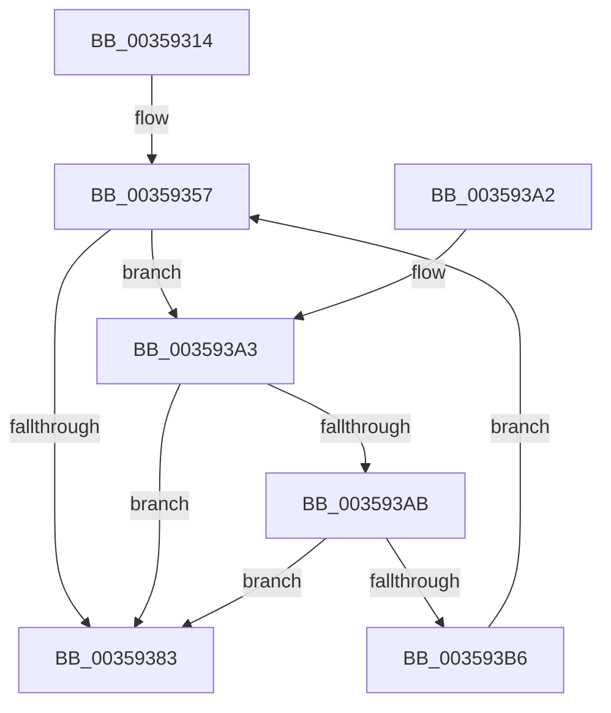

# vDbgPrintExWithPrefixInternal

- RVA: `0x00359314`–`0x003593B8` (길이 `164` bytes)
- VA: `0x0000000140359314`
- 실행 섹션: `.text`
- PDB 이름 있음: `예`; PDB Function 태그: `아니요`
- unwind 정보 RVA: `0x00079858`
- 디코드: `45`개 명령, `164/164` bytes 표시
- 미해석 바이트: `0` (있으면 어셈블리에 `.byte`로 보존)

> 이 문서는 커널 이미지의 기계어와 PDB 기호를 분석해 생성했습니다. 4번과 5번은 함수 원형과 자료형을 바이너리 사용 방식에서 추정한 C 해석이며 원본 소스 복구 결과는 아닙니다.

## 1. Dependencies

- 직접 호출 지점: **1**; 고유 호출 대상: **1**
- 직접 호출자로 확인된 함수: **8**
- RIP 상대 이미지 참조: **0**

### Outgoing calls
- `0x00359377` → [vDbgPrintExWithPrefixInternalHelper](vDbgPrintExWithPrefixInternalHelper_function_003593C0.md) (function, `0x003593C0`)

### Direct callers
- [PopPrintEx](../48/PopPrintEx_function_0048EF24.md) at `0x0048EF56`
- [vDbgPrintExWithPrefix](../4B/vDbgPrintExWithPrefix_function_004B0B00.md) at `0x004B0B13`
- [KsepDebugPrint](../4D/KsepDebugPrint_function_004DCFF0.md) at `0x004DD021`
- [IopDebugPrint](../5A/IopDebugPrint_function_005A68F8.md) at `0x005A692D`
- [DbgPrintReturnControlC](../5E/DbgPrintReturnControlC_function_005E5830.md) at `0x005E5865`
- [VfUtilDbgPrint](../61/VfUtilDbgPrint_function_006122AC.md) at `0x006122E1`
- [DifUtilDbgPrint](../61/DifUtilDbgPrint_function_00619B70.md) at `0x00619BB9`
- [CarpDbgPrint](../61/CarpDbgPrint_function_0061B7B4.md) at `0x0061B7F1`

### Static image references
- 디코드된 RIP-relative 메모리 참조가 없습니다.

## 2. Other-region calls and transfers

- 다른 실행 섹션으로 향하는 call: **0**
- 별도 외부 분기/꼬리 이동을 확인하지 못했습니다.

## 3. Assembly (complete function range)

```asm
00359314  48 8B C4                        mov rax, rsp
00359317  48 89 58 08                     mov qword ptr [rax + 8], rbx
0035931B  48 89 68 10                     mov qword ptr [rax + 0x10], rbp
0035931F  48 89 70 18                     mov qword ptr [rax + 0x18], rsi
00359323  48 89 78 20                     mov qword ptr [rax + 0x20], rdi
00359327  41 54                           push r12
00359329  41 56                           push r14
0035932B  41 57                           push r15
0035932D  48 83 EC 40                     sub rsp, 0x40
00359331  44 8A BC 24 88 00 00 00         mov r15b, byte ptr [rsp + 0x88]
00359339  BB 80 00 00 00                  mov ebx, 0x80
0035933E  4C 8B A4 24 80 00 00 00         mov r12, qword ptr [rsp + 0x80]
00359346  81 FB 00 02 00 00               cmp ebx, 0x200
0035934C  49 8B F9                        mov rdi, r9
0035934F  41 8B F0                        mov esi, r8d
00359352  8B EA                           mov ebp, edx
00359354  4C 8B F1                        mov r14, rcx
00359357  0F 92 C0                        setb al
0035935A  4C 8B CF                        mov r9, rdi
0035935D  88 44 24 38                     mov byte ptr [rsp + 0x38], al
00359361  44 8B C6                        mov r8d, esi
00359364  89 5C 24 30                     mov dword ptr [rsp + 0x30], ebx
00359368  8B D5                           mov edx, ebp
0035936A  44 88 7C 24 28                  mov byte ptr [rsp + 0x28], r15b
0035936F  49 8B CE                        mov rcx, r14
00359372  4C 89 64 24 20                  mov qword ptr [rsp + 0x20], r12
00359377  E8 44 00 00 00                  call 0x1403593c0
0035937C  3D 05 00 00 80                  cmp eax, 0x80000005
00359381  74 20                           je 0x1403593a3
00359383  48 8B 5C 24 60                  mov rbx, qword ptr [rsp + 0x60]
00359388  48 8B 6C 24 68                  mov rbp, qword ptr [rsp + 0x68]
0035938D  48 8B 74 24 70                  mov rsi, qword ptr [rsp + 0x70]
00359392  48 8B 7C 24 78                  mov rdi, qword ptr [rsp + 0x78]
00359397  48 83 C4 40                     add rsp, 0x40
0035939B  41 5F                           pop r15
0035939D  41 5E                           pop r14
0035939F  41 5C                           pop r12
003593A1  C3                              ret
003593A2  CC                              int3
003593A3  81 FB 00 02 00 00               cmp ebx, 0x200
003593A9  73 D8                           jae 0x140359383
003593AB  83 EB 80                        sub ebx, -0x80
003593AE  81 FB 00 02 00 00               cmp ebx, 0x200
003593B4  77 CD                           ja 0x140359383
003593B6  EB 9F                           jmp 0x140359357
```

## 4. C-style interpretation (structured pseudocode)

```c
__int64 __fastcall vDbgPrintExWithPrefixInternal(__int64 a1, int a2, int a3, __int64 a4, __int64 a5, unsigned __int8 a6)
{
    __int64 result;
    __int64 v_rbx;
    __int64 v_rsp;
    unsigned __int8 v_stack_m20;
    unsigned int v_stack_m28;
    unsigned __int8 v_stack_m30;
    unsigned __int64 v_stack_m38;
    unsigned __int64 v_stack_p10;
    unsigned __int64 v_stack_p18;
    unsigned __int64 v_stack_p20;
    unsigned __int64 v_stack_p8;

    *(unsigned __int64 *)(v_rsp + 8) = v_rbx;
    *(unsigned __int64 *)(v_rsp + 16) = v_rbp;
    *(unsigned __int64 *)(v_rsp + 24) = v_rsi;
    *(unsigned __int64 *)(v_rsp + 32) = v_rdi;
    v_rsp = (v_rsp) - (64);
loc_00359357:
    result = (128 < 512) ? 1 : 0;
    v_stack_m20 = (unsigned __int8)(result);
    v_stack_m28 = 128;
    v_stack_m30 = a6;
    v_stack_m38 = a5;
    result = vDbgPrintExWithPrefixInternalHelper(a1, (unsigned int)((unsigned int)((unsigned int)(a2))), (unsigned int)((unsigned int)((unsigned int)(a3))), a4);
    if (((unsigned int)(result)) == 0x80000005ULL) goto loc_003593A3;
loc_00359383:
    v_rsp = (v_rsp) + (64);
    return result;
loc_003593A3:
    if (((unsigned int)(v_stack_p8)) >= 512) goto loc_00359383;
    v_rbx = (unsigned int)((v_stack_p8) - (-128));
    if (((unsigned int)(v_rbx)) > 512) goto loc_00359383;
    goto loc_00359357;
}
```

## 5. (Beta) C Style

```c
int64_t vDbgPrintExWithPrefixInternal(int64_t Arg1, int32_t Arg2, int32_t Arg3, int64_t Arg4, int64_t Arg5, uint8_t Arg6)
{
    int64_t result;
    int64_t local_rbx;
    int64_t local_rsp;
    uint8_t v_stack_m20;
    uint32_t v_stack_m28;
    uint8_t v_stack_m30;
    uint64_t v_stack_m38;
    uint64_t v_stack_p10;
    uint64_t v_stack_p18;
    uint64_t v_stack_p20;
    uint64_t v_stack_p8;

    *(uint64_t *)(local_rsp + 0x8) = local_rbx;
    *(uint64_t *)(local_rsp + 0x10) = local_rbp;
    *(uint64_t *)(local_rsp + 0x18) = local_rsi;
    *(uint64_t *)(local_rsp + 0x20) = local_rdi;
    local_rsp = (local_rsp) - (64);
loc_00359357:
    result = (128 < 512) ? 1 : 0;
    v_stack_m20 = (uint8_t)(result);
    v_stack_m28 = 128;
    v_stack_m30 = Arg6;
    v_stack_m38 = Arg5;
    result = vDbgPrintExWithPrefixInternalHelper(Arg1, (uint32_t)((uint32_t)((uint32_t)(Arg2))), (uint32_t)((uint32_t)((uint32_t)(Arg3))), Arg4);
    if (((uint32_t)(result)) == 0x80000005ULL) goto loc_003593A3;
loc_00359383:
    local_rsp = (local_rsp) + (64);
    return result;
loc_003593A3:
    if (((uint32_t)(v_stack_p8)) >= 512) goto loc_00359383;
    local_rbx = (uint32_t)((v_stack_p8) - (-128));
    if (((uint32_t)(local_rbx)) > 512) goto loc_00359383;
    goto loc_00359357;
}
```

## 6. Execution-region graph

[열기: 2D/3D 그래프와 함수 탐색 컨트롤 패널](../../../control-panel.html?section=text&rva=0x00359314&view=graph)

- 2D 그래프는 위에서 아래로 흐르고, 3D 그래프는 빈 공간을 드래그해 회전합니다. Shift+드래그는 이동, 휠은 확대·축소, 함수 노드 선택은 대상 보고서 이동입니다.

### Static fallback


