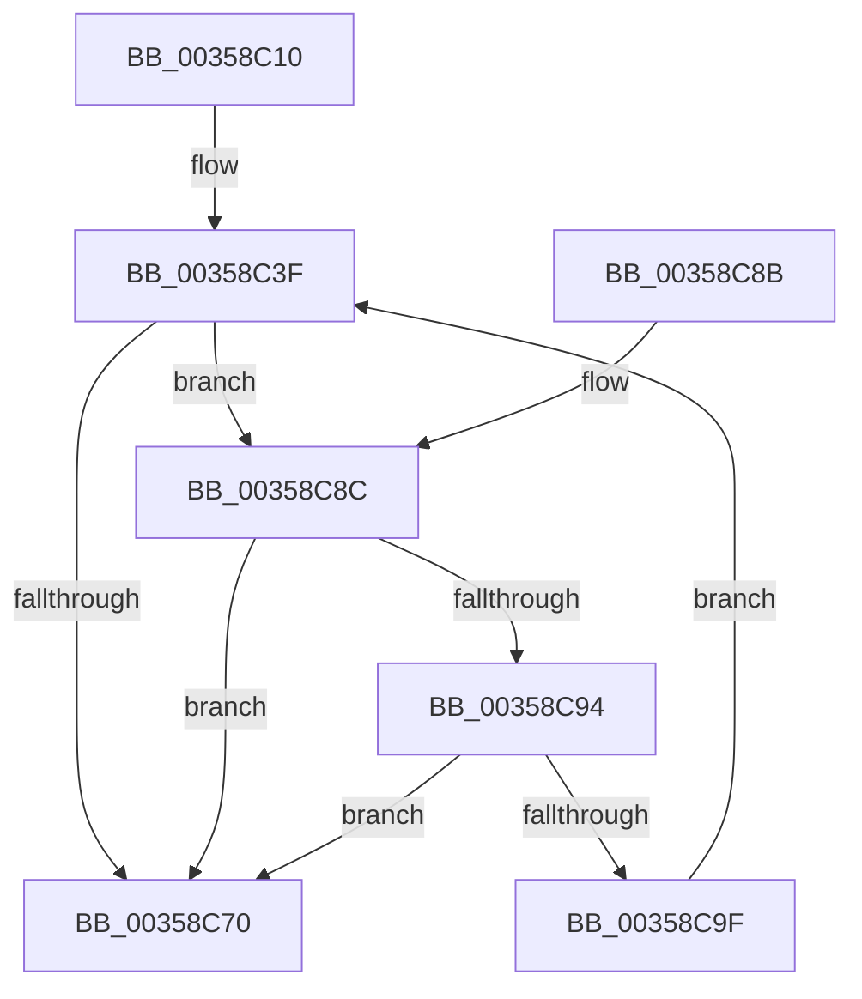

# vDbgPrintEx

- RVA: `0x00358C10`–`0x00358CA1` (길이 `145` bytes)
- VA: `0x0000000140358C10`
- 실행 섹션: `.text`
- PDB 이름 있음: `예`; PDB Function 태그: `아니요`
- unwind 정보 RVA: `0x000797B8`
- 디코드: `39`개 명령, `145/145` bytes 표시
- 미해석 바이트: `0` (있으면 어셈블리에 `.byte`로 보존)

> 이 문서는 커널 이미지의 기계어와 PDB 기호를 분석해 생성했습니다. 4번과 5번은 함수 원형과 자료형을 바이너리 사용 방식에서 추정한 C 해석이며 원본 소스 복구 결과는 아닙니다.

## 1. Dependencies

- 직접 호출 지점: **1**; 고유 호출 대상: **1**
- 직접 호출자로 확인된 함수: **0**
- RIP 상대 이미지 참조: **1**

### Outgoing calls
- `0x00358C64` → [vDbgPrintExWithPrefixInternalHelper](vDbgPrintExWithPrefixInternalHelper_function_003593C0.md) (function, `0x003593C0`)

### Direct callers
- 이 함수 시작 RVA로 연결되는 직접 call은 확인되지 않았습니다. 간접 호출은 완전히 역산할 수 없습니다.

### Static image references
- `0x00358C42` → RVA `0x006C7800` (` ?? ::FNODOBFM::`string'`; read)

## 2. Other-region calls and transfers

- 다른 실행 섹션으로 향하는 call: **0**
- 별도 외부 분기/꼬리 이동을 확인하지 못했습니다.

## 3. Assembly (complete function range)

```asm
00358C10  48 8B C4                        mov rax, rsp
00358C13  48 89 58 08                     mov qword ptr [rax + 8], rbx
00358C17  48 89 68 10                     mov qword ptr [rax + 0x10], rbp
00358C1B  48 89 70 18                     mov qword ptr [rax + 0x18], rsi
00358C1F  48 89 78 20                     mov qword ptr [rax + 0x20], rdi
00358C23  41 56                           push r14
00358C25  48 83 EC 40                     sub rsp, 0x40
00358C29  BB 80 00 00 00                  mov ebx, 0x80
00358C2E  49 8B F9                        mov rdi, r9
00358C31  81 FB 00 02 00 00               cmp ebx, 0x200
00358C37  49 8B F0                        mov rsi, r8
00358C3A  8B EA                           mov ebp, edx
00358C3C  44 8B F1                        mov r14d, ecx
00358C3F  0F 92 C0                        setb al
00358C42  48 8D 0D B7 EB 36 00            lea rcx, [rip + 0x36ebb7]
00358C49  88 44 24 38                     mov byte ptr [rsp + 0x38], al
00358C4D  4C 8B CE                        mov r9, rsi
00358C50  89 5C 24 30                     mov dword ptr [rsp + 0x30], ebx
00358C54  44 8B C5                        mov r8d, ebp
00358C57  C6 44 24 28 01                  mov byte ptr [rsp + 0x28], 1
00358C5C  41 8B D6                        mov edx, r14d
00358C5F  48 89 7C 24 20                  mov qword ptr [rsp + 0x20], rdi
00358C64  E8 57 07 00 00                  call 0x1403593c0
00358C69  3D 05 00 00 80                  cmp eax, 0x80000005
00358C6E  74 1C                           je 0x140358c8c
00358C70  48 8B 5C 24 50                  mov rbx, qword ptr [rsp + 0x50]
00358C75  48 8B 6C 24 58                  mov rbp, qword ptr [rsp + 0x58]
00358C7A  48 8B 74 24 60                  mov rsi, qword ptr [rsp + 0x60]
00358C7F  48 8B 7C 24 68                  mov rdi, qword ptr [rsp + 0x68]
00358C84  48 83 C4 40                     add rsp, 0x40
00358C88  41 5E                           pop r14
00358C8A  C3                              ret
00358C8B  CC                              int3
00358C8C  81 FB 00 02 00 00               cmp ebx, 0x200
00358C92  73 DC                           jae 0x140358c70
00358C94  83 EB 80                        sub ebx, -0x80
00358C97  81 FB 00 02 00 00               cmp ebx, 0x200
00358C9D  77 D1                           ja 0x140358c70
00358C9F  EB 9E                           jmp 0x140358c3f
```

## 4. C-style interpretation (structured pseudocode)

```c
__int64 __fastcall vDbgPrintEx(int a1, int a2, __int64 a3, __int64 a4)
{
    __int64 result;
    __int64 v_rbx;
    __int64 v_rsp;
    unsigned __int8 v_stack_m10;
    unsigned int v_stack_m18;
    unsigned __int8 v_stack_m20;
    unsigned __int64 v_stack_m28;
    unsigned __int64 v_stack_p10;
    unsigned __int64 v_stack_p18;
    unsigned __int64 v_stack_p20;
    unsigned __int64 v_stack_p8;

    *(unsigned __int64 *)(v_rsp + 8) = v_rbx;
    *(unsigned __int64 *)(v_rsp + 16) = v_rbp;
    *(unsigned __int64 *)(v_rsp + 24) = v_rsi;
    *(unsigned __int64 *)(v_rsp + 32) = v_rdi;
    v_rsp = (v_rsp) - (64);
loc_00358C3F:
    result = (128 < 512) ? 1 : 0;
    v_stack_m10 = (unsigned __int8)(result);
    v_stack_m18 = 128;
    v_stack_m20 = 1;
    v_stack_m28 = a4;
    result = vDbgPrintExWithPrefixInternalHelper(v_rip + 3599287, (unsigned int)((unsigned int)((unsigned int)(a1))), (unsigned int)((unsigned int)((unsigned int)(a2))), a3);
    if (((unsigned int)(result)) == 0x80000005ULL) goto loc_00358C8C;
loc_00358C70:
    v_rsp = (v_rsp) + (64);
    return result;
loc_00358C8C:
    if (((unsigned int)(v_stack_p8)) >= 512) goto loc_00358C70;
    v_rbx = (unsigned int)((v_stack_p8) - (-128));
    if (((unsigned int)(v_rbx)) > 512) goto loc_00358C70;
    goto loc_00358C3F;
}
```

## 5. (Beta) C Style

```c
int64_t vDbgPrintEx(int32_t Arg1, int32_t Arg2, int64_t Arg3, int64_t Arg4)
{
    int64_t result;
    int64_t local_rbx;
    int64_t local_rsp;
    uint8_t v_stack_m10;
    uint32_t v_stack_m18;
    uint8_t v_stack_m20;
    uint64_t v_stack_m28;
    uint64_t v_stack_p10;
    uint64_t v_stack_p18;
    uint64_t v_stack_p20;
    uint64_t v_stack_p8;

    *(uint64_t *)(local_rsp + 0x8) = local_rbx;
    *(uint64_t *)(local_rsp + 0x10) = local_rbp;
    *(uint64_t *)(local_rsp + 0x18) = local_rsi;
    *(uint64_t *)(local_rsp + 0x20) = local_rdi;
    local_rsp = (local_rsp) - (64);
loc_00358C3F:
    result = (128 < 512) ? 1 : 0;
    v_stack_m10 = (uint8_t)(result);
    v_stack_m18 = 128;
    v_stack_m20 = 1;
    v_stack_m28 = Arg4;
    result = vDbgPrintExWithPrefixInternalHelper(v_rip + 3599287, (uint32_t)((uint32_t)((uint32_t)(Arg1))), (uint32_t)((uint32_t)((uint32_t)(Arg2))), Arg3);
    if (((uint32_t)(result)) == 0x80000005ULL) goto loc_00358C8C;
loc_00358C70:
    local_rsp = (local_rsp) + (64);
    return result;
loc_00358C8C:
    if (((uint32_t)(v_stack_p8)) >= 512) goto loc_00358C70;
    local_rbx = (uint32_t)((v_stack_p8) - (-128));
    if (((uint32_t)(local_rbx)) > 512) goto loc_00358C70;
    goto loc_00358C3F;
}
```

## 6. Execution-region graph

[열기: 2D/3D 그래프와 함수 탐색 컨트롤 패널](../../../control-panel.html?section=text&rva=0x00358C10&view=graph)

- 2D 그래프는 위에서 아래로 흐르고, 3D 그래프는 빈 공간을 드래그해 회전합니다. Shift+드래그는 이동, 휠은 확대·축소, 함수 노드 선택은 대상 보고서 이동입니다.

### Static fallback


