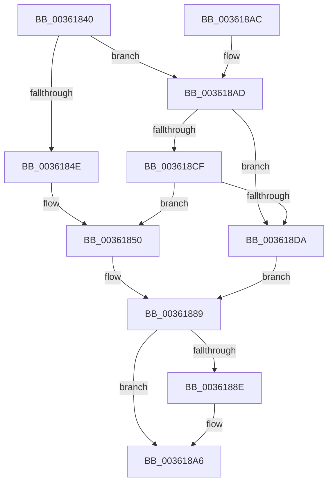

# ExGetHeapFromVA

- RVA: `0x00361840`–`0x00361905` (길이 `197` bytes)
- VA: `0x0000000140361840`
- 실행 섹션: `.text`
- PDB 이름 있음: `예`; PDB Function 태그: `아니요`
- unwind 정보 RVA: `0x00079D0C`
- 디코드: `52`개 명령, `197/197` bytes 표시
- 미해석 바이트: `0` (있으면 어셈블리에 `.byte`로 보존)

> 이 문서는 커널 이미지의 기계어와 PDB 기호를 분석해 생성했습니다. 4번과 5번은 함수 원형과 자료형을 바이너리 사용 방식에서 추정한 C 해석이며 원본 소스 복구 결과는 아닙니다.

## 1. Dependencies

- 직접 호출 지점: **3**; 고유 호출 대상: **3**
- 직접 호출자로 확인된 함수: **3**
- RIP 상대 이미지 참조: **4**

### Outgoing calls
- `0x003618A0` → [KeBugCheckEx](../4F/KeBugCheckEx_function_004FD660.md) (function, `0x004FD660`)
- `0x003618C5` → [RtlCSparseBitmapBitmaskRead](RtlCSparseBitmapBitmaskRead_function_0036190C.md) (function, `0x0036190C`)
- `0x003618F6` → [RtlpHpVaMgrCtxQuery](../32/RtlpHpVaMgrCtxQuery_function_003273C0.md) (function, `0x003273C0`)

### Direct callers
- [ExpHpCompactHeapCallback](../2E/ExpHpCompactHeapCallback_function_002E75F0.md) at `0x002E763C`
- [ExFreeHeapPages](../44/ExFreeHeapPages_function_00446B8C.md) at `0x00446B95`
- [ExIsSpecialPoolAddress](../49/ExIsSpecialPoolAddress_function_0049C410.md) at `0x0049C414`

### Static image references
- `0x00361879` → RVA `0x00E28300` (`.data`; read)
- `0x003618B0` → RVA `0x00E68610` (`.data`; read)
- `0x003618B7` → RVA `0x00E68608` (`.data`; read)
- `0x003618E5` → RVA `0x00E68658` (`.data`; read)

## 2. Other-region calls and transfers

- 다른 실행 섹션으로 향하는 call: **0**
- 별도 외부 분기/꼬리 이동을 확인하지 못했습니다.

## 3. Assembly (complete function range)

```asm
00361840  40 53                           push rbx
00361842  48 83 EC 50                     sub rsp, 0x50
00361846  48 8B D9                        mov rbx, rcx
00361849  66 85 C9                        test cx, cx
0036184C  74 5F                           je 0x1403618ad
0036184E  33 C0                           xor eax, eax
00361850  48 63 C8                        movsxd rcx, eax
00361853  C7 44 24 60 00 00 10 00         mov dword ptr [rsp + 0x60], 0x100000
0036185B  C7 44 24 64 00 00 00 01         mov dword ptr [rsp + 0x64], 0x1000000
00361863  8B 44 8C 60                     mov eax, dword ptr [rsp + rcx*4 + 0x60]
00361867  48 8D 0C 49                     lea rcx, [rcx + rcx*2]
0036186B  48 F7 D8                        neg rax
0036186E  48 C1 E1 06                     shl rcx, 6
00361872  48 23 C3                        and rax, rbx
00361875  48 33 40 10                     xor rax, qword ptr [rax + 0x10]
00361879  48 33 05 80 6A AC 00            xor rax, qword ptr [rip + 0xac6a80]
00361880  48 2B C1                        sub rax, rcx
00361883  48 2D 40 01 00 00               sub rax, 0x140
00361889  48 85 C0                        test rax, rax
0036188C  75 18                           jne 0x1403618a6
0036188E  4C 8B CB                        mov r9, rbx
00361891  48 89 44 24 20                  mov qword ptr [rsp + 0x20], rax
00361896  45 33 C0                        xor r8d, r8d
00361899  33 D2                           xor edx, edx
0036189B  B9 C2 00 00 00                  mov ecx, 0xc2
003618A0  E8 BB BD 19 00                  call 0x1404fd660
003618A5  CC                              int3
003618A6  48 83 C4 50                     add rsp, 0x50
003618AA  5B                              pop rbx
003618AB  C3                              ret
003618AC  CC                              int3
003618AD  48 8B D3                        mov rdx, rbx
003618B0  48 8D 0D 59 6D B0 00            lea rcx, [rip + 0xb06d59]
003618B7  48 2B 15 4A 6D B0 00            sub rdx, qword ptr [rip + 0xb06d4a]
003618BE  48 C1 EA 14                     shr rdx, 0x14
003618C2  48 03 D2                        add rdx, rdx
003618C5  E8 42 00 00 00                  call 0x14036190c
003618CA  48 85 C0                        test rax, rax
003618CD  74 0B                           je 0x1403618da
003618CF  FF C8                           dec eax
003618D1  83 F8 02                        cmp eax, 2
003618D4  0F 85 76 FF FF FF               jne 0x140361850
003618DA  0F 57 C0                        xorps xmm0, xmm0
003618DD  4C 8D 44 24 30                  lea r8, [rsp + 0x30]
003618E2  48 8B D3                        mov rdx, rbx
003618E5  48 8D 0D 6C 6D B0 00            lea rcx, [rip + 0xb06d6c]
003618EC  0F 11 44 24 30                  movups xmmword ptr [rsp + 0x30], xmm0
003618F1  0F 11 44 24 40                  movups xmmword ptr [rsp + 0x40], xmm0
003618F6  E8 C5 5A FC FF                  call 0x1403273c0
003618FB  48 8B 44 24 40                  mov rax, qword ptr [rsp + 0x40]
00361900  48 8B 00                        mov rax, qword ptr [rax]
00361903  EB 84                           jmp 0x140361889
```

## 4. C-style interpretation (structured pseudocode)

```c
__int64 __fastcall ExGetHeapFromVA(__int64 a1, int a2, int a3)
{
    __int64 result;
    __int64 v_rsp;
    unsigned __int64 v_stack_m38;
    unsigned __int64 v_stack_p30;
    unsigned __int64 v_stack_p40;
    unsigned int v_stack_p8;
    unsigned int v_stack_pC;

    v_rsp = (v_rsp) - (80);
    if ((unsigned __int16)(a1) == 0) goto loc_003618AD;
    result = 0;
loc_00361850:
    v_stack_p8 = 0x100000ULL;
    v_stack_pC = 0x1000000ULL;
    result = -((unsigned int)(*(unsigned int *)(v_rsp + (int)(0) * 4 + 96)));
    a1 = ((int)(0) + (int)(0) * 2) << (6);
    result = (result) & (a1);
    result = (result) ^ (*(unsigned __int64 *)(result + 16));
    result = (result) ^ (*(unsigned __int64 *)(v_rip + 11299456));
    result = (result) - (a1);
    result = (result) - (320);
loc_00361889:
    if (result == 0) {
        a4 = a1;
        v_stack_m38 = result;
        a3 = 0;
        a2 = 0;
        a1 = 194;
        result = KeBugCheckEx(a1, a2, a3, a4);
    }
    v_rsp = (v_rsp) + (80);
    return result;
loc_003618AD:
    a2 = (a1) - (*(unsigned __int64 *)(v_rip + 11562314));
    a2 = (a2) >> (20);
    a2 = (a2) + (a2);
    result = RtlCSparseBitmapBitmaskRead(v_rip + 11562329, a2, a3, a4);
    if (result == 0) goto loc_003618DA;
    result = (unsigned int)((result) - 1);
    if (((unsigned int)(result)) != 2) goto loc_00361850;
loc_003618DA:
    v_stack_p30 = v_xmm0;
    v_stack_p40 = v_xmm0;
    result = RtlpHpVaMgrCtxQuery(v_rip + 11562348, a1, v_stack_p30, a4);
    goto loc_00361889;
}
```

## 5. (Beta) C Style

```c
int64_t ExGetHeapFromVA(int64_t Arg1, int32_t Arg2, int32_t Arg3)
{
    int64_t result;
    int64_t local_rsp;
    uint64_t v_stack_m38;
    uint64_t v_stack_p30;
    uint64_t v_stack_p40;
    uint32_t v_stack_p8;
    uint32_t v_stack_pC;

    local_rsp = (local_rsp) - (80);
    if ((uint16_t)(Arg1) == 0) goto loc_003618AD;
    result = 0;
loc_00361850:
    v_stack_p8 = 0x100000ULL;
    v_stack_pC = 0x1000000ULL;
    result = -((uint32_t)(*(uint32_t *)(local_rsp + (int32_t)(0) * 4 + 0x60)));
    Arg1 = ((int32_t)(0) + (int32_t)(0) * 2) << (6);
    result = (result) & (Arg1);
    result = (result) ^ (*(uint64_t *)(result + 0x10));
    result = (result) ^ (*(uint64_t *)(v_rip + 0xAC6A80));
    result = (result) - (Arg1);
    result = (result) - (320);
loc_00361889:
    if (result == 0) {
        a4 = Arg1;
        v_stack_m38 = result;
        Arg3 = 0;
        Arg2 = 0;
        Arg1 = 194;
        result = KeBugCheckEx(Arg1, Arg2, Arg3, a4);
    }
    local_rsp = (local_rsp) + (80);
    return result;
loc_003618AD:
    Arg2 = (Arg1) - (*(uint64_t *)(v_rip + 0xB06D4A));
    Arg2 = (Arg2) >> (20);
    Arg2 = (Arg2) + (Arg2);
    result = RtlCSparseBitmapBitmaskRead(v_rip + 11562329, Arg2, Arg3, a4);
    if (result == 0) goto loc_003618DA;
    result = (uint32_t)((result) - 1);
    if (((uint32_t)(result)) != 2) goto loc_00361850;
loc_003618DA:
    v_stack_p30 = v_xmm0;
    v_stack_p40 = v_xmm0;
    result = RtlpHpVaMgrCtxQuery(v_rip + 11562348, Arg1, v_stack_p30, a4);
    goto loc_00361889;
}
```

## 6. Execution-region graph

[열기: 2D/3D 그래프와 함수 탐색 컨트롤 패널](../../../control-panel.html?section=text&rva=0x00361840&view=graph)

- 2D 그래프는 위에서 아래로 흐르고, 3D 그래프는 빈 공간을 드래그해 회전합니다. Shift+드래그는 이동, 휠은 확대·축소, 함수 노드 선택은 대상 보고서 이동입니다.

### Static fallback


