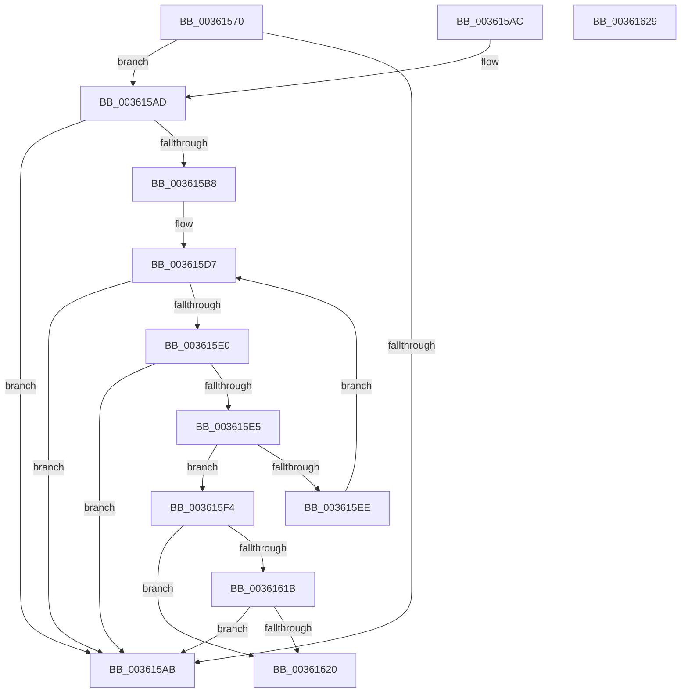

# ExpPoolTrackerReturnLimit

- RVA: `0x00361570`–`0x0036162A` (길이 `186` bytes)
- VA: `0x0000000140361570`
- 실행 섹션: `.text`
- PDB 이름 있음: `예`; PDB Function 태그: `아니요`
- unwind 정보 RVA: `0x000DB714`
- 디코드: `51`개 명령, `186/186` bytes 표시
- 미해석 바이트: `0` (있으면 어셈블리에 `.byte`로 보존)

> 이 문서는 커널 이미지의 기계어와 PDB 기호를 분석해 생성했습니다. 4번과 5번은 함수 원형과 자료형을 바이너리 사용 방식에서 추정한 C 해석이며 원본 소스 복구 결과는 아닙니다.

## 1. Dependencies

- 직접 호출 지점: **0**; 고유 호출 대상: **0**
- 직접 호출자로 확인된 함수: **7**
- RIP 상대 이미지 참조: **0**

### Outgoing calls
- 직접 디코드된 call 명령이 없습니다.

### Direct callers
- [ExpFreeHeapSpecialPool](../2E/ExpFreeHeapSpecialPool_function_002EE600.md) at `0x002EE833`
- [ExAllocateHeapPool](../35/ExAllocateHeapPool_function_0035BA30.md) at `0x0035EB88`
- [sub_003602E3](Unknown_function_003602E3.md) at `0x003606B7`
- [ExRemovePoolTag](../3F/ExRemovePoolTag_function_003F7CBC.md) at `0x003F7EB6`
- [ExPoolCleanupExpansionTable](../65/ExPoolCleanupExpansionTable_function_00656164.md) at `0x0065627A`
- [sub_006DED54](../6D/Unknown_function_006DED54.md) at `0x006DEE43`
- [sub_00B830A9](../../poolcode/B8/Unknown_function_00B830A9.md) at `0x00B83471`

### Static image references
- 디코드된 RIP-relative 메모리 참조가 없습니다.

## 2. Other-region calls and transfers

- 다른 실행 섹션으로 향하는 call: **0**
- 별도 외부 분기/꼬리 이동을 확인하지 못했습니다.

## 3. Assembly (complete function range)

```asm
00361570  4C 63 C9                        movsxd r9, ecx
00361573  41 BA 08 00 00 00               mov r10d, 8
00361579  41 83 F9 01                     cmp r9d, 1
0036157D  B9 20 00 00 00                  mov ecx, 0x20
00361582  B8 18 00 00 00                  mov eax, 0x18
00361587  44 0F 45 D1                     cmovne r10d, ecx
0036158B  B9 30 00 00 00                  mov ecx, 0x30
00361590  0F 45 C1                        cmovne eax, ecx
00361593  F0 4A FF 04 00                  lock inc qword ptr [rax + r8]
00361598  48 8B CA                        mov rcx, rdx
0036159B  48 F7 D9                        neg rcx
0036159E  F0 4B 0F C1 0C 02               lock xadd qword ptr [r10 + r8], rcx
003615A4  49 83 78 48 00                  cmp qword ptr [r8 + 0x48], 0
003615A9  75 02                           jne 0x1403615ad
003615AB  C3                              ret
003615AC  CC                              int3
003615AD  43 F6 44 C8 38 01               test byte ptr [r8 + r9*8 + 0x38], 1
003615B3  4D 8B D9                        mov r11, r9
003615B6  75 F3                           jne 0x1403615ab
003615B8  4B 8B 44 C8 38                  mov rax, qword ptr [r8 + r9*8 + 0x38]
003615BD  48 8D 14 95 3F 00 00 00         lea rdx, [rdx*4 + 0x3f]
003615C5  48 83 E2 C0                     and rdx, 0xffffffffffffffc0
003615C9  41 B9 80 00 00 00               mov r9d, 0x80
003615CF  48 83 FA 40                     cmp rdx, 0x40
003615D3  4C 0F 45 CA                     cmovne r9, rdx
003615D7  49 8D 14 09                     lea rdx, [r9 + rcx]
003615DB  48 3B C8                        cmp rcx, rax
003615DE  7D CB                           jge 0x1403615ab
003615E0  48 3B D0                        cmp rdx, rax
003615E3  7D C6                           jge 0x1403615ab
003615E5  F0 4B 0F B1 54 D8 38            lock cmpxchg qword ptr [r8 + r11*8 + 0x38], rdx
003615EC  74 06                           je 0x1403615f4
003615EE  4B 8B 0C 02                     mov rcx, qword ptr [r10 + r8]
003615F2  EB E3                           jmp 0x1403615d7
003615F4  49 8B 48 48                     mov rcx, qword ptr [r8 + 0x48]
003615F8  48 2B C2                        sub rax, rdx
003615FB  48 8B D0                        mov rdx, rax
003615FE  48 F7 DA                        neg rdx
00361601  48 0F 48 D0                     cmovs rdx, rax
00361605  4B 8D 04 5B                     lea rax, [r11 + r11*2]
00361609  4C 8D 04 C1                     lea r8, [rcx + rax*8]
0036160D  48 8B 44 C1 10                  mov rax, qword ptr [rcx + rax*8 + 0x10]
00361612  49 8B 48 18                     mov rcx, qword ptr [r8 + 0x18]
00361616  48 85 C0                        test rax, rax
00361619  75 05                           jne 0x140361620
0036161B  48 85 C9                        test rcx, rcx
0036161E  74 8B                           je 0x1403615ab
00361620  48 F7 DA                        neg rdx
00361623  F0 49 01 50 20                  lock add qword ptr [r8 + 0x20], rdx
00361628  C3                              ret
00361629  CC                              int3
```

## 4. C-style interpretation (structured pseudocode)

```c
__int64 __fastcall ExpPoolTrackerReturnLimit(int a1, __int64 a2, __int64 a3)
{
    __int64 result;
    __int64 v_r10;

    v_r10 = 8;
    if (((unsigned int)((int)(a1))) != 1) { v_r10 = 32; }
    result = 24;
    if (((unsigned int)((int)(a1))) != 1) { result = 48; }
    a1 = -(a2);
    if ((*(unsigned __int64 *)(a3 + 72)) != 0) goto loc_003615AD;
loc_003615AB:
    return result;
loc_003615AD:
    if (((*(unsigned __int8 *)(a3 + (int)(a1) * 8 + 56)) & (1)) != 0) goto loc_003615AB;
    a2 = (a2 * 4 + 63) & (-64);
    a4 = 128;
    if (a2 != 64) { a4 = a2; }
loc_003615D7:
    if (a1 >= (*(unsigned __int64 *)(a3 + (int)(a1) * 8 + 56))) goto loc_003615AB;
    if ((a4 + a1 * 1) >= (*(unsigned __int64 *)(a3 + (int)(a1) * 8 + 56))) goto loc_003615AB;
    if ((a4 + a1 * 1) == (*(unsigned __int64 *)(a3 + (int)(a1) * 8 + 56))) goto loc_003615F4;
    goto loc_003615D7;
loc_003615F4:
    result = (*(unsigned __int64 *)(a3 + (int)(a1) * 8 + 56)) - (a4 + a1 * 1);
    a2 = -(result);
    if (sign_flag) { a2 = result; }
    if (*(unsigned __int64 *)(*(unsigned __int64 *)(a3 + 72) + (int)(a1) + (int)(a1) * 2 * 8 + 16) != 0) goto loc_00361620;
    if (*(unsigned __int64 *)(*(unsigned __int64 *)(a3 + 72) + (int)(a1) + (int)(a1) * 2 * 8 + 24) == 0) goto loc_003615AB;
loc_00361620:
    a2 = -(a2);
    return *(unsigned __int64 *)(*(unsigned __int64 *)(a3 + 72) + (int)(a1) + (int)(a1) * 2 * 8 + 16);
}
```

## 5. (Beta) C Style

```c
int64_t ExpPoolTrackerReturnLimit(int32_t Arg1, int64_t Arg2, void *Arg3)
{
    uint8_t *arg3 = (uint8_t *)Arg3;

    int64_t result;
    int64_t local_r10;

    local_r10 = 8;
    if (((uint32_t)((int32_t)(Arg1))) != 1) { local_r10 = 32; }
    result = 24;
    if (((uint32_t)((int32_t)(Arg1))) != 1) { result = 48; }
    Arg1 = -(Arg2);
    if ((*(uint64_t *)(arg3 + 0x48)) != 0) goto loc_003615AD;
loc_003615AB:
    return result;
loc_003615AD:
    if (((*(uint8_t *)(arg3 + (int32_t)(Arg1) * 8 + 0x38)) & (1)) != 0) goto loc_003615AB;
    Arg2 = (Arg2 * 4 + 63) & (-64);
    a4 = 128;
    if (Arg2 != 64) { a4 = Arg2; }
loc_003615D7:
    if (Arg1 >= (*(uint64_t *)(arg3 + (int32_t)(Arg1) * 8 + 0x38))) goto loc_003615AB;
    if ((a4 + Arg1 * 1) >= (*(uint64_t *)(arg3 + (int32_t)(Arg1) * 8 + 0x38))) goto loc_003615AB;
    if ((a4 + Arg1 * 1) == (*(uint64_t *)(arg3 + (int32_t)(Arg1) * 8 + 0x38))) goto loc_003615F4;
    goto loc_003615D7;
loc_003615F4:
    result = (*(uint64_t *)(arg3 + (int32_t)(Arg1) * 8 + 0x38)) - (a4 + Arg1 * 1);
    Arg2 = -(result);
    if (sign_flag) { Arg2 = result; }
    if (*(uint64_t *)(*(uint64_t *)(arg3 + 0x48) + (int32_t)(Arg1) + (int32_t)(Arg1) * 2 * 8 + 0x10) != 0) goto loc_00361620;
    if (*(uint64_t *)(*(uint64_t *)(arg3 + 0x48) + (int32_t)(Arg1) + (int32_t)(Arg1) * 2 * 8 + 0x18) == 0) goto loc_003615AB;
loc_00361620:
    Arg2 = -(Arg2);
    return *(uint64_t *)(*(uint64_t *)(arg3 + 0x48) + (int32_t)(Arg1) + (int32_t)(Arg1) * 2 * 8 + 0x10);
}
```

### 관측된 메모리 오프셋

구조체 형식이 확인되지 않은 접근은 인자 기준의 오프셋으로만 기록했습니다.

| 기준 인자 | 오프셋 표현 | 폭 (bit) | 접근 |
|---|---:|---:|---|
| `Arg3` | `+ 0x38 + r11*8` | `64` | `R` |
| `Arg3` | `+ 0x38 + r9*8` | `8` | `R` |
| `Arg3` | `+ 0x38 + r9*8` | `64` | `R` |
| `Arg3` | `+ 0x48` | `64` | `R` |

## 6. Execution-region graph

[열기: 2D/3D 그래프와 함수 탐색 컨트롤 패널](../../../control-panel.html?section=text&rva=0x00361570&view=graph)

- 2D 그래프는 위에서 아래로 흐르고, 3D 그래프는 빈 공간을 드래그해 회전합니다. Shift+드래그는 이동, 휠은 확대·축소, 함수 노드 선택은 대상 보고서 이동입니다.

### Static fallback


