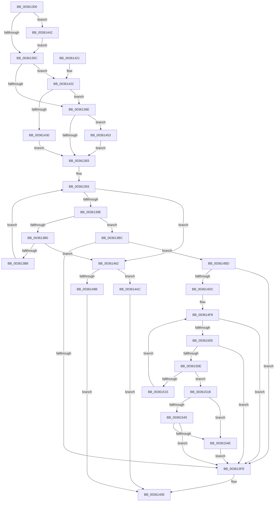

# ExpRemovePoolTrackerExpansion

- RVA: `0x00361300`–`0x0036155C` (길이 `604` bytes)
- VA: `0x0000000140361300`
- 실행 섹션: `.text`
- PDB 이름 있음: `예`; PDB Function 태그: `아니요`
- unwind 정보 RVA: `0x00079CD8`
- 디코드: `145`개 명령, `604/604` bytes 표시
- 미해석 바이트: `0` (있으면 어셈블리에 `.byte`로 보존)

> 이 문서는 커널 이미지의 기계어와 PDB 기호를 분석해 생성했습니다. 4번과 5번은 함수 원형과 자료형을 바이너리 사용 방식에서 추정한 C 해석이며 원본 소스 복구 결과는 아닙니다.

## 1. Dependencies

- 직접 호출 지점: **5**; 고유 호출 대상: **4**
- 직접 호출자로 확인된 함수: **7**
- RIP 상대 이미지 참조: **9**

### Outgoing calls
- `0x00361403` → [KeReleaseInStackQueuedSpinLock](../34/KeReleaseInStackQueuedSpinLock_function_00342CE0.md) (function, `0x00342CE0`)
- `0x00361438` → [KiAcquireQueuedSpinLockInstrumented](../27/KiAcquireQueuedSpinLockInstrumented_function_00275850.md) (function, `0x00275850`)
- `0x00361449` → [KiRaiseIrqlProcessIrqlFlags](../4F/KiRaiseIrqlProcessIrqlFlags_function_004F56FC.md) (function, `0x004F56FC`)
- `0x00361458` → [KxWaitForLockOwnerShip](../25/KxWaitForLockOwnerShip_function_00257EB0.md) (function, `0x00257EB0`)
- `0x00361467` → [KeReleaseInStackQueuedSpinLock](../34/KeReleaseInStackQueuedSpinLock_function_00342CE0.md) (function, `0x00342CE0`)

### Direct callers
- [ExpFreeHeapSpecialPool](../2E/ExpFreeHeapSpecialPool_function_002EE600.md) at `0x002EE7B7`
- [ExAllocateHeapPool](../35/ExAllocateHeapPool_function_0035BA30.md) at `0x0035EB1C`
- [sub_0035FB85](../35/Unknown_function_0035FB85.md) at `0x003602AD`
- [ExRemovePoolTag](../3F/ExRemovePoolTag_function_003F7CBC.md) at `0x003F7E62`
- [ExPoolCleanupExpansionTable](../65/ExPoolCleanupExpansionTable_function_00656164.md) at `0x0065626B`
- [sub_006DED54](../6D/Unknown_function_006DED54.md) at `0x006DEE34`
- [sub_00B82950](../../poolcode/B8/Unknown_function_00B82950.md) at `0x00B83064`

### Static image references
- `0x0036131A` → RVA `0x00EFAD00` (`.data`; read)
- `0x00361350` → RVA `0x00FC6D20` (`ALMOSTRO`; read)
- `0x0036135C` → RVA `0x00FC6B06` (`ALMOSTRO`; read)
- `0x00361373` → RVA `0x00EFAD00` (`.data`; read/write)
- `0x00361383` → RVA `0x00EFED48` (`.data`; read)
- `0x0036138C` → RVA `0x00EFED40` (`.data`; read)
- `0x00361422` → RVA `0x00F0DE58` (`.data`; read)
- `0x00361474` → RVA `0x00EFAD20` (`.data`; read)
- `0x00361481` → RVA `0x00EFED50` (`.data`; read)

## 2. Other-region calls and transfers

- 다른 실행 섹션으로 향하는 call: **0**
- 별도 외부 분기/꼬리 이동을 확인하지 못했습니다.

## 3. Assembly (complete function range)

```asm
00361300  48 89 5C 24 08                  mov qword ptr [rsp + 8], rbx
00361305  48 89 6C 24 10                  mov qword ptr [rsp + 0x10], rbp
0036130A  48 89 74 24 18                  mov qword ptr [rsp + 0x18], rsi
0036130F  57                              push rdi
00361310  41 56                           push r14
00361312  41 57                           push r15
00361314  48 83 EC 40                     sub rsp, 0x40
00361318  33 C0                           xor eax, eax
0036131A  4C 8D 3D DF 99 B9 00            lea r15, [rip + 0xb999df]
00361321  0F 57 C0                        xorps xmm0, xmm0
00361324  48 89 44 24 30                  mov qword ptr [rsp + 0x30], rax
00361329  0F 11 44 24 20                  movups xmmword ptr [rsp + 0x20], xmm0
0036132E  33 F6                           xor esi, esi
00361330  4C 89 7C 24 28                  mov qword ptr [rsp + 0x28], r15
00361335  48 89 74 24 20                  mov qword ptr [rsp + 0x20], rsi
0036133A  49 8B E8                        mov rbp, r8
0036133D  90                              nop
0036133E  4C 8B F2                        mov r14, rdx
00361341  8B D9                           mov ebx, ecx
00361343  44 0F 20 C7                     mov rdi, cr8
00361347  B8 02 00 00 00                  mov eax, 2
0036134C  44 0F 22 C0                     mov cr8, rax
00361350  39 35 CA 59 C6 00               cmp dword ptr [rip + 0xc659ca], esi
00361356  0F 85 E6 00 00 00               jne 0x140361442
0036135C  F6 05 A3 57 C6 00 21            test byte ptr [rip + 0xc657a3], 0x21
00361363  40 88 7C 24 30                  mov byte ptr [rsp + 0x30], dil
00361368  0F 85 B4 00 00 00               jne 0x140361422
0036136E  48 8D 54 24 20                  lea rdx, [rsp + 0x20]
00361373  48 87 15 86 99 B9 00            xchg qword ptr [rip + 0xb99986], rdx
0036137A  48 85 D2                        test rdx, rdx
0036137D  0F 85 D0 00 00 00               jne 0x140361453
00361383  4C 8B 0D BE D9 B9 00            mov r9, qword ptr [rip + 0xb9d9be]
0036138A  8B D6                           mov edx, esi
0036138C  4C 8B 15 AD D9 B9 00            mov r10, qword ptr [rip + 0xb9d9ad]
00361393  8B C2                           mov eax, edx
00361395  49 3B C1                        cmp rax, r9
00361398  0F 83 C4 00 00 00               jae 0x140361462
0036139E  4C 8D 04 80                     lea r8, [rax + rax*4]
003613A2  49 C1 E0 04                     shl r8, 4
003613A6  4D 03 C2                        add r8, r10
003613A9  41 8B 00                        mov eax, dword ptr [r8]
003613AC  3B C3                           cmp eax, ebx
003613AE  74 0C                           je 0x1403613bc
003613B0  85 C0                           test eax, eax
003613B2  0F 84 AA 00 00 00               je 0x140361462
003613B8  FF C2                           inc edx
003613BA  EB D7                           jmp 0x140361393
003613BC  81 E5 00 01 00 00               and ebp, 0x100
003613C2  B8 20 00 00 00                  mov eax, 0x20
003613C7  BA 08 00 00 00                  mov edx, 8
003613CC  41 BA 18 00 00 00               mov r10d, 0x18
003613D2  0F 45 D0                        cmovne edx, eax
003613D5  BF 30 00 00 00                  mov edi, 0x30
003613DA  48 85 ED                        test rbp, rbp
003613DD  41 8B C2                        mov eax, r10d
003613E0  0F 45 C7                        cmovne eax, edi
003613E3  F0 4A FF 04 00                  lock inc qword ptr [rax + r8]
003613E8  4D 8B CE                        mov r9, r14
003613EB  49 F7 D9                        neg r9
003613EE  F0 4E 0F C1 0C 02               lock xadd qword ptr [rdx + r8], r9
003613F4  49 39 70 48                     cmp qword ptr [r8 + 0x48], rsi
003613F8  0F 85 BF 00 00 00               jne 0x1403614bd
003613FE  48 8D 4C 24 20                  lea rcx, [rsp + 0x20]
00361403  E8 D8 18 FE FF                  call 0x140342ce0
00361408  48 8B 5C 24 60                  mov rbx, qword ptr [rsp + 0x60]
0036140D  48 8B 6C 24 68                  mov rbp, qword ptr [rsp + 0x68]
00361412  48 8B 74 24 70                  mov rsi, qword ptr [rsp + 0x70]
00361417  48 83 C4 40                     add rsp, 0x40
0036141B  41 5F                           pop r15
0036141D  41 5E                           pop r14
0036141F  5F                              pop rdi
00361420  C3                              ret
00361421  CC                              int3
00361422  8B 05 30 CA BA 00               mov eax, dword ptr [rip + 0xbaca30]
00361428  85 C0                           test eax, eax
0036142A  0F 85 3E FF FF FF               jne 0x14036136e
00361430  49 8B D7                        mov rdx, r15
00361433  48 8D 4C 24 20                  lea rcx, [rsp + 0x20]
00361438  E8 13 44 F1 FF                  call 0x140275850
0036143D  E9 41 FF FF FF                  jmp 0x140361383
00361442  0F B6 D0                        movzx edx, al
00361445  40 0F B6 CF                     movzx ecx, dil
00361449  E8 AE 42 19 00                  call 0x1404f56fc
0036144E  E9 09 FF FF FF                  jmp 0x14036135c
00361453  48 8D 4C 24 20                  lea rcx, [rsp + 0x20]
00361458  E8 53 6A EF FF                  call 0x140257eb0
0036145D  E9 21 FF FF FF                  jmp 0x140361383
00361462  48 8D 4C 24 20                  lea rcx, [rsp + 0x20]
00361467  E8 74 18 FE FF                  call 0x140342ce0
0036146C  65 8B 04 25 A4 01 00 00         mov eax, dword ptr gs:[0x1a4]
00361474  4C 8D 0D A5 98 B9 00            lea r9, [rip + 0xb998a5]
0036147B  44 8B C0                        mov r8d, eax
0036147E  49 F7 DE                        neg r14
00361481  8B 05 C9 D8 B9 00               mov eax, dword ptr [rip + 0xb9d8c9]
00361487  FF C8                           dec eax
00361489  48 8D 14 80                     lea rdx, [rax + rax*4]
0036148D  4B 8B 04 C1                     mov rax, qword ptr [r9 + r8*8]
00361491  48 03 D2                        add rdx, rdx
00361494  48 0F BA E5 08                  bt rbp, 8
00361499  72 11                           jb 0x1403614ac
0036149B  F0 48 FF 44 D0 18               lock inc qword ptr [rax + rdx*8 + 0x18]
003614A1  F0 4C 01 74 D0 08               lock add qword ptr [rax + rdx*8 + 8], r14
003614A7  E9 5C FF FF FF                  jmp 0x140361408
003614AC  F0 48 FF 44 D0 30               lock inc qword ptr [rax + rdx*8 + 0x30]
003614B2  F0 4C 01 74 D0 20               lock add qword ptr [rax + rdx*8 + 0x20], r14
003614B8  E9 4B FF FF FF                  jmp 0x140361408
003614BD  48 85 ED                        test rbp, rbp
003614C0  B9 40 00 00 00                  mov ecx, 0x40
003614C5  41 BB 38 00 00 00               mov r11d, 0x38
003614CB  44 0F 44 D9                     cmove r11d, ecx
003614CF  4D 03 D8                        add r11, r8
003614D2  41 F6 03 01                     test byte ptr [r11], 1
003614D6  0F 85 22 FF FF FF               jne 0x1403613fe
003614DC  49 8B 03                        mov rax, qword ptr [r11]
003614DF  4A 8D 0C B5 3F 00 00 00         lea rcx, [r14*4 + 0x3f]
003614E7  48 83 E1 C0                     and rcx, 0xffffffffffffffc0
003614EB  BB 80 00 00 00                  mov ebx, 0x80
003614F0  48 83 F9 40                     cmp rcx, 0x40
003614F4  48 0F 45 D9                     cmovne rbx, rcx
003614F8  4A 8D 0C 0B                     lea rcx, [rbx + r9]
003614FC  4C 3B C8                        cmp r9, rax
003614FF  0F 8D F9 FE FF FF               jge 0x1403613fe
00361505  48 3B C8                        cmp rcx, rax
00361508  0F 8D F0 FE FF FF               jge 0x1403613fe
0036150E  F0 49 0F B1 0B                  lock cmpxchg qword ptr [r11], rcx
00361513  74 06                           je 0x14036151b
00361515  4E 8B 0C 02                     mov r9, qword ptr [rdx + r8]
00361519  EB DD                           jmp 0x1403614f8
0036151B  48 2B C1                        sub rax, rcx
0036151E  49 8B 48 48                     mov rcx, qword ptr [r8 + 0x48]
00361522  48 8B D0                        mov rdx, rax
00361525  48 F7 DA                        neg rdx
00361528  48 0F 48 D0                     cmovs rdx, rax
0036152C  48 85 ED                        test rbp, rbp
0036152F  49 0F 44 F2                     cmove rsi, r10
00361533  4C 0F 44 D7                     cmove r10, rdi
00361537  48 8B 44 0E 10                  mov rax, qword ptr [rsi + rcx + 0x10]
0036153C  4D 8B 04 0A                     mov r8, qword ptr [r10 + rcx]
00361540  48 85 C0                        test rax, rax
00361543  75 09                           jne 0x14036154e
00361545  4D 85 C0                        test r8, r8
00361548  0F 84 B0 FE FF FF               je 0x1403613fe
0036154E  48 F7 DA                        neg rdx
00361551  F0 48 01 54 0E 20               lock add qword ptr [rsi + rcx + 0x20], rdx
00361557  E9 A2 FE FF FF                  jmp 0x1403613fe
```

## 4. C-style interpretation (structured pseudocode)

```c
__int64 __fastcall ExpRemovePoolTrackerExpansion(int a1, __int64 a2, __int64 a3)
{
    __int64 result;
    __int64 v_r10;
    __int64 v_r11;
    __int64 v_r14;
    __int64 v_rbp;
    __int64 v_rbx;
    __int64 v_rsi;
    __int64 v_rsp;
    unsigned __int64 v_stack_m28;
    unsigned __int64 v_stack_m30;
    unsigned __int64 v_stack_m38;
    unsigned __int64 v_stack_p10;
    unsigned __int64 v_stack_p18;
    unsigned __int64 v_stack_p20;
    unsigned __int64 v_stack_p8;

    v_stack_p8 = v_rbx;
    v_stack_p10 = v_rbp;
    v_stack_p18 = v_rsi;
    v_rsp = (v_rsp) - (64);
    result = 0;
    v_stack_m28 = 0;
    v_stack_m38 = v_xmm0;
    v_rsi = 0;
    v_stack_m30 = v_rip + 12163551;
    v_stack_m38 = 0;
    if ((*(unsigned int *)(v_rip + 12999114)) != 0) goto loc_00361442;
loc_0036135C:
    v_stack_m28 = (unsigned __int8)(v_cr8);
    if (((*(unsigned __int8 *)(v_rip + 12998563)) & (33)) != 0) goto loc_00361422;
loc_0036136E:
    if (v_stack_m38 != 0) goto loc_00361453;
loc_00361383:
loc_00361393:
    if (0 >= (*(unsigned __int64 *)(v_rip + 12179902))) goto loc_00361462;
    a3 = (0 + 0 * 4) << (4);
    a3 = (a3) + (*(unsigned __int64 *)(v_rip + 12179885));
    if (((unsigned int)((unsigned int)(*(unsigned int *)(a3)))) == ((unsigned int)((unsigned int)(a1)))) goto loc_003613BC;
    if ((unsigned int)((unsigned int)(*(unsigned int *)(a3))) == 0) goto loc_00361462;
    a2 = (unsigned int)((0) + 1);
    goto loc_00361393;
loc_003613BC:
    v_rbp = (unsigned int)((a3) & (256));
    a2 = 8;
    if (condition_is_not_equal) { a2 = 32; }
    result = 24;
    if (v_rbp != 0) { result = 48; }
    a4 = -(a2);
    if ((*(unsigned __int64 *)(a3 + 72)) != 0) goto loc_003614BD;
loc_003613FE:
    result = KeReleaseInStackQueuedSpinLock(v_stack_m38, a2, a3, a4);
loc_00361408:
    v_rsp = (v_rsp) + (64);
    return result;
loc_00361422:
    if ((unsigned int)((unsigned int)(*(unsigned int *)(v_rip + 12241456))) != 0) goto loc_0036136E;
    result = KiAcquireQueuedSpinLockInstrumented(v_stack_p20, v_rip + 12163551, a3, a4);
    goto loc_00361383;
loc_00361442:
    result = KiRaiseIrqlProcessIrqlFlags(48, (unsigned __int8)(result), a3, a4);
    goto loc_0036135C;
loc_00361453:
    result = KxWaitForLockOwnerShip(v_stack_p20, (unsigned __int8)(result), a3, a4);
    goto loc_00361383;
loc_00361462:
    result = KeReleaseInStackQueuedSpinLock(v_stack_p20, (unsigned __int8)(result), a3, a4);
    v_r14 = -(a2);
    result = (unsigned int)(((unsigned int)(*(unsigned int *)(v_rip + 12179657))) - 1);
    a2 = (result + result * 4) + (result + result * 4);
    if (condition_is_below) goto loc_003614AC;
    goto loc_00361408;
loc_003614AC:
    goto loc_00361408;
loc_003614BD:
    v_r11 = 56;
    if (v_stack_p10 == 0) { v_r11 = 64; }
    v_r11 = (v_r11) + ((unsigned int)((unsigned int)((unsigned int)(*(unsigned int *)(gs_base + (0 + 420))))));
    if (((*(unsigned __int8 *)(v_r11)) & (1)) != 0) goto loc_003613FE;
    a1 = (v_r14 * 4 + 63) & (-64);
    v_rbx = 128;
    if (a1 != 64) { v_rbx = a1; }
loc_003614F8:
    if ((v_rip + 12163237) >= (*(unsigned __int64 *)(v_r11))) goto loc_003613FE;
    if ((v_rbx + v_rip + 12163237 * 1) >= (*(unsigned __int64 *)(v_r11))) goto loc_003613FE;
    if ((v_rbx + v_rip + 12163237 * 1) == (*(unsigned __int64 *)(v_r11))) goto loc_0036151B;
    goto loc_003614F8;
loc_0036151B:
    result = (*(unsigned __int64 *)(v_r11)) - (v_rbx + v_rip + 12163237 * 1);
    a2 = -(result);
    if (sign_flag) { a2 = result; }
    v_rsi = v_stack_p18;
    if (v_stack_p10 == 0) { v_rsi = 24; }
    v_r10 = 24;
    if (v_stack_p10 == 0) { v_r10 = 48; }
    if (*(unsigned __int64 *)(v_rsi + *(unsigned __int64 *)((unsigned int)((unsigned int)((unsigned int)(*(unsigned int *)(gs_base + (0 + 420))))) + 72) * 1 + 16) != 0) goto loc_0036154E;
    if (*(unsigned __int64 *)(v_r10 + *(unsigned __int64 *)((unsigned int)((unsigned int)((unsigned int)(*(unsigned int *)(gs_base + (0 + 420))))) + 72) * 1) == 0) goto loc_003613FE;
loc_0036154E:
    a2 = -(a2);
    goto loc_003613FE;
}
```

## 5. (Beta) C Style

```c
int64_t ExpRemovePoolTrackerExpansion(int32_t Arg1, int64_t Arg2, int64_t Arg3)
{
    int64_t result;
    int64_t local_r10;
    int64_t local_r11;
    int64_t local_r14;
    int64_t local_rbp;
    int64_t local_rbx;
    int64_t local_rsi;
    int64_t local_rsp;
    uint64_t v_stack_m28;
    uint64_t v_stack_m30;
    uint64_t v_stack_m38;
    uint64_t v_stack_p10;
    uint64_t v_stack_p18;
    uint64_t v_stack_p20;
    uint64_t v_stack_p8;

    v_stack_p8 = local_rbx;
    v_stack_p10 = local_rbp;
    v_stack_p18 = local_rsi;
    local_rsp = (local_rsp) - (64);
    result = 0;
    v_stack_m28 = 0;
    v_stack_m38 = v_xmm0;
    local_rsi = 0;
    v_stack_m30 = v_rip + 12163551;
    v_stack_m38 = 0;
    if ((*(uint32_t *)(v_rip + 0xC659CA)) != 0) goto loc_00361442;
loc_0036135C:
    v_stack_m28 = (uint8_t)(v_cr8);
    if (((*(uint8_t *)(v_rip + 0xC657A3)) & (33)) != 0) goto loc_00361422;
loc_0036136E:
    if (v_stack_m38 != 0) goto loc_00361453;
loc_00361383:
loc_00361393:
    if (0 >= (*(uint64_t *)(v_rip + 0xB9D9BE))) goto loc_00361462;
    Arg3 = (0 + 0 * 4) << (4);
    Arg3 = (Arg3) + (*(uint64_t *)(v_rip + 0xB9D9AD));
    if (((uint32_t)((uint32_t)(*(uint32_t *)(Arg3)))) == ((uint32_t)((uint32_t)(Arg1)))) goto loc_003613BC;
    if ((uint32_t)((uint32_t)(*(uint32_t *)(Arg3))) == 0) goto loc_00361462;
    Arg2 = (uint32_t)((0) + 1);
    goto loc_00361393;
loc_003613BC:
    local_rbp = (uint32_t)((Arg3) & (256));
    Arg2 = 8;
    if (condition_is_not_equal) { Arg2 = 32; }
    result = 24;
    if (local_rbp != 0) { result = 48; }
    a4 = -(Arg2);
    if ((*(uint64_t *)(Arg3 + 0x48)) != 0) goto loc_003614BD;
loc_003613FE:
    result = KeReleaseInStackQueuedSpinLock(v_stack_m38, Arg2, Arg3, a4);
loc_00361408:
    local_rsp = (local_rsp) + (64);
    return result;
loc_00361422:
    if ((uint32_t)((uint32_t)(*(uint32_t *)(v_rip + 0xBACA30))) != 0) goto loc_0036136E;
    result = KiAcquireQueuedSpinLockInstrumented(v_stack_p20, v_rip + 12163551, Arg3, a4);
    goto loc_00361383;
loc_00361442:
    result = KiRaiseIrqlProcessIrqlFlags(48, (uint8_t)(result), Arg3, a4);
    goto loc_0036135C;
loc_00361453:
    result = KxWaitForLockOwnerShip(v_stack_p20, (uint8_t)(result), Arg3, a4);
    goto loc_00361383;
loc_00361462:
    result = KeReleaseInStackQueuedSpinLock(v_stack_p20, (uint8_t)(result), Arg3, a4);
    local_r14 = -(Arg2);
    result = (uint32_t)(((uint32_t)(*(uint32_t *)(v_rip + 0xB9D8C9))) - 1);
    Arg2 = (result + result * 4) + (result + result * 4);
    if (condition_is_below) goto loc_003614AC;
    goto loc_00361408;
loc_003614AC:
    goto loc_00361408;
loc_003614BD:
    local_r11 = 56;
    if (v_stack_p10 == 0) { local_r11 = 64; }
    local_r11 = (local_r11) + ((uint32_t)((uint32_t)((uint32_t)(*(uint32_t *)(gs_base + (0 + 0x1A4))))));
    if (((*(uint8_t *)(local_r11)) & (1)) != 0) goto loc_003613FE;
    Arg1 = (local_r14 * 4 + 63) & (-64);
    local_rbx = 128;
    if (Arg1 != 64) { local_rbx = Arg1; }
loc_003614F8:
    if ((v_rip + 12163237) >= (*(uint64_t *)(local_r11))) goto loc_003613FE;
    if ((local_rbx + v_rip + 12163237 * 1) >= (*(uint64_t *)(local_r11))) goto loc_003613FE;
    if ((local_rbx + v_rip + 12163237 * 1) == (*(uint64_t *)(local_r11))) goto loc_0036151B;
    goto loc_003614F8;
loc_0036151B:
    result = (*(uint64_t *)(local_r11)) - (local_rbx + v_rip + 12163237 * 1);
    Arg2 = -(result);
    if (sign_flag) { Arg2 = result; }
    local_rsi = v_stack_p18;
    if (v_stack_p10 == 0) { local_rsi = 24; }
    local_r10 = 24;
    if (v_stack_p10 == 0) { local_r10 = 48; }
    if (*(uint64_t *)(local_rsi + *(uint64_t *)((uint32_t)((uint32_t)((uint32_t)(*(uint32_t *)(gs_base + (0 + 0x1A4))))) + 0x48) * 1 + 0x10) != 0) goto loc_0036154E;
    if (*(uint64_t *)(local_r10 + *(uint64_t *)((uint32_t)((uint32_t)((uint32_t)(*(uint32_t *)(gs_base + (0 + 0x1A4))))) + 0x48) * 1) == 0) goto loc_003613FE;
loc_0036154E:
    Arg2 = -(Arg2);
    goto loc_003613FE;
}
```

## 6. Execution-region graph

[열기: 2D/3D 그래프와 함수 탐색 컨트롤 패널](../../../control-panel.html?section=text&rva=0x00361300&view=graph)

- 2D 그래프는 위에서 아래로 흐르고, 3D 그래프는 빈 공간을 드래그해 회전합니다. Shift+드래그는 이동, 휠은 확대·축소, 함수 노드 선택은 대상 보고서 이동입니다.

### Static fallback


