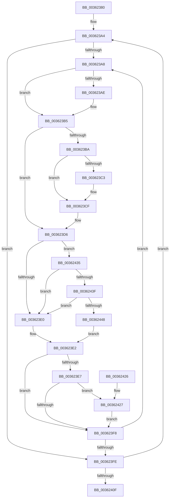

# ExpWaitForSpinLockSharedAndAcquire

- RVA: `0x00362380`–`0x00362451` (길이 `209` bytes)
- VA: `0x0000000140362380`
- 실행 섹션: `.text`
- PDB 이름 있음: `예`; PDB Function 태그: `아니요`
- unwind 정보 RVA: `0x0007593C`
- 디코드: `65`개 명령, `209/209` bytes 표시
- 미해석 바이트: `0` (있으면 어셈블리에 `.byte`로 보존)

> 이 문서는 커널 이미지의 기계어와 PDB 기호를 분석해 생성했습니다. 4번과 5번은 함수 원형과 자료형을 바이너리 사용 방식에서 추정한 C 해석이며 원본 소스 복구 결과는 아닙니다.

## 1. Dependencies

- 직접 호출 지점: **4**; 고유 호출 대상: **4**
- 직접 호출자로 확인된 함수: **40**
- RIP 상대 이미지 참조: **3**

### Outgoing calls
- `0x003623CA` → [KiLowerIrqlProcessIrqlFlags](../4F/KiLowerIrqlProcessIrqlFlags_function_004F5698.md) (function, `0x004F5698`)
- `0x0036242E` → [KiRaiseIrqlProcessIrqlFlags](../4F/KiRaiseIrqlProcessIrqlFlags_function_004F56FC.md) (function, `0x004F56FC`)
- `0x0036243F` → [KiCheckVpBackingLongSpinWaitHypercall](../30/KiCheckVpBackingLongSpinWaitHypercall_function_0030F490.md) (function, `0x0030F490`)
- `0x0036244A` → [HvlNotifyLongSpinWait](../30/HvlNotifyLongSpinWait_function_0030F460.md) (function, `0x0030F460`)

### Direct callers
- [KiActivateWaiterQueueWithNoLocks](../20/KiActivateWaiterQueueWithNoLocks_function_0020CEB0.md) at `0x0020CFE8`
- [sub_0022178C](../22/Unknown_function_0022178C.md) at `0x00221979`
- [MiLockWorkingSetOptimal](../23/MiLockWorkingSetOptimal_function_00238FC0.md) at `0x00239141`
- [ExAcquireSpinLockSharedAtDpcLevel](../24/ExAcquireSpinLockSharedAtDpcLevel_function_00248E30.md) at `0x00248E72`
- [sub_0024A490](../24/Unknown_function_0024A490.md) at `0x0024A573`
- [sub_0024DC36](../24/Unknown_function_0024DC36.md) at `0x0024DC57`
- [ExAcquireSpinLockShared](../24/ExAcquireSpinLockShared_function_0024DCE0.md) at `0x0024DD4C`
- [KiAbEntryRemoveFromTree](../26/KiAbEntryRemoveFromTree_function_00262410.md) at `0x00262A2E`
- [MiLockVadTree](../27/MiLockVadTree_function_0027C0F0.md) at `0x0027C244`
- [MiLockVadTree](../27/MiLockVadTree_function_0027C0F0.md) at `0x0027C26F`
- [MiLockWorkingSetCoreShared](../27/MiLockWorkingSetCoreShared_function_0027C3E0.md) at `0x0027C435`
- [MiAcquirePageListLock](../27/MiAcquirePageListLock_function_0027C450.md) at `0x0027C8E1`
- [sub_0027CCA5](../27/Unknown_function_0027CCA5.md) at `0x0027CCC2`
- [sub_0027CD98](../27/Unknown_function_0027CD98.md) at `0x0027CDA3`
- [MiMakeHyperRangeAccessible](../27/MiMakeHyperRangeAccessible_function_0027CE10.md) at `0x0027D0B0`
- [MiAddWorkingSetEntries](../27/MiAddWorkingSetEntries_function_0027DC00.md) at `0x0027E1DD`
- [MiMakeSystemAddressValid](../27/MiMakeSystemAddressValid_function_0027FF70.md) at `0x00280935`
- [sub_00282144](../28/Unknown_function_00282144.md) at `0x00282165`
- [MiSetVaAgeList](../29/MiSetVaAgeList_function_00290A20.md) at `0x00291534`
- [MmIsFileObjectAPagingFile](../29/MmIsFileObjectAPagingFile_function_0029BDAC.md) at `0x0029BEAE`
- [sub_002BC06C](../2B/Unknown_function_002BC06C.md) at `0x002BC094`
- [KiAcquireProcessLockShared](../2C/KiAcquireProcessLockShared_function_002CF9A0.md) at `0x002CFA16`
- [sub_002E0B15](../2E/Unknown_function_002E0B15.md) at `0x002E0BB4`
- [ExpAddTagForBigPages](../2E/ExpAddTagForBigPages_function_002EF570.md) at `0x002EF7C3`
- [sub_002F0126](../2F/Unknown_function_002F0126.md) at `0x002F0153`
- [MiReturnLockedVadOrNextVa](../31/MiReturnLockedVadOrNextVa_function_00316980.md) at `0x00316C44`
- [MiUserFault](../32/MiUserFault_function_00329840.md) at `0x00329CA2`
- [sub_0032D782](../32/Unknown_function_0032D782.md) at `0x0032DB0D`
- [sub_0032E327](../32/Unknown_function_0032E327.md) at `0x0032E40E`
- [MiCheckVirtualAddress](../32/MiCheckVirtualAddress_function_0032E4F0.md) at `0x0032E7F3`
- [ExAllocateHeapPool](../35/ExAllocateHeapPool_function_0035BA30.md) at `0x0035D33B`
- [sub_003602E3](Unknown_function_003602E3.md) at `0x003607FB`
- [MiUpdateWorkingSetPrivateSize](MiUpdateWorkingSetPrivateSize_function_00362250.md) at `0x00362327`
- [MiEndingOffsetWithLock](../40/MiEndingOffsetWithLock_function_00404718.md) at `0x00404819`
- [sub_0040E5FD](../40/Unknown_function_0040E5FD.md) at `0x0040E61A`
- [ExpRemoveTagForBigPages](../41/ExpRemoveTagForBigPages_function_00411980.md) at `0x00411B3E`
- [MiLockPageListAndLastPage](../41/MiLockPageListAndLastPage_function_00411BA0.md) at `0x00411D92`
- [sub_0041CCAA](../41/Unknown_function_0041CCAA.md) at `0x0041CCCE`
- [KeQueryBasePriorityThread](../41/KeQueryBasePriorityThread_function_0041E500.md) at `0x0041E62F`
- [sub_004348A7](../43/Unknown_function_004348A7.md) at `0x004348B4`
- [sub_00B830A9](../../poolcode/B8/Unknown_function_00B830A9.md) at `0x00B835B5`

### Static image references
- `0x003623BA` → RVA `0x00FC6D20` (`ALMOSTRO`; read)
- `0x003623D8` → RVA `0x00FC52AC` (`ALMOSTRO`; reference)
- `0x00362435` → RVA `0x00FC6AB8` (`ALMOSTRO`; read)

## 2. Other-region calls and transfers

- 다른 실행 섹션으로 향하는 call: **0**
- 별도 외부 분기/꼬리 이동을 확인하지 못했습니다.

## 3. Assembly (complete function range)

```asm
00362380  48 89 5C 24 08                  mov qword ptr [rsp + 8], rbx
00362385  48 89 6C 24 10                  mov qword ptr [rsp + 0x10], rbp
0036238A  48 89 74 24 18                  mov qword ptr [rsp + 0x18], rsi
0036238F  57                              push rdi
00362390  48 83 EC 20                     sub rsp, 0x20
00362394  0F B6 DA                        movzx ebx, dl
00362397  48 8B F9                        mov rdi, rcx
0036239A  33 F6                           xor esi, esi
0036239C  0F 0D 09                        prefetchw byte ptr [rcx]
0036239F  8B 01                           mov eax, dword ptr [rcx]
003623A1  8D 6E 02                        lea ebp, [rsi + 2]
003623A4  85 C0                           test eax, eax
003623A6  79 56                           jns 0x1403623fe
003623A8  0F BA E0 1E                     bt eax, 0x1e
003623AC  72 07                           jb 0x1403623b5
003623AE  F0 81 0F 00 00 00 40            lock or dword ptr [rdi], 0x40000000
003623B5  80 FB FF                        cmp bl, 0xff
003623B8  74 1C                           je 0x1403623d6
003623BA  83 3D 5F 49 C6 00 00            cmp dword ptr [rip + 0xc6495f], 0
003623C1  74 0C                           je 0x1403623cf
003623C3  44 0F 20 C1                     mov rcx, cr8
003623C7  0F B6 D3                        movzx edx, bl
003623CA  E8 C9 32 19 00                  call 0x1404f5698
003623CF  0F B6 C3                        movzx eax, bl
003623D2  44 0F 22 C0                     mov cr8, rax
003623D6  FF C6                           inc esi
003623D8  85 35 CE 2E C6 00               test dword ptr [rip + 0xc62ece], esi
003623DE  74 55                           je 0x140362435
003623E0  F3 90                           pause
003623E2  80 FB FF                        cmp bl, 0xff
003623E5  74 11                           je 0x1403623f8
003623E7  44 0F 20 C3                     mov rbx, cr8
003623EB  44 0F 22 C5                     mov cr8, rbp
003623EF  83 3D 2A 49 C6 00 00            cmp dword ptr [rip + 0xc6492a], 0
003623F6  75 2F                           jne 0x140362427
003623F8  8B 07                           mov eax, dword ptr [rdi]
003623FA  85 C0                           test eax, eax
003623FC  78 AA                           js 0x1403623a8
003623FE  8D 48 01                        lea ecx, [rax + 1]
00362401  8B D0                           mov edx, eax
00362403  0F BA F1 1E                     btr ecx, 0x1e
00362407  F0 0F B1 0F                     lock cmpxchg dword ptr [rdi], ecx
0036240B  3B C2                           cmp eax, edx
0036240D  75 95                           jne 0x1403623a4
0036240F  48 8B 5C 24 30                  mov rbx, qword ptr [rsp + 0x30]
00362414  8B C6                           mov eax, esi
00362416  48 8B 74 24 40                  mov rsi, qword ptr [rsp + 0x40]
0036241B  48 8B 6C 24 38                  mov rbp, qword ptr [rsp + 0x38]
00362420  48 83 C4 20                     add rsp, 0x20
00362424  5F                              pop rdi
00362425  C3                              ret
00362426  CC                              int3
00362427  40 0F B6 D5                     movzx edx, bpl
0036242B  0F B6 CB                        movzx ecx, bl
0036242E  E8 C9 32 19 00                  call 0x1404f56fc
00362433  EB C3                           jmp 0x1403623f8
00362435  8B 05 7D 46 C6 00               mov eax, dword ptr [rip + 0xc6467d]
0036243B  A8 40                           test al, 0x40
0036243D  74 A1                           je 0x1403623e0
0036243F  E8 4C D0 FA FF                  call 0x14030f490
00362444  84 C0                           test al, al
00362446  74 98                           je 0x1403623e0
00362448  8B CE                           mov ecx, esi
0036244A  E8 11 D0 FA FF                  call 0x14030f460
0036244F  EB 91                           jmp 0x1403623e2
```

## 4. C-style interpretation (structured pseudocode)

```c
__int64 __fastcall ExpWaitForSpinLockSharedAndAcquire(__int64 a1, unsigned __int8 a2)
{
    __int64 result;
    __int64 v_rsi;
    __int64 v_rsp;
    unsigned __int64 v_stack_p10;
    unsigned __int64 v_stack_p18;
    unsigned __int64 v_stack_p8;

    v_stack_p8 = v_rbx;
    v_stack_p10 = v_rbp;
    v_stack_p18 = v_rsi;
    v_rsp = (v_rsp) - (32);
    v_rsi = 0;
loc_003623A4:
    if (!sign_flag) goto loc_003623FE;
loc_003623A8:
    if (!(condition_is_below)) {
    }
    if (a2 == 255) goto loc_003623D6;
    result = (unsigned int)(*(unsigned int *)(a1));
    if ((*(unsigned int *)(v_rip + 12994911)) != 0) {
        a1 = v_cr8;
        a2 = a2;
        result = KiLowerIrqlProcessIrqlFlags(a1, a2, a3, a4);
    }
loc_003623D6:
    v_rsi = (unsigned int)((v_rsi) + 1);
    if (((*(unsigned int *)(v_rip + 12988110)) & ((unsigned int)(v_rsi))) == 0) goto loc_00362435;
loc_003623E0:
loc_003623E2:
    if (a2 == 255) goto loc_003623F8;
    if ((*(unsigned int *)(v_rip + 12994858)) != 0) goto loc_00362427;
loc_003623F8:
    if (sign_flag) goto loc_003623A8;
loc_003623FE:
    if (((unsigned int)((unsigned int)(*(unsigned int *)(a1)))) != ((unsigned int)((unsigned int)((unsigned int)((unsigned int)(*(unsigned int *)(a1))))))) goto loc_003623A4;
    v_rsp = (v_rsp) + (32);
    return (unsigned int)((unsigned int)(v_rsi));
loc_00362427:
    result = KiRaiseIrqlProcessIrqlFlags((unsigned __int8)(v_stack_p8), (unsigned __int8)(v_stack_p10), a3, a4);
    goto loc_003623F8;
loc_00362435:
    if ((((unsigned __int8)((unsigned int)(*(unsigned int *)(v_rip + 12994173)))) & (64)) == 0) goto loc_003623E0;
    result = KiCheckVpBackingLongSpinWaitHypercall((unsigned __int8)(v_stack_p8), (unsigned __int8)(v_stack_p10), a3, a4);
    if ((unsigned __int8)(result) == 0) goto loc_003623E0;
    result = HvlNotifyLongSpinWait((unsigned int)((unsigned int)(v_stack_p18)), (unsigned __int8)(v_stack_p10), a3, a4);
    goto loc_003623E2;
}
```

## 5. (Beta) C Style

```c
int64_t ExpWaitForSpinLockSharedAndAcquire(void *Arg1, uint8_t Arg2)
{
    uint8_t *arg1 = (uint8_t *)Arg1;

    int64_t result;
    int64_t local_rsi;
    int64_t local_rsp;
    uint64_t v_stack_p10;
    uint64_t v_stack_p18;
    uint64_t v_stack_p8;

    v_stack_p8 = local_rbx;
    v_stack_p10 = local_rbp;
    v_stack_p18 = local_rsi;
    local_rsp = (local_rsp) - (32);
    local_rsi = 0;
loc_003623A4:
    if (!sign_flag) goto loc_003623FE;
loc_003623A8:
    if (!(condition_is_below)) {
    }
    if (Arg2 == 255) goto loc_003623D6;
    result = (uint32_t)(*(uint32_t *)(arg1));
    if ((*(uint32_t *)(v_rip + 0xC6495F)) != 0) {
        Arg1 = v_cr8;
        Arg2 = Arg2;
        result = KiLowerIrqlProcessIrqlFlags(Arg1, Arg2, a3, a4);
    }
loc_003623D6:
    local_rsi = (uint32_t)((local_rsi) + 1);
    if (((*(uint32_t *)(v_rip + 0xC62ECE)) & ((uint32_t)(local_rsi))) == 0) goto loc_00362435;
loc_003623E0:
loc_003623E2:
    if (Arg2 == 255) goto loc_003623F8;
    if ((*(uint32_t *)(v_rip + 0xC6492A)) != 0) goto loc_00362427;
loc_003623F8:
    if (sign_flag) goto loc_003623A8;
loc_003623FE:
    if (((uint32_t)((uint32_t)(*(uint32_t *)(arg1)))) != ((uint32_t)((uint32_t)((uint32_t)((uint32_t)(*(uint32_t *)(arg1))))))) goto loc_003623A4;
    local_rsp = (local_rsp) + (32);
    return (uint32_t)((uint32_t)(local_rsi));
loc_00362427:
    result = KiRaiseIrqlProcessIrqlFlags((uint8_t)(v_stack_p8), (uint8_t)(v_stack_p10), a3, a4);
    goto loc_003623F8;
loc_00362435:
    if ((((uint8_t)((uint32_t)(*(uint32_t *)(v_rip + 0xC6467D)))) & (64)) == 0) goto loc_003623E0;
    result = KiCheckVpBackingLongSpinWaitHypercall((uint8_t)(v_stack_p8), (uint8_t)(v_stack_p10), a3, a4);
    if ((uint8_t)(result) == 0) goto loc_003623E0;
    result = HvlNotifyLongSpinWait((uint32_t)((uint32_t)(v_stack_p18)), (uint8_t)(v_stack_p10), a3, a4);
    goto loc_003623E2;
}
```

### 관측된 메모리 오프셋

구조체 형식이 확인되지 않은 접근은 인자 기준의 오프셋으로만 기록했습니다.

| 기준 인자 | 오프셋 표현 | 폭 (bit) | 접근 |
|---|---:|---:|---|
| `Arg1` | `+ 0x0` | `8` | `R` |
| `Arg1` | `+ 0x0` | `32` | `R` |
| `Arg1` | `+ 0x0` | `32` | `R/W` |

## 6. Execution-region graph

[열기: 2D/3D 그래프와 함수 탐색 컨트롤 패널](../../../control-panel.html?section=text&rva=0x00362380&view=graph)

- 2D 그래프는 위에서 아래로 흐르고, 3D 그래프는 빈 공간을 드래그해 회전합니다. Shift+드래그는 이동, 휠은 확대·축소, 함수 노드 선택은 대상 보고서 이동입니다.

### Static fallback


