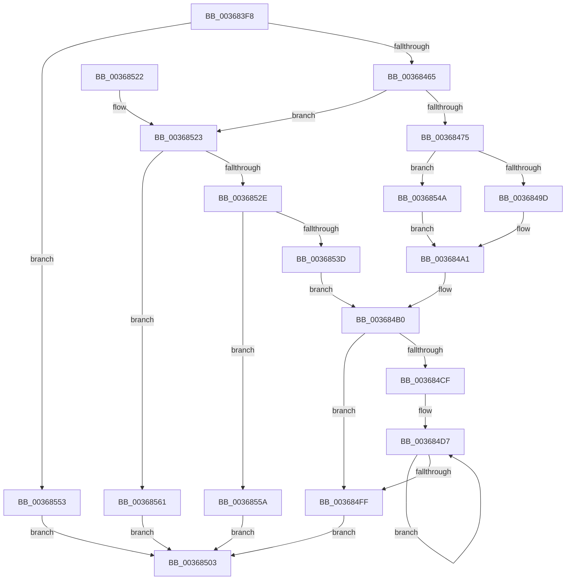

# KeAddEnclavePage

- RVA: `0x003683F8`–`0x00368568` (길이 `368` bytes)
- VA: `0x00000001403683F8`
- 실행 섹션: `.text`
- PDB 이름 있음: `예`; PDB Function 태그: `아니요`
- unwind 정보 RVA: `0x0007A09C`
- 디코드: `100`개 명령, `368/368` bytes 표시
- 미해석 바이트: `0` (있으면 어셈블리에 `.byte`로 보존)

> 이 문서는 커널 이미지의 기계어와 PDB 기호를 분석해 생성했습니다. 4번과 5번은 함수 원형과 자료형을 바이너리 사용 방식에서 추정한 C 해석이며 원본 소스 복구 결과는 아닙니다.

## 1. Dependencies

- 직접 호출 지점: **4**; 고유 호출 대상: **3**
- 직접 호출자로 확인된 함수: **2**
- RIP 상대 이미지 참조: **2**

### Outgoing calls
- `0x00368440` → [memset](../6C/memset_function_006C6C40.md) (function, `0x006C6C40`)
- `0x003684C5` → [KiEncls](../6B/KiEncls_function_006B1BE0.md) (function, `0x006B1BE0`)
- `0x003684E4` → [KiEncls](../6B/KiEncls_function_006B1BE0.md) (function, `0x006B1BE0`)
- `0x0036850D` → [_security_check_cookie](../6A/_security_check_cookie_function_006AC640.md) (function, `0x006AC640`)

### Direct callers
- [MiAddPagesToEnclave](MiAddPagesToEnclave_function_00367EEC.md) at `0x00368110`
- [MiCopyPagesIntoEnclave](../../page/A4/MiCopyPagesIntoEnclave_function_00A472AC.md) at `0x00A477BD`

### Static image references
- `0x00368411` → RVA `0x00E0A740` (`.data`; read)
- `0x0036844F` → RVA `0x00FC6B30` (`ALMOSTRO`; read)

## 2. Other-region calls and transfers

- 다른 실행 섹션으로 향하는 call: **0**
- 별도 외부 분기/꼬리 이동을 확인하지 못했습니다.

## 3. Assembly (complete function range)

```asm
003683F8  40 55                           push rbp
003683FA  53                              push rbx
003683FB  56                              push rsi
003683FC  57                              push rdi
003683FD  41 56                           push r14
003683FF  41 57                           push r15
00368401  48 81 EC F8 00 00 00            sub rsp, 0xf8
00368408  48 8D 6C 24 60                  lea rbp, [rsp + 0x60]
0036840D  48 83 E5 C0                     and rbp, 0xffffffffffffffc0
00368411  48 8B 05 28 23 AA 00            mov rax, qword ptr [rip + 0xaa2328]
00368418  48 33 C4                        xor rax, rsp
0036841B  48 89 85 80 00 00 00            mov qword ptr [rbp + 0x80], rax
00368422  4D 8B F9                        mov r15, r9
00368425  49 8B F8                        mov rdi, r8
00368428  4C 8B F2                        mov r14, rdx
0036842B  48 8B F1                        mov rsi, rcx
0036842E  48 8B 9C 24 58 01 00 00         mov rbx, qword ptr [rsp + 0x158]
00368436  33 D2                           xor edx, edx
00368438  44 8D 42 40                     lea r8d, [rdx + 0x40]
0036843C  48 8D 4D 40                     lea rcx, [rbp + 0x40]
00368440  E8 FB E7 35 00                  call 0x1406c6c40
00368445  48 B9 00 00 00 00 00 01 00 00   movabs rcx, 0x10000000000
0036844F  48 85 0D DA E6 C5 00            test qword ptr [rip + 0xc5e6da], rcx
00368456  41 B8 00 00 00 00               mov r8d, 0
0036845C  44 89 03                        mov dword ptr [rbx], r8d
0036845F  0F 84 EE 00 00 00               je 0x140368553
00368465  8B 9C 24 50 01 00 00            mov ebx, dword ptr [rsp + 0x150]
0036846C  F6 C3 40                        test bl, 0x40
0036846F  0F 85 AE 00 00 00               jne 0x140368523
00368475  45 8D 50 01                     lea r10d, [r8 + 1]
00368479  8B CB                           mov ecx, ebx
0036847B  41 23 CA                        and ecx, r10d
0036847E  8B D1                           mov edx, ecx
00368480  83 CA 02                        or edx, 2
00368483  F6 C3 02                        test bl, 2
00368486  0F 44 D1                        cmove edx, ecx
00368489  8B CA                           mov ecx, edx
0036848B  83 C9 04                        or ecx, 4
0036848E  F6 C3 04                        test bl, 4
00368491  0F 44 CA                        cmove ecx, edx
00368494  F6 C3 08                        test bl, 8
00368497  0F 85 AD 00 00 00               jne 0x14036854a
0036849D  0F BA E9 09                     bts ecx, 9
003684A1  89 4D 40                        mov dword ptr [rbp + 0x40], ecx
003684A4  4C 89 75 28                     mov qword ptr [rbp + 0x28], r14
003684A8  48 8D 45 40                     lea rax, [rbp + 0x40]
003684AC  48 89 45 30                     mov qword ptr [rbp + 0x30], rax
003684B0  4C 89 7D 20                     mov qword ptr [rbp + 0x20], r15
003684B4  48 89 75 38                     mov qword ptr [rbp + 0x38], rsi
003684B8  45 33 C9                        xor r9d, r9d
003684BB  4C 8B C7                        mov r8, rdi
003684BE  48 8D 55 20                     lea rdx, [rbp + 0x20]
003684C2  41 8B CA                        mov ecx, r10d
003684C5  E8 16 97 34 00                  call 0x1406b1be0
003684CA  F6 C3 50                        test bl, 0x50
003684CD  75 30                           jne 0x1403684ff
003684CF  BB 00 10 00 00                  mov ebx, 0x1000
003684D4  89 5D 00                        mov dword ptr [rbp], ebx
003684D7  45 33 C9                        xor r9d, r9d
003684DA  4C 8B C7                        mov r8, rdi
003684DD  48 8B D6                        mov rdx, rsi
003684E0  41 8D 49 06                     lea ecx, [r9 + 6]
003684E4  E8 F7 96 34 00                  call 0x1406b1be0
003684E9  48 81 C7 00 01 00 00            add rdi, 0x100
003684F0  48 89 7D 10                     mov qword ptr [rbp + 0x10], rdi
003684F4  81 C3 00 FF FF FF               add ebx, 0xffffff00
003684FA  89 5D 00                        mov dword ptr [rbp], ebx
003684FD  75 D8                           jne 0x1403684d7
003684FF  33 C0                           xor eax, eax
00368501  EB 00                           jmp 0x140368503
00368503  48 8B 8D 80 00 00 00            mov rcx, qword ptr [rbp + 0x80]
0036850A  48 33 CC                        xor rcx, rsp
0036850D  E8 2E 41 34 00                  call 0x1406ac640
00368512  48 81 C4 F8 00 00 00            add rsp, 0xf8
00368519  41 5F                           pop r15
0036851B  41 5E                           pop r14
0036851D  5F                              pop rdi
0036851E  5E                              pop rsi
0036851F  5B                              pop rbx
00368520  5D                              pop rbp
00368521  C3                              ret
00368522  CC                              int3
00368523  48 0F BA 25 04 E6 C5 00 2B      bt qword ptr [rip + 0xc5e604], 0x2b
0036852C  73 33                           jae 0x140368561
0036852E  41 BA 0D 00 00 00               mov r10d, 0xd
00368534  8B C3                           mov eax, ebx
00368536  83 E0 0F                        and eax, 0xf
00368539  3C 03                           cmp al, 3
0036853B  75 1D                           jne 0x14036855a
0036853D  4C 89 45 28                     mov qword ptr [rbp + 0x28], r8
00368541  4C 89 45 30                     mov qword ptr [rbp + 0x30], r8
00368545  E9 66 FF FF FF                  jmp 0x1403684b0
0036854A  0F BA E9 08                     bts ecx, 8
0036854E  E9 4E FF FF FF                  jmp 0x1403684a1
00368553  B8 BB 00 00 C0                  mov eax, 0xc00000bb
00368558  EB A9                           jmp 0x140368503
0036855A  B8 45 00 00 C0                  mov eax, 0xc0000045
0036855F  EB A2                           jmp 0x140368503
00368561  B8 18 00 00 C0                  mov eax, 0xc0000018
00368566  EB 9B                           jmp 0x140368503
```

## 4. C-style interpretation (structured pseudocode)

```c
__int64 __fastcall KeAddEnclavePage(__int64 a1, __int64 a2, __int64 a3, __int64 a4, unsigned int a5, __int64 a6)
{
    __int64 result;
    __int64 v_rbp;
    __int64 v_rbx;
    __int64 v_rdi;
    __int64 v_rsp;
    unsigned __int64 v_stack_m48;
    unsigned __int64 v_stack_m88;
    unsigned __int64 v_stack_m90;
    unsigned __int64 v_stack_m98;
    unsigned __int64 v_stack_mA0;
    unsigned __int64 v_stack_mA8;
    unsigned __int64 v_stack_mB8;
    unsigned __int64 v_stack_mC8;

    v_rsp = (v_rsp) - (248);
    v_rbp = (v_stack_mC8) & (-64);
    result = (*(unsigned __int64 *)(v_rip + 11150120)) ^ (v_rsp);
    v_stack_m48 = result;
    a2 = 0;
    result = memset(v_stack_m88, a2, a2 + 64, a4);
    *(unsigned int *)(a6) = 0;
    if (((*(unsigned __int64 *)(v_rip + 12969690)) & (v_stack_m88)) == 0) goto loc_00368553;
    if ((((unsigned __int8)((unsigned int)(a5))) & (64)) != 0) goto loc_00368523;
    a1 = (unsigned int)(((unsigned int)((unsigned int)((unsigned int)(a5)))) & ((unsigned int)(0 + 1)));
    a2 = (unsigned int)(((unsigned int)((unsigned int)(a1))) | (2));
    if ((((unsigned __int8)((unsigned int)(a5))) & (2)) == 0) { a2 = (unsigned int)(a1); }
    a1 = (unsigned int)(((unsigned int)((unsigned int)(a2))) | (4));
    if ((((unsigned __int8)((unsigned int)(a5))) & (4)) == 0) { a1 = (unsigned int)(a2); }
    if ((((unsigned __int8)((unsigned int)(a5))) & (8)) != 0) goto loc_0036854A;
loc_003684A1:
    v_stack_m88 = (unsigned int)(a1);
    v_stack_mA0 = a2;
    v_stack_m98 = v_stack_m88;
loc_003684B0:
    v_stack_mA8 = a4;
    v_stack_m90 = a1;
    a4 = 0;
    result = KiEncls((unsigned int)((unsigned int)(0 + 1)), v_stack_mA8, a3, a4);
    if ((((unsigned __int8)((unsigned int)(a5))) & (80)) != 0) goto loc_003684FF;
    v_stack_mC8 = (unsigned int)((unsigned int)(0x1000ULL));
loc_003684D7:
    a4 = 0;
    result = KiEncls(a4 + 6, a1, a3, a4);
    v_rdi = (a3) + (256);
    v_stack_mB8 = v_rdi;
    v_rbx = (unsigned int)(((unsigned int)(0x1000ULL)) + (0xFFFFFF00ULL));
    v_stack_mC8 = (unsigned int)(v_rbx);
    if (condition_is_not_equal) goto loc_003684D7;
loc_003684FF:
    result = 0;
    goto loc_00368503;
loc_00368503:
    a1 = (v_stack_m48) ^ (v_rsp);
    result = _security_check_cookie(a1, a1, a3, a4);
    v_rsp = (v_rsp) + (248);
    return result;
loc_00368523:
    if (condition_is_above_or_equal) goto loc_00368561;
    result = (unsigned int)(((unsigned int)((unsigned int)(v_rbx))) & (15));
    if (((unsigned __int8)(result)) != 3) goto loc_0036855A;
    v_stack_mA0 = a3;
    v_stack_m98 = a3;
    goto loc_003684B0;
loc_0036854A:
    goto loc_003684A1;
loc_00368553:
    goto loc_00368503;
loc_0036855A:
    goto loc_00368503;
loc_00368561:
    goto loc_00368503;
}
```

## 5. (Beta) C Style

```c
int64_t KeAddEnclavePage(int64_t Arg1, int64_t Arg2, int64_t Arg3, int64_t Arg4, uint32_t Arg5, void *Arg6)
{
    uint8_t *arg6 = (uint8_t *)Arg6;

    int64_t result;
    int64_t local_rbp;
    int64_t local_rbx;
    int64_t local_rdi;
    int64_t local_rsp;
    uint64_t v_stack_m48;
    uint64_t v_stack_m88;
    uint64_t v_stack_m90;
    uint64_t v_stack_m98;
    uint64_t v_stack_mA0;
    uint64_t v_stack_mA8;
    uint64_t v_stack_mB8;
    uint64_t v_stack_mC8;

    local_rsp = (local_rsp) - (248);
    local_rbp = (v_stack_mC8) & (-64);
    result = (*(uint64_t *)(v_rip + 0xAA2328)) ^ (local_rsp);
    v_stack_m48 = result;
    Arg2 = 0;
    result = memset(v_stack_m88, Arg2, Arg2 + 64, Arg4);
    *(uint32_t *)(arg6) = 0;
    if (((*(uint64_t *)(v_rip + 0xC5E6DA)) & (v_stack_m88)) == 0) goto loc_00368553;
    if ((((uint8_t)((uint32_t)(Arg5))) & (64)) != 0) goto loc_00368523;
    Arg1 = (uint32_t)(((uint32_t)((uint32_t)((uint32_t)(Arg5)))) & ((uint32_t)(0 + 1)));
    Arg2 = (uint32_t)(((uint32_t)((uint32_t)(Arg1))) | (2));
    if ((((uint8_t)((uint32_t)(Arg5))) & (2)) == 0) { Arg2 = (uint32_t)(Arg1); }
    Arg1 = (uint32_t)(((uint32_t)((uint32_t)(Arg2))) | (4));
    if ((((uint8_t)((uint32_t)(Arg5))) & (4)) == 0) { Arg1 = (uint32_t)(Arg2); }
    if ((((uint8_t)((uint32_t)(Arg5))) & (8)) != 0) goto loc_0036854A;
loc_003684A1:
    v_stack_m88 = (uint32_t)(Arg1);
    v_stack_mA0 = Arg2;
    v_stack_m98 = v_stack_m88;
loc_003684B0:
    v_stack_mA8 = Arg4;
    v_stack_m90 = Arg1;
    Arg4 = 0;
    result = KiEncls((uint32_t)((uint32_t)(0 + 1)), v_stack_mA8, Arg3, Arg4);
    if ((((uint8_t)((uint32_t)(Arg5))) & (80)) != 0) goto loc_003684FF;
    v_stack_mC8 = (uint32_t)((uint32_t)(0x1000ULL));
loc_003684D7:
    Arg4 = 0;
    result = KiEncls(Arg4 + 6, Arg1, Arg3, Arg4);
    local_rdi = (Arg3) + (256);
    v_stack_mB8 = local_rdi;
    local_rbx = (uint32_t)(((uint32_t)(0x1000ULL)) + (0xFFFFFF00ULL));
    v_stack_mC8 = (uint32_t)(local_rbx);
    if (condition_is_not_equal) goto loc_003684D7;
loc_003684FF:
    result = 0;
    goto loc_00368503;
loc_00368503:
    Arg1 = (v_stack_m48) ^ (local_rsp);
    result = _security_check_cookie(Arg1, Arg1, Arg3, Arg4);
    local_rsp = (local_rsp) + (248);
    return result;
loc_00368523:
    if (condition_is_above_or_equal) goto loc_00368561;
    result = (uint32_t)(((uint32_t)((uint32_t)(local_rbx))) & (15));
    if (((uint8_t)(result)) != 3) goto loc_0036855A;
    v_stack_mA0 = Arg3;
    v_stack_m98 = Arg3;
    goto loc_003684B0;
loc_0036854A:
    goto loc_003684A1;
loc_00368553:
    goto loc_00368503;
loc_0036855A:
    goto loc_00368503;
loc_00368561:
    goto loc_00368503;
}
```

### 관측된 메모리 오프셋

구조체 형식이 확인되지 않은 접근은 인자 기준의 오프셋으로만 기록했습니다.

| 기준 인자 | 오프셋 표현 | 폭 (bit) | 접근 |
|---|---:|---:|---|
| `Arg6` | `+ 0x0` | `32` | `W` |

## 6. Execution-region graph

[열기: 2D/3D 그래프와 함수 탐색 컨트롤 패널](../../../control-panel.html?section=text&rva=0x003683F8&view=graph)

- 2D 그래프는 위에서 아래로 흐르고, 3D 그래프는 빈 공간을 드래그해 회전합니다. Shift+드래그는 이동, 휠은 확대·축소, 함수 노드 선택은 대상 보고서 이동입니다.

### Static fallback


