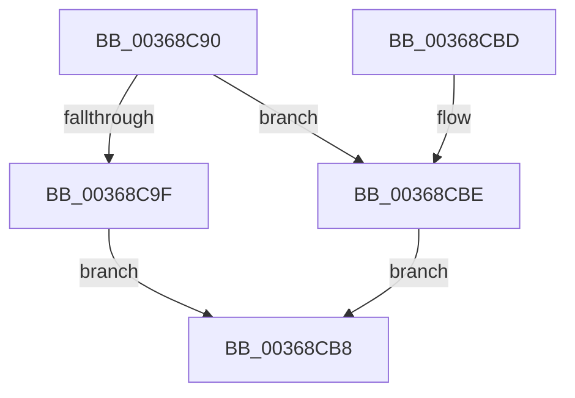

# KeRemoveEnclavePage

- RVA: `0x00368C90`–`0x00368CC5` (길이 `53` bytes)
- VA: `0x0000000140368C90`
- 실행 섹션: `.text`
- PDB 이름 있음: `예`; PDB Function 태그: `아니요`
- unwind 정보 RVA: `0x0007A144`
- 디코드: `16`개 명령, `53/53` bytes 표시
- 미해석 바이트: `0` (있으면 어셈블리에 `.byte`로 보존)

> 이 문서는 커널 이미지의 기계어와 PDB 기호를 분석해 생성했습니다. 4번과 5번은 함수 원형과 자료형을 바이너리 사용 방식에서 추정한 C 해석이며 원본 소스 복구 결과는 아닙니다.

## 1. Dependencies

- 직접 호출 지점: **2**; 고유 호출 대상: **2**
- 직접 호출자로 확인된 함수: **5**
- RIP 상대 이미지 참조: **1**

### Outgoing calls
- `0x00368CAA` → [KiEncls](../6B/KiEncls_function_006B1BE0.md) (function, `0x006B1BE0`)
- `0x00368CB1` → [KiEnclsStatus](KiEnclsStatus_function_00368E1C.md) (function, `0x00368E1C`)

### Direct callers
- [MiDecommitHardwareEnclavePages](MiDecommitHardwareEnclavePages_function_003688D4.md) at `0x00368A06`
- [sub_006E362E](../6E/Unknown_function_006E362E.md) at `0x006E3935`
- [MiDeleteAllHardwareEnclaves](../../pagelk/B7/MiDeleteAllHardwareEnclaves_function_00B74CAC.md) at `0x00B74EAE`
- [MiReleaseEnclaveMetadataPage](../../pagelk/B7/MiReleaseEnclaveMetadataPage_function_00B74EE4.md) at `0x00B74EF1`
- [MiDeleteEnclavePages](../../pagelk/B7/MiDeleteEnclavePages_function_00B7E228.md) at `0x00B7E298`

### Static image references
- `0x00368C94` → RVA `0x00FC6B30` (`ALMOSTRO`; read)

## 2. Other-region calls and transfers

- 다른 실행 섹션으로 향하는 call: **0**
- 별도 외부 분기/꼬리 이동을 확인하지 못했습니다.

## 3. Assembly (complete function range)

```asm
00368C90  48 83 EC 28                     sub rsp, 0x28
00368C94  48 0F BA 25 93 DE C5 00 28      bt qword ptr [rip + 0xc5de93], 0x28
00368C9D  73 1F                           jae 0x140368cbe
00368C9F  45 33 C9                        xor r9d, r9d
00368CA2  4C 8B C1                        mov r8, rcx
00368CA5  33 D2                           xor edx, edx
00368CA7  8D 4A 03                        lea ecx, [rdx + 3]
00368CAA  E8 31 8F 34 00                  call 0x1406b1be0
00368CAF  8B C8                           mov ecx, eax
00368CB1  E8 66 01 00 00                  call 0x140368e1c
00368CB6  EB 00                           jmp 0x140368cb8
00368CB8  48 83 C4 28                     add rsp, 0x28
00368CBC  C3                              ret
00368CBD  CC                              int3
00368CBE  B8 BB 00 00 C0                  mov eax, 0xc00000bb
00368CC3  EB F3                           jmp 0x140368cb8
```

## 4. C-style interpretation (structured pseudocode)

```c
__int64 __fastcall KeRemoveEnclavePage(__int64 a1, int a2, __int64 a3, int a4)
{
    __int64 result;
    __int64 v_rsp;

    v_rsp = (v_rsp) - (40);
    if (condition_is_above_or_equal) goto loc_00368CBE;
    a4 = 0;
    a2 = 0;
    result = KiEncls(a2 + 3, a2, a1, a4);
    result = KiEnclsStatus((unsigned int)((unsigned int)(result)), a2, a1, a4);
    goto loc_00368CB8;
loc_00368CB8:
    v_rsp = (v_rsp) + (40);
    return result;
loc_00368CBE:
    goto loc_00368CB8;
}
```

## 5. (Beta) C Style

```c
int64_t KeRemoveEnclavePage(int64_t Arg1, int32_t Arg2, int64_t Arg3, int32_t Arg4)
{
    int64_t result;
    int64_t local_rsp;

    local_rsp = (local_rsp) - (40);
    if (condition_is_above_or_equal) goto loc_00368CBE;
    Arg4 = 0;
    Arg2 = 0;
    result = KiEncls(Arg2 + 3, Arg2, Arg1, Arg4);
    result = KiEnclsStatus((uint32_t)((uint32_t)(result)), Arg2, Arg1, Arg4);
    goto loc_00368CB8;
loc_00368CB8:
    local_rsp = (local_rsp) + (40);
    return result;
loc_00368CBE:
    goto loc_00368CB8;
}
```

## 6. Execution-region graph

[열기: 2D/3D 그래프와 함수 탐색 컨트롤 패널](../../../control-panel.html?section=text&rva=0x00368C90&view=graph)

- 2D 그래프는 위에서 아래로 흐르고, 3D 그래프는 빈 공간을 드래그해 회전합니다. Shift+드래그는 이동, 휠은 확대·축소, 함수 노드 선택은 대상 보고서 이동입니다.

### Static fallback


