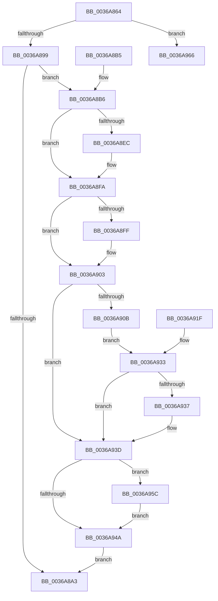

# KeSwappablePageReference

- RVA: `0x0036A864`–`0x0036A96D` (길이 `265` bytes)
- VA: `0x000000014036A864`
- 실행 섹션: `.text`
- PDB 이름 있음: `예`; PDB Function 태그: `아니요`
- unwind 정보 RVA: `0x0007A2C8`
- 디코드: `77`개 명령, `265/265` bytes 표시
- 미해석 바이트: `0` (있으면 어셈블리에 `.byte`로 보존)

> 이 문서는 커널 이미지의 기계어와 PDB 기호를 분석해 생성했습니다. 4번과 5번은 함수 원형과 자료형을 바이너리 사용 방식에서 추정한 C 해석이며 원본 소스 복구 결과는 아닙니다.

## 1. Dependencies

- 직접 호출 지점: **6**; 고유 호출 대상: **6**
- 직접 호출자로 확인된 함수: **2**
- RIP 상대 이미지 참조: **0**

### Outgoing calls
- `0x0036A8DC` → [KeAbPreAcquire](../21/KeAbPreAcquire_function_00210230.md) (function, `0x00210230`)
- `0x0036A8F5` → [ExfAcquirePushLockExclusiveEx](../20/ExfAcquirePushLockExclusiveEx_function_0020FC90.md) (function, `0x0020FC90`)
- `0x0036A914` → [MmProbeAndLockPages](../23/MmProbeAndLockPages_function_0023B990.md) (function, `0x0023B990`)
- `0x0036A94D` → [KeAbPostRelease](../2E/KeAbPostRelease_function_002E1600.md) (function, `0x002E1600`)
- `0x0036A952` → [KeLeaveCriticalRegion](../25/KeLeaveCriticalRegion_function_0025D8B0.md) (function, `0x0025D8B0`)
- `0x0036A95F` → [ExfTryToWakePushLock](../26/ExfTryToWakePushLock_function_00265DD0.md) (function, `0x00265DD0`)

### Direct callers
- [KeSwapProcessOrStack](../5C/KeSwapProcessOrStack_function_005C5E00.md) at `0x005C5EA8`
- [PspSchedulerSharedDataRegionSlotAllocate](../../page/A2/PspSchedulerSharedDataRegionSlotAllocate_function_00A268C8.md) at `0x00A26A73`

### Static image references
- 디코드된 RIP-relative 메모리 참조가 없습니다.

## 2. Other-region calls and transfers

- 다른 실행 섹션으로 향하는 call: **0**
- 별도 외부 분기/꼬리 이동을 확인하지 못했습니다.

## 3. Assembly (complete function range)

```asm
0036A864  48 89 5C 24 18                  mov qword ptr [rsp + 0x18], rbx
0036A869  56                              push rsi
0036A86A  57                              push rdi
0036A86B  41 55                           push r13
0036A86D  41 56                           push r14
0036A86F  41 57                           push r15
0036A871  48 83 EC 30                     sub rsp, 0x30
0036A875  4C 8B E9                        mov r13, rcx
0036A878  4C 8D 71 10                     lea r14, [rcx + 0x10]
0036A87C  4C 89 74 24 60                  mov qword ptr [rsp + 0x60], r14
0036A881  B8 02 00 00 00                  mov eax, 2
0036A886  F0 49 0F C1 06                  lock xadd qword ptr [r14], rax
0036A88B  48 83 C0 02                     add rax, 2
0036A88F  48 83 F8 02                     cmp rax, 2
0036A893  0F 82 CD 00 00 00               jb 0x14036a966
0036A899  BF 01 00 00 00                  mov edi, 1
0036A89E  40 84 C7                        test dil, al
0036A8A1  74 13                           je 0x14036a8b6
0036A8A3  48 8B 5C 24 70                  mov rbx, qword ptr [rsp + 0x70]
0036A8A8  48 83 C4 30                     add rsp, 0x30
0036A8AC  41 5F                           pop r15
0036A8AE  41 5E                           pop r14
0036A8B0  41 5D                           pop r13
0036A8B2  5F                              pop rdi
0036A8B3  5E                              pop rsi
0036A8B4  C3                              ret
0036A8B5  CC                              int3
0036A8B6  65 48 8B 04 25 88 01 00 00      mov rax, qword ptr gs:[0x188]
0036A8BF  48 83 CB FF                     or rbx, 0xffffffffffffffff
0036A8C3  66 01 98 E4 01 00 00            add word ptr [rax + 0x1e4], bx
0036A8CA  90                              nop
0036A8CB  48 8D 71 08                     lea rsi, [rcx + 8]
0036A8CF  48 89 74 24 68                  mov qword ptr [rsp + 0x68], rsi
0036A8D4  45 33 C0                        xor r8d, r8d
0036A8D7  33 D2                           xor edx, edx
0036A8D9  48 8B CE                        mov rcx, rsi
0036A8DC  E8 4F 59 EA FF                  call 0x140210230
0036A8E1  4C 8B F8                        mov r15, rax
0036A8E4  F0 48 0F BA 2E 00               lock bts qword ptr [rsi], 0
0036A8EA  73 0E                           jae 0x14036a8fa
0036A8EC  4C 8B C6                        mov r8, rsi
0036A8EF  48 8B D0                        mov rdx, rax
0036A8F2  48 8B CE                        mov rcx, rsi
0036A8F5  E8 96 53 EA FF                  call 0x14020fc90
0036A8FA  4D 85 FF                        test r15, r15
0036A8FD  74 04                           je 0x14036a903
0036A8FF  41 88 7F 0A                     mov byte ptr [r15 + 0xa], dil
0036A903  49 8B 06                        mov rax, qword ptr [r14]
0036A906  40 84 C7                        test dil, al
0036A909  75 32                           jne 0x14036a93d
0036A90B  49 8D 4D 18                     lea rcx, [r13 + 0x18]
0036A90F  44 8B C7                        mov r8d, edi
0036A912  33 D2                           xor edx, edx
0036A914  E8 77 10 ED FF                  call 0x14023b990
0036A919  89 7C 24 20                     mov dword ptr [rsp + 0x20], edi
0036A91D  EB 14                           jmp 0x14036a933
0036A91F  33 FF                           xor edi, edi
0036A921  89 7C 24 20                     mov dword ptr [rsp + 0x20], edi
0036A925  48 83 CB FF                     or rbx, 0xffffffffffffffff
0036A929  4C 8B 74 24 60                  mov r14, qword ptr [rsp + 0x60]
0036A92E  48 8B 74 24 68                  mov rsi, qword ptr [rsp + 0x68]
0036A933  85 FF                           test edi, edi
0036A935  74 06                           je 0x14036a93d
0036A937  F0 49 0F BA 2E 00               lock bts qword ptr [r14], 0
0036A93D  F0 48 0F C1 1E                  lock xadd qword ptr [rsi], rbx
0036A942  80 E3 06                        and bl, 6
0036A945  80 FB 02                        cmp bl, 2
0036A948  74 12                           je 0x14036a95c
0036A94A  48 8B CE                        mov rcx, rsi
0036A94D  E8 AE 6C F7 FF                  call 0x1402e1600
0036A952  E8 59 2F EF FF                  call 0x14025d8b0
0036A957  E9 47 FF FF FF                  jmp 0x14036a8a3
0036A95C  48 8B CE                        mov rcx, rsi
0036A95F  E8 6C B4 EF FF                  call 0x140265dd0
0036A964  EB E4                           jmp 0x14036a94a
0036A966  B9 0E 00 00 00                  mov ecx, 0xe
0036A96B  CD 29                           int 0x29
```

## 4. C-style interpretation (structured pseudocode)

```c
__int64 __fastcall KeSwappablePageReference(__int64 a1, int a2, int a3)
{
    __int64 result;
    __int64 v_rbx;
    __int64 v_rsp;
    unsigned __int64 v_stack_p18;
    unsigned int v_stack_p20;
    unsigned __int64 v_stack_p60;
    unsigned __int64 v_stack_p68;
    unsigned __int64 v_stack_p8;

    v_stack_p18 = v_rbx;
    v_rsp = (v_rsp) - (48);
    v_stack_p8 = a1 + 16;
    result = (2) + (2);
    if (result < 2) goto loc_0036A966;
    if (((1) & ((unsigned __int8)(result))) == 0) goto loc_0036A8B6;
loc_0036A8A3:
    v_rsp = (v_rsp) + (48);
    return result;
loc_0036A8B6:
    v_rbx = (v_stack_p18) | (-1);
    v_stack_p68 = a1 + 8;
    a3 = 0;
    a2 = 0;
    result = KeAbPreAcquire(a1 + 8, a2, a3, a4);
    if (!(condition_is_above_or_equal)) {
        a3 = a1 + 8;
        a2 = result;
        a1 = a1 + 8;
        result = ExfAcquirePushLockExclusiveEx(a1, a2, a3, a4);
    }
    if (result != 0) {
        *(unsigned __int8 *)(result + 10) = 1;
    }
    if (((1) & ((unsigned __int8)(*(unsigned __int64 *)(a1 + 16)))) != 0) goto loc_0036A93D;
    a2 = 0;
    result = MmProbeAndLockPages(a1 + 24, a2, 1, a4);
    v_stack_p20 = 1;
    goto loc_0036A933;
loc_0036A933:
    if (1 != 0) {
    }
    v_rbx = (unsigned __int8)((v_rbx) & (6));
    if (((unsigned __int8)(v_rbx)) == 2) goto loc_0036A95C;
loc_0036A94A:
    result = KeAbPostRelease(a1 + 8, a2, 1, a4);
    result = KeLeaveCriticalRegion(a1 + 8, a2, 1, a4);
    goto loc_0036A8A3;
loc_0036A95C:
    result = ExfTryToWakePushLock(a1 + 8, a2, 1, a4);
    goto loc_0036A94A;
loc_0036A966:
    return result;
}
```

## 5. (Beta) C Style

```c
int64_t KeSwappablePageReference(void *Arg1, int32_t Arg2, int32_t Arg3)
{
    uint8_t *arg1 = (uint8_t *)Arg1;

    int64_t result;
    int64_t local_rbx;
    int64_t local_rsp;
    uint64_t v_stack_p18;
    uint32_t v_stack_p20;
    uint64_t v_stack_p60;
    uint64_t v_stack_p68;
    uint64_t v_stack_p8;

    v_stack_p18 = local_rbx;
    local_rsp = (local_rsp) - (48);
    v_stack_p8 = Arg1 + 16;
    result = (2) + (2);
    if (result < 2) goto loc_0036A966;
    if (((1) & ((uint8_t)(result))) == 0) goto loc_0036A8B6;
loc_0036A8A3:
    local_rsp = (local_rsp) + (48);
    return result;
loc_0036A8B6:
    local_rbx = (v_stack_p18) | (-1);
    v_stack_p68 = Arg1 + 8;
    Arg3 = 0;
    Arg2 = 0;
    result = KeAbPreAcquire(Arg1 + 8, Arg2, Arg3, a4);
    if (!(condition_is_above_or_equal)) {
        Arg3 = Arg1 + 8;
        Arg2 = result;
        Arg1 = Arg1 + 8;
        result = ExfAcquirePushLockExclusiveEx(Arg1, Arg2, Arg3, a4);
    }
    if (result != 0) {
        *(uint8_t *)(result + 0xA) = 1;
    }
    if (((1) & ((uint8_t)(*(uint64_t *)(arg1 + 0x10)))) != 0) goto loc_0036A93D;
    Arg2 = 0;
    result = MmProbeAndLockPages(Arg1 + 24, Arg2, 1, a4);
    v_stack_p20 = 1;
    goto loc_0036A933;
loc_0036A933:
    if (1 != 0) {
    }
    local_rbx = (uint8_t)((local_rbx) & (6));
    if (((uint8_t)(local_rbx)) == 2) goto loc_0036A95C;
loc_0036A94A:
    result = KeAbPostRelease(Arg1 + 8, Arg2, 1, a4);
    result = KeLeaveCriticalRegion(Arg1 + 8, Arg2, 1, a4);
    goto loc_0036A8A3;
loc_0036A95C:
    result = ExfTryToWakePushLock(Arg1 + 8, Arg2, 1, a4);
    goto loc_0036A94A;
loc_0036A966:
    return result;
}
```

### 관측된 메모리 오프셋

구조체 형식이 확인되지 않은 접근은 인자 기준의 오프셋으로만 기록했습니다.

| 기준 인자 | 오프셋 표현 | 폭 (bit) | 접근 |
|---|---:|---:|---|
| `Arg1` | `+ 0x0` | `64` | `R` |
| `Arg1` | `+ 0x0` | `64` | `R/W` |
| `Arg1` | `+ 0x8` | `64` | `R` |
| `Arg1` | `+ 0x10` | `64` | `R` |
| `Arg1` | `+ 0x18` | `64` | `R` |

## 6. Execution-region graph

[열기: 2D/3D 그래프와 함수 탐색 컨트롤 패널](../../../control-panel.html?section=text&rva=0x0036A864&view=graph)

- 2D 그래프는 위에서 아래로 흐르고, 3D 그래프는 빈 공간을 드래그해 회전합니다. Shift+드래그는 이동, 휠은 확대·축소, 함수 노드 선택은 대상 보고서 이동입니다.

### Static fallback


