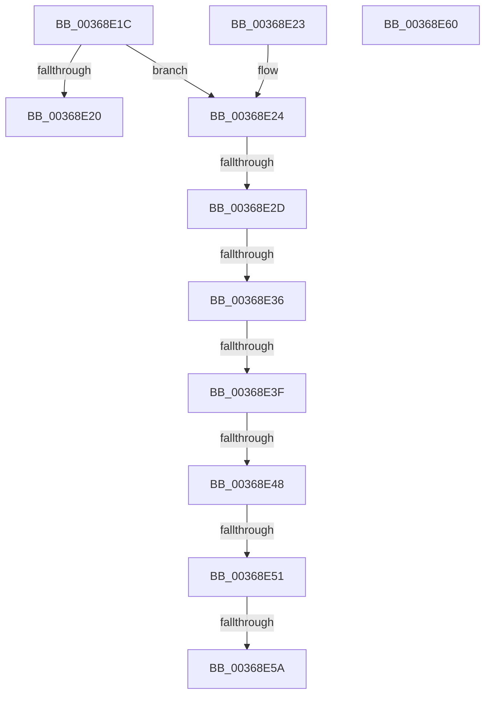

# KiEnclsStatus

- RVA: `0x00368E1C`–`0x00368E61` (길이 `69` bytes)
- VA: `0x0000000140368E1C`
- 실행 섹션: `.text`
- PDB 이름 있음: `예`; PDB Function 태그: `예`
- unwind 정보 RVA: `0x000DB714`
- 디코드: `20`개 명령, `69/69` bytes 표시
- 미해석 바이트: `0` (있으면 어셈블리에 `.byte`로 보존)

> 이 문서는 커널 이미지의 기계어와 PDB 기호를 분석해 생성했습니다. 4번과 5번은 함수 원형과 자료형을 바이너리 사용 방식에서 추정한 C 해석이며 원본 소스 복구 결과는 아닙니다.

## 1. Dependencies

- 직접 호출 지점: **0**; 고유 호출 대상: **0**
- 직접 호출자로 확인된 함수: **6**
- RIP 상대 이미지 참조: **0**

### Outgoing calls
- 직접 디코드된 call 명령이 없습니다.

### Direct callers
- [KeRemoveEnclavePage](KeRemoveEnclavePage_function_00368C90.md) at `0x00368CB1`
- [KeBlockEnclavePage](../5B/KeBlockEnclavePage_function_005BB998.md) at `0x005BB9C3`
- [KeCanChangeEnclavePageProtection](../5B/KeCanChangeEnclavePageProtection_function_005BB9E0.md) at `0x005BBA49`
- [KeChangeEnclavePageProtection](../5B/KeChangeEnclavePageProtection_function_005BBAA0.md) at `0x005BBB66`
- [KeOutPageEnclavePage](../5B/KeOutPageEnclavePage_function_005BBBDC.md) at `0x005BBC5F`
- [KeTrackEnclaveTbFlush](../5B/KeTrackEnclaveTbFlush_function_005BBC94.md) at `0x005BBCB5`

### Static image references
- 디코드된 RIP-relative 메모리 참조가 없습니다.

## 2. Other-region calls and transfers

- 다른 실행 섹션으로 향하는 call: **0**
- call이 아닌 외부 분기/꼬리 이동: **6**
  - `0x00368E27` → `0x006E3B06` (`tail-transfer`)
  - `0x00368E30` → `0x006E3AFF` (`tail-transfer`)
  - `0x00368E39` → `0x006E3B06` (`tail-transfer`)
  - `0x00368E42` → `0x006E3B06` (`tail-transfer`)
  - `0x00368E4B` → `0x006E3B06` (`tail-transfer`)
  - `0x00368E54` → `0x006E3AF8` (`tail-transfer`)

## 3. Assembly (complete function range)

```asm
00368E1C  85 C9                           test ecx, ecx
00368E1E  75 04                           jne 0x140368e24
00368E20  33 C0                           xor eax, eax
00368E22  C3                              ret
00368E23  CC                              int3
00368E24  83 E9 07                        sub ecx, 7
00368E27  0F 84 D9 AC 37 00               je 0x1406e3b06
00368E2D  83 E9 05                        sub ecx, 5
00368E30  0F 84 C9 AC 37 00               je 0x1406e3aff
00368E36  83 E9 01                        sub ecx, 1
00368E39  0F 84 C7 AC 37 00               je 0x1406e3b06
00368E3F  83 E9 01                        sub ecx, 1
00368E42  0F 84 BE AC 37 00               je 0x1406e3b06
00368E48  83 E9 03                        sub ecx, 3
00368E4B  0F 84 B5 AC 37 00               je 0x1406e3b06
00368E51  83 F9 03                        cmp ecx, 3
00368E54  0F 84 9E AC 37 00               je 0x1406e3af8
00368E5A  B8 01 00 00 C0                  mov eax, 0xc0000001
00368E5F  C3                              ret
00368E60  CC                              int3
```

## 4. C-style interpretation (structured pseudocode)

```c
__int64 __fastcall KiEnclsStatus(int a1)
{
    __int64 result;

    if (a1 != 0) goto loc_00368E24;
    result = 0;
    return result;
loc_00368E24:
    a1 = (unsigned int)((a1) - (7));
    a1 = (unsigned int)((a1) - (5));
    a1 = (unsigned int)((a1) - (1));
    a1 = (unsigned int)((a1) - (1));
    a1 = (unsigned int)((a1) - (3));
    return (unsigned int)(0xC0000001ULL);
}
```

## 5. (Beta) C Style

```c
int64_t KiEnclsStatus(int32_t Arg1)
{
    int64_t result;

    if (Arg1 != 0) goto loc_00368E24;
    result = 0;
    return result;
loc_00368E24:
    Arg1 = (uint32_t)((Arg1) - (7));
    Arg1 = (uint32_t)((Arg1) - (5));
    Arg1 = (uint32_t)((Arg1) - (1));
    Arg1 = (uint32_t)((Arg1) - (1));
    Arg1 = (uint32_t)((Arg1) - (3));
    return (uint32_t)(0xC0000001ULL);
}
```

## 6. Execution-region graph

[열기: 2D/3D 그래프와 함수 탐색 컨트롤 패널](../../../control-panel.html?section=text&rva=0x00368E1C&view=graph)

- 2D 그래프는 위에서 아래로 흐르고, 3D 그래프는 빈 공간을 드래그해 회전합니다. Shift+드래그는 이동, 휠은 확대·축소, 함수 노드 선택은 대상 보고서 이동입니다.

### Static fallback


