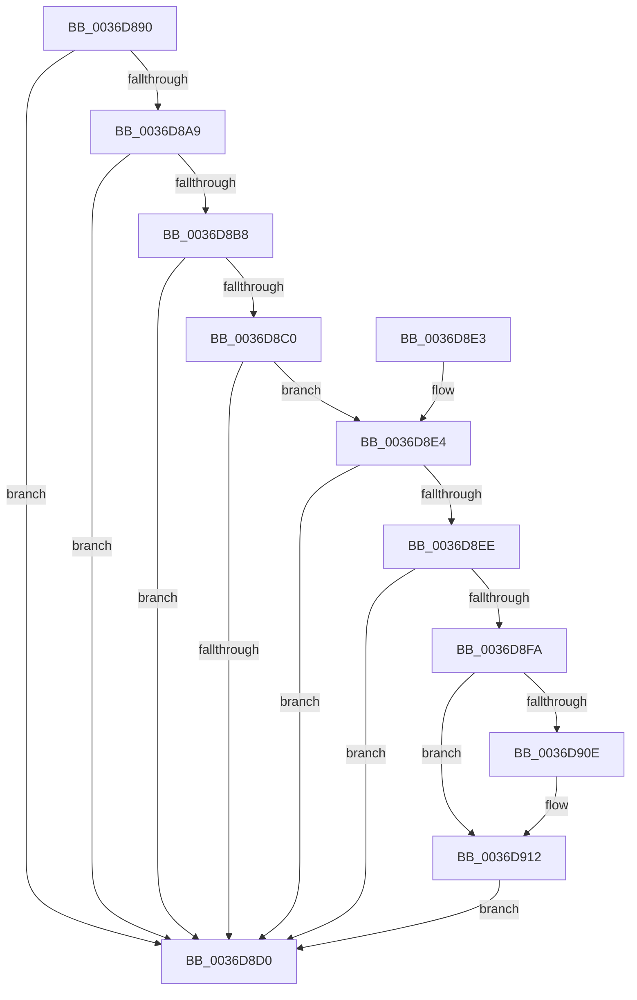

# MI_CLEAR_PTE_BITS_FOR_READ_CLUSTER

- RVA: `0x0036D890`–`0x0036D921` (길이 `145` bytes)
- VA: `0x000000014036D890`
- 실행 섹션: `.text`
- PDB 이름 있음: `예`; PDB Function 태그: `아니요`
- unwind 정보 RVA: `0x000760CC`
- 디코드: `42`개 명령, `145/145` bytes 표시
- 미해석 바이트: `0` (있으면 어셈블리에 `.byte`로 보존)

> 이 문서는 커널 이미지의 기계어와 PDB 기호를 분석해 생성했습니다. 4번과 5번은 함수 원형과 자료형을 바이너리 사용 방식에서 추정한 C 해석이며 원본 소스 복구 결과는 아닙니다.

## 1. Dependencies

- 직접 호출 지점: **1**; 고유 호출 대상: **1**
- 직접 호출자로 확인된 함수: **1**
- RIP 상대 이미지 참조: **0**

### Outgoing calls
- `0x0036D8E4` → [MiPteHasShadow](../32/MiPteHasShadow_function_0032B998.md) (function, `0x0032B998`)

### Direct callers
- [MiResolvePageFileFault](MiResolvePageFileFault_function_0036D968.md) at `0x0036E248`
- [MiResolvePageFileFault](MiResolvePageFileFault_function_0036D968.md) at `0x0036E290`
- [MiResolvePageFileFault](MiResolvePageFileFault_function_0036D968.md) at `0x0036E313`
- [MiResolvePageFileFault](MiResolvePageFileFault_function_0036D968.md) at `0x0036E357`

### Static image references
- 디코드된 RIP-relative 메모리 참조가 없습니다.

## 2. Other-region calls and transfers

- 다른 실행 섹션으로 향하는 call: **0**
- 별도 외부 분기/꼬리 이동을 확인하지 못했습니다.

## 3. Assembly (complete function range)

```asm
0036D890  48 83 EC 28                     sub rsp, 0x28
0036D894  48 8B 11                        mov rdx, qword ptr [rcx]
0036D897  4C 8B C9                        mov r9, rcx
0036D89A  48 B8 00 D0 BE 7D FB F6 FF FF   movabs rax, 0xfffff6fb7dbed000
0036D8A4  48 3B C8                        cmp rcx, rax
0036D8A7  72 27                           jb 0x14036d8d0
0036D8A9  48 B8 F8 D7 BE 7D FB F6 FF FF   movabs rax, 0xfffff6fb7dbed7f8
0036D8B3  48 3B C8                        cmp rcx, rax
0036D8B6  77 18                           ja 0x14036d8d0
0036D8B8  4C 8B C2                        mov r8, rdx
0036D8BB  F6 C2 01                        test dl, 1
0036D8BE  74 10                           je 0x14036d8d0
0036D8C0  F6 C2 42                        test dl, 0x42
0036D8C3  0F 95 C1                        setne cl
0036D8C6  F6 C2 20                        test dl, 0x20
0036D8C9  0F 95 C0                        setne al
0036D8CC  84 C8                           test al, cl
0036D8CE  74 14                           je 0x14036d8e4
0036D8D0  48 83 E2 FD                     and rdx, 0xfffffffffffffffd
0036D8D4  49 89 11                        mov qword ptr [r9], rdx
0036D8D7  49 81 21 1F FF 00 FC            and qword ptr [r9], 0xfffffffffc00ff1f
0036D8DE  48 83 C4 28                     add rsp, 0x28
0036D8E2  C3                              ret
0036D8E3  CC                              int3
0036D8E4  E8 AF E0 FB FF                  call 0x14032b998
0036D8E9  48 85 C0                        test rax, rax
0036D8EC  74 E2                           je 0x14036d8d0
0036D8EE  48 8B 88 08 05 00 00            mov rcx, qword ptr [rax + 0x508]
0036D8F5  48 85 C9                        test rcx, rcx
0036D8F8  74 D6                           je 0x14036d8d0
0036D8FA  49 8B C1                        mov rax, r9
0036D8FD  48 C1 E8 03                     shr rax, 3
0036D901  25 FF 01 00 00                  and eax, 0x1ff
0036D906  48 8B 04 C1                     mov rax, qword ptr [rcx + rax*8]
0036D90A  A8 20                           test al, 0x20
0036D90C  74 04                           je 0x14036d912
0036D90E  49 83 C8 20                     or r8, 0x20
0036D912  49 8B D0                        mov rdx, r8
0036D915  48 83 CA 42                     or rdx, 0x42
0036D919  A8 42                           test al, 0x42
0036D91B  49 0F 44 D0                     cmove rdx, r8
0036D91F  EB AF                           jmp 0x14036d8d0
```

## 4. C-style interpretation (structured pseudocode)

```c
__int64 __fastcall MI_CLEAR_PTE_BITS_FOR_READ_CLUSTER(__int64 a1)
{
    __int64 result;
    __int64 v_rsp;

    v_rsp = (v_rsp) - (40);
    if (a1 < result) goto loc_0036D8D0;
    if (a1 > result) goto loc_0036D8D0;
    if ((((unsigned __int8)(*(unsigned __int64 *)(a1))) & (1)) == 0) goto loc_0036D8D0;
    a1 = ((((unsigned __int8)(*(unsigned __int64 *)(a1))) & (66)) != 0) ? 1 : 0;
    result = ((((unsigned __int8)(*(unsigned __int64 *)(a1))) & (32)) != 0) ? 1 : 0;
    if ((((unsigned __int8)(result)) & ((unsigned __int8)(a1))) == 0) goto loc_0036D8E4;
loc_0036D8D0:
    a2 = (*(unsigned __int64 *)(a1)) & (-3);
    *(unsigned __int64 *)(a1) = a2;
    v_rsp = (v_rsp) + (40);
    return result;
loc_0036D8E4:
    result = MiPteHasShadow(a1, a2, *(unsigned __int64 *)(a1), a1);
    if (result == 0) goto loc_0036D8D0;
    if (*(unsigned __int64 *)(result + 1288) == 0) goto loc_0036D8D0;
    result = (a1) >> (3);
    result = (unsigned int)((result) & (511));
    if ((((unsigned __int8)(*(unsigned __int64 *)(*(unsigned __int64 *)(result + 1288) + result * 8))) & (32)) != 0) {
        a3 = (*(unsigned __int64 *)(a1)) | (32);
    }
    a2 = (a3) | (66);
    if ((((unsigned __int8)(*(unsigned __int64 *)(*(unsigned __int64 *)(result + 1288) + result * 8))) & (66)) == 0) { a2 = a3; }
    goto loc_0036D8D0;
}
```

## 5. (Beta) C Style

```c
int64_t MI_CLEAR_PTE_BITS_FOR_READ_CLUSTER(void *Arg1)
{
    uint8_t *arg1 = (uint8_t *)Arg1;

    int64_t result;
    int64_t local_rsp;

    local_rsp = (local_rsp) - (40);
    if (Arg1 < result) goto loc_0036D8D0;
    if (Arg1 > result) goto loc_0036D8D0;
    if ((((uint8_t)(*(uint64_t *)(arg1))) & (1)) == 0) goto loc_0036D8D0;
    Arg1 = ((((uint8_t)(*(uint64_t *)(arg1))) & (66)) != 0) ? 1 : 0;
    result = ((((uint8_t)(*(uint64_t *)(arg1))) & (32)) != 0) ? 1 : 0;
    if ((((uint8_t)(result)) & ((uint8_t)(Arg1))) == 0) goto loc_0036D8E4;
loc_0036D8D0:
    a2 = (*(uint64_t *)(arg1)) & (-3);
    *(uint64_t *)(arg1) = a2;
    local_rsp = (local_rsp) + (40);
    return result;
loc_0036D8E4:
    result = MiPteHasShadow(Arg1, a2, *(uint64_t *)(arg1), Arg1);
    if (result == 0) goto loc_0036D8D0;
    if (*(uint64_t *)(result + 0x508) == 0) goto loc_0036D8D0;
    result = (Arg1) >> (3);
    result = (uint32_t)((result) & (511));
    if ((((uint8_t)(*(uint64_t *)(*(uint64_t *)(result + 0x508) + result * 8))) & (32)) != 0) {
        a3 = (*(uint64_t *)(arg1)) | (32);
    }
    a2 = (a3) | (66);
    if ((((uint8_t)(*(uint64_t *)(*(uint64_t *)(result + 0x508) + result * 8))) & (66)) == 0) { a2 = a3; }
    goto loc_0036D8D0;
}
```

### 관측된 메모리 오프셋

구조체 형식이 확인되지 않은 접근은 인자 기준의 오프셋으로만 기록했습니다.

| 기준 인자 | 오프셋 표현 | 폭 (bit) | 접근 |
|---|---:|---:|---|
| `Arg1` | `+ 0x0` | `64` | `R` |

## 6. Execution-region graph

[열기: 2D/3D 그래프와 함수 탐색 컨트롤 패널](../../../control-panel.html?section=text&rva=0x0036D890&view=graph)

- 2D 그래프는 위에서 아래로 흐르고, 3D 그래프는 빈 공간을 드래그해 회전합니다. Shift+드래그는 이동, 휠은 확대·축소, 함수 노드 선택은 대상 보고서 이동입니다.

### Static fallback


