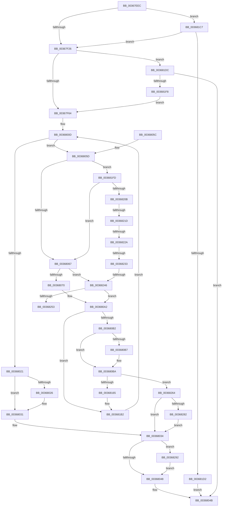

# MiAddPagesToEnclave

- RVA: `0x00367EEC`–`0x003682A2` (길이 `950` bytes)
- VA: `0x0000000140367EEC`
- 실행 섹션: `.text`
- PDB 이름 있음: `예`; PDB Function 태그: `예`
- unwind 정보 RVA: `0x0007A070`
- 디코드: `231`개 명령, `950/950` bytes 표시
- 미해석 바이트: `0` (있으면 어셈블리에 `.byte`로 보존)

> 이 문서는 커널 이미지의 기계어와 PDB 기호를 분석해 생성했습니다. 4번과 5번은 함수 원형과 자료형을 바이너리 사용 방식에서 추정한 C 해석이며 원본 소스 복구 결과는 아닙니다.

## 1. Dependencies

- 직접 호출 지점: **19**; 고유 호출 대상: **17**
- 직접 호출자로 확인된 함수: **1**
- RIP 상대 이미지 참조: **3**

### Outgoing calls
- `0x00368005` → [MiLockWorkingSetShared](../27/MiLockWorkingSetShared_function_0027CBF0.md) (function, `0x0027CBF0`)
- `0x0036802C` → [MiUnlockPageTable](../21/MiUnlockPageTable_function_00216EC0.md) (function, `0x00216EC0`)
- `0x0036803A` → [MiUnlockWorkingSetShared](../27/MiUnlockWorkingSetShared_function_0027D690.md) (function, `0x0027D690`)
- `0x0036809D` → [MiMakeSystemAddressValid](../27/MiMakeSystemAddressValid_function_0027FF70.md) (function, `0x0027FF70`)
- `0x003680A5` → [MI_READ_PTE_LOCK_FREE](../28/MI_READ_PTE_LOCK_FREE_function_002828A0.md) (function, `0x002828A0`)
- `0x003680CD` → [MiGetPageForEnclave](MiGetPageForEnclave_function_00367C38.md) (function, `0x00367C38`)
- `0x003680E2` → [MiMapPageInHyperSpaceWorker](../33/MiMapPageInHyperSpaceWorker_function_00332B10.md) (function, `0x00332B10`)
- `0x00368110` → [KeAddEnclavePage](KeAddEnclavePage_function_003683F8.md) (function, `0x003683F8`)
- `0x00368173` → [MiInitializeEnclavePfn](MiInitializeEnclavePfn_function_003682A8.md) (function, `0x003682A8`)
- `0x0036818A` → [MiMakeValidPte](../2C/MiMakeValidPte_function_002C5590.md) (function, `0x002C5590`)
- `0x003681A0` → [MiWriteEnclavePte](MiWriteEnclavePte_function_00368570.md) (function, `0x00368570`)
- `0x003681EB` → [MiReserveEnclavePages](../3B/MiReserveEnclavePages_function_003BD430.md) (function, `0x003BD430`)
- `0x00368210` → [MiWorkingSetIsContended](../2A/MiWorkingSetIsContended_function_002AE520.md) (function, `0x002AE520`)
- `0x0036821D` → [KeShouldYieldProcessor](../27/KeShouldYieldProcessor_function_002773E0.md) (function, `0x002773E0`)
- `0x00368239` → [MiPageTableLockIsContended](../2A/MiPageTableLockIsContended_function_002AE650.md) (function, `0x002AE650`)
- `0x00368259` → [MiUnlockPageTable](../21/MiUnlockPageTable_function_00216EC0.md) (function, `0x00216EC0`)
- `0x00368264` → [MiReturnEnclavePage](../4D/MiReturnEnclavePage_function_004DEEF8.md) (function, `0x004DEEF8`)
- `0x00368288` → [MiUnlockPageTable](../21/MiUnlockPageTable_function_00216EC0.md) (function, `0x00216EC0`)
- `0x00368298` → [MiReturnReservedEnclavePages](../../pagelk/B7/MiReturnReservedEnclavePages_function_00B74FD0.md) (function, `0x00B74FD0`)

### Direct callers
- [MiCommitEnclavePages](MiCommitEnclavePages_function_00367CCC.md) at `0x00367DB2`

### Static image references
- `0x00367F39` → RVA `0x00E30088` (`.data`; read)
- `0x00367F79` → RVA `0x00E37460` (`.data`; read)
- `0x00368149` → RVA `0x00010880` (`.rdata`; read)

## 2. Other-region calls and transfers

- 다른 실행 섹션으로 향하는 call: **1**
  - `0x00368298` → [MiReturnReservedEnclavePages](../../pagelk/B7/MiReturnReservedEnclavePages_function_00B74FD0.md) (`.text` → `PAGELK`)
- call이 아닌 외부 분기/꼬리 이동: **5**
  - `0x00368217` → [sub_006E35FC](../6E/Unknown_function_006E35FC.md) (`tail-transfer`)
  - `0x00368224` → [sub_006E35FC](../6E/Unknown_function_006E35FC.md) (`tail-transfer`)
  - `0x0036822D` → [sub_006E35FC + 0x23](../6E/Unknown_function_006E35FC.md) (`tail-transfer`)
  - `0x00368240` → [sub_006E35FC + 0x5](../6E/Unknown_function_006E35FC.md) (`tail-transfer`)
  - `0x0036825F` → [sub_006E35FC + 0x23](../6E/Unknown_function_006E35FC.md) (`tail-transfer`)

## 3. Assembly (complete function range)

```asm
00367EEC  4C 89 4C 24 20                  mov qword ptr [rsp + 0x20], r9
00367EF1  4C 89 44 24 18                  mov qword ptr [rsp + 0x18], r8
00367EF6  53                              push rbx
00367EF7  55                              push rbp
00367EF8  56                              push rsi
00367EF9  57                              push rdi
00367EFA  41 54                           push r12
00367EFC  41 55                           push r13
00367EFE  41 56                           push r14
00367F00  41 57                           push r15
00367F02  48 83 EC 78                     sub rsp, 0x78
00367F06  83 64 24 30 00                  and dword ptr [rsp + 0x30], 0
00367F0B  49 8B E8                        mov rbp, r8
00367F0E  8B 41 40                        mov eax, dword ptr [rcx + 0x40]
00367F11  48 8B DA                        mov rbx, rdx
00367F14  8B BC 24 E0 00 00 00            mov edi, dword ptr [rsp + 0xe0]
00367F1B  4C 8B F9                        mov r15, rcx
00367F1E  A8 02                           test al, 2
00367F20  0F 85 A1 02 00 00               jne 0x1403681c7
00367F26  65 48 8B 04 25 88 01 00 00      mov rax, qword ptr gs:[0x188]
00367F2F  45 33 F6                        xor r14d, r14d
00367F32  48 8B B0 B8 00 00 00            mov rsi, qword ptr [rax + 0xb8]
00367F39  48 8B 05 48 81 AC 00            mov rax, qword ptr [rip + 0xac8148]
00367F40  48 81 C6 00 04 00 00            add rsi, 0x400
00367F47  0F B7 8E AE 00 00 00            movzx ecx, word ptr [rsi + 0xae]
00367F4E  48 8B 0C C8                     mov rcx, qword ptr [rax + rcx*8]
00367F52  49 8B 47 70                     mov rax, qword ptr [r15 + 0x70]
00367F56  48 89 4C 24 48                  mov qword ptr [rsp + 0x48], rcx
00367F5B  48 3B D0                        cmp rdx, rax
00367F5E  0F 87 78 02 00 00               ja 0x1403681dc
00367F64  45 8B 4F 40                     mov r9d, dword ptr [r15 + 0x40]
00367F68  8B C7                           mov eax, edi
00367F6A  41 F6 C1 02                     test r9b, 2
00367F6E  41 BA 04 00 00 00               mov r10d, 4
00367F74  B9 00 00 00 00                  mov ecx, 0
00367F79  48 0F 44 0D DF F4 AC 00         cmove rcx, qword ptr [rip + 0xacf4df]
00367F81  D1 E8                           shr eax, 1
00367F83  24 02                           and al, 2
00367F85  48 89 4C 24 50                  mov qword ptr [rsp + 0x50], rcx
00367F8A  0C 31                           or al, 0x31
00367F8C  44 0F B6 C0                     movzx r8d, al
00367F90  41 8A C0                        mov al, r8b
00367F93  41 0A C2                        or al, r10b
00367F96  0F B6 C8                        movzx ecx, al
00367F99  40 F6 C7 02                     test dil, 2
00367F9D  41 0F 44 C8                     cmove ecx, r8d
00367FA1  41 0F BA E1 01                  bt r9d, 1
00367FA6  0F B6 D1                        movzx edx, cl
00367FA9  8A C2                           mov al, dl
00367FAB  44 0F 43 D7                     cmovae r10d, edi
00367FAF  0C 40                           or al, 0x40
00367FB1  44 89 54 24 34                  mov dword ptr [rsp + 0x34], r10d
00367FB6  0F B6 C0                        movzx eax, al
00367FB9  41 0F BA E1 01                  bt r9d, 1
00367FBE  0F 43 C2                        cmovae eax, edx
00367FC1  89 84 24 C0 00 00 00            mov dword ptr [rsp + 0xc0], eax
00367FC8  48 B8 00 00 00 00 80 F6 FF FF   movabs rax, 0xfffff68000000000
00367FD2  48 8B C0                        mov rax, rax
00367FD5  49 8B 4F 50                     mov rcx, qword ptr [r15 + 0x50]
00367FD9  4C 8B E5                        mov r12, rbp
00367FDC  48 C1 E1 19                     shl rcx, 0x19
00367FE0  33 FF                           xor edi, edi
00367FE2  48 C1 E0 19                     shl rax, 0x19
00367FE6  48 2B C8                        sub rcx, rax
00367FE9  49 C1 E4 19                     shl r12, 0x19
00367FED  48 C1 F9 10                     sar rcx, 0x10
00367FF1  4C 2B E0                        sub r12, rax
00367FF4  48 89 4C 24 58                  mov qword ptr [rsp + 0x58], rcx
00367FF9  48 8B CE                        mov rcx, rsi
00367FFC  49 C1 FC 10                     sar r12, 0x10
00368000  4C 89 64 24 38                  mov qword ptr [rsp + 0x38], r12
00368005  E8 E6 4B F1 FF                  call 0x14027cbf0
0036800A  44 8A E8                        mov r13b, al
0036800D  48 B8 F8 FF FF FF 7F 00 00 00   movabs rax, 0x7ffffffff8
00368017  48 3B AC 24 D8 00 00 00         cmp rbp, qword ptr [rsp + 0xd8]
0036801F  76 3C                           jbe 0x14036805d
00368021  48 85 FF                        test rdi, rdi
00368024  74 0B                           je 0x140368031
00368026  48 8B D7                        mov rdx, rdi
00368029  48 8B CE                        mov rcx, rsi
0036802C  E8 8F EE EA FF                  call 0x140216ec0
00368031  45 33 E4                        xor r12d, r12d
00368034  41 8A D5                        mov dl, r13b
00368037  48 8B CE                        mov rcx, rsi
0036803A  E8 51 56 F1 FF                  call 0x14027d690
0036803F  4D 85 F6                        test r14, r14
00368042  0F 85 4A 02 00 00               jne 0x140368292
00368048  41 8B C4                        mov eax, r12d
0036804B  48 83 C4 78                     add rsp, 0x78
0036804F  41 5F                           pop r15
00368051  41 5E                           pop r14
00368053  41 5D                           pop r13
00368055  41 5C                           pop r12
00368057  5F                              pop rdi
00368058  5E                              pop rsi
00368059  5D                              pop rbp
0036805A  5B                              pop rbx
0036805B  C3                              ret
0036805C  CC                              int3
0036805D  40 F6 C5 78                     test bpl, 0x78
00368061  0F 84 96 01 00 00               je 0x1403681fd
00368067  48 85 FF                        test rdi, rdi
0036806A  0F 85 D6 01 00 00               jne 0x140368246
00368070  48 8B FD                        mov rdi, rbp
00368073  48 C1 EF 09                     shr rdi, 9
00368077  48 23 F8                        and rdi, rax
0036807A  48 B8 00 00 00 00 80 F6 FF FF   movabs rax, 0xfffff68000000000
00368084  48 8B C0                        mov rax, rax
00368087  41 8B 57 30                     mov edx, dword ptr [r15 + 0x30]
0036808B  48 03 F8                        add rdi, rax
0036808E  C1 EA 0C                        shr edx, 0xc
00368091  45 33 C9                        xor r9d, r9d
00368094  83 E2 7F                        and edx, 0x7f
00368097  45 8A C5                        mov r8b, r13b
0036809A  48 8B CD                        mov rcx, rbp
0036809D  E8 CE 7E F1 FF                  call 0x14027ff70
003680A2  48 8B CD                        mov rcx, rbp
003680A5  E8 F6 A7 F1 FF                  call 0x1402828a0
003680AA  A8 01                           test al, 1
003680AC  0F 85 00 01 00 00               jne 0x1403681b2
003680B2  4C 3B F3                        cmp r14, rbx
003680B5  75 03                           jne 0x1403680ba
003680B7  49 FF CE                        dec r14
003680BA  48 8B 54 24 48                  mov rdx, qword ptr [rsp + 0x48]
003680BF  48 FF CB                        dec rbx
003680C2  49 8B CF                        mov rcx, r15
003680C5  48 89 9C 24 C8 00 00 00         mov qword ptr [rsp + 0xc8], rbx
003680CD  E8 66 FB FF FF                  call 0x140367c38
003680D2  33 D2                           xor edx, edx
003680D4  48 89 44 24 40                  mov qword ptr [rsp + 0x40], rax
003680D9  41 B8 00 00 00 80               mov r8d, 0x80000000
003680DF  48 8B C8                        mov rcx, rax
003680E2  E8 29 AA FC FF                  call 0x140332b10
003680E7  0F B6 8C 24 C0 00 00 00         movzx ecx, byte ptr [rsp + 0xc0]
003680EF  48 8B D8                        mov rbx, rax
003680F2  48 8B 54 24 50                  mov rdx, qword ptr [rsp + 0x50]
003680F7  48 8D 44 24 30                  lea rax, [rsp + 0x30]
003680FC  48 89 44 24 28                  mov qword ptr [rsp + 0x28], rax
00368101  4D 8B CC                        mov r9, r12
00368104  89 4C 24 20                     mov dword ptr [rsp + 0x20], ecx
00368108  4C 8B C3                        mov r8, rbx
0036810B  48 8B 4C 24 58                  mov rcx, qword ptr [rsp + 0x58]
00368110  E8 E3 02 00 00                  call 0x1403683f8
00368115  44 8B E0                        mov r12d, eax
00368118  48 C1 EB 09                     shr rbx, 9
0036811C  48 B8 F8 FF FF FF 7F 00 00 00   movabs rax, 0x7ffffffff8
00368126  48 23 D8                        and rbx, rax
00368129  48 B8 00 00 00 00 80 F6 FF FF   movabs rax, 0xfffff68000000000
00368133  48 8B C0                        mov rax, rax
00368136  48 03 D8                        add rbx, rax
00368139  65 48 8B 04 25 20 00 00 00      mov rax, qword ptr gs:[0x20]
00368142  48 8B 88 38 88 00 00            mov rcx, qword ptr [rax + 0x8838]
00368149  48 8B 05 30 87 CA FF            mov rax, qword ptr [rip - 0x3578d0]
00368150  48 83 21 00                     and qword ptr [rcx], 0
00368154  48 8B 4C 24 40                  mov rcx, qword ptr [rsp + 0x40]
00368159  48 89 03                        mov qword ptr [rbx], rax
0036815C  45 85 E4                        test r12d, r12d
0036815F  0F 88 FF 00 00 00               js 0x140368264
00368165  44 8B 44 24 34                  mov r8d, dword ptr [rsp + 0x34]
0036816A  41 B9 01 00 00 00               mov r9d, 1
00368170  48 8B D5                        mov rdx, rbp
00368173  E8 30 01 00 00                  call 0x1403682a8
00368178  44 8B 44 24 34                  mov r8d, dword ptr [rsp + 0x34]
0036817D  48 8B CD                        mov rcx, rbp
00368180  48 8B 54 24 40                  mov rdx, qword ptr [rsp + 0x40]
00368185  41 0F BA E8 1F                  bts r8d, 0x1f
0036818A  E8 01 D4 F5 FF                  call 0x1402c5590
0036818F  83 64 24 20 00                  and dword ptr [rsp + 0x20], 0
00368194  45 33 C9                        xor r9d, r9d
00368197  4D 8B C7                        mov r8, r15
0036819A  48 8B D0                        mov rdx, rax
0036819D  48 8B CD                        mov rcx, rbp
003681A0  E8 CB 03 00 00                  call 0x140368570
003681A5  48 8B 9C 24 C8 00 00 00         mov rbx, qword ptr [rsp + 0xc8]
003681AD  4C 8B 64 24 38                  mov r12, qword ptr [rsp + 0x38]
003681B2  48 83 C5 08                     add rbp, 8
003681B6  49 81 C4 00 10 00 00            add r12, 0x1000
003681BD  4C 89 64 24 38                  mov qword ptr [rsp + 0x38], r12
003681C2  E9 46 FE FF FF                  jmp 0x14036800d
003681C7  8B 41 48                        mov eax, dword ptr [rcx + 0x48]
003681CA  A8 01                           test al, 1
003681CC  0F 85 54 FD FF FF               jne 0x140367f26
003681D2  B8 18 00 00 C0                  mov eax, 0xc0000018
003681D7  E9 6F FE FF FF                  jmp 0x14036804b
003681DC  4C 8B F2                        mov r14, rdx
003681DF  48 8B D1                        mov rdx, rcx
003681E2  4C 2B F0                        sub r14, rax
003681E5  49 8B CF                        mov rcx, r15
003681E8  4D 8B C6                        mov r8, r14
003681EB  E8 40 52 05 00                  call 0x1403bd430
003681F0  85 C0                           test eax, eax
003681F2  0F 88 53 FE FF FF               js 0x14036804b
003681F8  E9 67 FD FF FF                  jmp 0x140367f64
003681FD  48 3B AC 24 D0 00 00 00         cmp rbp, qword ptr [rsp + 0xd0]
00368205  0F 84 5C FE FF FF               je 0x140368067
0036820B  33 D2                           xor edx, edx
0036820D  48 8B CE                        mov rcx, rsi
00368210  E8 0B 63 F4 FF                  call 0x1402ae520
00368215  85 C0                           test eax, eax
00368217  0F 85 DF B3 37 00               jne 0x1406e35fc
0036821D  E8 BE F1 F0 FF                  call 0x1402773e0
00368222  85 C0                           test eax, eax
00368224  0F 85 D2 B3 37 00               jne 0x1406e35fc
0036822A  48 85 FF                        test rdi, rdi
0036822D  0F 84 EC B3 37 00               je 0x1406e361f
00368233  48 8B D7                        mov rdx, rdi
00368236  48 8B CE                        mov rcx, rsi
00368239  E8 12 64 F4 FF                  call 0x1402ae650
0036823E  85 C0                           test eax, eax
00368240  0F 85 BB B3 37 00               jne 0x1406e3601
00368246  48 F7 C5 FF 0F 00 00            test rbp, 0xfff
0036824D  0F 85 4F FE FF FF               jne 0x1403680a2
00368253  48 8B D7                        mov rdx, rdi
00368256  48 8B CE                        mov rcx, rsi
00368259  E8 62 EC EA FF                  call 0x140216ec0
0036825E  90                              nop
0036825F  E9 BB B3 37 00                  jmp 0x1406e361f
00368264  E8 8F 6C 17 00                  call 0x1404deef8
00368269  41 81 FC 8F 04 00 C0            cmp r12d, 0xc000048f
00368270  B8 01 00 00 C0                  mov eax, 0xc0000001
00368275  44 0F 44 E0                     cmove r12d, eax
00368279  48 85 FF                        test rdi, rdi
0036827C  0F 84 B2 FD FF FF               je 0x140368034
00368282  48 8B D7                        mov rdx, rdi
00368285  48 8B CE                        mov rcx, rsi
00368288  E8 33 EC EA FF                  call 0x140216ec0
0036828D  E9 A2 FD FF FF                  jmp 0x140368034
00368292  49 8B D6                        mov rdx, r14
00368295  49 8B CF                        mov rcx, r15
00368298  E8 33 CD 80 00                  call 0x140b74fd0
0036829D  E9 A6 FD FF FF                  jmp 0x140368048
```

## 4. C-style interpretation (structured pseudocode)

```c
__int64 __fastcall MiAddPagesToEnclave(__int64 a1, __int64 a2, __int64 a3, __int64 a4, unsigned int a5)
{
    __int64 result;
    __int64 v_r10;
    __int64 v_r12;
    __int64 v_r14;
    __int64 v_rbp;
    __int64 v_rbx;
    __int64 v_rdi;
    __int64 v_rsi;
    __int64 v_rsp;
    unsigned __int64 v_stack_m60;
    unsigned __int64 v_stack_m68;
    unsigned __int64 v_stack_m70;
    unsigned __int64 v_stack_m80;
    unsigned int v_stack_m84;
    unsigned int v_stack_m88;
    unsigned __int64 v_stack_p18;
    unsigned __int64 v_stack_p20;
    unsigned __int64 v_stack_p28;
    unsigned __int64 v_stack_p30;
    unsigned int v_stack_p34;
    unsigned __int64 v_stack_p38;
    unsigned __int64 v_stack_p40;
    unsigned __int64 v_stack_p48;
    unsigned __int64 v_stack_p50;
    unsigned __int64 v_stack_p58;
    unsigned int v_stack_p8;
    unsigned __int8 v_stack_pC0;
    unsigned __int64 v_stack_pC8;
    unsigned __int64 v_stack_pD0;

    v_stack_p20 = a4;
    v_stack_p18 = a3;
    v_rsp = (v_rsp) - (120);
    if ((((unsigned __int8)((unsigned int)(*(unsigned int *)(a1 + 64)))) & (2)) != 0) goto loc_003681C7;
loc_00367F26:
    v_r14 = 0;
    v_rsi = (*(unsigned __int64 *)(*(unsigned __int64 *)(gs_base + (0 + 392)) + 184)) + (0x400ULL);
    v_stack_m70 = *(unsigned __int64 *)(*(unsigned __int64 *)(v_rip + 11305288) + *(unsigned __int16 *)(v_rsi + 174) * 8);
    if (a2 > (*(unsigned __int64 *)(a1 + 112))) goto loc_003681DC;
loc_00367F64:
    a1 = 0;
    if ((((unsigned __int8)((unsigned int)(*(unsigned int *)(a1 + 64)))) & (2)) == 0) { a1 = *(unsigned __int64 *)(v_rip + 11334879); }
    result = (unsigned int)(((unsigned int)((unsigned int)((unsigned int)(a5)))) >> (1));
    result = (unsigned __int8)((result) & (2));
    v_stack_m68 = a1;
    result = (unsigned __int8)((result) | (49));
    result = (unsigned __int8)(((unsigned __int8)((unsigned __int8)(result))) | (4));
    a1 = (unsigned __int8)(result);
    if ((((unsigned __int8)((unsigned int)(a5))) & (2)) == 0) { a1 = (unsigned int)((unsigned __int8)(result)); }
    v_r10 = 4;
    if (condition_is_above_or_equal) { v_r10 = (unsigned int)((unsigned int)(a5)); }
    result = (unsigned __int8)(((unsigned __int8)((unsigned __int8)(a1))) | (64));
    v_stack_m84 = (unsigned int)(v_r10);
    result = (unsigned __int8)(result);
    if (condition_is_above_or_equal) { result = (unsigned int)((unsigned __int8)(a1)); }
    v_stack_p8 = (unsigned int)(result);
    a1 = (*(unsigned __int64 *)(a1 + 80)) << (25);
    v_rdi = 0;
    result = (result) << (25);
    a1 = (a1) - (result);
    v_r12 = (a3) << (25);
    a1 = (a1) >> (16);
    v_r12 = (v_r12) - (result);
    v_stack_m60 = a1;
    v_r12 = (v_r12) >> (16);
    v_stack_m80 = v_r12;
    result = MiLockWorkingSetShared(v_rsi, (unsigned __int8)(a1), (unsigned __int8)(result), (unsigned int)(*(unsigned int *)(a1 + 64)));
loc_0036800D:
    if (a3 <= v_stack_p20) goto loc_0036805D;
    if (0 != 0) {
        a2 = 0;
        a1 = v_rsi;
        result = MiUnlockPageTable(a1, a2, (unsigned __int8)(result), (unsigned int)(*(unsigned int *)(a1 + 64)));
    }
    v_r12 = 0;
loc_00368034:
    result = MiUnlockWorkingSetShared(v_rsi, (unsigned __int8)((unsigned __int8)(result)), (unsigned __int8)(result), (unsigned int)(*(unsigned int *)(a1 + 64)));
    if (0 != 0) goto loc_00368292;
loc_00368048:
loc_0036804B:
    v_rsp = (v_rsp) + (120);
    return 0;
loc_0036805D:
    if ((((unsigned __int8)(a3)) & (120)) == 0) goto loc_003681FD;
loc_00368067:
    if (0 != 0) goto loc_00368246;
    v_rdi = (a3) >> (9);
    v_rdi = (v_rdi) & (0);
    v_rdi = (v_rdi) + (0);
    a2 = (unsigned int)(((unsigned int)(*(unsigned int *)(a1 + 48))) >> (12));
    a4 = 0;
    a2 = (unsigned int)((a2) & (127));
    result = MiMakeSystemAddressValid(a3, a2, (unsigned __int8)((unsigned __int8)(result)), a4);
loc_003680A2:
    result = MI_READ_PTE_LOCK_FREE(a3, a2, (unsigned __int8)((unsigned __int8)(result)), a4);
    if ((((unsigned __int8)(result)) & (1)) != 0) goto loc_003681B2;
    if (0 == a2) {
        v_r14 = (v_r14) - 1;
    }
    v_rbx = (a2) - 1;
    v_stack_pC8 = v_rbx;
    result = MiGetPageForEnclave(a1, v_stack_p48, (unsigned __int8)((unsigned __int8)(result)), a4);
    a2 = 0;
    v_stack_p40 = result;
    result = MiMapPageInHyperSpaceWorker(result, a2, (unsigned int)(0x80000000ULL), a4);
    v_stack_p28 = v_stack_p30;
    v_stack_p20 = (unsigned int)(v_stack_pC0);
    result = KeAddEnclavePage(v_stack_p58, v_stack_p50, result, 0);
    v_rbx = (result) >> (9);
    v_rbx = (v_rbx) & (result);
    v_rbx = (v_rbx) + (result);
    *(unsigned __int64 *)(v_rbx) = *(unsigned __int64 *)(v_rip - 3504336);
    if (sign_flag) goto loc_00368264;
    result = MiInitializeEnclavePfn(v_stack_p40, a3, (unsigned int)(v_stack_p34), 1);
    result = MiMakeValidPte(a3, v_stack_p40, (unsigned int)(v_stack_p34), 1);
    a4 = 0;
    result = MiWriteEnclavePte(a3, result, a1, a4);
loc_003681B2:
    v_rbp = (a3) + (8);
    v_r12 = (v_stack_p38) + (0x1000ULL);
    v_stack_p38 = v_r12;
    goto loc_0036800D;
loc_003681C7:
    if ((((unsigned __int8)((unsigned int)(*(unsigned int *)(a3 + 72)))) & (1)) != 0) goto loc_00367F26;
    goto loc_0036804B;
loc_003681DC:
    v_r14 = (result) - ((unsigned int)(0xC0000018ULL));
    result = MiReserveEnclavePages(a1, a3, v_r14, a4);
    if (sign_flag) goto loc_0036804B;
    goto loc_00367F64;
loc_003681FD:
    if (v_rbp == v_stack_pD0) goto loc_00368067;
    a2 = 0;
    result = MiWorkingSetIsContended(v_rsi, a2, v_r14, a4);
    result = KeShouldYieldProcessor(v_rsi, a2, v_r14, a4);
    result = MiPageTableLockIsContended(v_rsi, v_rdi, v_r14, a4);
loc_00368246:
    if (((v_rbp) & (0xFFFULL)) != 0) goto loc_003680A2;
    result = MiUnlockPageTable(v_rsi, v_rdi, v_r14, a4);
loc_00368264:
    result = MiReturnEnclavePage(v_rsi, v_rdi, v_r14, a4);
    if (((unsigned int)(v_r12)) == 0xC000048FULL) { v_r12 = (unsigned int)((unsigned int)(0xC0000001ULL)); }
    if (v_rdi == 0) goto loc_00368034;
    result = MiUnlockPageTable(v_rsi, v_rdi, v_r14, a4);
    goto loc_00368034;
loc_00368292:
    result = MiReturnReservedEnclavePages(a1, v_r14, v_r14, a4);
    goto loc_00368048;
}
```

## 5. (Beta) C Style

```c
int64_t MiAddPagesToEnclave(void *Arg1, int64_t Arg2, int64_t Arg3, int64_t Arg4, uint32_t Arg5)
{
    uint8_t *arg1 = (uint8_t *)Arg1;

    int64_t result;
    int64_t local_r10;
    int64_t local_r12;
    int64_t local_r14;
    int64_t local_rbp;
    int64_t local_rbx;
    int64_t local_rdi;
    int64_t local_rsi;
    int64_t local_rsp;
    uint64_t v_stack_m60;
    uint64_t v_stack_m68;
    uint64_t v_stack_m70;
    uint64_t v_stack_m80;
    uint32_t v_stack_m84;
    uint32_t v_stack_m88;
    uint64_t v_stack_p18;
    uint64_t v_stack_p20;
    uint64_t v_stack_p28;
    uint64_t v_stack_p30;
    uint32_t v_stack_p34;
    uint64_t v_stack_p38;
    uint64_t v_stack_p40;
    uint64_t v_stack_p48;
    uint64_t v_stack_p50;
    uint64_t v_stack_p58;
    uint32_t v_stack_p8;
    uint8_t v_stack_pC0;
    uint64_t v_stack_pC8;
    uint64_t v_stack_pD0;

    v_stack_p20 = Arg4;
    v_stack_p18 = Arg3;
    local_rsp = (local_rsp) - (120);
    if ((((uint8_t)((uint32_t)(*(uint32_t *)(arg1 + 0x40)))) & (2)) != 0) goto loc_003681C7;
loc_00367F26:
    local_r14 = 0;
    local_rsi = (*(uint64_t *)(*(uint64_t *)(gs_base + (0 + 0x188)) + 0xB8)) + (0x400ULL);
    v_stack_m70 = *(uint64_t *)(*(uint64_t *)(v_rip + 0xAC8148) + *(uint16_t *)(local_rsi + 0xAE) * 8);
    if (Arg2 > (*(uint64_t *)(arg1 + 0x70))) goto loc_003681DC;
loc_00367F64:
    Arg1 = 0;
    if ((((uint8_t)((uint32_t)(*(uint32_t *)(arg1 + 0x40)))) & (2)) == 0) { Arg1 = *(uint64_t *)(v_rip + 0xACF4DF); }
    result = (uint32_t)(((uint32_t)((uint32_t)((uint32_t)(Arg5)))) >> (1));
    result = (uint8_t)((result) & (2));
    v_stack_m68 = Arg1;
    result = (uint8_t)((result) | (49));
    result = (uint8_t)(((uint8_t)((uint8_t)(result))) | (4));
    Arg1 = (uint8_t)(result);
    if ((((uint8_t)((uint32_t)(Arg5))) & (2)) == 0) { Arg1 = (uint32_t)((uint8_t)(result)); }
    local_r10 = 4;
    if (condition_is_above_or_equal) { local_r10 = (uint32_t)((uint32_t)(Arg5)); }
    result = (uint8_t)(((uint8_t)((uint8_t)(Arg1))) | (64));
    v_stack_m84 = (uint32_t)(local_r10);
    result = (uint8_t)(result);
    if (condition_is_above_or_equal) { result = (uint32_t)((uint8_t)(Arg1)); }
    v_stack_p8 = (uint32_t)(result);
    Arg1 = (*(uint64_t *)(arg1 + 0x50)) << (25);
    local_rdi = 0;
    result = (result) << (25);
    Arg1 = (Arg1) - (result);
    local_r12 = (Arg3) << (25);
    Arg1 = (Arg1) >> (16);
    local_r12 = (local_r12) - (result);
    v_stack_m60 = Arg1;
    local_r12 = (local_r12) >> (16);
    v_stack_m80 = local_r12;
    result = MiLockWorkingSetShared(local_rsi, (uint8_t)(Arg1), (uint8_t)(result), (uint32_t)(*(uint32_t *)(arg1 + 0x40)));
loc_0036800D:
    if (Arg3 <= v_stack_p20) goto loc_0036805D;
    if (0 != 0) {
        Arg2 = 0;
        Arg1 = local_rsi;
        result = MiUnlockPageTable(Arg1, Arg2, (uint8_t)(result), (uint32_t)(*(uint32_t *)(arg1 + 0x40)));
    }
    local_r12 = 0;
loc_00368034:
    result = MiUnlockWorkingSetShared(local_rsi, (uint8_t)((uint8_t)(result)), (uint8_t)(result), (uint32_t)(*(uint32_t *)(arg1 + 0x40)));
    if (0 != 0) goto loc_00368292;
loc_00368048:
loc_0036804B:
    local_rsp = (local_rsp) + (120);
    return 0;
loc_0036805D:
    if ((((uint8_t)(Arg3)) & (120)) == 0) goto loc_003681FD;
loc_00368067:
    if (0 != 0) goto loc_00368246;
    local_rdi = (Arg3) >> (9);
    local_rdi = (local_rdi) & (0);
    local_rdi = (local_rdi) + (0);
    Arg2 = (uint32_t)(((uint32_t)(*(uint32_t *)(arg1 + 0x30))) >> (12));
    Arg4 = 0;
    Arg2 = (uint32_t)((Arg2) & (127));
    result = MiMakeSystemAddressValid(Arg3, Arg2, (uint8_t)((uint8_t)(result)), Arg4);
loc_003680A2:
    result = MI_READ_PTE_LOCK_FREE(Arg3, Arg2, (uint8_t)((uint8_t)(result)), Arg4);
    if ((((uint8_t)(result)) & (1)) != 0) goto loc_003681B2;
    if (0 == Arg2) {
        local_r14 = (local_r14) - 1;
    }
    local_rbx = (Arg2) - 1;
    v_stack_pC8 = local_rbx;
    result = MiGetPageForEnclave(Arg1, v_stack_p48, (uint8_t)((uint8_t)(result)), Arg4);
    Arg2 = 0;
    v_stack_p40 = result;
    result = MiMapPageInHyperSpaceWorker(result, Arg2, (uint32_t)(0x80000000ULL), Arg4);
    v_stack_p28 = v_stack_p30;
    v_stack_p20 = (uint32_t)(v_stack_pC0);
    result = KeAddEnclavePage(v_stack_p58, v_stack_p50, result, 0);
    local_rbx = (result) >> (9);
    local_rbx = (local_rbx) & (result);
    local_rbx = (local_rbx) + (result);
    *(uint64_t *)(local_rbx) = *(uint64_t *)(v_rip - 0x3578D0);
    if (sign_flag) goto loc_00368264;
    result = MiInitializeEnclavePfn(v_stack_p40, Arg3, (uint32_t)(v_stack_p34), 1);
    result = MiMakeValidPte(Arg3, v_stack_p40, (uint32_t)(v_stack_p34), 1);
    Arg4 = 0;
    result = MiWriteEnclavePte(Arg3, result, Arg1, Arg4);
loc_003681B2:
    local_rbp = (Arg3) + (8);
    local_r12 = (v_stack_p38) + (0x1000ULL);
    v_stack_p38 = local_r12;
    goto loc_0036800D;
loc_003681C7:
    if ((((uint8_t)((uint32_t)(*(uint32_t *)(Arg3 + 0x48)))) & (1)) != 0) goto loc_00367F26;
    goto loc_0036804B;
loc_003681DC:
    local_r14 = (result) - ((uint32_t)(0xC0000018ULL));
    result = MiReserveEnclavePages(Arg1, Arg3, local_r14, Arg4);
    if (sign_flag) goto loc_0036804B;
    goto loc_00367F64;
loc_003681FD:
    if (local_rbp == v_stack_pD0) goto loc_00368067;
    Arg2 = 0;
    result = MiWorkingSetIsContended(local_rsi, Arg2, local_r14, Arg4);
    result = KeShouldYieldProcessor(local_rsi, Arg2, local_r14, Arg4);
    result = MiPageTableLockIsContended(local_rsi, local_rdi, local_r14, Arg4);
loc_00368246:
    if (((local_rbp) & (0xFFFULL)) != 0) goto loc_003680A2;
    result = MiUnlockPageTable(local_rsi, local_rdi, local_r14, Arg4);
loc_00368264:
    result = MiReturnEnclavePage(local_rsi, local_rdi, local_r14, Arg4);
    if (((uint32_t)(local_r12)) == 0xC000048FULL) { local_r12 = (uint32_t)((uint32_t)(0xC0000001ULL)); }
    if (local_rdi == 0) goto loc_00368034;
    result = MiUnlockPageTable(local_rsi, local_rdi, local_r14, Arg4);
    goto loc_00368034;
loc_00368292:
    result = MiReturnReservedEnclavePages(Arg1, local_r14, local_r14, Arg4);
    goto loc_00368048;
}
```

### 관측된 메모리 오프셋

구조체 형식이 확인되지 않은 접근은 인자 기준의 오프셋으로만 기록했습니다.

| 기준 인자 | 오프셋 표현 | 폭 (bit) | 접근 |
|---|---:|---:|---|
| `Arg1` | `+ 0x30` | `32` | `R` |
| `Arg1` | `+ 0x40` | `32` | `R` |
| `Arg1` | `+ 0x48` | `32` | `R` |
| `Arg1` | `+ 0x50` | `64` | `R` |
| `Arg1` | `+ 0x70` | `64` | `R` |

## 6. Execution-region graph

[열기: 2D/3D 그래프와 함수 탐색 컨트롤 패널](../../../control-panel.html?section=text&rva=0x00367EEC&view=graph)

- 2D 그래프는 위에서 아래로 흐르고, 3D 그래프는 빈 공간을 드래그해 회전합니다. Shift+드래그는 이동, 휠은 확대·축소, 함수 노드 선택은 대상 보고서 이동입니다.

### Static fallback


