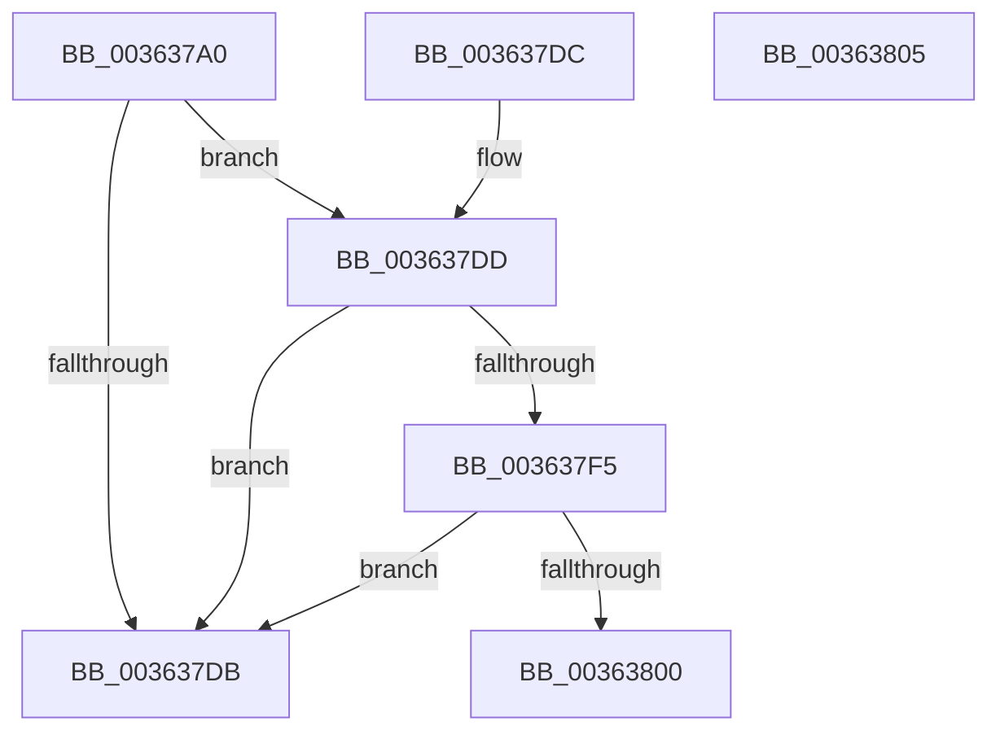

# MiAdvanceFaultList

- RVA: `0x003637A0`–`0x00363806` (길이 `102` bytes)
- VA: `0x00000001403637A0`
- 실행 섹션: `.text`
- PDB 이름 있음: `예`; PDB Function 태그: `아니요`
- unwind 정보 RVA: `0x000DB714`
- 디코드: `29`개 명령, `102/102` bytes 표시
- 미해석 바이트: `0` (있으면 어셈블리에 `.byte`로 보존)

> 이 문서는 커널 이미지의 기계어와 PDB 기호를 분석해 생성했습니다. 4번과 5번은 함수 원형과 자료형을 바이너리 사용 방식에서 추정한 C 해석이며 원본 소스 복구 결과는 아닙니다.

## 1. Dependencies

- 직접 호출 지점: **0**; 고유 호출 대상: **0**
- 직접 호출자로 확인된 함수: **11**
- RIP 상대 이미지 참조: **0**

### Outgoing calls
- 직접 디코드된 call 명령이 없습니다.

### Direct callers
- [MiCopyDataPageToImagePage](../2A/MiCopyDataPageToImagePage_function_002AE818.md) at `0x002AEDB3`
- [MiCreateSharedZeroPages](../2B/MiCreateSharedZeroPages_function_002B6318.md) at `0x002B65FA`
- [sub_00320866](../32/Unknown_function_00320866.md) at `0x00320DD0`
- [sub_0032FB87](../32/Unknown_function_0032FB87.md) at `0x0032FB94`
- [MiCompletePrivateZeroFault](../33/MiCompletePrivateZeroFault_function_00330CC0.md) at `0x0033185F`
- [MiComputeFaultCluster](MiComputeFaultCluster_function_003635B4.md) at `0x00363613`
- [MiComputeFaultCluster](MiComputeFaultCluster_function_003635B4.md) at `0x003636F9`
- [MiBuildMdlForMappedFileFault](MiBuildMdlForMappedFileFault_function_0036380C.md) at `0x00363BC4`
- [MiCopyFileOnlyGlobalSubsectionPage](MiCopyFileOnlyGlobalSubsectionPage_function_0036A9EC.md) at `0x0036AC34`
- [sub_0036C6B5](Unknown_function_0036C6B5.md) at `0x0036C985`
- [MiResolvePageFileFault](MiResolvePageFileFault_function_0036D968.md) at `0x0036DF47`
- [sub_006EAE58](../6E/Unknown_function_006EAE58.md) at `0x006EAE8A`

### Static image references
- 디코드된 RIP-relative 메모리 참조가 없습니다.

## 2. Other-region calls and transfers

- 다른 실행 섹션으로 향하는 call: **0**
- 별도 외부 분기/꼬리 이동을 확인하지 못했습니다.

## 3. Assembly (complete function range)

```asm
003637A0  4C 8B 51 08                     mov r10, qword ptr [rcx + 8]
003637A4  4C 8B 49 18                     mov r9, qword ptr [rcx + 0x18]
003637A8  49 8B C1                        mov rax, r9
003637AB  48 03 C0                        add rax, rax
003637AE  41 8B 14 C2                     mov edx, dword ptr [r10 + rax*8]
003637B2  4D 8B 44 C2 08                  mov r8, qword ptr [r10 + rax*8 + 8]
003637B7  81 E2 FF 0F 00 00               and edx, 0xfff
003637BD  48 8B 41 20                     mov rax, qword ptr [rcx + 0x20]
003637C1  49 81 C0 FF 0F 00 00            add r8, 0xfff
003637C8  4C 03 C2                        add r8, rdx
003637CB  49 C1 E8 0C                     shr r8, 0xc
003637CF  48 FF C0                        inc rax
003637D2  48 89 41 20                     mov qword ptr [rcx + 0x20], rax
003637D6  49 3B C0                        cmp rax, r8
003637D9  74 02                           je 0x1403637dd
003637DB  C3                              ret
003637DC  CC                              int3
003637DD  48 8B 41 10                     mov rax, qword ptr [rcx + 0x10]
003637E1  49 FF C1                        inc r9
003637E4  4C 89 49 18                     mov qword ptr [rcx + 0x18], r9
003637E8  48 C7 41 20 00 00 00 00         mov qword ptr [rcx + 0x20], 0
003637F0  4C 3B C8                        cmp r9, rax
003637F3  73 E6                           jae 0x1403637db
003637F5  4D 03 C9                        add r9, r9
003637F8  4B 83 7C CA 08 00               cmp qword ptr [r10 + r9*8 + 8], 0
003637FE  75 DB                           jne 0x1403637db
00363800  48 89 41 18                     mov qword ptr [rcx + 0x18], rax
00363804  C3                              ret
00363805  CC                              int3
```

## 4. C-style interpretation (structured pseudocode)

```c
__int64 __fastcall MiAdvanceFaultList(__int64 a1)
{
    __int64 result;

    result = (*(unsigned __int64 *)(a1 + 24)) + (*(unsigned __int64 *)(a1 + 24));
    a2 = (unsigned int)(((unsigned int)(*(unsigned int *)(*(unsigned __int64 *)(a1 + 8) + result * 8))) & (0xFFFULL));
    a3 = (*(unsigned __int64 *)(*(unsigned __int64 *)(a1 + 8) + result * 8 + 8)) + (0xFFFULL);
    a3 = (a3) + (a2);
    a3 = (a3) >> (12);
    result = (*(unsigned __int64 *)(a1 + 32)) + 1;
    *(unsigned __int64 *)(a1 + 32) = result;
    if (result == a3) goto loc_003637DD;
loc_003637DB:
    return result;
loc_003637DD:
    a4 = (*(unsigned __int64 *)(a1 + 24)) + 1;
    *(unsigned __int64 *)(a1 + 24) = a4;
    *(unsigned __int64 *)(a1 + 32) = 0;
    if (a4 >= (*(unsigned __int64 *)(a1 + 16))) goto loc_003637DB;
    a4 = (a4) + (a4);
    if ((*(unsigned __int64 *)(*(unsigned __int64 *)(a1 + 8) + a4 * 8 + 8)) != 0) goto loc_003637DB;
    *(unsigned __int64 *)(a1 + 24) = *(unsigned __int64 *)(a1 + 16);
    return *(unsigned __int64 *)(a1 + 16);
}
```

## 5. (Beta) C Style

```c
int64_t MiAdvanceFaultList(void *Arg1)
{
    uint8_t *arg1 = (uint8_t *)Arg1;

    int64_t result;

    result = (*(uint64_t *)(arg1 + 0x18)) + (*(uint64_t *)(arg1 + 0x18));
    a2 = (uint32_t)(((uint32_t)(*(uint32_t *)(*(uint64_t *)(arg1 + 0x8) + result * 8))) & (0xFFFULL));
    a3 = (*(uint64_t *)(*(uint64_t *)(arg1 + 0x8) + result * 8 + 0x8)) + (0xFFFULL);
    a3 = (a3) + (a2);
    a3 = (a3) >> (12);
    result = (*(uint64_t *)(arg1 + 0x20)) + 1;
    *(uint64_t *)(arg1 + 0x20) = result;
    if (result == a3) goto loc_003637DD;
loc_003637DB:
    return result;
loc_003637DD:
    a4 = (*(uint64_t *)(arg1 + 0x18)) + 1;
    *(uint64_t *)(arg1 + 0x18) = a4;
    *(uint64_t *)(arg1 + 0x20) = 0;
    if (a4 >= (*(uint64_t *)(arg1 + 0x10))) goto loc_003637DB;
    a4 = (a4) + (a4);
    if ((*(uint64_t *)(*(uint64_t *)(arg1 + 0x8) + a4 * 8 + 0x8)) != 0) goto loc_003637DB;
    *(uint64_t *)(arg1 + 0x18) = *(uint64_t *)(arg1 + 0x10);
    return *(uint64_t *)(arg1 + 0x10);
}
```

### 관측된 메모리 오프셋

구조체 형식이 확인되지 않은 접근은 인자 기준의 오프셋으로만 기록했습니다.

| 기준 인자 | 오프셋 표현 | 폭 (bit) | 접근 |
|---|---:|---:|---|
| `Arg1` | `+ 0x8` | `64` | `R` |
| `Arg1` | `+ 0x10` | `64` | `R` |
| `Arg1` | `+ 0x18` | `64` | `R` |
| `Arg1` | `+ 0x18` | `64` | `W` |
| `Arg1` | `+ 0x20` | `64` | `R` |
| `Arg1` | `+ 0x20` | `64` | `W` |

## 6. Execution-region graph

[열기: 2D/3D 그래프와 함수 탐색 컨트롤 패널](../../../control-panel.html?section=text&rva=0x003637A0&view=graph)

- 2D 그래프는 위에서 아래로 흐르고, 3D 그래프는 빈 공간을 드래그해 회전합니다. Shift+드래그는 이동, 휠은 확대·축소, 함수 노드 선택은 대상 보고서 이동입니다.

### Static fallback


