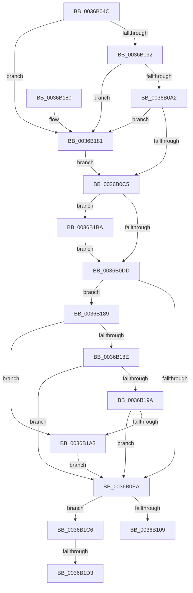

# MiAllocateAccessLog

- RVA: `0x0036B04C`–`0x0036B1E7` (길이 `411` bytes)
- VA: `0x000000014036B04C`
- 실행 섹션: `.text`
- PDB 이름 있음: `예`; PDB Function 태그: `예`
- unwind 정보 RVA: `0x0007A334`
- 디코드: `99`개 명령, `411/411` bytes 표시
- 미해석 바이트: `0` (있으면 어셈블리에 `.byte`로 보존)

> 이 문서는 커널 이미지의 기계어와 PDB 기호를 분석해 생성했습니다. 4번과 5번은 함수 원형과 자료형을 바이너리 사용 방식에서 추정한 C 해석이며 원본 소스 복구 결과는 아닙니다.

## 1. Dependencies

- 직접 호출 지점: **5**; 고유 호출 대상: **4**
- 직접 호출자로 확인된 함수: **1**
- RIP 상대 이미지 참조: **3**

### Outgoing calls
- `0x0036B06C` → [MiGetVmAccessLoggingPartition](../38/MiGetVmAccessLoggingPartition_function_003815A0.md) (function, `0x003815A0`)
- `0x0036B07C` → [MiSufficientAvailablePages](MiSufficientAvailablePages_function_0036D0B0.md) (function, `0x0036D0B0`)
- `0x0036B0F8` → [MiAllocatePool](../35/MiAllocatePool_function_0035B540.md) (function, `0x0035B540`)
- `0x0036B1A9` → [MiEmptyPageAccessLog](../34/MiEmptyPageAccessLog_function_00348700.md) (function, `0x00348700`)
- `0x0036B1D6` → [MiEmptyPageAccessLog](../34/MiEmptyPageAccessLog_function_00348700.md) (function, `0x00348700`)

### Direct callers
- [MiLogPageAccess](../24/MiLogPageAccess_function_00240870.md) at `0x00240915`

### Static image references
- `0x0036B0A2` → RVA `0x00E2CB48` (`.data`; read)
- `0x0036B0AE` → RVA `0x00E2CB40` (`.data`; read)
- `0x0036B0CC` → RVA `0x00E38840` (`.data`; read)

## 2. Other-region calls and transfers

- 다른 실행 섹션으로 향하는 call: **0**
- call이 아닌 외부 분기/꼬리 이동: **2**
  - `0x0036B1CD` → [sub_006E3BBC](../6E/Unknown_function_006E3BBC.md) (`tail-transfer`)
  - `0x0036B1E2` → [sub_006E3BBC](../6E/Unknown_function_006E3BBC.md) (`tail-transfer`)

## 3. Assembly (complete function range)

```asm
0036B04C  48 8B C4                        mov rax, rsp
0036B04F  48 89 58 08                     mov qword ptr [rax + 8], rbx
0036B053  48 89 68 10                     mov qword ptr [rax + 0x10], rbp
0036B057  48 89 70 18                     mov qword ptr [rax + 0x18], rsi
0036B05B  48 89 78 20                     mov qword ptr [rax + 0x20], rdi
0036B05F  41 54                           push r12
0036B061  41 56                           push r14
0036B063  41 57                           push r15
0036B065  48 83 EC 20                     sub rsp, 0x20
0036B069  4C 8B F1                        mov r14, rcx
0036B06C  E8 2F 65 01 00                  call 0x1403815a0
0036B071  BA 20 04 00 00                  mov edx, 0x420
0036B076  48 8B C8                        mov rcx, rax
0036B079  48 8B E8                        mov rbp, rax
0036B07C  E8 2F 20 00 00                  call 0x14036d0b0
0036B081  45 33 FF                        xor r15d, r15d
0036B084  41 BC 00 02 00 00               mov r12d, 0x200
0036B08A  85 C0                           test eax, eax
0036B08C  0F 84 EF 00 00 00               je 0x14036b181
0036B092  48 8B 8D 40 49 00 00            mov rcx, qword ptr [rbp + 0x4940]
0036B099  48 3B CA                        cmp rcx, rdx
0036B09C  0F 8C DF 00 00 00               jl 0x14036b181
0036B0A2  48 8B 05 9F 1A AC 00            mov rax, qword ptr [rip + 0xac1a9f]
0036B0A9  BB 00 10 00 00                  mov ebx, 0x1000
0036B0AE  48 8B 0D 8B 1A AC 00            mov rcx, qword ptr [rip + 0xac1a8b]
0036B0B5  48 2B C8                        sub rcx, rax
0036B0B8  48 81 F9 00 08 00 00            cmp rcx, 0x800
0036B0BF  0F 82 BC 00 00 00               jb 0x14036b181
0036B0C5  41 8B 86 B8 00 00 00            mov eax, dword ptr [r14 + 0xb8]
0036B0CC  48 8D 3D 6D D7 AC 00            lea rdi, [rip + 0xacd76d]
0036B0D3  24 0F                           and al, 0xf
0036B0D5  3C 01                           cmp al, 1
0036B0D7  0F 85 DD 00 00 00               jne 0x14036b1ba
0036B0DD  48 8B 77 28                     mov rsi, qword ptr [rdi + 0x28]
0036B0E1  48 85 F6                        test rsi, rsi
0036B0E4  0F 85 9F 00 00 00               jne 0x14036b189
0036B0EA  41 B8 4D 6D 41 63               mov r8d, 0x63416d4d
0036B0F0  48 8B D3                        mov rdx, rbx
0036B0F3  B9 40 00 00 00                  mov ecx, 0x40
0036B0F8  E8 43 04 FF FF                  call 0x14035b540
0036B0FD  48 8B C8                        mov rcx, rax
0036B100  48 85 C0                        test rax, rax
0036B103  0F 84 BD 00 00 00               je 0x14036b1c6
0036B109  48 89 47 28                     mov qword ptr [rdi + 0x28], rax
0036B10D  44 89 78 08                     mov dword ptr [rax + 8], r15d
0036B111  48 83 C0 40                     add rax, 0x40
0036B115  48 89 41 20                     mov qword ptr [rcx + 0x20], rax
0036B119  48 8D 43 F8                     lea rax, [rbx - 8]
0036B11D  48 03 C1                        add rax, rcx
0036B120  4C 89 38                        mov qword ptr [rax], r15
0036B123  48 89 41 30                     mov qword ptr [rcx + 0x30], rax
0036B127  48 83 C0 F8                     add rax, -8
0036B12B  48 89 41 28                     mov qword ptr [rcx + 0x28], rax
0036B12F  4C 89 39                        mov qword ptr [rcx], r15
0036B132  41 8B 86 B8 00 00 00            mov eax, dword ptr [r14 + 0xb8]
0036B139  A8 0F                           test al, 0xf
0036B13B  49 8D 86 00 FC FF FF            lea rax, [r14 - 0x400]
0036B142  49 0F 45 C7                     cmovne rax, r15
0036B146  48 89 41 38                     mov qword ptr [rcx + 0x38], rax
0036B14A  48 B8 20 03 00 00 80 F7 FF FF   movabs rax, 0xfffff78000000320
0036B154  48 8B 00                        mov rax, qword ptr [rax]
0036B157  48 89 41 10                     mov qword ptr [rcx + 0x10], rax
0036B15B  48 8B C1                        mov rax, rcx
0036B15E  48 89 31                        mov qword ptr [rcx], rsi
0036B161  48 8B 5C 24 40                  mov rbx, qword ptr [rsp + 0x40]
0036B166  48 8B 6C 24 48                  mov rbp, qword ptr [rsp + 0x48]
0036B16B  48 8B 74 24 50                  mov rsi, qword ptr [rsp + 0x50]
0036B170  48 8B 7C 24 58                  mov rdi, qword ptr [rsp + 0x58]
0036B175  48 83 C4 20                     add rsp, 0x20
0036B179  41 5F                           pop r15
0036B17B  41 5E                           pop r14
0036B17D  41 5C                           pop r12
0036B17F  C3                              ret
0036B180  CC                              int3
0036B181  49 8B DC                        mov rbx, r12
0036B184  E9 3C FF FF FF                  jmp 0x14036b0c5
0036B189  49 3B DC                        cmp rbx, r12
0036B18C  74 15                           je 0x14036b1a3
0036B18E  48 8B 06                        mov rax, qword ptr [rsi]
0036B191  48 85 C0                        test rax, rax
0036B194  0F 84 50 FF FF FF               je 0x14036b0ea
0036B19A  4C 39 38                        cmp qword ptr [rax], r15
0036B19D  0F 84 47 FF FF FF               je 0x14036b0ea
0036B1A3  48 8B D6                        mov rdx, rsi
0036B1A6  48 8B CD                        mov rcx, rbp
0036B1A9  E8 52 D5 FD FF                  call 0x140348700
0036B1AE  49 8B F7                        mov rsi, r15
0036B1B1  4C 89 7F 28                     mov qword ptr [rdi + 0x28], r15
0036B1B5  E9 30 FF FF FF                  jmp 0x14036b0ea
0036B1BA  49 8D BE C0 00 00 00            lea rdi, [r14 + 0xc0]
0036B1C1  E9 17 FF FF FF                  jmp 0x14036b0dd
0036B1C6  48 8B 57 28                     mov rdx, qword ptr [rdi + 0x28]
0036B1CA  48 85 D2                        test rdx, rdx
0036B1CD  0F 84 E9 89 37 00               je 0x1406e3bbc
0036B1D3  48 8B CD                        mov rcx, rbp
0036B1D6  E8 25 D5 FD FF                  call 0x140348700
0036B1DB  49 8B F7                        mov rsi, r15
0036B1DE  4C 89 7F 28                     mov qword ptr [rdi + 0x28], r15
0036B1E2  E9 D5 89 37 00                  jmp 0x1406e3bbc
```

## 4. C-style interpretation (structured pseudocode)

```c
__int64 __fastcall MiAllocateAccessLog(__int64 a1)
{
    __int64 result;
    __int64 v_r15;
    __int64 v_rsp;
    unsigned __int64 v_stack_p10;
    unsigned __int64 v_stack_p18;
    unsigned __int64 v_stack_p20;
    unsigned __int64 v_stack_p8;

    *(unsigned __int64 *)(v_rsp + 8) = v_rbx;
    *(unsigned __int64 *)(v_rsp + 16) = v_rbp;
    *(unsigned __int64 *)(v_rsp + 24) = v_rsi;
    *(unsigned __int64 *)(v_rsp + 32) = v_rdi;
    v_rsp = (v_rsp) - (32);
    result = MiGetVmAccessLoggingPartition(a1, a2, a3, a4);
    result = MiSufficientAvailablePages(result, (unsigned int)(0x420ULL), a3, a4);
    v_r15 = 0;
    if ((unsigned int)(result) == 0) goto loc_0036B181;
    if ((*(unsigned __int64 *)(result + 18752)) < ((unsigned int)(0x420ULL))) goto loc_0036B181;
    a1 = (*(unsigned __int64 *)(v_rip + 11278987)) - (*(unsigned __int64 *)(v_rip + 11279007));
    if (a1 < 0x800ULL) goto loc_0036B181;
loc_0036B0C5:
    result = (unsigned __int8)(((unsigned int)(*(unsigned int *)(a1 + 184))) & (15));
    if (((unsigned __int8)(result)) != 1) goto loc_0036B1BA;
loc_0036B0DD:
    if (*(unsigned __int64 *)(v_rip + 11327341 + 40) != 0) goto loc_0036B189;
loc_0036B0EA:
    result = MiAllocatePool(64, (unsigned int)(0x1000ULL), (unsigned int)(0x63416D4DULL), a4);
    if (result == 0) goto loc_0036B1C6;
    *(unsigned __int64 *)(v_rip + 11327341 + 40) = result;
    *(unsigned int *)(result + 8) = 0;
    result = (result) + (64);
    *(unsigned __int64 *)(result + 32) = result;
    result = ((unsigned int)(0x1000ULL) - 8) + (result);
    *(unsigned __int64 *)(result) = 0;
    *(unsigned __int64 *)(result + 48) = result;
    result = (result) + (-8);
    *(unsigned __int64 *)(result + 40) = result;
    *(unsigned __int64 *)(result) = 0;
    result = a1 - 1024;
    if ((((unsigned __int8)((unsigned int)(*(unsigned int *)(a1 + 184)))) & (15)) != 0) { result = 0; }
    *(unsigned __int64 *)(result + 56) = result;
    *(unsigned __int64 *)(result + 16) = *(unsigned __int64 *)(result);
    *(unsigned __int64 *)(result) = *(unsigned __int64 *)(v_rip + 11327341 + 40);
    v_rsp = (v_rsp) + (32);
    return result;
loc_0036B181:
    goto loc_0036B0C5;
loc_0036B189:
    if (512 == 512) goto loc_0036B1A3;
    if (*(unsigned __int64 *)(v_stack_p18) == 0) goto loc_0036B0EA;
    if ((*(unsigned __int64 *)(*(unsigned __int64 *)(v_stack_p18))) == 0) goto loc_0036B0EA;
loc_0036B1A3:
    result = MiEmptyPageAccessLog(v_stack_p10, v_stack_p18, (unsigned int)(0x63416D4DULL), a4);
    *(unsigned __int64 *)(v_stack_p20 + 40) = 0;
    goto loc_0036B0EA;
loc_0036B1BA:
    goto loc_0036B0DD;
loc_0036B1C6:
    result = MiEmptyPageAccessLog(v_stack_p10, *(unsigned __int64 *)(a1 + 192 + 40), (unsigned int)(0x63416D4DULL), a4);
    *(unsigned __int64 *)(a1 + 192 + 40) = 0;
}
```

## 5. (Beta) C Style

```c
int64_t MiAllocateAccessLog(void *Arg1)
{
    uint8_t *arg1 = (uint8_t *)Arg1;

    int64_t result;
    int64_t local_r15;
    int64_t local_rsp;
    uint64_t v_stack_p10;
    uint64_t v_stack_p18;
    uint64_t v_stack_p20;
    uint64_t v_stack_p8;

    *(uint64_t *)(local_rsp + 0x8) = local_rbx;
    *(uint64_t *)(local_rsp + 0x10) = local_rbp;
    *(uint64_t *)(local_rsp + 0x18) = local_rsi;
    *(uint64_t *)(local_rsp + 0x20) = local_rdi;
    local_rsp = (local_rsp) - (32);
    result = MiGetVmAccessLoggingPartition(Arg1, a2, a3, a4);
    result = MiSufficientAvailablePages(result, (uint32_t)(0x420ULL), a3, a4);
    local_r15 = 0;
    if ((uint32_t)(result) == 0) goto loc_0036B181;
    if ((*(uint64_t *)(result + 0x4940)) < ((uint32_t)(0x420ULL))) goto loc_0036B181;
    Arg1 = (*(uint64_t *)(v_rip + 0xAC1A8B)) - (*(uint64_t *)(v_rip + 0xAC1A9F));
    if (Arg1 < 0x800ULL) goto loc_0036B181;
loc_0036B0C5:
    result = (uint8_t)(((uint32_t)(*(uint32_t *)(arg1 + 0xB8))) & (15));
    if (((uint8_t)(result)) != 1) goto loc_0036B1BA;
loc_0036B0DD:
    if (*(uint64_t *)(v_rip + 0xACD76D + 0x28) != 0) goto loc_0036B189;
loc_0036B0EA:
    result = MiAllocatePool(64, (uint32_t)(0x1000ULL), (uint32_t)(0x63416D4DULL), a4);
    if (result == 0) goto loc_0036B1C6;
    *(uint64_t *)(v_rip + 0xACD76D + 0x28) = result;
    *(uint32_t *)(result + 0x8) = 0;
    result = (result) + (64);
    *(uint64_t *)(result + 0x20) = result;
    result = ((uint32_t)(0x1000ULL) - 8) + (result);
    *(uint64_t *)(result) = 0;
    *(uint64_t *)(result + 0x30) = result;
    result = (result) + (-8);
    *(uint64_t *)(result + 0x28) = result;
    *(uint64_t *)(result) = 0;
    result = Arg1 - 1024;
    if ((((uint8_t)((uint32_t)(*(uint32_t *)(arg1 + 0xB8)))) & (15)) != 0) { result = 0; }
    *(uint64_t *)(result + 0x38) = result;
    *(uint64_t *)(result + 0x10) = *(uint64_t *)(result);
    *(uint64_t *)(result) = *(uint64_t *)(v_rip + 0xACD76D + 0x28);
    local_rsp = (local_rsp) + (32);
    return result;
loc_0036B181:
    goto loc_0036B0C5;
loc_0036B189:
    if (512 == 512) goto loc_0036B1A3;
    if (*(uint64_t *)(v_stack_p18) == 0) goto loc_0036B0EA;
    if ((*(uint64_t *)(*(uint64_t *)(v_stack_p18))) == 0) goto loc_0036B0EA;
loc_0036B1A3:
    result = MiEmptyPageAccessLog(v_stack_p10, v_stack_p18, (uint32_t)(0x63416D4DULL), a4);
    *(uint64_t *)(v_stack_p20 + 0x28) = 0;
    goto loc_0036B0EA;
loc_0036B1BA:
    goto loc_0036B0DD;
loc_0036B1C6:
    result = MiEmptyPageAccessLog(v_stack_p10, *(uint64_t *)(arg1 + 0xC0 + 0x28), (uint32_t)(0x63416D4DULL), a4);
    *(uint64_t *)(arg1 + 0xC0 + 0x28) = 0;
}
```

### 관측된 메모리 오프셋

구조체 형식이 확인되지 않은 접근은 인자 기준의 오프셋으로만 기록했습니다.

| 기준 인자 | 오프셋 표현 | 폭 (bit) | 접근 |
|---|---:|---:|---|
| `Arg1` | `- 0x400` | `64` | `R` |
| `Arg1` | `+ 0xB8` | `32` | `R` |
| `Arg1` | `+ 0xC0` | `64` | `R` |

## 6. Execution-region graph

[열기: 2D/3D 그래프와 함수 탐색 컨트롤 패널](../../../control-panel.html?section=text&rva=0x0036B04C&view=graph)

- 2D 그래프는 위에서 아래로 흐르고, 3D 그래프는 빈 공간을 드래그해 회전합니다. Shift+드래그는 이동, 휠은 확대·축소, 함수 노드 선택은 대상 보고서 이동입니다.

### Static fallback


