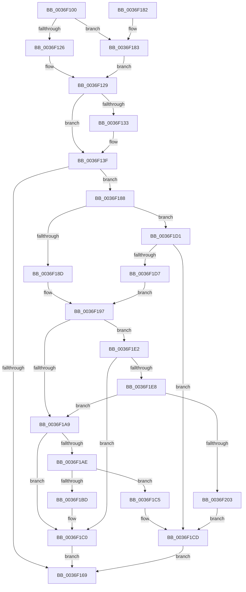

# MiAllocateInPageSupport

- RVA: `0x0036F100`–`0x0036F205` (길이 `261` bytes)
- VA: `0x000000014036F100`
- 실행 섹션: `.text`
- PDB 이름 있음: `예`; PDB Function 태그: `아니요`
- unwind 정보 RVA: `0x00068F60`
- 디코드: `84`개 명령, `261/261` bytes 표시
- 미해석 바이트: `0` (있으면 어셈블리에 `.byte`로 보존)

> 이 문서는 커널 이미지의 기계어와 PDB 기호를 분석해 생성했습니다. 4번과 5번은 함수 원형과 자료형을 바이너리 사용 방식에서 추정한 C 해석이며 원본 소스 복구 결과는 아닙니다.

## 1. Dependencies

- 직접 호출 지점: **6**; 고유 호출 대상: **4**
- 직접 호출자로 확인된 함수: **1**
- RIP 상대 이미지 참조: **0**

### Outgoing calls
- `0x0036F15F` → [MiGetInPageSupportBlock](MiGetInPageSupportBlock_function_00362500.md) (function, `0x00362500`)
- `0x0036F192` → [MiUnlockProtoPoolPage](../24/MiUnlockProtoPoolPage_function_00246090.md) (function, `0x00246090`)
- `0x0036F19C` → [MiGetInPageSupportBlock](MiGetInPageSupportBlock_function_00362500.md) (function, `0x00362500`)
- `0x0036F1B3` → [MiLockProtoPoolPage](../2B/MiLockProtoPoolPage_function_002B8B80.md) (function, `0x002B8B80`)
- `0x0036F1C8` → [MiFreeInPageSupportBlock](../2B/MiFreeInPageSupportBlock_function_002B5900.md) (function, `0x002B5900`)
- `0x0036F1F6` → [MiGetInPageSupportBlock](MiGetInPageSupportBlock_function_00362500.md) (function, `0x00362500`)

### Direct callers
- [MiResolvePageFileFault](MiResolvePageFileFault_function_0036D968.md) at `0x0036DD02`

### Static image references
- 디코드된 RIP-relative 메모리 참조가 없습니다.

## 2. Other-region calls and transfers

- 다른 실행 섹션으로 향하는 call: **0**
- 별도 외부 분기/꼬리 이동을 확인하지 못했습니다.

## 3. Assembly (complete function range)

```asm
0036F100  48 89 5C 24 08                  mov qword ptr [rsp + 8], rbx
0036F105  48 89 6C 24 10                  mov qword ptr [rsp + 0x10], rbp
0036F10A  48 89 74 24 18                  mov qword ptr [rsp + 0x18], rsi
0036F10F  57                              push rdi
0036F110  41 56                           push r14
0036F112  41 57                           push r15
0036F114  48 83 EC 20                     sub rsp, 0x20
0036F118  49 8B F9                        mov rdi, r9
0036F11B  49 8B D8                        mov rbx, r8
0036F11E  48 8B E9                        mov rbp, rcx
0036F121  4D 85 C9                        test r9, r9
0036F124  74 5D                           je 0x14036f183
0036F126  4D 8B 39                        mov r15, qword ptr [r9]
0036F129  41 8B 00                        mov eax, dword ptr [r8]
0036F12C  3D 00 01 00 00                  cmp eax, 0x100
0036F131  76 0C                           jbe 0x14036f13f
0036F133  41 C7 00 00 01 00 00            mov dword ptr [r8], 0x100
0036F13A  B8 00 01 00 00                  mov eax, 0x100
0036F13F  4C 8B 74 24 60                  mov r14, qword ptr [rsp + 0x60]
0036F144  8B F2                           mov esi, edx
0036F146  83 CE 01                        or esi, 1
0036F149  83 F8 10                        cmp eax, 0x10
0036F14C  0F 46 F2                        cmovbe esi, edx
0036F14F  49 8B D6                        mov rdx, r14
0036F152  8B C6                           mov eax, esi
0036F154  8B CE                           mov ecx, esi
0036F156  83 C8 04                        or eax, 4
0036F159  48 85 FF                        test rdi, rdi
0036F15C  0F 45 C8                        cmovne ecx, eax
0036F15F  E8 9C 33 FF FF                  call 0x140362500
0036F164  48 85 C0                        test rax, rax
0036F167  74 1F                           je 0x14036f188
0036F169  48 8B 5C 24 40                  mov rbx, qword ptr [rsp + 0x40]
0036F16E  48 8B 6C 24 48                  mov rbp, qword ptr [rsp + 0x48]
0036F173  48 8B 74 24 50                  mov rsi, qword ptr [rsp + 0x50]
0036F178  48 83 C4 20                     add rsp, 0x20
0036F17C  41 5F                           pop r15
0036F17E  41 5E                           pop r14
0036F180  5F                              pop rdi
0036F181  C3                              ret
0036F182  CC                              int3
0036F183  45 33 FF                        xor r15d, r15d
0036F186  EB A1                           jmp 0x14036f129
0036F188  48 85 FF                        test rdi, rdi
0036F18B  74 44                           je 0x14036f1d1
0036F18D  B2 11                           mov dl, 0x11
0036F18F  49 8B CF                        mov rcx, r15
0036F192  E8 F9 6E ED FF                  call 0x140246090
0036F197  49 8B D6                        mov rdx, r14
0036F19A  8B CE                           mov ecx, esi
0036F19C  E8 5F 33 FF FF                  call 0x140362500
0036F1A1  4C 8B F8                        mov r15, rax
0036F1A4  48 85 C0                        test rax, rax
0036F1A7  74 39                           je 0x14036f1e2
0036F1A9  48 85 FF                        test rdi, rdi
0036F1AC  74 12                           je 0x14036f1c0
0036F1AE  33 D2                           xor edx, edx
0036F1B0  48 8B CD                        mov rcx, rbp
0036F1B3  E8 C8 99 F4 FF                  call 0x1402b8b80
0036F1B8  48 85 C0                        test rax, rax
0036F1BB  74 08                           je 0x14036f1c5
0036F1BD  48 89 07                        mov qword ptr [rdi], rax
0036F1C0  49 8B C7                        mov rax, r15
0036F1C3  EB A4                           jmp 0x14036f169
0036F1C5  49 8B CF                        mov rcx, r15
0036F1C8  E8 33 67 F4 FF                  call 0x1402b5900
0036F1CD  33 C0                           xor eax, eax
0036F1CF  EB 98                           jmp 0x14036f169
0036F1D1  40 F6 C6 01                     test sil, 1
0036F1D5  74 F6                           je 0x14036f1cd
0036F1D7  83 E6 FE                        and esi, 0xfffffffe
0036F1DA  C7 03 10 00 00 00               mov dword ptr [rbx], 0x10
0036F1E0  EB B5                           jmp 0x14036f197
0036F1E2  40 F6 C6 01                     test sil, 1
0036F1E6  74 D8                           je 0x14036f1c0
0036F1E8  83 E6 FE                        and esi, 0xfffffffe
0036F1EB  C7 03 10 00 00 00               mov dword ptr [rbx], 0x10
0036F1F1  8B CE                           mov ecx, esi
0036F1F3  49 8B D6                        mov rdx, r14
0036F1F6  E8 05 33 FF FF                  call 0x140362500
0036F1FB  4C 8B F8                        mov r15, rax
0036F1FE  48 85 C0                        test rax, rax
0036F201  75 A6                           jne 0x14036f1a9
0036F203  EB C8                           jmp 0x14036f1cd
```

## 4. C-style interpretation (structured pseudocode)

```c
__int64 __fastcall MiAllocateInPageSupport(__int64 a1, int a2, __int64 a3, __int64 a4, __int64 a5)
{
    __int64 result;
    __int64 v_r15;
    __int64 v_rsi;
    __int64 v_rsp;
    unsigned __int64 v_stack_p10;
    unsigned __int64 v_stack_p18;
    unsigned __int64 v_stack_p8;

    v_stack_p8 = v_rbx;
    v_stack_p10 = v_rbp;
    v_stack_p18 = v_rsi;
    v_rsp = (v_rsp) - (32);
    if (a4 == 0) goto loc_0036F183;
loc_0036F129:
    result = (unsigned int)(*(unsigned int *)(a3));
    if (((unsigned int)((unsigned int)(*(unsigned int *)(a3)))) >= = 256) {
        *(unsigned int *)(a3) = 256;
        result = 256;
    }
    v_rsi = (unsigned int)(((unsigned int)(a2)) | (1));
    if (((unsigned int)(result)) <= 16) { v_rsi = a2; }
    result = (unsigned int)(((unsigned int)((unsigned int)(v_rsi))) | (4));
    a1 = (unsigned int)((unsigned int)(v_rsi));
    if (a4 != 0) { a1 = (unsigned int)(result); }
    result = MiGetInPageSupportBlock(a1, a5, a3, a4);
    if (result == 0) goto loc_0036F188;
loc_0036F169:
    v_rsp = (v_rsp) + (32);
    return result;
loc_0036F183:
    v_r15 = 0;
    goto loc_0036F129;
loc_0036F188:
    if (a4 == 0) goto loc_0036F1D1;
    result = MiUnlockProtoPoolPage(0, 17, a3, a4);
loc_0036F197:
    result = MiGetInPageSupportBlock((unsigned int)((unsigned int)(v_stack_p18)), a5, a3, a4);
    if (result == 0) goto loc_0036F1E2;
loc_0036F1A9:
    if (a4 == 0) goto loc_0036F1C0;
    a2 = 0;
    result = MiLockProtoPoolPage(v_stack_p10, a2, a3, a4);
    if (result == 0) goto loc_0036F1C5;
    *(unsigned __int64 *)(a4) = result;
loc_0036F1C0:
    goto loc_0036F169;
loc_0036F1C5:
    result = MiFreeInPageSupportBlock(result, a2, a3, a4);
loc_0036F1CD:
    result = 0;
    goto loc_0036F169;
loc_0036F1D1:
    if ((((unsigned __int8)(v_stack_p18)) & (1)) == 0) goto loc_0036F1CD;
    v_rsi = (unsigned int)((v_stack_p18) & (0xFFFFFFFEULL));
    *(unsigned int *)(v_stack_p8) = 16;
    goto loc_0036F197;
loc_0036F1E2:
    if ((((unsigned __int8)(v_rsi)) & (1)) == 0) goto loc_0036F1C0;
    v_rsi = (unsigned int)((v_rsi) & (0xFFFFFFFEULL));
    *(unsigned int *)(v_stack_p8) = 16;
    result = MiGetInPageSupportBlock((unsigned int)((unsigned int)(v_rsi)), a5, a3, a4);
    if (result != 0) goto loc_0036F1A9;
    goto loc_0036F1CD;
}
```

## 5. (Beta) C Style

```c
int64_t MiAllocateInPageSupport(int64_t Arg1, int32_t Arg2, void *Arg3, int64_t Arg4, int64_t Arg5)
{
    uint8_t *arg3 = (uint8_t *)Arg3;

    int64_t result;
    int64_t local_r15;
    int64_t local_rsi;
    int64_t local_rsp;
    uint64_t v_stack_p10;
    uint64_t v_stack_p18;
    uint64_t v_stack_p8;

    v_stack_p8 = local_rbx;
    v_stack_p10 = local_rbp;
    v_stack_p18 = local_rsi;
    local_rsp = (local_rsp) - (32);
    if (Arg4 == 0) goto loc_0036F183;
loc_0036F129:
    result = (uint32_t)(*(uint32_t *)(arg3));
    if (((uint32_t)((uint32_t)(*(uint32_t *)(arg3)))) >= = 256) {
        *(uint32_t *)(arg3) = 256;
        result = 256;
    }
    local_rsi = (uint32_t)(((uint32_t)(Arg2)) | (1));
    if (((uint32_t)(result)) <= 16) { local_rsi = Arg2; }
    result = (uint32_t)(((uint32_t)((uint32_t)(local_rsi))) | (4));
    Arg1 = (uint32_t)((uint32_t)(local_rsi));
    if (Arg4 != 0) { Arg1 = (uint32_t)(result); }
    result = MiGetInPageSupportBlock(Arg1, Arg5, Arg3, Arg4);
    if (result == 0) goto loc_0036F188;
loc_0036F169:
    local_rsp = (local_rsp) + (32);
    return result;
loc_0036F183:
    local_r15 = 0;
    goto loc_0036F129;
loc_0036F188:
    if (Arg4 == 0) goto loc_0036F1D1;
    result = MiUnlockProtoPoolPage(0, 17, Arg3, Arg4);
loc_0036F197:
    result = MiGetInPageSupportBlock((uint32_t)((uint32_t)(v_stack_p18)), Arg5, Arg3, Arg4);
    if (result == 0) goto loc_0036F1E2;
loc_0036F1A9:
    if (Arg4 == 0) goto loc_0036F1C0;
    Arg2 = 0;
    result = MiLockProtoPoolPage(v_stack_p10, Arg2, Arg3, Arg4);
    if (result == 0) goto loc_0036F1C5;
    *(uint64_t *)(Arg4) = result;
loc_0036F1C0:
    goto loc_0036F169;
loc_0036F1C5:
    result = MiFreeInPageSupportBlock(result, Arg2, Arg3, Arg4);
loc_0036F1CD:
    result = 0;
    goto loc_0036F169;
loc_0036F1D1:
    if ((((uint8_t)(v_stack_p18)) & (1)) == 0) goto loc_0036F1CD;
    local_rsi = (uint32_t)((v_stack_p18) & (0xFFFFFFFEULL));
    *(uint32_t *)(v_stack_p8) = 16;
    goto loc_0036F197;
loc_0036F1E2:
    if ((((uint8_t)(local_rsi)) & (1)) == 0) goto loc_0036F1C0;
    local_rsi = (uint32_t)((local_rsi) & (0xFFFFFFFEULL));
    *(uint32_t *)(v_stack_p8) = 16;
    result = MiGetInPageSupportBlock((uint32_t)((uint32_t)(local_rsi)), Arg5, Arg3, Arg4);
    if (result != 0) goto loc_0036F1A9;
    goto loc_0036F1CD;
}
```

### 관측된 메모리 오프셋

구조체 형식이 확인되지 않은 접근은 인자 기준의 오프셋으로만 기록했습니다.

| 기준 인자 | 오프셋 표현 | 폭 (bit) | 접근 |
|---|---:|---:|---|
| `Arg3` | `+ 0x0` | `32` | `R` |
| `Arg3` | `+ 0x0` | `32` | `W` |

## 6. Execution-region graph

[열기: 2D/3D 그래프와 함수 탐색 컨트롤 패널](../../../control-panel.html?section=text&rva=0x0036F100&view=graph)

- 2D 그래프는 위에서 아래로 흐르고, 3D 그래프는 빈 공간을 드래그해 회전합니다. Shift+드래그는 이동, 휠은 확대·축소, 함수 노드 선택은 대상 보고서 이동입니다.

### Static fallback


