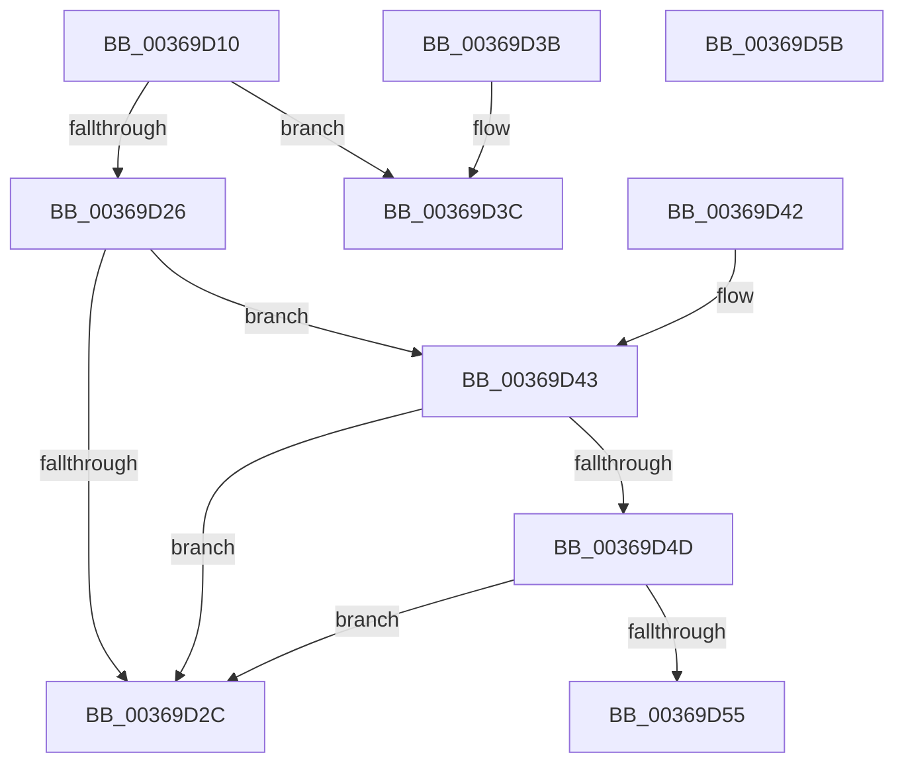

# MiAllowReadInProgress

- RVA: `0x00369D10`–`0x00369D5C` (길이 `76` bytes)
- VA: `0x0000000140369D10`
- 실행 섹션: `.text`
- PDB 이름 있음: `예`; PDB Function 태그: `아니요`
- unwind 정보 RVA: `0x000DB714`
- 디코드: `25`개 명령, `76/76` bytes 표시
- 미해석 바이트: `0` (있으면 어셈블리에 `.byte`로 보존)

> 이 문서는 커널 이미지의 기계어와 PDB 기호를 분석해 생성했습니다. 4번과 5번은 함수 원형과 자료형을 바이너리 사용 방식에서 추정한 C 해석이며 원본 소스 복구 결과는 아닙니다.

## 1. Dependencies

- 직접 호출 지점: **0**; 고유 호출 대상: **0**
- 직접 호출자로 확인된 함수: **1**
- RIP 상대 이미지 참조: **0**

### Outgoing calls
- 직접 디코드된 call 명령이 없습니다.

### Direct callers
- [MiHandleCollidedFault](MiHandleCollidedFault_function_00369B48.md) at `0x00369B7F`

### Static image references
- 디코드된 RIP-relative 메모리 참조가 없습니다.

## 2. Other-region calls and transfers

- 다른 실행 섹션으로 향하는 call: **0**
- 별도 외부 분기/꼬리 이동을 확인하지 못했습니다.

## 3. Assembly (complete function range)

```asm
00369D10  65 48 8B 04 25 88 01 00 00      mov rax, qword ptr gs:[0x188]
00369D19  4C 8B 41 10                     mov r8, qword ptr [rcx + 0x10]
00369D1D  F6 80 A8 05 00 00 04            test byte ptr [rax + 0x5a8], 4
00369D24  75 16                           jne 0x140369d3c
00369D26  41 F6 C0 01                     test r8b, 1
00369D2A  75 17                           jne 0x140369d43
00369D2C  8A 41 45                        mov al, byte ptr [rcx + 0x45]
00369D2F  24 10                           and al, 0x10
00369D31  F6 D8                           neg al
00369D33  1B C0                           sbb eax, eax
00369D35  25 34 04 00 C0                  and eax, 0xc0000434
00369D3A  C3                              ret
00369D3B  CC                              int3
00369D3C  B8 A1 00 00 C0                  mov eax, 0xc00000a1
00369D41  C3                              ret
00369D42  CC                              int3
00369D43  49 83 E0 FE                     and r8, 0xfffffffffffffffe
00369D47  41 80 38 05                     cmp byte ptr [r8], 5
00369D4B  75 DF                           jne 0x140369d2c
00369D4D  41 8B 40 38                     mov eax, dword ptr [r8 + 0x38]
00369D51  A8 04                           test al, 4
00369D53  74 D7                           je 0x140369d2c
00369D55  B8 17 00 00 C0                  mov eax, 0xc0000017
00369D5A  C3                              ret
00369D5B  CC                              int3
```

## 4. C-style interpretation (structured pseudocode)

```c
__int64 __fastcall MiAllowReadInProgress(__int64 a1)
{
    __int64 result;

    if (((*(unsigned __int8 *)(*(unsigned __int64 *)(gs_base + (0 + 392)) + 1448)) & (4)) != 0) goto loc_00369D3C;
    if ((((unsigned __int8)(*(unsigned __int64 *)(a1 + 16))) & (1)) != 0) goto loc_00369D43;
loc_00369D2C:
    result = (unsigned __int8)((*(unsigned __int8 *)(a1 + 69)) & (16));
    result = (unsigned __int8)(-(result));
    result = (unsigned int)((result) & (0xC0000434ULL));
    return result;
loc_00369D3C:
    return (unsigned int)(0xC00000A1ULL);
loc_00369D43:
    a3 = (*(unsigned __int64 *)(a1 + 16)) & (-2);
    if ((*(unsigned __int8 *)(a3)) != 5) goto loc_00369D2C;
    if ((((unsigned __int8)((unsigned int)(*(unsigned int *)(a3 + 56)))) & (4)) == 0) goto loc_00369D2C;
    return (unsigned int)(0xC0000017ULL);
}
```

## 5. (Beta) C Style

```c
int64_t MiAllowReadInProgress(void *Arg1)
{
    uint8_t *arg1 = (uint8_t *)Arg1;

    int64_t result;

    if (((*(uint8_t *)(*(uint64_t *)(gs_base + (0 + 0x188)) + 0x5A8)) & (4)) != 0) goto loc_00369D3C;
    if ((((uint8_t)(*(uint64_t *)(arg1 + 0x10))) & (1)) != 0) goto loc_00369D43;
loc_00369D2C:
    result = (uint8_t)((*(uint8_t *)(arg1 + 0x45)) & (16));
    result = (uint8_t)(-(result));
    result = (uint32_t)((result) & (0xC0000434ULL));
    return result;
loc_00369D3C:
    return (uint32_t)(0xC00000A1ULL);
loc_00369D43:
    a3 = (*(uint64_t *)(arg1 + 0x10)) & (-2);
    if ((*(uint8_t *)(a3)) != 5) goto loc_00369D2C;
    if ((((uint8_t)((uint32_t)(*(uint32_t *)(a3 + 0x38)))) & (4)) == 0) goto loc_00369D2C;
    return (uint32_t)(0xC0000017ULL);
}
```

### 관측된 메모리 오프셋

구조체 형식이 확인되지 않은 접근은 인자 기준의 오프셋으로만 기록했습니다.

| 기준 인자 | 오프셋 표현 | 폭 (bit) | 접근 |
|---|---:|---:|---|
| `Arg1` | `+ 0x10` | `64` | `R` |
| `Arg1` | `+ 0x45` | `8` | `R` |

## 6. Execution-region graph

[열기: 2D/3D 그래프와 함수 탐색 컨트롤 패널](../../../control-panel.html?section=text&rva=0x00369D10&view=graph)

- 2D 그래프는 위에서 아래로 흐르고, 3D 그래프는 빈 공간을 드래그해 회전합니다. Shift+드래그는 이동, 휠은 확대·축소, 함수 노드 선택은 대상 보고서 이동입니다.

### Static fallback


