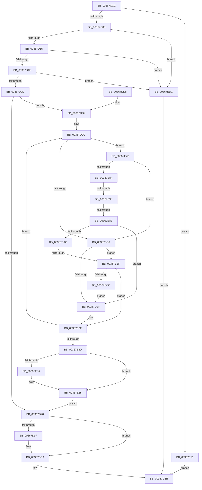

# MiCommitEnclavePages

- RVA: `0x00367CCC`–`0x00367EE6` (길이 `538` bytes)
- VA: `0x0000000140367CCC`
- 실행 섹션: `.text`
- PDB 이름 있음: `예`; PDB Function 태그: `예`
- unwind 정보 RVA: `0x0007A040`
- 디코드: `134`개 명령, `538/538` bytes 표시
- 미해석 바이트: `0` (있으면 어셈블리에 `.byte`로 보존)

> 이 문서는 커널 이미지의 기계어와 PDB 기호를 분석해 생성했습니다. 4번과 5번은 함수 원형과 자료형을 바이너리 사용 방식에서 추정한 C 해석이며 원본 소스 복구 결과는 아닙니다.

## 1. Dependencies

- 직접 호출 지점: **10**; 고유 호출 대상: **9**
- 직접 호출자로 확인된 함수: **1**
- RIP 상대 이미지 참조: **0**

### Outgoing calls
- `0x00367D7F` → [MiLockWorkingSetShared](../27/MiLockWorkingSetShared_function_0027CBF0.md) (function, `0x0027CBF0`)
- `0x00367D95` → [MiUnlockWorkingSetShared](../27/MiUnlockWorkingSetShared_function_0027D690.md) (function, `0x0027D690`)
- `0x00367DB2` → [MiAddPagesToEnclave](MiAddPagesToEnclave_function_00367EEC.md) (function, `0x00367EEC`)
- `0x00367E2A` → [MiMakeSystemAddressValid](../27/MiMakeSystemAddressValid_function_0027FF70.md) (function, `0x0027FF70`)
- `0x00367E32` → [MI_READ_PTE_LOCK_FREE](../28/MI_READ_PTE_LOCK_FREE_function_002828A0.md) (function, `0x002828A0`)
- `0x00367E60` → [MiUnlockPageTable](../21/MiUnlockPageTable_function_00216EC0.md) (function, `0x00216EC0`)
- `0x00367E89` → [MiWorkingSetIsContended](../2A/MiWorkingSetIsContended_function_002AE520.md) (function, `0x002AE520`)
- `0x00367E96` → [KeShouldYieldProcessor](../27/KeShouldYieldProcessor_function_002773E0.md) (function, `0x002773E0`)
- `0x00367EB2` → [MiPageTableLockIsContended](../2A/MiPageTableLockIsContended_function_002AE650.md) (function, `0x002AE650`)
- `0x00367ED2` → [MiUnlockPageTable](../21/MiUnlockPageTable_function_00216EC0.md) (function, `0x00216EC0`)

### Direct callers
- [MiAllocateVirtualMemory](../../page/88/MiAllocateVirtualMemory_function_00883B40.md) at `0x00883FE6`

### Static image references
- 디코드된 RIP-relative 메모리 참조가 없습니다.

## 2. Other-region calls and transfers

- 다른 실행 섹션으로 향하는 call: **0**
- call이 아닌 외부 분기/꼬리 이동: **3**
  - `0x00367E90` → [sub_006E35D2](../6E/Unknown_function_006E35D2.md) (`tail-transfer`)
  - `0x00367E9D` → [sub_006E35D2](../6E/Unknown_function_006E35D2.md) (`tail-transfer`)
  - `0x00367EB9` → [sub_006E35D2 + 0x5](../6E/Unknown_function_006E35D2.md) (`tail-transfer`)

## 3. Assembly (complete function range)

```asm
00367CCC  48 8B C4                        mov rax, rsp
00367CCF  48 89 58 08                     mov qword ptr [rax + 8], rbx
00367CD3  48 89 68 18                     mov qword ptr [rax + 0x18], rbp
00367CD7  48 89 70 20                     mov qword ptr [rax + 0x20], rsi
00367CDB  48 89 50 10                     mov qword ptr [rax + 0x10], rdx
00367CDF  57                              push rdi
00367CE0  41 54                           push r12
00367CE2  41 55                           push r13
00367CE4  41 56                           push r14
00367CE6  41 57                           push r15
00367CE8  48 83 EC 30                     sub rsp, 0x30
00367CEC  81 BC 24 80 00 00 00 00 10 00 00  cmp dword ptr [rsp + 0x80], 0x1000
00367CF7  4D 8B E9                        mov r13, r9
00367CFA  4D 8B E0                        mov r12, r8
00367CFD  0F 85 6E 01 00 00               jne 0x140367e71
00367D03  44 8B BC 24 88 00 00 00         mov r15d, dword ptr [rsp + 0x88]
00367D0B  41 F6 C7 07                     test r15b, 7
00367D0F  0F 84 C7 01 00 00               je 0x140367edc
00367D15  41 83 FF 07                     cmp r15d, 7
00367D19  0F 87 BD 01 00 00               ja 0x140367edc
00367D1F  41 8B C7                        mov eax, r15d
00367D22  83 E0 05                        and eax, 5
00367D25  3C 05                           cmp al, 5
00367D27  0F 84 AF 01 00 00               je 0x140367edc
00367D2D  49 C1 EC 09                     shr r12, 9
00367D31  48 BA F8 FF FF FF 7F 00 00 00   movabs rdx, 0x7ffffffff8
00367D3B  4C 23 E2                        and r12, rdx
00367D3E  48 B9 00 00 00 00 80 F6 FF FF   movabs rcx, 0xfffff68000000000
00367D48  48 8B C1                        mov rax, rcx
00367D4B  49 C1 ED 09                     shr r13, 9
00367D4F  4C 03 E0                        add r12, rax
00367D52  4C 23 EA                        and r13, rdx
00367D55  48 8B C1                        mov rax, rcx
00367D58  4C 03 E8                        add r13, rax
00367D5B  33 FF                           xor edi, edi
00367D5D  65 48 8B 04 25 88 01 00 00      mov rax, qword ptr gs:[0x188]
00367D66  49 8B EC                        mov rbp, r12
00367D69  44 8B F7                        mov r14d, edi
00367D6C  8B DF                           mov ebx, edi
00367D6E  48 8B B0 B8 00 00 00            mov rsi, qword ptr [rax + 0xb8]
00367D75  48 81 C6 00 04 00 00            add rsi, 0x400
00367D7C  48 8B CE                        mov rcx, rsi
00367D7F  E8 6C 4E F1 FF                  call 0x14027cbf0
00367D84  88 84 24 80 00 00 00            mov byte ptr [rsp + 0x80], al
00367D8B  4D 3B E5                        cmp r12, r13
00367D8E  76 49                           jbe 0x140367dd9
00367D90  8A D0                           mov dl, al
00367D92  48 8B CE                        mov rcx, rsi
00367D95  E8 F6 58 F1 FF                  call 0x14027d690
00367D9A  4D 85 F6                        test r14, r14
00367D9D  74 1A                           je 0x140367db9
00367D9F  48 8B 4C 24 68                  mov rcx, qword ptr [rsp + 0x68]
00367DA4  4D 8B CD                        mov r9, r13
00367DA7  4D 8B C4                        mov r8, r12
00367DAA  44 89 7C 24 20                  mov dword ptr [rsp + 0x20], r15d
00367DAF  49 8B D6                        mov rdx, r14
00367DB2  E8 35 01 00 00                  call 0x140367eec
00367DB7  8B F8                           mov edi, eax
00367DB9  8B C7                           mov eax, edi
00367DBB  48 8B 5C 24 60                  mov rbx, qword ptr [rsp + 0x60]
00367DC0  48 8B 6C 24 70                  mov rbp, qword ptr [rsp + 0x70]
00367DC5  48 8B 74 24 78                  mov rsi, qword ptr [rsp + 0x78]
00367DCA  48 83 C4 30                     add rsp, 0x30
00367DCE  41 5F                           pop r15
00367DD0  41 5E                           pop r14
00367DD2  41 5D                           pop r13
00367DD4  41 5C                           pop r12
00367DD6  5F                              pop rdi
00367DD7  C3                              ret
00367DD8  CC                              int3
00367DD9  44 8A F8                        mov r15b, al
00367DDC  40 F6 C5 78                     test bpl, 0x78
00367DE0  0F 84 95 00 00 00               je 0x140367e7b
00367DE6  48 85 DB                        test rbx, rbx
00367DE9  0F 85 D0 00 00 00               jne 0x140367ebf
00367DEF  48 B8 F8 FF FF FF 7F 00 00 00   movabs rax, 0x7ffffffff8
00367DF9  48 8B DD                        mov rbx, rbp
00367DFC  48 C1 EB 09                     shr rbx, 9
00367E00  48 23 D8                        and rbx, rax
00367E03  48 B8 00 00 00 00 80 F6 FF FF   movabs rax, 0xfffff68000000000
00367E0D  48 8B C0                        mov rax, rax
00367E10  48 03 D8                        add rbx, rax
00367E13  45 33 C9                        xor r9d, r9d
00367E16  48 8B 44 24 68                  mov rax, qword ptr [rsp + 0x68]
00367E1B  45 8A C7                        mov r8b, r15b
00367E1E  48 8B CD                        mov rcx, rbp
00367E21  8B 50 30                        mov edx, dword ptr [rax + 0x30]
00367E24  C1 EA 0C                        shr edx, 0xc
00367E27  83 E2 7F                        and edx, 0x7f
00367E2A  E8 41 81 F1 FF                  call 0x14027ff70
00367E2F  48 8B CD                        mov rcx, rbp
00367E32  E8 69 AA F1 FF                  call 0x1402828a0
00367E37  A8 01                           test al, 1
00367E39  49 8D 46 01                     lea rax, [r14 + 1]
00367E3D  49 0F 45 C6                     cmovne rax, r14
00367E41  48 83 C5 08                     add rbp, 8
00367E45  4C 8B F0                        mov r14, rax
00367E48  49 3B ED                        cmp rbp, r13
00367E4B  76 8F                           jbe 0x140367ddc
00367E4D  44 8B BC 24 88 00 00 00         mov r15d, dword ptr [rsp + 0x88]
00367E55  48 85 DB                        test rbx, rbx
00367E58  74 0B                           je 0x140367e65
00367E5A  48 8B D3                        mov rdx, rbx
00367E5D  48 8B CE                        mov rcx, rsi
00367E60  E8 5B F0 EA FF                  call 0x140216ec0
00367E65  8A 84 24 80 00 00 00            mov al, byte ptr [rsp + 0x80]
00367E6C  E9 1F FF FF FF                  jmp 0x140367d90
00367E71  B8 F3 00 00 C0                  mov eax, 0xc00000f3
00367E76  E9 40 FF FF FF                  jmp 0x140367dbb
00367E7B  49 3B EC                        cmp rbp, r12
00367E7E  0F 84 62 FF FF FF               je 0x140367de6
00367E84  33 D2                           xor edx, edx
00367E86  48 8B CE                        mov rcx, rsi
00367E89  E8 92 66 F4 FF                  call 0x1402ae520
00367E8E  85 C0                           test eax, eax
00367E90  0F 85 3C B7 37 00               jne 0x1406e35d2
00367E96  E8 45 F5 F0 FF                  call 0x1402773e0
00367E9B  85 C0                           test eax, eax
00367E9D  0F 85 2F B7 37 00               jne 0x1406e35d2
00367EA3  48 85 DB                        test rbx, rbx
00367EA6  0F 84 43 FF FF FF               je 0x140367def
00367EAC  48 8B D3                        mov rdx, rbx
00367EAF  48 8B CE                        mov rcx, rsi
00367EB2  E8 99 67 F4 FF                  call 0x1402ae650
00367EB7  85 C0                           test eax, eax
00367EB9  0F 85 18 B7 37 00               jne 0x1406e35d7
00367EBF  48 F7 C5 FF 0F 00 00            test rbp, 0xfff
00367EC6  0F 85 63 FF FF FF               jne 0x140367e2f
00367ECC  48 8B D3                        mov rdx, rbx
00367ECF  48 8B CE                        mov rcx, rsi
00367ED2  E8 E9 EF EA FF                  call 0x140216ec0
00367ED7  E9 13 FF FF FF                  jmp 0x140367def
00367EDC  B8 F2 00 00 C0                  mov eax, 0xc00000f2
00367EE1  E9 D5 FE FF FF                  jmp 0x140367dbb
```

## 4. C-style interpretation (structured pseudocode)

```c
__int64 __fastcall MiCommitEnclavePages(__int64 a1, __int64 a2, __int64 a3, __int64 a4, unsigned __int8 a5, unsigned int a6)
{
    __int64 result;
    __int64 v_r12;
    __int64 v_r13;
    __int64 v_rbp;
    __int64 v_rbx;
    __int64 v_rdi;
    __int64 v_rsi;
    __int64 v_rsp;
    unsigned int v_stack_m38;
    unsigned __int64 v_stack_p10;
    unsigned __int64 v_stack_p18;
    unsigned __int64 v_stack_p20;
    unsigned __int8 v_stack_p28;
    unsigned __int64 v_stack_p68;
    unsigned __int64 v_stack_p8;

    *(unsigned __int64 *)(v_rsp + 8) = v_rbx;
    *(unsigned __int64 *)(v_rsp + 24) = v_rbp;
    *(unsigned __int64 *)(v_rsp + 32) = v_rsi;
    *(unsigned __int64 *)(v_rsp + 16) = a2;
    v_rsp = (v_rsp) - (48);
    if (a5 != 0x1000ULL) goto loc_00367E71;
    if ((((unsigned __int8)((unsigned int)(a6))) & (7)) == 0) goto loc_00367EDC;
    if (((unsigned int)((unsigned int)(a6))) > 7) goto loc_00367EDC;
    result = (unsigned int)(((unsigned int)((unsigned int)((unsigned int)(a6)))) & (5));
    if (((unsigned __int8)(result)) == 5) goto loc_00367EDC;
    v_r12 = (a3) >> (9);
    v_r12 = (v_r12) & (a2);
    v_r13 = (a4) >> (9);
    v_r12 = (v_r12) + (a1);
    v_r13 = (v_r13) & (a2);
    v_r13 = (v_r13) + (a1);
    v_rdi = 0;
    v_rsi = (*(unsigned __int64 *)(*(unsigned __int64 *)(gs_base + (0 + 392)) + 184)) + (0x400ULL);
    result = MiLockWorkingSetShared(v_rsi, a2, a3, a4);
    v_stack_p28 = (unsigned __int8)(result);
    if (v_r12 <= v_r13) goto loc_00367DD9;
loc_00367D90:
    result = MiUnlockWorkingSetShared(v_rsi, (unsigned __int8)(result), a3, a4);
    if (0 != 0) {
        a1 = v_stack_p10;
        a4 = v_r13;
        a3 = v_r12;
        v_stack_m38 = (unsigned int)((unsigned int)(a6));
        a2 = 0;
        result = MiAddPagesToEnclave(a1, a2, a3, a4);
        v_rdi = (unsigned int)(result);
    }
loc_00367DBB:
    v_rsp = (v_rsp) + (48);
    return (unsigned int)((unsigned int)(v_rdi));
loc_00367DD9:
loc_00367DDC:
    if ((((unsigned __int8)(v_stack_p18)) & (120)) == 0) goto loc_00367E7B;
loc_00367DE6:
    if (v_stack_p8 != 0) goto loc_00367EBF;
loc_00367DEF:
    v_rbx = (v_stack_p18) >> (9);
    v_rbx = (v_rbx) & ((unsigned int)((unsigned int)(v_rdi)));
    v_rbx = (v_rbx) + ((unsigned int)((unsigned int)(v_rdi)));
    a4 = 0;
    a2 = (unsigned int)(((unsigned int)(*(unsigned int *)(v_stack_p68 + 48))) >> (12));
    a2 = (unsigned int)((a2) & (127));
    result = MiMakeSystemAddressValid(v_stack_p18, a2, (unsigned __int8)((unsigned __int8)((unsigned int)((unsigned int)(v_rdi)))), a4);
loc_00367E2F:
    result = MI_READ_PTE_LOCK_FREE(v_stack_p18, a2, (unsigned __int8)((unsigned __int8)((unsigned int)((unsigned int)(v_rdi)))), a4);
    result = 0 + 1;
    if ((((unsigned __int8)(result)) & (1)) != 0) { result = 0; }
    v_rbp = (v_stack_p18) + (8);
    if (v_rbp <= v_r13) goto loc_00367DDC;
    if (v_rbx != 0) {
        a2 = v_rbx;
        a1 = v_stack_p20;
        result = MiUnlockPageTable(a1, a2, (unsigned __int8)((unsigned __int8)((unsigned int)((unsigned int)(v_rdi)))), a4);
    }
    goto loc_00367D90;
loc_00367E71:
    goto loc_00367DBB;
loc_00367E7B:
    if (v_rbp == v_r12) goto loc_00367DE6;
    a2 = 0;
    result = MiWorkingSetIsContended(v_stack_p20, a2, (unsigned __int8)((unsigned __int8)((unsigned int)((unsigned int)(v_rdi)))), a4);
    result = KeShouldYieldProcessor(v_stack_p20, a2, (unsigned __int8)((unsigned __int8)((unsigned int)((unsigned int)(v_rdi)))), a4);
    if (v_rbx == 0) goto loc_00367DEF;
    result = MiPageTableLockIsContended(v_stack_p20, v_rbx, (unsigned __int8)((unsigned __int8)((unsigned int)((unsigned int)(v_rdi)))), a4);
loc_00367EBF:
    if (((v_rbp) & (0xFFFULL)) != 0) goto loc_00367E2F;
    result = MiUnlockPageTable(v_stack_p20, v_rbx, (unsigned __int8)((unsigned __int8)((unsigned int)((unsigned int)(v_rdi)))), a4);
    goto loc_00367DEF;
loc_00367EDC:
    goto loc_00367DBB;
}
```

## 5. (Beta) C Style

```c
int64_t MiCommitEnclavePages(int64_t Arg1, int64_t Arg2, int64_t Arg3, int64_t Arg4, uint8_t Arg5, uint32_t Arg6)
{
    int64_t result;
    int64_t local_r12;
    int64_t local_r13;
    int64_t local_rbp;
    int64_t local_rbx;
    int64_t local_rdi;
    int64_t local_rsi;
    int64_t local_rsp;
    uint32_t v_stack_m38;
    uint64_t v_stack_p10;
    uint64_t v_stack_p18;
    uint64_t v_stack_p20;
    uint8_t v_stack_p28;
    uint64_t v_stack_p68;
    uint64_t v_stack_p8;

    *(uint64_t *)(local_rsp + 0x8) = local_rbx;
    *(uint64_t *)(local_rsp + 0x18) = local_rbp;
    *(uint64_t *)(local_rsp + 0x20) = local_rsi;
    *(uint64_t *)(local_rsp + 0x10) = Arg2;
    local_rsp = (local_rsp) - (48);
    if (Arg5 != 0x1000ULL) goto loc_00367E71;
    if ((((uint8_t)((uint32_t)(Arg6))) & (7)) == 0) goto loc_00367EDC;
    if (((uint32_t)((uint32_t)(Arg6))) > 7) goto loc_00367EDC;
    result = (uint32_t)(((uint32_t)((uint32_t)((uint32_t)(Arg6)))) & (5));
    if (((uint8_t)(result)) == 5) goto loc_00367EDC;
    local_r12 = (Arg3) >> (9);
    local_r12 = (local_r12) & (Arg2);
    local_r13 = (Arg4) >> (9);
    local_r12 = (local_r12) + (Arg1);
    local_r13 = (local_r13) & (Arg2);
    local_r13 = (local_r13) + (Arg1);
    local_rdi = 0;
    local_rsi = (*(uint64_t *)(*(uint64_t *)(gs_base + (0 + 0x188)) + 0xB8)) + (0x400ULL);
    result = MiLockWorkingSetShared(local_rsi, Arg2, Arg3, Arg4);
    v_stack_p28 = (uint8_t)(result);
    if (local_r12 <= local_r13) goto loc_00367DD9;
loc_00367D90:
    result = MiUnlockWorkingSetShared(local_rsi, (uint8_t)(result), Arg3, Arg4);
    if (0 != 0) {
        Arg1 = v_stack_p10;
        Arg4 = local_r13;
        Arg3 = local_r12;
        v_stack_m38 = (uint32_t)((uint32_t)(Arg6));
        Arg2 = 0;
        result = MiAddPagesToEnclave(Arg1, Arg2, Arg3, Arg4);
        local_rdi = (uint32_t)(result);
    }
loc_00367DBB:
    local_rsp = (local_rsp) + (48);
    return (uint32_t)((uint32_t)(local_rdi));
loc_00367DD9:
loc_00367DDC:
    if ((((uint8_t)(v_stack_p18)) & (120)) == 0) goto loc_00367E7B;
loc_00367DE6:
    if (v_stack_p8 != 0) goto loc_00367EBF;
loc_00367DEF:
    local_rbx = (v_stack_p18) >> (9);
    local_rbx = (local_rbx) & ((uint32_t)((uint32_t)(local_rdi)));
    local_rbx = (local_rbx) + ((uint32_t)((uint32_t)(local_rdi)));
    Arg4 = 0;
    Arg2 = (uint32_t)(((uint32_t)(*(uint32_t *)(v_stack_p68 + 0x30))) >> (12));
    Arg2 = (uint32_t)((Arg2) & (127));
    result = MiMakeSystemAddressValid(v_stack_p18, Arg2, (uint8_t)((uint8_t)((uint32_t)((uint32_t)(local_rdi)))), Arg4);
loc_00367E2F:
    result = MI_READ_PTE_LOCK_FREE(v_stack_p18, Arg2, (uint8_t)((uint8_t)((uint32_t)((uint32_t)(local_rdi)))), Arg4);
    result = 0 + 1;
    if ((((uint8_t)(result)) & (1)) != 0) { result = 0; }
    local_rbp = (v_stack_p18) + (8);
    if (local_rbp <= local_r13) goto loc_00367DDC;
    if (local_rbx != 0) {
        Arg2 = local_rbx;
        Arg1 = v_stack_p20;
        result = MiUnlockPageTable(Arg1, Arg2, (uint8_t)((uint8_t)((uint32_t)((uint32_t)(local_rdi)))), Arg4);
    }
    goto loc_00367D90;
loc_00367E71:
    goto loc_00367DBB;
loc_00367E7B:
    if (local_rbp == local_r12) goto loc_00367DE6;
    Arg2 = 0;
    result = MiWorkingSetIsContended(v_stack_p20, Arg2, (uint8_t)((uint8_t)((uint32_t)((uint32_t)(local_rdi)))), Arg4);
    result = KeShouldYieldProcessor(v_stack_p20, Arg2, (uint8_t)((uint8_t)((uint32_t)((uint32_t)(local_rdi)))), Arg4);
    if (local_rbx == 0) goto loc_00367DEF;
    result = MiPageTableLockIsContended(v_stack_p20, local_rbx, (uint8_t)((uint8_t)((uint32_t)((uint32_t)(local_rdi)))), Arg4);
loc_00367EBF:
    if (((local_rbp) & (0xFFFULL)) != 0) goto loc_00367E2F;
    result = MiUnlockPageTable(v_stack_p20, local_rbx, (uint8_t)((uint8_t)((uint32_t)((uint32_t)(local_rdi)))), Arg4);
    goto loc_00367DEF;
loc_00367EDC:
    goto loc_00367DBB;
}
```

## 6. Execution-region graph

[열기: 2D/3D 그래프와 함수 탐색 컨트롤 패널](../../../control-panel.html?section=text&rva=0x00367CCC&view=graph)

- 2D 그래프는 위에서 아래로 흐르고, 3D 그래프는 빈 공간을 드래그해 회전합니다. Shift+드래그는 이동, 휠은 확대·축소, 함수 노드 선택은 대상 보고서 이동입니다.

### Static fallback


