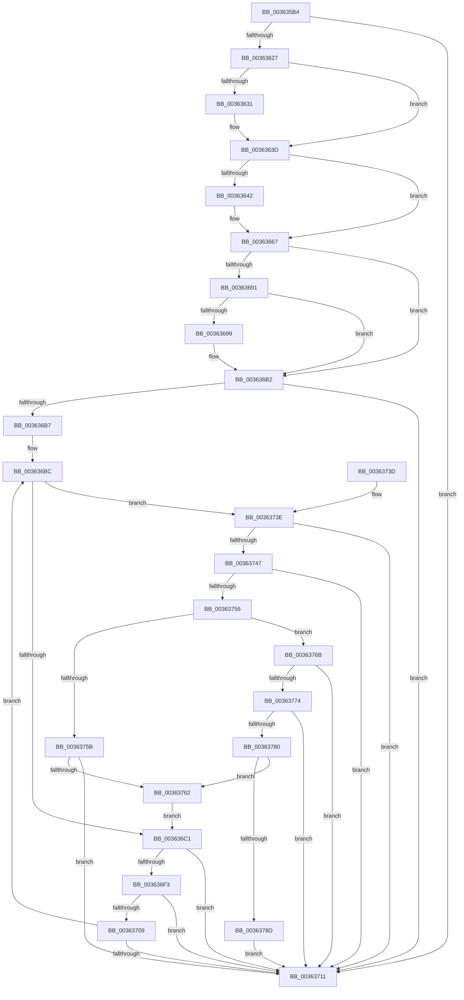

# MiComputeFaultCluster

- RVA: `0x003635B4`–`0x0036378F` (길이 `475` bytes)
- VA: `0x00000001403635B4`
- 실행 섹션: `.text`
- PDB 이름 있음: `예`; PDB Function 태그: `아니요`
- unwind 정보 RVA: `0x00079E5C`
- 디코드: `136`개 명령, `475/475` bytes 표시
- 미해석 바이트: `0` (있으면 어셈블리에 `.byte`로 보존)

> 이 문서는 커널 이미지의 기계어와 PDB 기호를 분석해 생성했습니다. 4번과 5번은 함수 원형과 자료형을 바이너리 사용 방식에서 추정한 C 해석이며 원본 소스 복구 결과는 아닙니다.

## 1. Dependencies

- 직접 호출 지점: **5**; 고유 호출 대상: **4**
- 직접 호출자로 확인된 함수: **2**
- RIP 상대 이미지 참조: **0**

### Outgoing calls
- `0x00363613` → [MiAdvanceFaultList](MiAdvanceFaultList_function_003637A0.md) (function, `0x003637A0`)
- `0x003636F9` → [MiAdvanceFaultList](MiAdvanceFaultList_function_003637A0.md) (function, `0x003637A0`)
- `0x0036374A` → [MI_READ_PTE_LOCK_FREE](../28/MI_READ_PTE_LOCK_FREE_function_002828A0.md) (function, `0x002828A0`)
- `0x00363777` → [MiGetPagingFileOffset](MiGetPagingFileOffset_function_0036F530.md) (function, `0x0036F530`)
- `0x00363783` → [MiIsPteInStore](MiIsPteInStore_function_00362460.md) (function, `0x00362460`)

### Direct callers
- [MiResolveMappedFileFault](MiResolveMappedFileFault_function_0036B640.md) at `0x0036BBDA`
- [MiResolvePageFileFault](MiResolvePageFileFault_function_0036D968.md) at `0x0036E826`

### Static image references
- 디코드된 RIP-relative 메모리 참조가 없습니다.

## 2. Other-region calls and transfers

- 다른 실행 섹션으로 향하는 call: **0**
- 별도 외부 분기/꼬리 이동을 확인하지 못했습니다.

## 3. Assembly (complete function range)

```asm
003635B4  48 89 5C 24 18                  mov qword ptr [rsp + 0x18], rbx
003635B9  48 89 4C 24 08                  mov qword ptr [rsp + 8], rcx
003635BE  55                              push rbp
003635BF  56                              push rsi
003635C0  57                              push rdi
003635C1  41 54                           push r12
003635C3  41 55                           push r13
003635C5  41 56                           push r14
003635C7  41 57                           push r15
003635C9  48 83 EC 30                     sub rsp, 0x30
003635CD  48 8B 42 18                     mov rax, qword ptr [rdx + 0x18]
003635D1  48 8B F2                        mov rsi, rdx
003635D4  48 8B 52 20                     mov rdx, qword ptr [rdx + 0x20]
003635D8  48 8B D9                        mov rbx, rcx
003635DB  48 8B C8                        mov rcx, rax
003635DE  48 89 44 24 20                  mov qword ptr [rsp + 0x20], rax
003635E3  48 03 C9                        add rcx, rcx
003635E6  48 89 54 24 28                  mov qword ptr [rsp + 0x28], rdx
003635EB  48 8B 46 08                     mov rax, qword ptr [rsi + 8]
003635EF  4C 8B F2                        mov r14, rdx
003635F2  48 8B 7E 10                     mov rdi, qword ptr [rsi + 0x10]
003635F6  45 8B E9                        mov r13d, r9d
003635F9  49 C1 E6 0C                     shl r14, 0xc
003635FD  45 8B F9                        mov r15d, r9d
00363600  4D 8B D8                        mov r11, r8
00363603  48 89 7C 24 78                  mov qword ptr [rsp + 0x78], rdi
00363608  4C 03 34 C8                     add r14, qword ptr [rax + rcx*8]
0036360C  41 83 E5 01                     and r13d, 1
00363610  48 8B CE                        mov rcx, rsi
00363613  E8 88 01 00 00                  call 0x1403637a0
00363618  BD 01 00 00 00                  mov ebp, 1
0036361D  48 39 7E 18                     cmp qword ptr [rsi + 0x18], rdi
00363621  0F 83 EA 00 00 00               jae 0x140363711
00363627  BF 00 01 00 00                  mov edi, 0x100
0036362C  45 85 ED                        test r13d, r13d
0036362F  74 0C                           je 0x14036363d
00363631  8B 83 B8 04 00 00               mov eax, dword ptr [rbx + 0x4b8]
00363637  48 3B C7                        cmp rax, rdi
0036363A  0F 42 F8                        cmovb edi, eax
0036363D  4D 85 DB                        test r11, r11
00363640  74 25                           je 0x140363667
00363642  41 8B 43 1C                     mov eax, dword ptr [r11 + 0x1c]
00363646  41 0F B6 4B 21                  movzx ecx, byte ptr [r11 + 0x21]
0036364B  48 C1 E1 20                     shl rcx, 0x20
0036364F  48 0B C8                        or rcx, rax
00363652  49 8B C6                        mov rax, r14
00363655  48 C1 E8 0C                     shr rax, 0xc
00363659  48 2B C8                        sub rcx, rax
0036365C  48 8D 41 01                     lea rax, [rcx + 1]
00363660  48 3B F8                        cmp rdi, rax
00363663  48 0F 47 F8                     cmova rdi, rax
00363667  49 8B DE                        mov rbx, r14
0036366A  48 B8 F8 FF FF FF 7F 00 00 00   movabs rax, 0x7ffffffff8
00363674  48 C1 EB 09                     shr rbx, 9
00363678  45 33 E4                        xor r12d, r12d
0036367B  48 23 D8                        and rbx, rax
0036367E  48 B8 08 00 00 00 80 F6 FF FF   movabs rax, 0xfffff68000000008
00363688  48 03 D8                        add rbx, rax
0036368B  41 F6 C7 02                     test r15b, 2
0036368F  74 21                           je 0x1403636b2
00363691  44 8B E5                        mov r12d, ebp
00363694  4D 85 DB                        test r11, r11
00363697  74 19                           je 0x1403636b2
00363699  41 8B 4B 34                     mov ecx, dword ptr [r11 + 0x34]
0036369D  41 0F B6 53 22                  movzx edx, byte ptr [r11 + 0x22]
003636A2  48 C1 E2 20                     shl rdx, 0x20
003636A6  48 0B D1                        or rdx, rcx
003636A9  48 F7 DA                        neg rdx
003636AC  48 1B C0                        sbb rax, rax
003636AF  48 23 D8                        and rbx, rax
003636B2  48 3B EF                        cmp rbp, rdi
003636B5  73 5A                           jae 0x140363711
003636B7  4C 8B 7C 24 70                  mov r15, qword ptr [rsp + 0x70]
003636BC  48 85 DB                        test rbx, rbx
003636BF  75 7D                           jne 0x14036373e
003636C1  48 8B 46 08                     mov rax, qword ptr [rsi + 8]
003636C5  49 81 E6 00 F0 FF FF            and r14, 0xfffffffffffff000
003636CC  48 8B 4E 18                     mov rcx, qword ptr [rsi + 0x18]
003636D0  4C 8B 5E 20                     mov r11, qword ptr [rsi + 0x20]
003636D4  48 03 C9                        add rcx, rcx
003636D7  49 C1 E3 0C                     shl r11, 0xc
003636DB  4C 03 1C C8                     add r11, qword ptr [rax + rcx*8]
003636DF  49 8B C3                        mov rax, r11
003636E2  48 25 00 F0 FF FF               and rax, 0xfffffffffffff000
003636E8  48 2D 00 10 00 00               sub rax, 0x1000
003636EE  49 3B C6                        cmp rax, r14
003636F1  75 1E                           jne 0x140363711
003636F3  48 8B CE                        mov rcx, rsi
003636F6  48 FF C5                        inc rbp
003636F9  E8 A2 00 00 00                  call 0x1403637a0
003636FE  48 8B 44 24 78                  mov rax, qword ptr [rsp + 0x78]
00363703  48 39 46 18                     cmp qword ptr [rsi + 0x18], rax
00363707  74 08                           je 0x140363711
00363709  4D 8B F3                        mov r14, r11
0036370C  48 3B EF                        cmp rbp, rdi
0036370F  72 AB                           jb 0x1403636bc
00363711  48 8B 44 24 20                  mov rax, qword ptr [rsp + 0x20]
00363716  48 8B 9C 24 80 00 00 00         mov rbx, qword ptr [rsp + 0x80]
0036371E  48 89 46 18                     mov qword ptr [rsi + 0x18], rax
00363722  48 8B 44 24 28                  mov rax, qword ptr [rsp + 0x28]
00363727  48 89 46 20                     mov qword ptr [rsi + 0x20], rax
0036372B  8B C5                           mov eax, ebp
0036372D  48 83 C4 30                     add rsp, 0x30
00363731  41 5F                           pop r15
00363733  41 5E                           pop r14
00363735  41 5D                           pop r13
00363737  41 5C                           pop r12
00363739  5F                              pop rdi
0036373A  5E                              pop rsi
0036373B  5D                              pop rbp
0036373C  C3                              ret
0036373D  CC                              int3
0036373E  48 F7 C3 FF 0F 00 00            test rbx, 0xfff
00363745  74 CA                           je 0x140363711
00363747  48 8B CB                        mov rcx, rbx
0036374A  E8 51 F1 F1 FF                  call 0x1402828a0
0036374F  48 8B D0                        mov rdx, rax
00363752  A8 01                           test al, 1
00363754  75 BB                           jne 0x140363711
00363756  45 85 E4                        test r12d, r12d
00363759  74 10                           je 0x14036376b
0036375B  48 0F BA E0 0A                  bt rax, 0xa
00363760  73 AF                           jae 0x140363711
00363762  48 83 C3 08                     add rbx, 8
00363766  E9 56 FF FF FF                  jmp 0x1403636c1
0036376B  48 F7 C2 00 0C 00 00            test rdx, 0xc00
00363772  75 9D                           jne 0x140363711
00363774  48 8B CA                        mov rcx, rdx
00363777  E8 B4 BD 00 00                  call 0x14036f530
0036377C  85 C0                           test eax, eax
0036377E  74 91                           je 0x140363711
00363780  49 8B CF                        mov rcx, r15
00363783  E8 D8 EC FF FF                  call 0x140362460
00363788  44 3B E8                        cmp r13d, eax
0036378B  74 D5                           je 0x140363762
0036378D  EB 82                           jmp 0x140363711
```

## 4. C-style interpretation (structured pseudocode)

```c
__int64 __fastcall MiComputeFaultCluster(__int64 a1, __int64 a2, __int64 a3, int a4)
{
    __int64 result;
    __int64 v_r11;
    __int64 v_r12;
    __int64 v_r13;
    __int64 v_r14;
    __int64 v_rbp;
    __int64 v_rbx;
    __int64 v_rdi;
    __int64 v_rsp;
    unsigned __int64 v_stack_m40;
    unsigned __int64 v_stack_m48;
    unsigned __int64 v_stack_p10;
    unsigned __int64 v_stack_p18;
    unsigned __int64 v_stack_p8;

    v_stack_p18 = v_rbx;
    v_stack_p8 = a1;
    v_rsp = (v_rsp) - (48);
    v_stack_m48 = *(unsigned __int64 *)(a2 + 24);
    a1 = (*(unsigned __int64 *)(a2 + 24)) + (*(unsigned __int64 *)(a2 + 24));
    v_stack_m40 = *(unsigned __int64 *)(a2 + 32);
    v_r14 = (*(unsigned __int64 *)(a2 + 32)) << (12);
    v_stack_p10 = *(unsigned __int64 *)(a2 + 16);
    v_r14 = (v_r14) + (*(unsigned __int64 *)(*(unsigned __int64 *)(a2 + 8) + a1 * 8));
    v_r13 = (unsigned int)(((unsigned int)(a4)) & (1));
    result = MiAdvanceFaultList(a2, *(unsigned __int64 *)(a2 + 32), a3, a4);
    if ((*(unsigned __int64 *)(a2 + 24)) >= (*(unsigned __int64 *)(a2 + 16))) goto loc_00363711;
    v_rdi = 256;
    if ((unsigned int)(v_r13) != 0) {
        result = *(unsigned int *)(a1 + 1208);
        v_rdi = 256;
        if (result < 256) { v_rdi = (unsigned int)(result); }
    }
    if (a3 != 0) {
        result = *(unsigned int *)(a3 + 28);
        a1 = *(unsigned __int8 *)(a3 + 33);
        a1 = (a1) << (32);
        a1 = (a1) | (result);
        result = v_r14;
        result = (result) >> (12);
        a1 = (a1) - (result);
        result = a1 + 1;
        if (v_rdi > result) { v_rdi = result; }
    }
    v_rbx = (v_r14) >> (9);
    v_r12 = 0;
    v_rbx = (v_rbx) & (result);
    v_rbx = (v_rbx) + (result);
    if ((((unsigned __int8)((unsigned int)(a4))) & (2)) == 0) goto loc_003636B2;
    if (a3 != 0) {
        a1 = *(unsigned int *)(a3 + 52);
        a2 = *(unsigned __int8 *)(a3 + 34);
        a2 = (a2) << (32);
        a2 = (a2) | (a1);
        a2 = -(a2);
        v_rbx = (v_rbx) & (result);
    }
    if (1 >= v_rdi) goto loc_00363711;
loc_003636BC:
    if (v_rbx != 0) goto loc_0036373E;
loc_003636C1:
    v_r14 = (v_r14) & (0xFFFFFFFFFFFFF000ULL);
    a1 = (*(unsigned __int64 *)(a2 + 24)) + (*(unsigned __int64 *)(a2 + 24));
    v_r11 = (*(unsigned __int64 *)(a2 + 32)) << (12);
    v_r11 = (v_r11) + (*(unsigned __int64 *)(*(unsigned __int64 *)(a2 + 8) + a1 * 8));
    result = (v_r11) & (0xFFFFFFFFFFFFF000ULL);
    result = (result) - (0x1000ULL);
    if (result != v_r14) goto loc_00363711;
    v_rbp = (1) + 1;
    result = MiAdvanceFaultList(a2, a2, a3, a4);
    if ((*(unsigned __int64 *)(a2 + 24)) == v_stack_p10) goto loc_00363711;
    if (v_rbp < v_rdi) goto loc_003636BC;
loc_00363711:
    *(unsigned __int64 *)(a2 + 24) = v_stack_m48;
    *(unsigned __int64 *)(a2 + 32) = v_stack_m40;
    v_rsp = (v_rsp) + (48);
    return (unsigned int)((unsigned int)(v_rbp));
loc_0036373E:
    if (((v_stack_p18) & (0xFFFULL)) == 0) goto loc_00363711;
    result = MI_READ_PTE_LOCK_FREE(v_stack_p18, a2, a3, a4);
    if ((((unsigned __int8)(result)) & (1)) != 0) goto loc_00363711;
    if (1 == 0) goto loc_0036376B;
    if (condition_is_above_or_equal) goto loc_00363711;
loc_00363762:
    v_rbx = (v_stack_p18) + (8);
    goto loc_003636C1;
loc_0036376B:
    if (((result) & (0xC00ULL)) != 0) goto loc_00363711;
    result = MiGetPagingFileOffset(result, result, a3, a4);
    if ((unsigned int)(result) == 0) goto loc_00363711;
    result = MiIsPteInStore(v_stack_p8, result, a3, a4);
    if (((unsigned int)(v_r13)) == ((unsigned int)(result))) goto loc_00363762;
    goto loc_00363711;
}
```

## 5. (Beta) C Style

```c
int64_t MiComputeFaultCluster(void *Arg1, void *Arg2, int64_t Arg3, int32_t Arg4)
{
    uint8_t *arg1 = (uint8_t *)Arg1;
    uint8_t *arg2 = (uint8_t *)Arg2;

    int64_t result;
    int64_t local_r11;
    int64_t local_r12;
    int64_t local_r13;
    int64_t local_r14;
    int64_t local_rbp;
    int64_t local_rbx;
    int64_t local_rdi;
    int64_t local_rsp;
    uint64_t v_stack_m40;
    uint64_t v_stack_m48;
    uint64_t v_stack_p10;
    uint64_t v_stack_p18;
    uint64_t v_stack_p8;

    v_stack_p18 = local_rbx;
    v_stack_p8 = Arg1;
    local_rsp = (local_rsp) - (48);
    v_stack_m48 = *(uint64_t *)(arg2 + 0x18);
    Arg1 = (*(uint64_t *)(arg2 + 0x18)) + (*(uint64_t *)(arg2 + 0x18));
    v_stack_m40 = *(uint64_t *)(arg2 + 0x20);
    local_r14 = (*(uint64_t *)(arg2 + 0x20)) << (12);
    v_stack_p10 = *(uint64_t *)(arg2 + 0x10);
    local_r14 = (local_r14) + (*(uint64_t *)(*(uint64_t *)(arg2 + 0x8) + arg1 * 8));
    local_r13 = (uint32_t)(((uint32_t)(Arg4)) & (1));
    result = MiAdvanceFaultList(Arg2, *(uint64_t *)(arg2 + 0x20), Arg3, Arg4);
    if ((*(uint64_t *)(arg2 + 0x18)) >= (*(uint64_t *)(arg2 + 0x10))) goto loc_00363711;
    local_rdi = 256;
    if ((uint32_t)(local_r13) != 0) {
        result = *(uint32_t *)(arg1 + 0x4B8);
        local_rdi = 256;
        if (result < 256) { local_rdi = (uint32_t)(result); }
    }
    if (Arg3 != 0) {
        result = *(uint32_t *)(Arg3 + 0x1C);
        Arg1 = *(uint8_t *)(Arg3 + 0x21);
        Arg1 = (Arg1) << (32);
        Arg1 = (Arg1) | (result);
        result = local_r14;
        result = (result) >> (12);
        Arg1 = (Arg1) - (result);
        result = Arg1 + 1;
        if (local_rdi > result) { local_rdi = result; }
    }
    local_rbx = (local_r14) >> (9);
    local_r12 = 0;
    local_rbx = (local_rbx) & (result);
    local_rbx = (local_rbx) + (result);
    if ((((uint8_t)((uint32_t)(Arg4))) & (2)) == 0) goto loc_003636B2;
    if (Arg3 != 0) {
        Arg1 = *(uint32_t *)(Arg3 + 0x34);
        Arg2 = *(uint8_t *)(Arg3 + 0x22);
        Arg2 = (Arg2) << (32);
        Arg2 = (Arg2) | (Arg1);
        Arg2 = -(Arg2);
        local_rbx = (local_rbx) & (result);
    }
    if (1 >= local_rdi) goto loc_00363711;
loc_003636BC:
    if (local_rbx != 0) goto loc_0036373E;
loc_003636C1:
    local_r14 = (local_r14) & (0xFFFFFFFFFFFFF000ULL);
    Arg1 = (*(uint64_t *)(arg2 + 0x18)) + (*(uint64_t *)(arg2 + 0x18));
    local_r11 = (*(uint64_t *)(arg2 + 0x20)) << (12);
    local_r11 = (local_r11) + (*(uint64_t *)(*(uint64_t *)(arg2 + 0x8) + arg1 * 8));
    result = (local_r11) & (0xFFFFFFFFFFFFF000ULL);
    result = (result) - (0x1000ULL);
    if (result != local_r14) goto loc_00363711;
    local_rbp = (1) + 1;
    result = MiAdvanceFaultList(Arg2, Arg2, Arg3, Arg4);
    if ((*(uint64_t *)(arg2 + 0x18)) == v_stack_p10) goto loc_00363711;
    if (local_rbp < local_rdi) goto loc_003636BC;
loc_00363711:
    *(uint64_t *)(arg2 + 0x18) = v_stack_m48;
    *(uint64_t *)(arg2 + 0x20) = v_stack_m40;
    local_rsp = (local_rsp) + (48);
    return (uint32_t)((uint32_t)(local_rbp));
loc_0036373E:
    if (((v_stack_p18) & (0xFFFULL)) == 0) goto loc_00363711;
    result = MI_READ_PTE_LOCK_FREE(v_stack_p18, Arg2, Arg3, Arg4);
    if ((((uint8_t)(result)) & (1)) != 0) goto loc_00363711;
    if (1 == 0) goto loc_0036376B;
    if (condition_is_above_or_equal) goto loc_00363711;
loc_00363762:
    local_rbx = (v_stack_p18) + (8);
    goto loc_003636C1;
loc_0036376B:
    if (((result) & (0xC00ULL)) != 0) goto loc_00363711;
    result = MiGetPagingFileOffset(result, result, Arg3, Arg4);
    if ((uint32_t)(result) == 0) goto loc_00363711;
    result = MiIsPteInStore(v_stack_p8, result, Arg3, Arg4);
    if (((uint32_t)(local_r13)) == ((uint32_t)(result))) goto loc_00363762;
    goto loc_00363711;
}
```

### 관측된 메모리 오프셋

구조체 형식이 확인되지 않은 접근은 인자 기준의 오프셋으로만 기록했습니다.

| 기준 인자 | 오프셋 표현 | 폭 (bit) | 접근 |
|---|---:|---:|---|
| `Arg1` | `+ 0x4B8` | `32` | `R` |
| `Arg2` | `+ 0x8` | `64` | `R` |
| `Arg2` | `+ 0x10` | `64` | `R` |
| `Arg2` | `+ 0x18` | `64` | `R` |
| `Arg2` | `+ 0x18` | `64` | `W` |
| `Arg2` | `+ 0x20` | `64` | `R` |
| `Arg2` | `+ 0x20` | `64` | `W` |

## 6. Execution-region graph

[열기: 2D/3D 그래프와 함수 탐색 컨트롤 패널](../../../control-panel.html?section=text&rva=0x003635B4&view=graph)

- 2D 그래프는 위에서 아래로 흐르고, 3D 그래프는 빈 공간을 드래그해 회전합니다. Shift+드래그는 이동, 휠은 확대·축소, 함수 노드 선택은 대상 보고서 이동입니다.

### Static fallback


