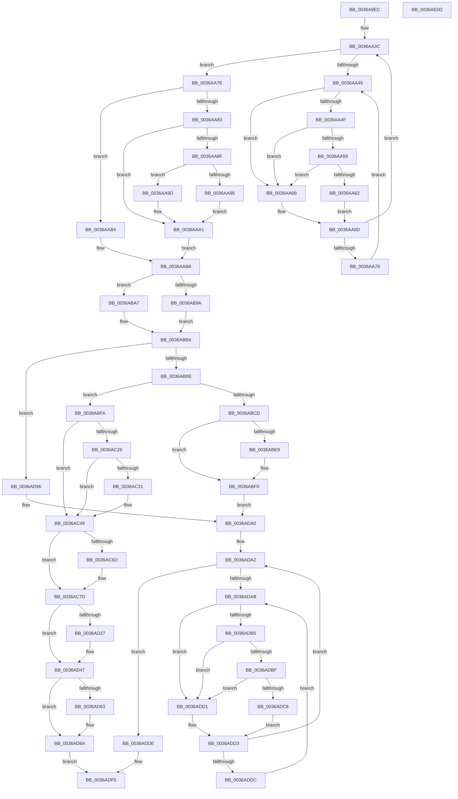

# MiCopyFileOnlyGlobalSubsectionPage

- RVA: `0x0036A9EC`–`0x0036AE0E` (길이 `1,058` bytes)
- VA: `0x000000014036A9EC`
- 실행 섹션: `.text`
- PDB 이름 있음: `예`; PDB Function 태그: `아니요`
- unwind 정보 RVA: `0x0007A2F8`
- 디코드: `271`개 명령, `1,058/1,058` bytes 표시
- 미해석 바이트: `0` (있으면 어셈블리에 `.byte`로 보존)

> 이 문서는 커널 이미지의 기계어와 PDB 기호를 분석해 생성했습니다. 4번과 5번은 함수 원형과 자료형을 바이너리 사용 방식에서 추정한 C 해석이며 원본 소스 복구 결과는 아닙니다.

## 1. Dependencies

- 직접 호출 지점: **21**; 고유 호출 대상: **17**
- 직접 호출자로 확인된 함수: **1**
- RIP 상대 이미지 참조: **3**

### Outgoing calls
- `0x0036AA59` → [KiCheckVpBackingLongSpinWaitHypercall](../30/KiCheckVpBackingLongSpinWaitHypercall_function_0030F490.md) (function, `0x0030F490`)
- `0x0036AA64` → [HvlNotifyLongSpinWait](../30/HvlNotifyLongSpinWait_function_0030F460.md) (function, `0x0030F460`)
- `0x0036AAC2` → [MiInitializeTransitionPfn](../2A/MiInitializeTransitionPfn_function_002AC2E8.md) (function, `0x002AC2E8`)
- `0x0036AB57` → [ExAcquireSpinLockExclusiveAtDpcLevel](../24/ExAcquireSpinLockExclusiveAtDpcLevel_function_00248E80.md) (function, `0x00248E80`)
- `0x0036AB64` → [ExReleaseSpinLockExclusiveFromDpcLevel](../24/ExReleaseSpinLockExclusiveFromDpcLevel_function_002497E0.md) (function, `0x002497E0`)
- `0x0036ABA0` → [MiTryLockLeafPage](../37/MiTryLockLeafPage_function_003728DC.md) (function, `0x003728DC`)
- `0x0036ABAF` → [MiTryLockProtoPoolPageAtDpc](../28/MiTryLockProtoPoolPageAtDpc_function_0028B3C8.md) (function, `0x0028B3C8`)
- `0x0036ABEB` → [MiUnlockProtoPoolPage](../24/MiUnlockProtoPoolPage_function_00246090.md) (function, `0x00246090`)
- `0x0036AC34` → [MiAdvanceFaultList](MiAdvanceFaultList_function_003637A0.md) (function, `0x003637A0`)
- `0x0036AC63` → [PsGetIoPriorityThread](../34/PsGetIoPriorityThread_function_00343930.md) (function, `0x00343930`)
- `0x0036ACC5` → [MiStartingOffset](../34/MiStartingOffset_function_003482E0.md) (function, `0x003482E0`)
- `0x0036AD04` → [MiObtainProtoReference](../31/MiObtainProtoReference_function_00318178.md) (function, `0x00318178`)
- `0x0036AD1C` → [MiCopyPage](../2B/MiCopyPage_function_002B1B30.md) (function, `0x002B1B30`)
- `0x0036AD42` → [MiFlowThroughInsertNode](../4B/MiFlowThroughInsertNode_function_004B560C.md) (function, `0x004B560C`)
- `0x0036AD65` → [MiUnlockProtoPoolPage](../24/MiUnlockProtoPoolPage_function_00246090.md) (function, `0x00246090`)
- `0x0036AD6F` → [MiUnlockProtoPoolPage](../24/MiUnlockProtoPoolPage_function_00246090.md) (function, `0x00246090`)
- `0x0036AD8D` → [KeSetEvent](../33/KeSetEvent_function_0033F310.md) (function, `0x0033F310`)
- `0x0036ADBF` → [KiCheckVpBackingLongSpinWaitHypercall](../30/KiCheckVpBackingLongSpinWaitHypercall_function_0030F490.md) (function, `0x0030F490`)
- `0x0036ADCA` → [HvlNotifyLongSpinWait](../30/HvlNotifyLongSpinWait_function_0030F460.md) (function, `0x0030F460`)
- `0x0036ADE1` → [MiHandleInPageError](MiHandleInPageError_function_00368EBC.md) (function, `0x00368EBC`)
- `0x0036ADE9` → [MiRemoveLockedPageChargeAndDecRef](../24/MiRemoveLockedPageChargeAndDecRef_function_002459D0.md) (function, `0x002459D0`)

### Direct callers
- [MiResolveMappedFileFault](MiResolveMappedFileFault_function_0036B640.md) at `0x0036BC1D`

### Static image references
- `0x0036AA47` → RVA `0x00FC52AC` (`ALMOSTRO`; reference)
- `0x0036AA4F` → RVA `0x00FC6AB8` (`ALMOSTRO`; read)
- `0x0036AA83` → RVA `0x00E2DC80` (`.data`; read)

## 2. Other-region calls and transfers

- 다른 실행 섹션으로 향하는 call: **0**
- 별도 외부 분기/꼬리 이동을 확인하지 못했습니다.

## 3. Assembly (complete function range)

```asm
0036A9EC  48 89 5C 24 20                  mov qword ptr [rsp + 0x20], rbx
0036A9F1  48 89 54 24 10                  mov qword ptr [rsp + 0x10], rdx
0036A9F6  55                              push rbp
0036A9F7  56                              push rsi
0036A9F8  57                              push rdi
0036A9F9  41 54                           push r12
0036A9FB  41 55                           push r13
0036A9FD  41 56                           push r14
0036A9FF  41 57                           push r15
0036AA01  48 8B EC                        mov rbp, rsp
0036AA04  48 83 EC 30                     sub rsp, 0x30
0036AA08  48 83 65 50 00                  and qword ptr [rbp + 0x50], 0
0036AA0D  48 8B F1                        mov rsi, rcx
0036AA10  48 8B 4D 60                     mov rcx, qword ptr [rbp + 0x60]
0036AA14  4D 8B E9                        mov r13, r9
0036AA17  48 83 65 F0 00                  and qword ptr [rbp - 0x10], 0
0036AA1C  4D 8B E0                        mov r12, r8
0036AA1F  48 B8 00 00 00 00 00 DE FF FF   movabs rax, 0xffffde0000000000
0036AA29  4C 8D 3C 49                     lea r15, [rcx + rcx*2]
0036AA2D  49 C1 E7 04                     shl r15, 4
0036AA31  48 8B C0                        mov rax, rax
0036AA34  4C 03 F8                        add r15, rax
0036AA37  33 DB                           xor ebx, ebx
0036AA39  8D 7B 01                        lea edi, [rbx + 1]
0036AA3C  F0 49 0F BA 6F 18 3F            lock bts qword ptr [r15 + 0x18], 0x3f
0036AA43  73 33                           jae 0x14036aa78
0036AA45  03 DF                           add ebx, edi
0036AA47  85 1D 5F A8 C5 00               test dword ptr [rip + 0xc5a85f], ebx
0036AA4D  75 1C                           jne 0x14036aa6b
0036AA4F  8B 05 63 C0 C5 00               mov eax, dword ptr [rip + 0xc5c063]
0036AA55  A8 40                           test al, 0x40
0036AA57  74 12                           je 0x14036aa6b
0036AA59  E8 32 4A FA FF                  call 0x14030f490
0036AA5E  84 C0                           test al, al
0036AA60  74 09                           je 0x14036aa6b
0036AA62  8B CB                           mov ecx, ebx
0036AA64  E8 F7 49 FA FF                  call 0x14030f460
0036AA69  EB 02                           jmp 0x14036aa6d
0036AA6B  F3 90                           pause
0036AA6D  49 8B 47 18                     mov rax, qword ptr [r15 + 0x18]
0036AA71  48 85 C0                        test rax, rax
0036AA74  79 C6                           jns 0x14036aa3c
0036AA76  EB CD                           jmp 0x14036aa45
0036AA78  4D 8B 34 24                     mov r14, qword ptr [r12]
0036AA7C  49 0F BA E6 0A                  bt r14, 0xa
0036AA81  72 31                           jb 0x14036aab4
0036AA83  48 8B 05 F6 31 AC 00            mov rax, qword ptr [rip + 0xac31f6]
0036AA8A  48 85 C0                        test rax, rax
0036AA8D  74 12                           je 0x14036aaa1
0036AA8F  41 F6 C6 10                     test r14b, 0x10
0036AA93  75 08                           jne 0x14036aa9d
0036AA95  48 F7 D0                        not rax
0036AA98  4C 23 F0                        and r14, rax
0036AA9B  EB 04                           jmp 0x14036aaa1
0036AA9D  49 83 E6 EF                     and r14, 0xffffffffffffffef
0036AAA1  49 C1 EE 0C                     shr r14, 0xc
0036AAA5  48 B8 FF FF FF FF FF 00 00 00   movabs rax, 0xffffffffff
0036AAAF  4C 23 F0                        and r14, rax
0036AAB2  EB 04                           jmp 0x14036aab8
0036AAB4  49 83 CE FF                     or r14, 0xffffffffffffffff
0036AAB8  48 8B 4D 60                     mov rcx, qword ptr [rbp + 0x60]
0036AABC  4D 8B C6                        mov r8, r14
0036AABF  49 8B D4                        mov rdx, r12
0036AAC2  E8 21 18 F4 FF                  call 0x1402ac2e8
0036AAC7  41 8B 47 20                     mov eax, dword ptr [r15 + 0x20]
0036AACB  48 8D 56 20                     lea rdx, [rsi + 0x20]
0036AACF  89 45 40                        mov dword ptr [rbp + 0x40], eax
0036AAD2  C1 E8 10                        shr eax, 0x10
0036AAD5  24 FA                           and al, 0xfa
0036AAD7  0C 02                           or al, 2
0036AAD9  88 45 42                        mov byte ptr [rbp + 0x42], al
0036AADC  8B 45 40                        mov eax, dword ptr [rbp + 0x40]
0036AADF  41 89 47 20                     mov dword ptr [r15 + 0x20], eax
0036AAE3  41 8B 47 20                     mov eax, dword ptr [r15 + 0x20]
0036AAE7  89 45 40                        mov dword ptr [rbp + 0x40], eax
0036AAEA  66 89 7D 40                     mov word ptr [rbp + 0x40], di
0036AAEE  8B 45 40                        mov eax, dword ptr [rbp + 0x40]
0036AAF1  41 89 47 20                     mov dword ptr [r15 + 0x20], eax
0036AAF5  41 8B 47 20                     mov eax, dword ptr [r15 + 0x20]
0036AAF9  89 45 40                        mov dword ptr [rbp + 0x40], eax
0036AAFC  C1 E8 10                        shr eax, 0x10
0036AAFF  0C 20                           or al, 0x20
0036AB01  88 45 42                        mov byte ptr [rbp + 0x42], al
0036AB04  8B 45 40                        mov eax, dword ptr [rbp + 0x40]
0036AB07  41 89 47 20                     mov dword ptr [r15 + 0x20], eax
0036AB0B  48 8B C6                        mov rax, rsi
0036AB0E  48 F7 D8                        neg rax
0036AB11  48 1B C9                        sbb rcx, rcx
0036AB14  48 23 CA                        and rcx, rdx
0036AB17  49 89 0F                        mov qword ptr [r15], rcx
0036AB1A  8B 86 C0 00 00 00               mov eax, dword ptr [rsi + 0xc0]
0036AB20  41 8B 4F 20                     mov ecx, dword ptr [r15 + 0x20]
0036AB24  C1 E8 0B                        shr eax, 0xb
0036AB27  89 4D 40                        mov dword ptr [rbp + 0x40], ecx
0036AB2A  C1 E9 18                        shr ecx, 0x18
0036AB2D  32 C1                           xor al, cl
0036AB2F  24 07                           and al, 7
0036AB31  32 C1                           xor al, cl
0036AB33  88 45 43                        mov byte ptr [rbp + 0x43], al
0036AB36  8B 45 40                        mov eax, dword ptr [rbp + 0x40]
0036AB39  41 89 47 20                     mov dword ptr [r15 + 0x20], eax
0036AB3D  48 B8 FF FF FF FF FF FF FF 7F   movabs rax, 0x7fffffffffffffff
0036AB47  F0 49 21 47 18                  lock and qword ptr [r15 + 0x18], rax
0036AB4C  48 8B 7D 48                     mov rdi, qword ptr [rbp + 0x48]
0036AB50  48 8B 1F                        mov rbx, qword ptr [rdi]
0036AB53  48 8D 4B 48                     lea rcx, [rbx + 0x48]
0036AB57  E8 24 E3 ED FF                  call 0x140248e80
0036AB5C  48 FF 43 20                     inc qword ptr [rbx + 0x20]
0036AB60  48 8D 4B 48                     lea rcx, [rbx + 0x48]
0036AB64  E8 77 EC ED FF                  call 0x1402497e0
0036AB69  48 8B 4D 70                     mov rcx, qword ptr [rbp + 0x70]
0036AB6D  49 8B C4                        mov rax, r12
0036AB70  48 BA 00 F0 FF FF FF FF 00 00   movabs rdx, 0xfffffffff000
0036AB7A  48 2B 41 48                     sub rax, qword ptr [rcx + 0x48]
0036AB7E  48 C1 F8 03                     sar rax, 3
0036AB82  8B C8                           mov ecx, eax
0036AB84  48 8B C7                        mov rax, rdi
0036AB87  48 8B 40 08                     mov rax, qword ptr [rax + 8]
0036AB8B  48 8D 0C C8                     lea rcx, [rax + rcx*8]
0036AB8F  48 8B C1                        mov rax, rcx
0036AB92  49 33 C4                        xor rax, r12
0036AB95  48 85 C2                        test rdx, rax
0036AB98  75 0D                           jne 0x14036aba7
0036AB9A  4C 8D 45 50                     lea r8, [rbp + 0x50]
0036AB9E  33 D2                           xor edx, edx
0036ABA0  E8 37 7D 00 00                  call 0x1403728dc
0036ABA5  EB 0D                           jmp 0x14036abb4
0036ABA7  4C 8D 4D 50                     lea r9, [rbp + 0x50]
0036ABAB  4C 8D 45 F0                     lea r8, [rbp - 0x10]
0036ABAF  E8 14 08 F2 FF                  call 0x14028b3c8
0036ABB4  8B F8                           mov edi, eax
0036ABB6  85 C0                           test eax, eax
0036ABB8  0F 88 D8 01 00 00               js 0x14036ad96
0036ABBE  48 8B 45 50                     mov rax, qword ptr [rbp + 0x50]
0036ABC2  8B 48 20                        mov ecx, dword ptr [rax + 0x20]
0036ABC5  C1 E9 18                        shr ecx, 0x18
0036ABC8  F6 C1 40                        test cl, 0x40
0036ABCB  74 2D                           je 0x14036abfa
0036ABCD  48 8B 45 50                     mov rax, qword ptr [rbp + 0x50]
0036ABD1  49 BE FF FF FF FF FF FF FF 7F   movabs r14, 0x7fffffffffffffff
0036ABDB  F0 4C 21 70 18                  lock and qword ptr [rax + 0x18], r14
0036ABE0  48 8B 4D F0                     mov rcx, qword ptr [rbp - 0x10]
0036ABE4  48 85 C9                        test rcx, rcx
0036ABE7  74 07                           je 0x14036abf0
0036ABE9  B2 11                           mov dl, 0x11
0036ABEB  E8 A0 B4 ED FF                  call 0x140246090
0036ABF0  BF 09 07 00 C0                  mov edi, 0xc0000709
0036ABF5  E9 A6 01 00 00                  jmp 0x14036ada0
0036ABFA  48 B8 00 00 00 00 00 DE FF FF   movabs rax, 0xffffde0000000000
0036AC04  48 8B C0                        mov rax, rax
0036AC07  48 8B 5D 50                     mov rbx, qword ptr [rbp + 0x50]
0036AC0B  48 2B D8                        sub rbx, rax
0036AC0E  48 B8 AB AA AA AA AA AA AA AA   movabs rax, 0xaaaaaaaaaaaaaaab
0036AC18  48 C1 FB 04                     sar rbx, 4
0036AC1C  48 0F AF D8                     imul rbx, rax
0036AC20  41 F6 C5 01                     test r13b, 1
0036AC24  74 22                           je 0x14036ac48
0036AC26  49 83 E5 FE                     and r13, 0xfffffffffffffffe
0036AC2A  41 80 7D 00 01                  cmp byte ptr [r13], 1
0036AC2F  75 17                           jne 0x14036ac48
0036AC31  49 8B CD                        mov rcx, r13
0036AC34  E8 67 8B FF FF                  call 0x1403637a0
0036AC39  8B 86 C0 00 00 00               mov eax, dword ptr [rsi + 0xc0]
0036AC3F  83 C8 20                        or eax, 0x20
0036AC42  89 86 C0 00 00 00               mov dword ptr [rsi + 0xc0], eax
0036AC48  49 8B 04 24                     mov rax, qword ptr [r12]
0036AC4C  48 89 86 A8 00 00 00            mov qword ptr [rsi + 0xa8], rax
0036AC53  4C 89 A6 E8 00 00 00            mov qword ptr [rsi + 0xe8], r12
0036AC5A  65 48 8B 0C 25 88 01 00 00      mov rcx, qword ptr gs:[0x188]
0036AC63  E8 C8 8C FD FF                  call 0x140343930
0036AC68  83 F8 02                        cmp eax, 2
0036AC6B  7D 10                           jge 0x14036ac7d
0036AC6D  8B 86 C0 00 00 00               mov eax, dword ptr [rsi + 0xc0]
0036AC73  0F BA E8 09                     bts eax, 9
0036AC77  89 86 C0 00 00 00               mov dword ptr [rsi + 0xc0], eax
0036AC7D  48 8B 45 70                     mov rax, qword ptr [rbp + 0x70]
0036AC81  49 8B D4                        mov rdx, r12
0036AC84  48 83 A6 10 01 00 00 00         and qword ptr [rsi + 0x110], 0
0036AC8C  48 83 A6 30 01 00 00 00         and qword ptr [rsi + 0x130], 0
0036AC94  83 A6 3C 01 00 00 00            and dword ptr [rsi + 0x13c], 0
0036AC9B  4C 8B 6D 60                     mov r13, qword ptr [rbp + 0x60]
0036AC9F  48 8B 7D 48                     mov rdi, qword ptr [rbp + 0x48]
0036ACA3  C7 86 18 01 00 00 38 00 42 00   mov dword ptr [rsi + 0x118], 0x420038
0036ACAD  48 8B CF                        mov rcx, rdi
0036ACB0  C7 86 38 01 00 00 00 10 00 00   mov dword ptr [rsi + 0x138], 0x1000
0036ACBA  4C 89 AE 40 01 00 00            mov qword ptr [rsi + 0x140], r13
0036ACC1  44 8B 40 40                     mov r8d, dword ptr [rax + 0x40]
0036ACC5  E8 16 D6 FD FF                  call 0x1403482e0
0036ACCA  48 83 A6 C8 00 00 00 00         and qword ptr [rsi + 0xc8], 0
0036ACD2  BA 01 00 00 00                  mov edx, 1
0036ACD7  48 89 BE D0 00 00 00            mov qword ptr [rsi + 0xd0], rdi
0036ACDE  48 8B 7D 68                     mov rdi, qword ptr [rbp + 0x68]
0036ACE2  4C 89 BE F8 00 00 00            mov qword ptr [rsi + 0xf8], r15
0036ACE9  48 8B CF                        mov rcx, rdi
0036ACEC  41 BF 00 10 00 00               mov r15d, 0x1000
0036ACF2  48 89 46 60                     mov qword ptr [rsi + 0x60], rax
0036ACF6  4C 89 A6 F0 00 00 00            mov qword ptr [rsi + 0xf0], r12
0036ACFD  44 89 BE B8 00 00 00            mov dword ptr [rsi + 0xb8], r15d
0036AD04  E8 6F D4 FA FF                  call 0x140318178
0036AD09  41 B8 44 00 00 00               mov r8d, 0x44
0036AD0F  48 89 BE A0 00 00 00            mov qword ptr [rsi + 0xa0], rdi
0036AD16  48 8B D3                        mov rdx, rbx
0036AD19  49 8B CD                        mov rcx, r13
0036AD1C  E8 0F 6E F4 FF                  call 0x1402b1b30
0036AD21  49 83 FE FF                     cmp r14, -1
0036AD25  74 20                           je 0x14036ad47
0036AD27  4B 8D 14 76                     lea rdx, [r14 + r14*2]
0036AD2B  48 B8 00 00 00 00 00 DE FF FF   movabs rax, 0xffffde0000000000
0036AD35  48 C1 E2 04                     shl rdx, 4
0036AD39  48 8B C0                        mov rax, rax
0036AD3C  48 03 D0                        add rdx, rax
0036AD3F  48 8B CE                        mov rcx, rsi
0036AD42  E8 C5 A8 14 00                  call 0x1404b560c
0036AD47  48 8B 45 50                     mov rax, qword ptr [rbp + 0x50]
0036AD4B  49 BE FF FF FF FF FF FF FF 7F   movabs r14, 0x7fffffffffffffff
0036AD55  F0 4C 21 70 18                  lock and qword ptr [rax + 0x18], r14
0036AD5A  48 8B 4D F0                     mov rcx, qword ptr [rbp - 0x10]
0036AD5E  48 85 C9                        test rcx, rcx
0036AD61  74 07                           je 0x14036ad6a
0036AD63  B2 11                           mov dl, 0x11
0036AD65  E8 26 B3 ED FF                  call 0x140246090
0036AD6A  B2 11                           mov dl, 0x11
0036AD6C  48 8B CF                        mov rcx, rdi
0036AD6F  E8 1C B3 ED FF                  call 0x140246090
0036AD74  65 FF 04 25 98 2E 00 00         inc dword ptr gs:[0x2e98]
0036AD7C  48 8D 4E 20                     lea rcx, [rsi + 0x20]
0036AD80  83 66 50 00                     and dword ptr [rsi + 0x50], 0
0036AD84  45 33 C0                        xor r8d, r8d
0036AD87  33 D2                           xor edx, edx
0036AD89  4C 89 7E 58                     mov qword ptr [rsi + 0x58], r15
0036AD8D  E8 7E 45 FD FF                  call 0x14033f310
0036AD92  33 C0                           xor eax, eax
0036AD94  EB 5F                           jmp 0x14036adf5
0036AD96  49 BE FF FF FF FF FF FF FF 7F   movabs r14, 0x7fffffffffffffff
0036ADA0  33 DB                           xor ebx, ebx
0036ADA2  F0 49 0F BA 6F 18 3F            lock bts qword ptr [r15 + 0x18], 0x3f
0036ADA9  73 33                           jae 0x14036adde
0036ADAB  FF C3                           inc ebx
0036ADAD  85 1D F9 A4 C5 00               test dword ptr [rip + 0xc5a4f9], ebx
0036ADB3  75 1C                           jne 0x14036add1
0036ADB5  8B 05 FD BC C5 00               mov eax, dword ptr [rip + 0xc5bcfd]
0036ADBB  A8 40                           test al, 0x40
0036ADBD  74 12                           je 0x14036add1
0036ADBF  E8 CC 46 FA FF                  call 0x14030f490
0036ADC4  84 C0                           test al, al
0036ADC6  74 09                           je 0x14036add1
0036ADC8  8B CB                           mov ecx, ebx
0036ADCA  E8 91 46 FA FF                  call 0x14030f460
0036ADCF  EB 02                           jmp 0x14036add3
0036ADD1  F3 90                           pause
0036ADD3  49 8B 47 18                     mov rax, qword ptr [r15 + 0x18]
0036ADD7  48 85 C0                        test rax, rax
0036ADDA  79 C6                           jns 0x14036ada2
0036ADDC  EB CD                           jmp 0x14036adab
0036ADDE  49 8B CF                        mov rcx, r15
0036ADE1  E8 D6 E0 FF FF                  call 0x140368ebc
0036ADE6  49 8B CF                        mov rcx, r15
0036ADE9  E8 E2 AB ED FF                  call 0x1402459d0
0036ADEE  F0 4D 21 77 18                  lock and qword ptr [r15 + 0x18], r14
0036ADF3  8B C7                           mov eax, edi
0036ADF5  48 8B 9C 24 88 00 00 00         mov rbx, qword ptr [rsp + 0x88]
0036ADFD  48 83 C4 30                     add rsp, 0x30
0036AE01  41 5F                           pop r15
0036AE03  41 5E                           pop r14
0036AE05  41 5D                           pop r13
0036AE07  41 5C                           pop r12
0036AE09  5F                              pop rdi
0036AE0A  5E                              pop rsi
0036AE0B  5D                              pop rbp
0036AE0C  C3                              ret
0036AE0D  CC                              int3
```

## 4. C-style interpretation (structured pseudocode)

```c
__int64 __fastcall MiCopyFileOnlyGlobalSubsectionPage(__int64 a1, __int64 a2, __int64 a3, __int64 a4, __int64 a5, __int64 a6, __int64 a7)
{
    __int64 result;
    __int64 v_r13;
    __int64 v_r14;
    __int64 v_r15;
    __int64 v_rbx;
    __int64 v_rsp;
    unsigned __int64 v_stack_m48;
    unsigned __int64 v_stack_p10;
    unsigned __int64 v_stack_p18;
    unsigned __int64 v_stack_p20;
    unsigned int v_stack_p8;
    unsigned __int8 v_stack_pA;
    unsigned __int8 v_stack_pB;

    v_stack_p20 = v_rbx;
    v_stack_p10 = a2;
    v_rsp = (v_rsp) - (48);
    v_r15 = (a5 + a5 * 2) << (4);
    v_r15 = (v_r15) + (result);
    v_rbx = 0;
loc_0036AA3C:
    if (condition_is_above_or_equal) goto loc_0036AA78;
loc_0036AA45:
    v_rbx = (unsigned int)((v_rbx) + ((unsigned int)(v_rbx + 1)));
    if (((*(unsigned int *)(v_rip + 12953695)) & ((unsigned int)(v_rbx))) != 0) goto loc_0036AA6B;
    if ((((unsigned __int8)((unsigned int)(*(unsigned int *)(v_rip + 12959843)))) & (64)) == 0) goto loc_0036AA6B;
    result = KiCheckVpBackingLongSpinWaitHypercall(a5, a2, a3, a4);
    if ((unsigned __int8)(result) == 0) goto loc_0036AA6B;
    result = HvlNotifyLongSpinWait((unsigned int)((unsigned int)(v_rbx)), a2, a3, a4);
    goto loc_0036AA6D;
loc_0036AA6B:
loc_0036AA6D:
    if (!sign_flag) goto loc_0036AA3C;
    goto loc_0036AA45;
loc_0036AA78:
    if (condition_is_below) goto loc_0036AAB4;
    if (*(unsigned __int64 *)(v_rip + 11284982) == 0) goto loc_0036AAA1;
    if ((((unsigned __int8)(*(unsigned __int64 *)(a3))) & (16)) != 0) goto loc_0036AA9D;
    result = ~(*(unsigned __int64 *)(v_rip + 11284982));
    v_r14 = (*(unsigned __int64 *)(a3)) & (result);
    goto loc_0036AAA1;
loc_0036AA9D:
    v_r14 = (v_r14) & (-17);
loc_0036AAA1:
    v_r14 = (v_r14) >> (12);
    v_r14 = (v_r14) & (result);
    goto loc_0036AAB8;
loc_0036AAB4:
    v_r14 = (v_r14) | (-1);
loc_0036AAB8:
    result = MiInitializeTransitionPfn(a5, a3, v_r14, a4);
    v_stack_p8 = (unsigned int)((unsigned int)(*(unsigned int *)(v_r15 + 32)));
    result = (unsigned int)(((unsigned int)(*(unsigned int *)(v_r15 + 32))) >> (16));
    result = (unsigned __int8)((result) & (250));
    result = (unsigned __int8)((result) | (2));
    v_stack_pA = (unsigned __int8)(result);
    *(unsigned int *)(v_r15 + 32) = (unsigned int)((unsigned int)(v_stack_p8));
    v_stack_p8 = (unsigned int)((unsigned int)(*(unsigned int *)(v_r15 + 32)));
    v_stack_p8 = (unsigned __int16)(v_rbx + 1);
    *(unsigned int *)(v_r15 + 32) = (unsigned int)((unsigned int)(v_stack_p8));
    v_stack_p8 = (unsigned int)((unsigned int)(*(unsigned int *)(v_r15 + 32)));
    result = (unsigned int)(((unsigned int)(*(unsigned int *)(v_r15 + 32))) >> (16));
    result = (unsigned __int8)((result) | (32));
    v_stack_pA = (unsigned __int8)(result);
    *(unsigned int *)(v_r15 + 32) = (unsigned int)((unsigned int)(v_stack_p8));
    result = -(a1);
    a1 = (a5) & (a1 + 32);
    *(unsigned __int64 *)(v_r15) = a1;
    result = (unsigned int)(((unsigned int)(*(unsigned int *)(a1 + 192))) >> (11));
    v_stack_p8 = (unsigned int)((unsigned int)(*(unsigned int *)(v_r15 + 32)));
    a1 = (unsigned int)(((unsigned int)(*(unsigned int *)(v_r15 + 32))) >> (24));
    result = (unsigned __int8)((result) ^ ((unsigned __int8)(a1)));
    result = (unsigned __int8)((result) & (7));
    result = (unsigned __int8)((result) ^ ((unsigned __int8)(a1)));
    v_stack_pB = (unsigned __int8)(result);
    *(unsigned int *)(v_r15 + 32) = (unsigned int)((unsigned int)(v_stack_p8));
    result = ExAcquireSpinLockExclusiveAtDpcLevel(*(unsigned __int64 *)(v_stack_p10) + 72, a1 + 32, v_r14, a4);
    result = ExReleaseSpinLockExclusiveFromDpcLevel(*(unsigned __int64 *)(v_stack_p10) + 72, a1 + 32, v_r14, a4);
    result = (a3) - (*(unsigned __int64 *)(a7 + 72));
    result = (result) >> (3);
    result = (*(unsigned __int64 *)(v_stack_p10 + 8) + (unsigned int)((unsigned int)(result)) * 8) ^ (a3);
    if (((a1 + 32) & (result)) != 0) goto loc_0036ABA7;
    a2 = 0;
    result = MiTryLockLeafPage(*(unsigned __int64 *)(v_stack_p10 + 8) + (unsigned int)((unsigned int)(result)) * 8, a2, v_stack_p18, a4);
    goto loc_0036ABB4;
loc_0036ABA7:
    result = MiTryLockProtoPoolPageAtDpc(*(unsigned __int64 *)(v_stack_p10 + 8) + (unsigned int)((unsigned int)(result)) * 8, a2, v_stack_m48, v_stack_p18);
loc_0036ABB4:
    if (sign_flag) goto loc_0036AD96;
    a1 = (unsigned int)(((unsigned int)(*(unsigned int *)(v_stack_p18 + 32))) >> (24));
    if ((((unsigned __int8)(a1)) & (64)) == 0) goto loc_0036ABFA;
    result = v_stack_p18;
    if (v_stack_m48 != 0) {
        a2 = 17;
        result = MiUnlockProtoPoolPage(v_stack_m48, a2, v_stack_m48, v_stack_p18);
    }
    goto loc_0036ADA0;
loc_0036ABFA:
    v_rbx = (v_stack_p18) - (result);
    v_rbx = (v_rbx) >> (4);
    v_rbx = (v_rbx) * (result);
    if ((((unsigned __int8)(a4)) & (1)) == 0) goto loc_0036AC48;
    v_r13 = (a4) & (-2);
    if ((*(unsigned __int8 *)(v_r13)) == 1) {
        a1 = v_r13;
        result = MiAdvanceFaultList(a1, a2, v_stack_m48, v_stack_p18);
        result = *(unsigned int *)(a1 + 192);
        result = (unsigned int)((result) | (32));
        *(unsigned int *)(a1 + 192) = (unsigned int)(result);
    }
    *(unsigned __int64 *)(a1 + 168) = *(unsigned __int64 *)(a3);
    *(unsigned __int64 *)(a1 + 232) = a3;
    result = PsGetIoPriorityThread(*(unsigned __int64 *)(gs_base + (0 + 392)), a2, v_stack_m48, v_stack_p18);
    if (((unsigned int)(result)) < 2) {
        result = *(unsigned int *)(a1 + 192);
        *(unsigned int *)(a1 + 192) = (unsigned int)(result);
    }
    *(unsigned int *)(a1 + 280) = 0x420038ULL;
    *(unsigned int *)(a1 + 312) = 0x1000ULL;
    *(unsigned __int64 *)(a1 + 320) = a5;
    result = MiStartingOffset(v_stack_p10, a3, (unsigned int)(*(unsigned int *)(a7 + 64)), v_stack_p18);
    *(unsigned __int64 *)(a1 + 208) = v_stack_p10;
    *(unsigned __int64 *)(a1 + 248) = v_r15;
    *(unsigned __int64 *)(a1 + 96) = result;
    *(unsigned __int64 *)(a1 + 240) = a3;
    *(unsigned int *)(a1 + 184) = (unsigned int)((unsigned int)(0x1000ULL));
    result = MiObtainProtoReference(a6, 1, (unsigned int)(*(unsigned int *)(a7 + 64)), v_stack_p18);
    *(unsigned __int64 *)(a1 + 160) = a6;
    result = MiCopyPage(a5, v_rbx, 68, v_stack_p18);
    if (v_r14 != -1) {
        a2 = v_r14 + v_r14 * 2;
        a2 = (a2) << (4);
        result = result;
        a2 = (a2) + (result);
        a1 = a1;
        result = MiFlowThroughInsertNode(a1, a2, 68, v_stack_p18);
    }
    result = v_stack_p18;
    if (v_stack_m48 != 0) {
        a2 = 17;
        result = MiUnlockProtoPoolPage(v_stack_m48, a2, 68, v_stack_p18);
    }
    result = MiUnlockProtoPoolPage(a6, 17, 68, v_stack_p18);
    a3 = 0;
    a2 = 0;
    *(unsigned __int64 *)(a1 + 88) = (unsigned int)(0x1000ULL);
    result = KeSetEvent(a1 + 32, a2, a3, v_stack_p18);
    result = 0;
    goto loc_0036ADF5;
loc_0036AD96:
loc_0036ADA0:
    v_rbx = 0;
loc_0036ADA2:
    if (condition_is_above_or_equal) goto loc_0036ADDE;
loc_0036ADAB:
    v_rbx = (unsigned int)((v_rbx) + 1);
    if (((*(unsigned int *)(v_rip + 12952825)) & ((unsigned int)(v_rbx))) != 0) goto loc_0036ADD1;
    if ((((unsigned __int8)((unsigned int)(*(unsigned int *)(v_rip + 12958973)))) & (64)) == 0) goto loc_0036ADD1;
    result = KiCheckVpBackingLongSpinWaitHypercall(a1 + 32, a2, a3, v_stack_p18);
    if ((unsigned __int8)(result) == 0) goto loc_0036ADD1;
    result = HvlNotifyLongSpinWait((unsigned int)((unsigned int)(v_rbx)), a2, a3, v_stack_p18);
    goto loc_0036ADD3;
loc_0036ADD1:
loc_0036ADD3:
    if (!sign_flag) goto loc_0036ADA2;
    goto loc_0036ADAB;
loc_0036ADDE:
    result = MiHandleInPageError((unsigned int)(0x1000ULL), a2, a3, v_stack_p18);
    result = MiRemoveLockedPageChargeAndDecRef((unsigned int)(0x1000ULL), a2, a3, v_stack_p18);
loc_0036ADF5:
    v_rsp = (v_rsp) + (48);
    return (unsigned int)((unsigned int)(a6));
}
```

## 5. (Beta) C Style

```c
int64_t MiCopyFileOnlyGlobalSubsectionPage(void *Arg1, int64_t Arg2, void *Arg3, int64_t Arg4, void *Arg5, int64_t Arg6, void *Arg7)
{
    uint8_t *arg1 = (uint8_t *)Arg1;
    uint8_t *arg3 = (uint8_t *)Arg3;
    uint8_t *arg5 = (uint8_t *)Arg5;
    uint8_t *arg7 = (uint8_t *)Arg7;

    int64_t result;
    int64_t local_r13;
    int64_t local_r14;
    int64_t local_r15;
    int64_t local_rbx;
    int64_t local_rsp;
    uint64_t v_stack_m48;
    uint64_t v_stack_p10;
    uint64_t v_stack_p18;
    uint64_t v_stack_p20;
    uint32_t v_stack_p8;
    uint8_t v_stack_pA;
    uint8_t v_stack_pB;

    v_stack_p20 = local_rbx;
    v_stack_p10 = Arg2;
    local_rsp = (local_rsp) - (48);
    local_r15 = (Arg5 + Arg5 * 2) << (4);
    local_r15 = (local_r15) + (result);
    local_rbx = 0;
loc_0036AA3C:
    if (condition_is_above_or_equal) goto loc_0036AA78;
loc_0036AA45:
    local_rbx = (uint32_t)((local_rbx) + ((uint32_t)(local_rbx + 1)));
    if (((*(uint32_t *)(v_rip + 0xC5A85F)) & ((uint32_t)(local_rbx))) != 0) goto loc_0036AA6B;
    if ((((uint8_t)((uint32_t)(*(uint32_t *)(v_rip + 0xC5C063)))) & (64)) == 0) goto loc_0036AA6B;
    result = KiCheckVpBackingLongSpinWaitHypercall(Arg5, Arg2, Arg3, Arg4);
    if ((uint8_t)(result) == 0) goto loc_0036AA6B;
    result = HvlNotifyLongSpinWait((uint32_t)((uint32_t)(local_rbx)), Arg2, Arg3, Arg4);
    goto loc_0036AA6D;
loc_0036AA6B:
loc_0036AA6D:
    if (!sign_flag) goto loc_0036AA3C;
    goto loc_0036AA45;
loc_0036AA78:
    if (condition_is_below) goto loc_0036AAB4;
    if (*(uint64_t *)(v_rip + 0xAC31F6) == 0) goto loc_0036AAA1;
    if ((((uint8_t)(*(uint64_t *)(arg3))) & (16)) != 0) goto loc_0036AA9D;
    result = ~(*(uint64_t *)(v_rip + 0xAC31F6));
    local_r14 = (*(uint64_t *)(arg3)) & (result);
    goto loc_0036AAA1;
loc_0036AA9D:
    local_r14 = (local_r14) & (-17);
loc_0036AAA1:
    local_r14 = (local_r14) >> (12);
    local_r14 = (local_r14) & (result);
    goto loc_0036AAB8;
loc_0036AAB4:
    local_r14 = (local_r14) | (-1);
loc_0036AAB8:
    result = MiInitializeTransitionPfn(Arg5, Arg3, local_r14, Arg4);
    v_stack_p8 = (uint32_t)((uint32_t)(*(uint32_t *)(local_r15 + 0x20)));
    result = (uint32_t)(((uint32_t)(*(uint32_t *)(local_r15 + 0x20))) >> (16));
    result = (uint8_t)((result) & (250));
    result = (uint8_t)((result) | (2));
    v_stack_pA = (uint8_t)(result);
    *(uint32_t *)(local_r15 + 0x20) = (uint32_t)((uint32_t)(v_stack_p8));
    v_stack_p8 = (uint32_t)((uint32_t)(*(uint32_t *)(local_r15 + 0x20)));
    v_stack_p8 = (uint16_t)(local_rbx + 1);
    *(uint32_t *)(local_r15 + 0x20) = (uint32_t)((uint32_t)(v_stack_p8));
    v_stack_p8 = (uint32_t)((uint32_t)(*(uint32_t *)(local_r15 + 0x20)));
    result = (uint32_t)(((uint32_t)(*(uint32_t *)(local_r15 + 0x20))) >> (16));
    result = (uint8_t)((result) | (32));
    v_stack_pA = (uint8_t)(result);
    *(uint32_t *)(local_r15 + 0x20) = (uint32_t)((uint32_t)(v_stack_p8));
    result = -(Arg1);
    Arg1 = (Arg5) & (Arg1 + 32);
    *(void **)(local_r15) = Arg1;
    result = (uint32_t)(((uint32_t)(*(uint32_t *)(arg1 + 0xC0))) >> (11));
    v_stack_p8 = (uint32_t)((uint32_t)(*(uint32_t *)(local_r15 + 0x20)));
    Arg1 = (uint32_t)(((uint32_t)(*(uint32_t *)(local_r15 + 0x20))) >> (24));
    result = (uint8_t)((result) ^ ((uint8_t)(Arg1)));
    result = (uint8_t)((result) & (7));
    result = (uint8_t)((result) ^ ((uint8_t)(Arg1)));
    v_stack_pB = (uint8_t)(result);
    *(uint32_t *)(local_r15 + 0x20) = (uint32_t)((uint32_t)(v_stack_p8));
    result = ExAcquireSpinLockExclusiveAtDpcLevel(*(uint64_t *)(v_stack_p10) + 72, Arg1 + 32, local_r14, Arg4);
    result = ExReleaseSpinLockExclusiveFromDpcLevel(*(uint64_t *)(v_stack_p10) + 72, Arg1 + 32, local_r14, Arg4);
    result = (Arg3) - (*(uint64_t *)(arg7 + 0x48));
    result = (result) >> (3);
    result = (*(uint64_t *)(v_stack_p10 + 0x8) + (uint32_t)((uint32_t)(result)) * 8) ^ (Arg3);
    if (((Arg1 + 32) & (result)) != 0) goto loc_0036ABA7;
    Arg2 = 0;
    result = MiTryLockLeafPage(*(uint64_t *)(v_stack_p10 + 0x8) + (uint32_t)((uint32_t)(result)) * 8, Arg2, v_stack_p18, Arg4);
    goto loc_0036ABB4;
loc_0036ABA7:
    result = MiTryLockProtoPoolPageAtDpc(*(uint64_t *)(v_stack_p10 + 0x8) + (uint32_t)((uint32_t)(result)) * 8, Arg2, v_stack_m48, v_stack_p18);
loc_0036ABB4:
    if (sign_flag) goto loc_0036AD96;
    Arg1 = (uint32_t)(((uint32_t)(*(uint32_t *)(v_stack_p18 + 0x20))) >> (24));
    if ((((uint8_t)(Arg1)) & (64)) == 0) goto loc_0036ABFA;
    result = v_stack_p18;
    if (v_stack_m48 != 0) {
        Arg2 = 17;
        result = MiUnlockProtoPoolPage(v_stack_m48, Arg2, v_stack_m48, v_stack_p18);
    }
    goto loc_0036ADA0;
loc_0036ABFA:
    local_rbx = (v_stack_p18) - (result);
    local_rbx = (local_rbx) >> (4);
    local_rbx = (local_rbx) * (result);
    if ((((uint8_t)(Arg4)) & (1)) == 0) goto loc_0036AC48;
    local_r13 = (Arg4) & (-2);
    if ((*(uint8_t *)(local_r13)) == 1) {
        Arg1 = local_r13;
        result = MiAdvanceFaultList(Arg1, Arg2, v_stack_m48, v_stack_p18);
        result = *(uint32_t *)(arg1 + 0xC0);
        result = (uint32_t)((result) | (32));
        *(uint32_t *)(arg1 + 0xC0) = (uint32_t)(result);
    }
    *(uint64_t *)(arg1 + 0xA8) = *(uint64_t *)(arg3);
    *(void **)(arg1 + 0xE8) = Arg3;
    result = PsGetIoPriorityThread(*(uint64_t *)(gs_base + (0 + 0x188)), Arg2, v_stack_m48, v_stack_p18);
    if (((uint32_t)(result)) < 2) {
        result = *(uint32_t *)(arg1 + 0xC0);
        *(uint32_t *)(arg1 + 0xC0) = (uint32_t)(result);
    }
    *(uint32_t *)(arg1 + 0x118) = 0x420038ULL;
    *(uint32_t *)(arg1 + 0x138) = 0x1000ULL;
    *(void **)(arg1 + 0x140) = Arg5;
    result = MiStartingOffset(v_stack_p10, Arg3, (uint32_t)(*(uint32_t *)(arg7 + 0x40)), v_stack_p18);
    *(uint64_t *)(arg1 + 0xD0) = v_stack_p10;
    *(uint64_t *)(arg1 + 0xF8) = local_r15;
    *(uint64_t *)(arg1 + 0x60) = result;
    *(void **)(arg1 + 0xF0) = Arg3;
    *(uint32_t *)(arg1 + 0xB8) = (uint32_t)((uint32_t)(0x1000ULL));
    result = MiObtainProtoReference(Arg6, 1, (uint32_t)(*(uint32_t *)(arg7 + 0x40)), v_stack_p18);
    *(uint64_t *)(arg1 + 0xA0) = Arg6;
    result = MiCopyPage(Arg5, local_rbx, 68, v_stack_p18);
    if (local_r14 != -1) {
        Arg2 = local_r14 + local_r14 * 2;
        Arg2 = (Arg2) << (4);
        result = result;
        Arg2 = (Arg2) + (result);
        Arg1 = Arg1;
        result = MiFlowThroughInsertNode(Arg1, Arg2, 68, v_stack_p18);
    }
    result = v_stack_p18;
    if (v_stack_m48 != 0) {
        Arg2 = 17;
        result = MiUnlockProtoPoolPage(v_stack_m48, Arg2, 68, v_stack_p18);
    }
    result = MiUnlockProtoPoolPage(Arg6, 17, 68, v_stack_p18);
    Arg3 = 0;
    Arg2 = 0;
    *(uint64_t *)(arg1 + 0x58) = (uint32_t)(0x1000ULL);
    result = KeSetEvent(Arg1 + 32, Arg2, Arg3, v_stack_p18);
    result = 0;
    goto loc_0036ADF5;
loc_0036AD96:
loc_0036ADA0:
    local_rbx = 0;
loc_0036ADA2:
    if (condition_is_above_or_equal) goto loc_0036ADDE;
loc_0036ADAB:
    local_rbx = (uint32_t)((local_rbx) + 1);
    if (((*(uint32_t *)(v_rip + 0xC5A4F9)) & ((uint32_t)(local_rbx))) != 0) goto loc_0036ADD1;
    if ((((uint8_t)((uint32_t)(*(uint32_t *)(v_rip + 0xC5BCFD)))) & (64)) == 0) goto loc_0036ADD1;
    result = KiCheckVpBackingLongSpinWaitHypercall(Arg1 + 32, Arg2, Arg3, v_stack_p18);
    if ((uint8_t)(result) == 0) goto loc_0036ADD1;
    result = HvlNotifyLongSpinWait((uint32_t)((uint32_t)(local_rbx)), Arg2, Arg3, v_stack_p18);
    goto loc_0036ADD3;
loc_0036ADD1:
loc_0036ADD3:
    if (!sign_flag) goto loc_0036ADA2;
    goto loc_0036ADAB;
loc_0036ADDE:
    result = MiHandleInPageError((uint32_t)(0x1000ULL), Arg2, Arg3, v_stack_p18);
    result = MiRemoveLockedPageChargeAndDecRef((uint32_t)(0x1000ULL), Arg2, Arg3, v_stack_p18);
loc_0036ADF5:
    local_rsp = (local_rsp) + (48);
    return (uint32_t)((uint32_t)(Arg6));
}
```

### 관측된 메모리 오프셋

구조체 형식이 확인되지 않은 접근은 인자 기준의 오프셋으로만 기록했습니다.

| 기준 인자 | 오프셋 표현 | 폭 (bit) | 접근 |
|---|---:|---:|---|
| `Arg1` | `+ 0x20` | `64` | `R` |
| `Arg1` | `+ 0x50` | `32` | `R/W` |
| `Arg1` | `+ 0x58` | `64` | `W` |
| `Arg1` | `+ 0x60` | `64` | `W` |
| `Arg1` | `+ 0xA0` | `64` | `W` |
| `Arg1` | `+ 0xA8` | `64` | `W` |
| `Arg1` | `+ 0xB8` | `32` | `W` |
| `Arg1` | `+ 0xC0` | `32` | `R` |
| `Arg1` | `+ 0xC0` | `32` | `W` |
| `Arg1` | `+ 0xC8` | `64` | `R/W` |
| `Arg1` | `+ 0xD0` | `64` | `W` |
| `Arg1` | `+ 0xE8` | `64` | `W` |
| `Arg1` | `+ 0xF0` | `64` | `W` |
| `Arg1` | `+ 0xF8` | `64` | `W` |
| `Arg1` | `+ 0x110` | `64` | `R/W` |
| `Arg1` | `+ 0x118` | `32` | `W` |
| `Arg1` | `+ 0x130` | `64` | `R/W` |
| `Arg1` | `+ 0x138` | `32` | `W` |
| `Arg1` | `+ 0x13C` | `32` | `R/W` |
| `Arg1` | `+ 0x140` | `64` | `W` |
| `Arg3` | `+ 0x0` | `64` | `R` |
| `Arg5` | `+ 0x0 + rcx*2` | `64` | `R` |
| `Arg7` | `+ 0x40` | `32` | `R` |
| `Arg7` | `+ 0x48` | `64` | `R` |

## 6. Execution-region graph

[열기: 2D/3D 그래프와 함수 탐색 컨트롤 패널](../../../control-panel.html?section=text&rva=0x0036A9EC&view=graph)

- 2D 그래프는 위에서 아래로 흐르고, 3D 그래프는 빈 공간을 드래그해 회전합니다. Shift+드래그는 이동, 휠은 확대·축소, 함수 노드 선택은 대상 보고서 이동입니다.

### Static fallback


