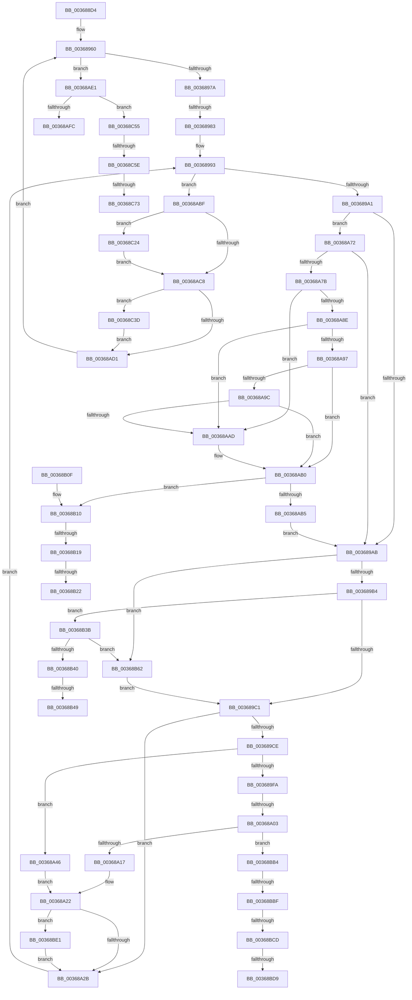

# MiDecommitHardwareEnclavePages

- RVA: `0x003688D4`–`0x00368C85` (길이 `945` bytes)
- VA: `0x00000001403688D4`
- 실행 섹션: `.text`
- PDB 이름 있음: `예`; PDB Function 태그: `예`
- unwind 정보 RVA: `0x0007A0F4`
- 디코드: `226`개 명령, `945/945` bytes 표시
- 미해석 바이트: `0` (있으면 어셈블리에 `.byte`로 보존)

> 이 문서는 커널 이미지의 기계어와 PDB 기호를 분석해 생성했습니다. 4번과 5번은 함수 원형과 자료형을 바이너리 사용 방식에서 추정한 C 해석이며 원본 소스 복구 결과는 아닙니다.

## 1. Dependencies

- 직접 호출 지점: **22**; 고유 호출 대상: **18**
- 직접 호출자로 확인된 함수: **2**
- RIP 상대 이미지 참조: **2**

### Outgoing calls
- `0x0036894A` → [MiLockWorkingSetShared](../27/MiLockWorkingSetShared_function_0027CBF0.md) (function, `0x0027CBF0`)
- `0x003689C4` → [MI_READ_PTE_LOCK_FREE](../28/MI_READ_PTE_LOCK_FREE_function_002828A0.md) (function, `0x002828A0`)
- `0x00368A06` → [KeRemoveEnclavePage](KeRemoveEnclavePage_function_00368C90.md) (function, `0x00368C90`)
- `0x00368A1D` → [MiDeleteEnclavePage](MiDeleteEnclavePage_function_00368CCC.md) (function, `0x00368CCC`)
- `0x00368A60` → [MiMakeValidPte](../2C/MiMakeValidPte_function_002C5590.md) (function, `0x002C5590`)
- `0x00368A6B` → [MiWriteValidPteNewProtection](../28/MiWriteValidPteNewProtection_function_00281810.md) (function, `0x00281810`)
- `0x00368A85` → [MiWorkingSetIsContended](../2A/MiWorkingSetIsContended_function_002AE520.md) (function, `0x002AE520`)
- `0x00368A8E` → [KeShouldYieldProcessor](../27/KeShouldYieldProcessor_function_002773E0.md) (function, `0x002773E0`)
- `0x00368AA4` → [MiPageTableLockIsContended](../2A/MiPageTableLockIsContended_function_002AE650.md) (function, `0x002AE650`)
- `0x00368AEB` → [MiUnlockWorkingSetShared](../27/MiUnlockWorkingSetShared_function_0027D690.md) (function, `0x0027D690`)
- `0x00368B25` → [MiFlushTbList](../31/MiFlushTbList_function_00311FC0.md) (function, `0x00311FC0`)
- `0x00368B2A` → [MiReleaseProcessorFlushList](../31/MiReleaseProcessorFlushList_function_00313C70.md) (function, `0x00313C70`)
- `0x00368B4C` → [MiFlushTbList](../31/MiFlushTbList_function_00311FC0.md) (function, `0x00311FC0`)
- `0x00368B51` → [MiReleaseProcessorFlushList](../31/MiReleaseProcessorFlushList_function_00313C70.md) (function, `0x00313C70`)
- `0x00368BAA` → [MiMakeSystemAddressValid](../27/MiMakeSystemAddressValid_function_0027FF70.md) (function, `0x0027FF70`)
- `0x00368BE1` → [MiGetProcessorFlushList](../24/MiGetProcessorFlushList_function_00242C90.md) (function, `0x00242C90`)
- `0x00368C0F` → [MiInitializeTbFlushList](../29/MiInitializeTbFlushList_function_00294F00.md) (function, `0x00294F00`)
- `0x00368C1A` → [MiInsertTbFlushEntry](../29/MiInsertTbFlushEntry_function_00293670.md) (function, `0x00293670`)
- `0x00368C27` → [MiFlushTbList](../31/MiFlushTbList_function_00311FC0.md) (function, `0x00311FC0`)
- `0x00368C2C` → [MiReleaseProcessorFlushList](../31/MiReleaseProcessorFlushList_function_00313C70.md) (function, `0x00313C70`)
- `0x00368C43` → [MiUnlockPageTable](../21/MiUnlockPageTable_function_00216EC0.md) (function, `0x00216EC0`)
- `0x00368C7A` → [ExfTryToWakePushLock](../26/ExfTryToWakePushLock_function_00265DD0.md) (function, `0x00265DD0`)

### Direct callers
- [MiDecommitEnclavePages](../../page/88/MiDecommitEnclavePages_function_00880C28.md) at `0x00880C89`
- [MiTerminateHardwareEnclave](../../pagelk/B7/MiTerminateHardwareEnclave_function_00B75030.md) at `0x00B75082`

### Static image references
- `0x00368C5E` → RVA `0x00E375D0` (`.data`; read/write)
- `0x00368C73` → RVA `0x00E375D0` (`.data`; read)

## 2. Other-region calls and transfers

- 다른 실행 섹션으로 향하는 call: **0**
- call이 아닌 외부 분기/꼬리 이동: **14**
  - `0x0036897D` → [sub_006E362E](../6E/Unknown_function_006E362E.md) (`tail-transfer`)
  - `0x003689FD` → [sub_006E362E + 0x297](../6E/Unknown_function_006E362E.md) (`tail-transfer`)
  - `0x00368B13` → [sub_006E362E + 0x99](../6E/Unknown_function_006E362E.md) (`tail-transfer`)
  - `0x00368B1C` → [sub_006E362E + 0x7F](../6E/Unknown_function_006E362E.md) (`tail-transfer`)
  - `0x00368B36` → [sub_006E362E + 0x7F](../6E/Unknown_function_006E362E.md) (`tail-transfer`)
  - `0x00368B43` → [sub_006E362E + 0xBB](../6E/Unknown_function_006E362E.md) (`tail-transfer`)
  - `0x00368B5D` → [sub_006E362E + 0xBB](../6E/Unknown_function_006E362E.md) (`tail-transfer`)
  - `0x00368BB9` → [sub_006E362E + 0x284](../6E/Unknown_function_006E362E.md) (`tail-transfer`)
  - `0x00368BC7` → [sub_006E362E + 0x284](../6E/Unknown_function_006E362E.md) (`tail-transfer`)
  - `0x00368BD3` → [sub_006E362E + 0x276](../6E/Unknown_function_006E362E.md) (`tail-transfer`)
  - `0x00368BDC` → [sub_006E362E + 0xCC](../6E/Unknown_function_006E362E.md) (`tail-transfer`)
  - `0x00368C58` → [sub_006E362E + 0x431](../6E/Unknown_function_006E362E.md) (`tail-transfer`)
  - `0x00368C6D` → [sub_006E362E + 0x3F2](../6E/Unknown_function_006E362E.md) (`tail-transfer`)
  - `0x00368C80` → [sub_006E362E + 0x3F2](../6E/Unknown_function_006E362E.md) (`tail-transfer`)

## 3. Assembly (complete function range)

```asm
003688D4  4C 8B DC                        mov r11, rsp
003688D7  4D 89 4B 20                     mov qword ptr [r11 + 0x20], r9
003688DB  4D 89 43 18                     mov qword ptr [r11 + 0x18], r8
003688DF  49 89 53 10                     mov qword ptr [r11 + 0x10], rdx
003688E3  53                              push rbx
003688E4  56                              push rsi
003688E5  57                              push rdi
003688E6  41 54                           push r12
003688E8  41 55                           push r13
003688EA  41 56                           push r14
003688EC  41 57                           push r15
003688EE  48 81 EC A0 00 00 00            sub rsp, 0xa0
003688F5  48 89 94 24 80 00 00 00         mov qword ptr [rsp + 0x80], rdx
003688FD  65 48 8B 04 25 88 01 00 00      mov rax, qword ptr gs:[0x188]
00368906  48 89 84 24 90 00 00 00         mov qword ptr [rsp + 0x90], rax
0036890E  4C 8D B9 00 04 00 00            lea r15, [rcx + 0x400]
00368915  4C 89 7C 24 38                  mov qword ptr [rsp + 0x38], r15
0036891A  45 33 ED                        xor r13d, r13d
0036891D  4C 89 6C 24 60                  mov qword ptr [rsp + 0x60], r13
00368922  45 33 E4                        xor r12d, r12d
00368925  44 89 64 24 34                  mov dword ptr [rsp + 0x34], r12d
0036892A  33 FF                           xor edi, edi
0036892C  48 89 7C 24 50                  mov qword ptr [rsp + 0x50], rdi
00368931  49 21 7B B0                     and qword ptr [r11 - 0x50], rdi
00368935  21 7C 24 58                     and dword ptr [rsp + 0x58], edi
00368939  33 F6                           xor esi, esi
0036893B  48 89 74 24 40                  mov qword ptr [rsp + 0x40], rsi
00368940  8D 7E 02                        lea edi, [rsi + 2]
00368943  89 7C 24 4C                     mov dword ptr [rsp + 0x4c], edi
00368947  49 8B CF                        mov rcx, r15
0036894A  E8 A1 42 F1 FF                  call 0x14027cbf0
0036894F  88 84 24 E0 00 00 00            mov byte ptr [rsp + 0xe0], al
00368956  33 C0                           xor eax, eax
00368958  45 8D 75 01                     lea r14d, [r13 + 1]
0036895C  48 83 CB FF                     or rbx, 0xffffffffffffffff
00368960  48 B9 00 00 00 00 80 F6 FF FF   movabs rcx, 0xfffff68000000000
0036896A  89 44 24 48                     mov dword ptr [rsp + 0x48], eax
0036896E  89 44 24 6C                     mov dword ptr [rsp + 0x6c], eax
00368972  3B C7                           cmp eax, edi
00368974  0F 83 67 01 00 00               jae 0x140368ae1
0036897A  83 F8 02                        cmp eax, 2
0036897D  0F 84 AB AC 37 00               je 0x1406e362e
00368983  48 8B 84 24 F0 00 00 00         mov rax, qword ptr [rsp + 0xf0]
0036898B  48 8B F8                        mov rdi, rax
0036898E  48 89 44 24 78                  mov qword ptr [rsp + 0x78], rax
00368993  48 3B BC 24 F8 00 00 00         cmp rdi, qword ptr [rsp + 0xf8]
0036899B  0F 87 1E 01 00 00               ja 0x140368abf
003689A1  40 F6 C7 78                     test dil, 0x78
003689A5  0F 84 C7 00 00 00               je 0x140368a72
003689AB  4D 85 ED                        test r13, r13
003689AE  0F 84 AE 01 00 00               je 0x140368b62
003689B4  48 F7 C7 FF 0F 00 00            test rdi, 0xfff
003689BB  0F 84 7A 01 00 00               je 0x140368b3b
003689C1  48 8B CF                        mov rcx, rdi
003689C4  E8 D7 9E F1 FF                  call 0x1402828a0
003689C9  48 85 C0                        test rax, rax
003689CC  74 5D                           je 0x140368a2b
003689CE  4C 8B FF                        mov r15, rdi
003689D1  49 C1 E7 19                     shl r15, 0x19
003689D5  48 B9 00 00 00 00 80 F6 FF FF   movabs rcx, 0xfffff68000000000
003689DF  48 8B C9                        mov rcx, rcx
003689E2  48 C1 E1 19                     shl rcx, 0x19
003689E6  4C 2B F9                        sub r15, rcx
003689E9  49 C1 FF 10                     sar r15, 0x10
003689ED  4C 89 7C 24 70                  mov qword ptr [rsp + 0x70], r15
003689F2  8B 4C 24 48                     mov ecx, dword ptr [rsp + 0x48]
003689F6  85 C9                           test ecx, ecx
003689F8  74 4C                           je 0x140368a46
003689FA  41 3B CE                        cmp ecx, r14d
003689FD  0F 85 C2 AE 37 00               jne 0x1406e38c5
00368A03  49 8B CF                        mov rcx, r15
00368A06  E8 85 02 00 00                  call 0x140368c90
00368A0B  89 44 24 30                     mov dword ptr [rsp + 0x30], eax
00368A0F  85 C0                           test eax, eax
00368A11  0F 88 9D 01 00 00               js 0x140368bb4
00368A17  41 8B D6                        mov edx, r14d
00368A1A  48 8B CF                        mov rcx, rdi
00368A1D  E8 AA 02 00 00                  call 0x140368ccc
00368A22  48 85 F6                        test rsi, rsi
00368A25  0F 84 B6 01 00 00               je 0x140368be1
00368A2B  48 83 C7 08                     add rdi, 8
00368A2F  48 89 7C 24 78                  mov qword ptr [rsp + 0x78], rdi
00368A34  4C 8B 7C 24 38                  mov r15, qword ptr [rsp + 0x38]
00368A39  48 8B 84 24 F0 00 00 00         mov rax, qword ptr [rsp + 0xf0]
00368A41  E9 4D FF FF FF                  jmp 0x140368993
00368A46  48 C1 E8 0C                     shr rax, 0xc
00368A4A  48 BA FF FF FF FF FF 00 00 00   movabs rdx, 0xffffffffff
00368A54  48 23 D0                        and rdx, rax
00368A57  41 B8 04 00 00 C0               mov r8d, 0xc0000004
00368A5D  48 8B CF                        mov rcx, rdi
00368A60  E8 2B CB F5 FF                  call 0x1402c5590
00368A65  48 8B D0                        mov rdx, rax
00368A68  48 8B CF                        mov rcx, rdi
00368A6B  E8 A0 8D F1 FF                  call 0x140281810
00368A70  EB B0                           jmp 0x140368a22
00368A72  48 3B F8                        cmp rdi, rax
00368A75  0F 84 30 FF FF FF               je 0x1403689ab
00368A7B  45 33 FF                        xor r15d, r15d
00368A7E  33 D2                           xor edx, edx
00368A80  48 8B 4C 24 38                  mov rcx, qword ptr [rsp + 0x38]
00368A85  E8 96 5A F4 FF                  call 0x1402ae520
00368A8A  85 C0                           test eax, eax
00368A8C  75 1F                           jne 0x140368aad
00368A8E  E8 4D E9 F0 FF                  call 0x1402773e0
00368A93  85 C0                           test eax, eax
00368A95  75 16                           jne 0x140368aad
00368A97  4D 85 ED                        test r13, r13
00368A9A  74 14                           je 0x140368ab0
00368A9C  49 8B D5                        mov rdx, r13
00368A9F  48 8B 4C 24 38                  mov rcx, qword ptr [rsp + 0x38]
00368AA4  E8 A7 5B F4 FF                  call 0x1402ae650
00368AA9  85 C0                           test eax, eax
00368AAB  74 03                           je 0x140368ab0
00368AAD  45 8B FE                        mov r15d, r14d
00368AB0  45 85 FF                        test r15d, r15d
00368AB3  75 5B                           jne 0x140368b10
00368AB5  4C 8B 7C 24 38                  mov r15, qword ptr [rsp + 0x38]
00368ABA  E9 EC FE FF FF                  jmp 0x1403689ab
00368ABF  48 85 F6                        test rsi, rsi
00368AC2  0F 85 5C 01 00 00               jne 0x140368c24
00368AC8  4D 85 ED                        test r13, r13
00368ACB  0F 85 6C 01 00 00               jne 0x140368c3d
00368AD1  8B 44 24 48                     mov eax, dword ptr [rsp + 0x48]
00368AD5  41 03 C6                        add eax, r14d
00368AD8  8B 7C 24 4C                     mov edi, dword ptr [rsp + 0x4c]
00368ADC  E9 7F FE FF FF                  jmp 0x140368960
00368AE1  8A 94 24 E0 00 00 00            mov dl, byte ptr [rsp + 0xe0]
00368AE8  49 8B CF                        mov rcx, r15
00368AEB  E8 A0 4B F1 FF                  call 0x14027d690
00368AF0  48 83 7C 24 50 00               cmp qword ptr [rsp + 0x50], 0
00368AF6  0F 85 59 01 00 00               jne 0x140368c55
00368AFC  48 81 C4 A0 00 00 00            add rsp, 0xa0
00368B03  41 5F                           pop r15
00368B05  41 5E                           pop r14
00368B07  41 5D                           pop r13
00368B09  41 5C                           pop r12
00368B0B  5F                              pop rdi
00368B0C  5E                              pop rsi
00368B0D  5B                              pop rbx
00368B0E  C3                              ret
00368B0F  CC                              int3
00368B10  4D 85 ED                        test r13, r13
00368B13  0F 84 AE AB 37 00               je 0x1406e36c7
00368B19  48 85 F6                        test rsi, rsi
00368B1C  0F 84 8B AB 37 00               je 0x1406e36ad
00368B22  48 8B CE                        mov rcx, rsi
00368B25  E8 96 94 FA FF                  call 0x140311fc0
00368B2A  E8 41 B1 FA FF                  call 0x140313c70
00368B2F  33 F6                           xor esi, esi
00368B31  48 89 74 24 40                  mov qword ptr [rsp + 0x40], rsi
00368B36  E9 72 AB 37 00                  jmp 0x1406e36ad
00368B3B  4D 85 ED                        test r13, r13
00368B3E  74 22                           je 0x140368b62
00368B40  48 85 F6                        test rsi, rsi
00368B43  0F 84 A0 AB 37 00               je 0x1406e36e9
00368B49  48 8B CE                        mov rcx, rsi
00368B4C  E8 6F 94 FA FF                  call 0x140311fc0
00368B51  E8 1A B1 FA FF                  call 0x140313c70
00368B56  33 F6                           xor esi, esi
00368B58  48 89 74 24 40                  mov qword ptr [rsp + 0x40], rsi
00368B5D  E9 87 AB 37 00                  jmp 0x1406e36e9
00368B62  4C 8B EF                        mov r13, rdi
00368B65  49 C1 ED 09                     shr r13, 9
00368B69  48 B8 F8 FF FF FF 7F 00 00 00   movabs rax, 0x7ffffffff8
00368B73  4C 23 E8                        and r13, rax
00368B76  48 B8 00 00 00 00 80 F6 FF FF   movabs rax, 0xfffff68000000000
00368B80  48 8B C0                        mov rax, rax
00368B83  4C 03 E8                        add r13, rax
00368B86  4C 89 6C 24 60                  mov qword ptr [rsp + 0x60], r13
00368B8B  48 8B 84 24 80 00 00 00         mov rax, qword ptr [rsp + 0x80]
00368B93  8B 50 30                        mov edx, dword ptr [rax + 0x30]
00368B96  C1 EA 0C                        shr edx, 0xc
00368B99  83 E2 7F                        and edx, 0x7f
00368B9C  45 33 C9                        xor r9d, r9d
00368B9F  44 8A 84 24 E0 00 00 00         mov r8b, byte ptr [rsp + 0xe0]
00368BA7  48 8B CF                        mov rcx, rdi
00368BAA  E8 C1 73 F1 FF                  call 0x14027ff70
00368BAF  E9 0D FE FF FF                  jmp 0x1403689c1
00368BB4  3D 43 00 00 C0                  cmp eax, 0xc0000043
00368BB9  0F 85 F3 AC 37 00               jne 0x1406e38b2
00368BBF  83 BC 24 00 01 00 00 00         cmp dword ptr [rsp + 0x100], 0
00368BC7  0F 85 E5 AC 37 00               jne 0x1406e38b2
00368BCD  48 83 7C 24 50 00               cmp qword ptr [rsp + 0x50], 0
00368BD3  0F 85 CB AC 37 00               jne 0x1406e38a4
00368BD9  83 CF FF                        or edi, 0xffffffff
00368BDC  E9 19 AB 37 00                  jmp 0x1406e36fa
00368BE1  E8 AA A0 ED FF                  call 0x140242c90
00368BE6  48 8B F0                        mov rsi, rax
00368BE9  48 89 44 24 40                  mov qword ptr [rsp + 0x40], rax
00368BEE  8B 44 24 6C                     mov eax, dword ptr [rsp + 0x6c]
00368BF2  F7 D8                           neg eax
00368BF4  1B C9                           sbb ecx, ecx
00368BF6  83 E1 E1                        and ecx, 0xffffffe1
00368BF9  83 C1 20                        add ecx, 0x20
00368BFC  89 4C 24 20                     mov dword ptr [rsp + 0x20], ecx
00368C00  45 33 C9                        xor r9d, r9d
00368C03  44 8B 46 0C                     mov r8d, dword ptr [rsi + 0xc]
00368C07  48 8B 54 24 38                  mov rdx, qword ptr [rsp + 0x38]
00368C0C  48 8B CE                        mov rcx, rsi
00368C0F  E8 EC C2 F2 FF                  call 0x140294f00
00368C14  4D 8B C6                        mov r8, r14
00368C17  49 8B D7                        mov rdx, r15
00368C1A  E8 51 AA F2 FF                  call 0x140293670
00368C1F  E9 07 FE FF FF                  jmp 0x140368a2b
00368C24  48 8B CE                        mov rcx, rsi
00368C27  E8 94 93 FA FF                  call 0x140311fc0
00368C2C  E8 3F B0 FA FF                  call 0x140313c70
00368C31  33 F6                           xor esi, esi
00368C33  48 89 74 24 40                  mov qword ptr [rsp + 0x40], rsi
00368C38  E9 8B FE FF FF                  jmp 0x140368ac8
00368C3D  49 8B D5                        mov rdx, r13
00368C40  49 8B CF                        mov rcx, r15
00368C43  E8 78 E2 EA FF                  call 0x140216ec0
00368C48  45 33 ED                        xor r13d, r13d
00368C4B  4C 89 6C 24 60                  mov qword ptr [rsp + 0x60], r13
00368C50  E9 7C FE FF FF                  jmp 0x140368ad1
00368C55  45 85 E4                        test r12d, r12d
00368C58  0F 85 01 AE 37 00               jne 0x1406e3a5f
00368C5E  F0 48 0F C1 1D 69 E9 AC 00      lock xadd qword ptr [rip + 0xace969], rbx
00368C67  80 E3 06                        and bl, 6
00368C6A  80 FB 02                        cmp bl, 2
00368C6D  0F 85 AD AD 37 00               jne 0x1406e3a20
00368C73  48 8D 0D 56 E9 AC 00            lea rcx, [rip + 0xace956]
00368C7A  E8 51 D1 EF FF                  call 0x140265dd0
00368C7F  90                              nop
00368C80  E9 9B AD 37 00                  jmp 0x1406e3a20
```

## 4. C-style interpretation (structured pseudocode)

```c
__int64 __fastcall MiDecommitHardwareEnclavePages(__int64 a1, __int64 a2, __int64 a3, __int64 a4, unsigned int a5)
{
    __int64 result;
    __int64 v_r12;
    __int64 v_r13;
    __int64 v_r15;
    __int64 v_rbx;
    __int64 v_rdi;
    __int64 v_rsi;
    __int64 v_rsp;
    unsigned __int64 v_stack_m48;
    unsigned __int64 v_stack_m58;
    unsigned __int64 v_stack_m60;
    unsigned __int64 v_stack_m68;
    unsigned int v_stack_m6C;
    unsigned __int64 v_stack_m78;
    unsigned int v_stack_m80;
    unsigned __int64 v_stack_m88;
    unsigned int v_stack_m8C;
    unsigned int v_stack_m90;
    unsigned __int64 v_stack_m98;
    unsigned __int64 v_stack_mA0;
    unsigned int v_stack_mA4;
    unsigned int v_stack_mA8;
    unsigned __int64 v_stack_p18;
    unsigned __int64 v_stack_p20;
    unsigned __int64 v_stack_p38;
    unsigned __int64 v_stack_p40;
    unsigned __int64 v_stack_p50;
    unsigned __int64 v_stack_p60;
    unsigned int v_stack_p6C;
    unsigned __int8 v_stack_p8;
    unsigned __int64 v_stack_p80;
    unsigned __int8 v_stack_pE0;

    *(unsigned __int64 *)(v_rsp + 32) = a4;
    *(unsigned __int64 *)(v_rsp + 24) = a3;
    *(unsigned __int64 *)(v_rsp + 16) = a2;
    v_rsp = (v_rsp) - (160);
    v_stack_m58 = a2;
    v_stack_m48 = *(unsigned __int64 *)(gs_base + (0 + 392));
    v_stack_mA0 = a1 + 1024;
    v_r13 = 0;
    v_stack_m78 = 0;
    v_r12 = 0;
    v_stack_mA4 = 0;
    v_rdi = 0;
    v_stack_m88 = 0;
    v_rsi = 0;
    v_stack_m98 = 0;
    v_stack_m8C = (unsigned int)(v_rsi + 2);
    result = MiLockWorkingSetShared(a1 + 1024, a2, a3, a4);
    v_stack_p8 = (unsigned __int8)(result);
    result = 0;
    v_rbx = (v_rbx) | (-1);
loc_00368960:
    v_stack_m90 = 0;
    v_stack_m6C = 0;
    if (0 >= ((unsigned int)(v_rsi + 2))) goto loc_00368AE1;
    v_stack_m60 = v_stack_p18;
loc_00368993:
    if (v_stack_p18 > v_stack_p20) goto loc_00368ABF;
    if ((((unsigned __int8)(v_stack_p18)) & (120)) == 0) goto loc_00368A72;
loc_003689AB:
    if (0 == 0) goto loc_00368B62;
    if (((v_stack_p18) & (0xFFFULL)) == 0) goto loc_00368B3B;
loc_003689C1:
    result = MI_READ_PTE_LOCK_FREE(v_stack_p18, a2, a3, a4);
    if (result == 0) goto loc_00368A2B;
    v_r15 = (v_stack_p18) << (25);
    a1 = (v_stack_p18) << (25);
    v_r15 = (v_r15) - (a1);
    v_r15 = (v_r15) >> (16);
    v_stack_m68 = v_r15;
    if ((unsigned int)((unsigned int)(v_stack_m90)) == 0) goto loc_00368A46;
    result = KeRemoveEnclavePage(v_r15, a2, a3, a4);
    v_stack_mA8 = (unsigned int)(result);
    if (sign_flag) goto loc_00368BB4;
    result = MiDeleteEnclavePage(v_stack_p18, (unsigned int)((unsigned int)(v_r13 + 1)), a3, a4);
loc_00368A22:
    if (0 == 0) goto loc_00368BE1;
loc_00368A2B:
    v_rdi = (v_stack_p18) + (8);
    v_stack_m60 = v_rdi;
    goto loc_00368993;
loc_00368A46:
    result = (v_stack_p18) >> (12);
    a2 = ((unsigned int)((unsigned int)(v_r13 + 1))) & (result);
    result = MiMakeValidPte(v_rdi, a2, (unsigned int)(0xC0000004ULL), a4);
    result = MiWriteValidPteNewProtection(v_rdi, result, (unsigned int)(0xC0000004ULL), a4);
    goto loc_00368A22;
loc_00368A72:
    if (v_rdi == result) goto loc_003689AB;
    v_r15 = 0;
    a2 = 0;
    result = MiWorkingSetIsContended(v_stack_mA0, a2, (unsigned int)(0xC0000004ULL), a4);
    if ((unsigned int)(result) != 0) goto loc_00368AAD;
    result = KeShouldYieldProcessor(v_stack_mA0, a2, (unsigned int)(0xC0000004ULL), a4);
    if ((unsigned int)(result) != 0) goto loc_00368AAD;
    if (0 == 0) goto loc_00368AB0;
    result = MiPageTableLockIsContended(v_stack_mA0, 0, (unsigned int)(0xC0000004ULL), a4);
    if ((unsigned int)(result) != 0) {
        v_r15 = (unsigned int)(v_r13 + 1);
    }
    if ((unsigned int)(v_r15) != 0) goto loc_00368B10;
    goto loc_003689AB;
loc_00368ABF:
    if (0 != 0) goto loc_00368C24;
loc_00368AC8:
    if (0 != 0) goto loc_00368C3D;
loc_00368AD1:
    result = (unsigned int)(((unsigned int)(v_stack_m90)) + ((unsigned int)(v_r13 + 1)));
    goto loc_00368960;
loc_00368AE1:
    result = MiUnlockWorkingSetShared(v_stack_mA0, v_stack_p8, (unsigned int)(0xC0000004ULL), a4);
    if (v_stack_m88 != 0) goto loc_00368C55;
    v_rsp = (v_rsp) + (160);
    return result;
loc_00368B10:
    result = MiFlushTbList(0, v_stack_p8, (unsigned int)(0xC0000004ULL), a4);
    result = MiReleaseProcessorFlushList(0, v_stack_p8, (unsigned int)(0xC0000004ULL), a4);
    v_rsi = 0;
    v_stack_p40 = 0;
loc_00368B3B:
    if (0 == 0) goto loc_00368B62;
    result = MiFlushTbList(0, v_stack_p8, (unsigned int)(0xC0000004ULL), a4);
    result = MiReleaseProcessorFlushList(0, v_stack_p8, (unsigned int)(0xC0000004ULL), a4);
    v_rsi = 0;
    v_stack_p40 = 0;
loc_00368B62:
    v_r13 = ((unsigned int)(v_stack_m8C)) >> (9);
    v_r13 = (v_r13) & (result);
    v_r13 = (v_r13) + (result);
    v_stack_p60 = v_r13;
    a2 = (unsigned int)(((unsigned int)(*(unsigned int *)(v_stack_p80 + 48))) >> (12));
    a2 = (unsigned int)((a2) & (127));
    a4 = 0;
    result = MiMakeSystemAddressValid((unsigned int)(v_stack_m8C), a2, v_stack_pE0, a4);
    goto loc_003689C1;
loc_00368BB4:
    v_rdi = (unsigned int)(((unsigned int)(v_stack_m8C)) | (0xFFFFFFFFULL));
loc_00368BE1:
    result = MiGetProcessorFlushList((unsigned int)(v_stack_m8C), a2, v_stack_pE0, a4);
    v_stack_p40 = result;
    result = (unsigned int)(-((unsigned int)(v_stack_p6C)));
    a1 = (unsigned int)(((unsigned int)(v_stack_m8C)) & (0xFFFFFFE1ULL));
    a1 = (unsigned int)((a1) + (32));
    v_stack_p20 = (unsigned int)(a1);
    a4 = 0;
    result = MiInitializeTbFlushList(result, v_stack_p38, (unsigned int)(*(unsigned int *)(result + 12)), a4);
    result = MiInsertTbFlushEntry(result, v_stack_mA0, v_r13 + 1, a4);
    goto loc_00368A2B;
loc_00368C24:
    result = MiFlushTbList(result, v_stack_mA0, v_r13 + 1, a4);
    result = MiReleaseProcessorFlushList(result, v_stack_mA0, v_r13 + 1, a4);
    v_rsi = 0;
    v_stack_p40 = 0;
    goto loc_00368AC8;
loc_00368C3D:
    result = MiUnlockPageTable(v_stack_mA0, v_r13, v_r13 + 1, a4);
    v_r13 = 0;
    v_stack_p60 = 0;
    goto loc_00368AD1;
loc_00368C55:
    v_rbx = (unsigned __int8)((v_rbx) & (6));
    result = ExfTryToWakePushLock(v_rip + 11331926, v_r13, v_r13 + 1, a4);
}
```

## 5. (Beta) C Style

```c
int64_t MiDecommitHardwareEnclavePages(void *Arg1, int64_t Arg2, int64_t Arg3, int64_t Arg4, uint32_t Arg5)
{
    uint8_t *arg1 = (uint8_t *)Arg1;

    int64_t result;
    int64_t local_r12;
    int64_t local_r13;
    int64_t local_r15;
    int64_t local_rbx;
    int64_t local_rdi;
    int64_t local_rsi;
    int64_t local_rsp;
    uint64_t v_stack_m48;
    uint64_t v_stack_m58;
    uint64_t v_stack_m60;
    uint64_t v_stack_m68;
    uint32_t v_stack_m6C;
    uint64_t v_stack_m78;
    uint32_t v_stack_m80;
    uint64_t v_stack_m88;
    uint32_t v_stack_m8C;
    uint32_t v_stack_m90;
    uint64_t v_stack_m98;
    uint64_t v_stack_mA0;
    uint32_t v_stack_mA4;
    uint32_t v_stack_mA8;
    uint64_t v_stack_p18;
    uint64_t v_stack_p20;
    uint64_t v_stack_p38;
    uint64_t v_stack_p40;
    uint64_t v_stack_p50;
    uint64_t v_stack_p60;
    uint32_t v_stack_p6C;
    uint8_t v_stack_p8;
    uint64_t v_stack_p80;
    uint8_t v_stack_pE0;

    *(uint64_t *)(local_rsp + 0x20) = Arg4;
    *(uint64_t *)(local_rsp + 0x18) = Arg3;
    *(uint64_t *)(local_rsp + 0x10) = Arg2;
    local_rsp = (local_rsp) - (160);
    v_stack_m58 = Arg2;
    v_stack_m48 = *(uint64_t *)(gs_base + (0 + 0x188));
    v_stack_mA0 = Arg1 + 1024;
    local_r13 = 0;
    v_stack_m78 = 0;
    local_r12 = 0;
    v_stack_mA4 = 0;
    local_rdi = 0;
    v_stack_m88 = 0;
    local_rsi = 0;
    v_stack_m98 = 0;
    v_stack_m8C = (uint32_t)(local_rsi + 2);
    result = MiLockWorkingSetShared(Arg1 + 1024, Arg2, Arg3, Arg4);
    v_stack_p8 = (uint8_t)(result);
    result = 0;
    local_rbx = (local_rbx) | (-1);
loc_00368960:
    v_stack_m90 = 0;
    v_stack_m6C = 0;
    if (0 >= ((uint32_t)(local_rsi + 2))) goto loc_00368AE1;
    v_stack_m60 = v_stack_p18;
loc_00368993:
    if (v_stack_p18 > v_stack_p20) goto loc_00368ABF;
    if ((((uint8_t)(v_stack_p18)) & (120)) == 0) goto loc_00368A72;
loc_003689AB:
    if (0 == 0) goto loc_00368B62;
    if (((v_stack_p18) & (0xFFFULL)) == 0) goto loc_00368B3B;
loc_003689C1:
    result = MI_READ_PTE_LOCK_FREE(v_stack_p18, Arg2, Arg3, Arg4);
    if (result == 0) goto loc_00368A2B;
    local_r15 = (v_stack_p18) << (25);
    Arg1 = (v_stack_p18) << (25);
    local_r15 = (local_r15) - (Arg1);
    local_r15 = (local_r15) >> (16);
    v_stack_m68 = local_r15;
    if ((uint32_t)((uint32_t)(v_stack_m90)) == 0) goto loc_00368A46;
    result = KeRemoveEnclavePage(local_r15, Arg2, Arg3, Arg4);
    v_stack_mA8 = (uint32_t)(result);
    if (sign_flag) goto loc_00368BB4;
    result = MiDeleteEnclavePage(v_stack_p18, (uint32_t)((uint32_t)(local_r13 + 1)), Arg3, Arg4);
loc_00368A22:
    if (0 == 0) goto loc_00368BE1;
loc_00368A2B:
    local_rdi = (v_stack_p18) + (8);
    v_stack_m60 = local_rdi;
    goto loc_00368993;
loc_00368A46:
    result = (v_stack_p18) >> (12);
    Arg2 = ((uint32_t)((uint32_t)(local_r13 + 1))) & (result);
    result = MiMakeValidPte(local_rdi, Arg2, (uint32_t)(0xC0000004ULL), Arg4);
    result = MiWriteValidPteNewProtection(local_rdi, result, (uint32_t)(0xC0000004ULL), Arg4);
    goto loc_00368A22;
loc_00368A72:
    if (local_rdi == result) goto loc_003689AB;
    local_r15 = 0;
    Arg2 = 0;
    result = MiWorkingSetIsContended(v_stack_mA0, Arg2, (uint32_t)(0xC0000004ULL), Arg4);
    if ((uint32_t)(result) != 0) goto loc_00368AAD;
    result = KeShouldYieldProcessor(v_stack_mA0, Arg2, (uint32_t)(0xC0000004ULL), Arg4);
    if ((uint32_t)(result) != 0) goto loc_00368AAD;
    if (0 == 0) goto loc_00368AB0;
    result = MiPageTableLockIsContended(v_stack_mA0, 0, (uint32_t)(0xC0000004ULL), Arg4);
    if ((uint32_t)(result) != 0) {
        local_r15 = (uint32_t)(local_r13 + 1);
    }
    if ((uint32_t)(local_r15) != 0) goto loc_00368B10;
    goto loc_003689AB;
loc_00368ABF:
    if (0 != 0) goto loc_00368C24;
loc_00368AC8:
    if (0 != 0) goto loc_00368C3D;
loc_00368AD1:
    result = (uint32_t)(((uint32_t)(v_stack_m90)) + ((uint32_t)(local_r13 + 1)));
    goto loc_00368960;
loc_00368AE1:
    result = MiUnlockWorkingSetShared(v_stack_mA0, v_stack_p8, (uint32_t)(0xC0000004ULL), Arg4);
    if (v_stack_m88 != 0) goto loc_00368C55;
    local_rsp = (local_rsp) + (160);
    return result;
loc_00368B10:
    result = MiFlushTbList(0, v_stack_p8, (uint32_t)(0xC0000004ULL), Arg4);
    result = MiReleaseProcessorFlushList(0, v_stack_p8, (uint32_t)(0xC0000004ULL), Arg4);
    local_rsi = 0;
    v_stack_p40 = 0;
loc_00368B3B:
    if (0 == 0) goto loc_00368B62;
    result = MiFlushTbList(0, v_stack_p8, (uint32_t)(0xC0000004ULL), Arg4);
    result = MiReleaseProcessorFlushList(0, v_stack_p8, (uint32_t)(0xC0000004ULL), Arg4);
    local_rsi = 0;
    v_stack_p40 = 0;
loc_00368B62:
    local_r13 = ((uint32_t)(v_stack_m8C)) >> (9);
    local_r13 = (local_r13) & (result);
    local_r13 = (local_r13) + (result);
    v_stack_p60 = local_r13;
    Arg2 = (uint32_t)(((uint32_t)(*(uint32_t *)(v_stack_p80 + 0x30))) >> (12));
    Arg2 = (uint32_t)((Arg2) & (127));
    Arg4 = 0;
    result = MiMakeSystemAddressValid((uint32_t)(v_stack_m8C), Arg2, v_stack_pE0, Arg4);
    goto loc_003689C1;
loc_00368BB4:
    local_rdi = (uint32_t)(((uint32_t)(v_stack_m8C)) | (0xFFFFFFFFULL));
loc_00368BE1:
    result = MiGetProcessorFlushList((uint32_t)(v_stack_m8C), Arg2, v_stack_pE0, Arg4);
    v_stack_p40 = result;
    result = (uint32_t)(-((uint32_t)(v_stack_p6C)));
    Arg1 = (uint32_t)(((uint32_t)(v_stack_m8C)) & (0xFFFFFFE1ULL));
    Arg1 = (uint32_t)((Arg1) + (32));
    v_stack_p20 = (uint32_t)(Arg1);
    Arg4 = 0;
    result = MiInitializeTbFlushList(result, v_stack_p38, (uint32_t)(*(uint32_t *)(result + 0xC)), Arg4);
    result = MiInsertTbFlushEntry(result, v_stack_mA0, local_r13 + 1, Arg4);
    goto loc_00368A2B;
loc_00368C24:
    result = MiFlushTbList(result, v_stack_mA0, local_r13 + 1, Arg4);
    result = MiReleaseProcessorFlushList(result, v_stack_mA0, local_r13 + 1, Arg4);
    local_rsi = 0;
    v_stack_p40 = 0;
    goto loc_00368AC8;
loc_00368C3D:
    result = MiUnlockPageTable(v_stack_mA0, local_r13, local_r13 + 1, Arg4);
    local_r13 = 0;
    v_stack_p60 = 0;
    goto loc_00368AD1;
loc_00368C55:
    local_rbx = (uint8_t)((local_rbx) & (6));
    result = ExfTryToWakePushLock(v_rip + 11331926, local_r13, local_r13 + 1, Arg4);
}
```

### 관측된 메모리 오프셋

구조체 형식이 확인되지 않은 접근은 인자 기준의 오프셋으로만 기록했습니다.

| 기준 인자 | 오프셋 표현 | 폭 (bit) | 접근 |
|---|---:|---:|---|
| `Arg1` | `+ 0x400` | `64` | `R` |

## 6. Execution-region graph

[열기: 2D/3D 그래프와 함수 탐색 컨트롤 패널](../../../control-panel.html?section=text&rva=0x003688D4&view=graph)

- 2D 그래프는 위에서 아래로 흐르고, 3D 그래프는 빈 공간을 드래그해 회전합니다. Shift+드래그는 이동, 휠은 확대·축소, 함수 노드 선택은 대상 보고서 이동입니다.

### Static fallback


