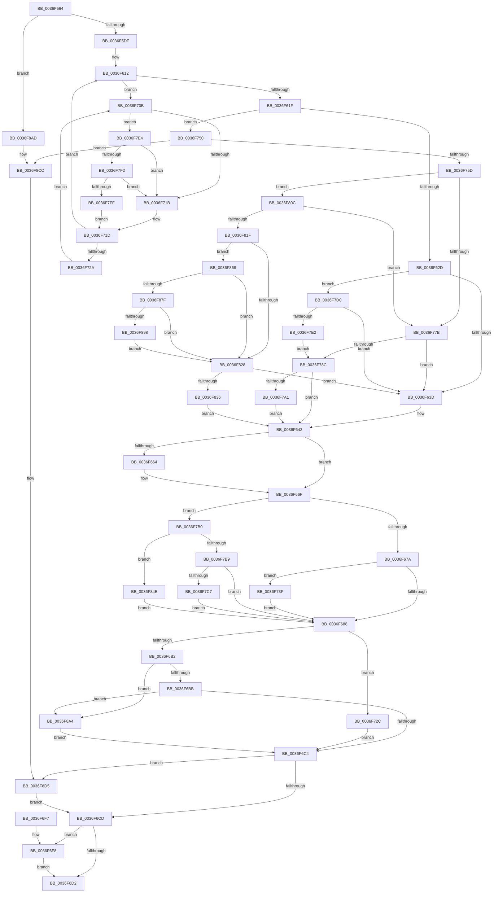

# MiDecommitPrivatePageTail

- RVA: `0x0036F564`–`0x0036F914` (길이 `944` bytes)
- VA: `0x000000014036F564`
- 실행 섹션: `.text`
- PDB 이름 있음: `예`; PDB Function 태그: `아니요`
- unwind 정보 RVA: `0x0007A688`
- 디코드: `223`개 명령, `944/944` bytes 표시
- 미해석 바이트: `0` (있으면 어셈블리에 `.byte`로 보존)

> 이 문서는 커널 이미지의 기계어와 PDB 기호를 분석해 생성했습니다. 4번과 5번은 함수 원형과 자료형을 바이너리 사용 방식에서 추정한 C 해석이며 원본 소스 복구 결과는 아닙니다.

## 1. Dependencies

- 직접 호출 지점: **15**; 고유 호출 대상: **14**
- 직접 호출자로 확인된 함수: **1**
- RIP 상대 이미지 참조: **5**

### Outgoing calls
- `0x0036F667` → [MiCaptureDirtyBitToPfn](../37/MiCaptureDirtyBitToPfn_function_00370DD0.md) (function, `0x00370DD0`)
- `0x0036F691` → [MiDecommitFreePage](../37/MiDecommitFreePage_function_00370870.md) (function, `0x00370870`)
- `0x0036F6DA` → [_security_check_cookie](../6A/_security_check_cookie_function_006AC640.md) (function, `0x006AC640`)
- `0x0036F704` → [MiReleasePageFileInfo](../28/MiReleasePageFileInfo_function_00283FD0.md) (function, `0x00283FD0`)
- `0x0036F738` → [MiChargeCommit](../28/MiChargeCommit_function_00286EB0.md) (function, `0x00286EB0`)
- `0x0036F78F` → [MiIsPfnSystemCharged](../43/MiIsPfnSystemCharged_function_0043E910.md) (function, `0x0043E910`)
- `0x0036F7F2` → [KiCheckVpBackingLongSpinWaitHypercall](../30/KiCheckVpBackingLongSpinWaitHypercall_function_0030F490.md) (function, `0x0030F490`)
- `0x0036F802` → [HvlNotifyLongSpinWait](../30/HvlNotifyLongSpinWait_function_0030F460.md) (function, `0x0030F460`)
- `0x0036F83E` → [MiIdentifyPfn](../31/MiIdentifyPfn_function_0031CAC0.md) (function, `0x0031CAC0`)
- `0x0036F851` → [MiCaptureDirtyBitToPfn](../37/MiCaptureDirtyBitToPfn_function_00370DD0.md) (function, `0x00370DD0`)
- `0x0036F85E` → [MiSetPfnIdentity](../2A/MiSetPfnIdentity_function_002A2350.md) (function, `0x002A2350`)
- `0x0036F86B` → [MiGetLeafVa](../27/MiGetLeafVa_function_0027C0A0.md) (function, `0x0027C0A0`)
- `0x0036F8C6` → [KeBugCheckEx](../4F/KeBugCheckEx_function_004FD660.md) (function, `0x004FD660`)
- `0x0036F8CF` → [MiBadShareCount](../37/MiBadShareCount_function_00370EF8.md) (function, `0x00370EF8`)
- `0x0036F90A` → [EtwTraceKernelEvent](../23/EtwTraceKernelEvent_function_00235350.md) (function, `0x00235350`)

### Direct callers
- [MiDecommitFreePagesTail](../41/MiDecommitFreePagesTail_function_0041ECE0.md) at `0x0041EEEC`

### Static image references
- `0x0036F578` → RVA `0x00E0A740` (`.data`; read)
- `0x0036F646` → RVA `0x00E30088` (`.data`; read)
- `0x0036F70E` → RVA `0x00FC52AC` (`ALMOSTRO`; reference)
- `0x0036F7E4` → RVA `0x00FC6AB8` (`ALMOSTRO`; read)
- `0x0036F828` → RVA `0x00FC6B04` (`ALMOSTRO`; read)

## 2. Other-region calls and transfers

- 다른 실행 섹션으로 향하는 call: **0**
- 별도 외부 분기/꼬리 이동을 확인하지 못했습니다.

## 3. Assembly (complete function range)

```asm
0036F564  48 89 5C 24 20                  mov qword ptr [rsp + 0x20], rbx
0036F569  55                              push rbp
0036F56A  56                              push rsi
0036F56B  57                              push rdi
0036F56C  41 54                           push r12
0036F56E  41 55                           push r13
0036F570  41 56                           push r14
0036F572  41 57                           push r15
0036F574  48 83 EC 70                     sub rsp, 0x70
0036F578  48 8B 05 C1 B1 A9 00            mov rax, qword ptr [rip + 0xa9b1c1]
0036F57F  48 33 C4                        xor rax, rsp
0036F582  48 89 44 24 60                  mov qword ptr [rsp + 0x60], rax
0036F587  33 C0                           xor eax, eax
0036F589  4D 8B F8                        mov r15, r8
0036F58C  48 89 44 24 48                  mov qword ptr [rsp + 0x48], rax
0036F591  0F 57 C0                        xorps xmm0, xmm0
0036F594  48 B8 FF FF FF FF FF 00 00 00   movabs rax, 0xffffffffff
0036F59E  49 C1 EF 0C                     shr r15, 0xc
0036F5A2  4C 23 F8                        and r15, rax
0036F5A5  4C 8B EA                        mov r13, rdx
0036F5A8  48 8B F1                        mov rsi, rcx
0036F5AB  0F 11 44 24 38                  movups xmmword ptr [rsp + 0x38], xmm0
0036F5B0  4B 8D 3C 7F                     lea rdi, [r15 + r15*2]
0036F5B4  48 C1 E7 04                     shl rdi, 4
0036F5B8  48 B8 00 00 00 00 00 DE FF FF   movabs rax, 0xffffde0000000000
0036F5C2  48 03 F8                        add rdi, rax
0036F5C5  48 B9 00 00 00 00 00 00 00 80   movabs rcx, 0x8000000000000000
0036F5CF  48 8B 47 08                     mov rax, qword ptr [rdi + 8]
0036F5D3  48 0B C1                        or rax, rcx
0036F5D6  48 3B C2                        cmp rax, rdx
0036F5D9  0F 85 CE 02 00 00               jne 0x14036f8ad
0036F5DF  48 8B EA                        mov rbp, rdx
0036F5E2  48 B9 00 00 00 00 80 F6 FF FF   movabs rcx, 0xfffff68000000000
0036F5EC  48 C1 E5 19                     shl rbp, 0x19
0036F5F0  48 8B C1                        mov rax, rcx
0036F5F3  83 A6 80 00 00 00 00            and dword ptr [rsi + 0x80], 0
0036F5FA  45 33 E4                        xor r12d, r12d
0036F5FD  83 64 24 30 00                  and dword ptr [rsp + 0x30], 0
0036F602  33 DB                           xor ebx, ebx
0036F604  48 C1 E0 19                     shl rax, 0x19
0036F608  48 2B E8                        sub rbp, rax
0036F60B  48 C1 FD 10                     sar rbp, 0x10
0036F60F  45 33 F6                        xor r14d, r14d
0036F612  F0 48 0F BA 6F 18 3F            lock bts qword ptr [rdi + 0x18], 0x3f
0036F619  0F 82 EC 00 00 00               jb 0x14036f70b
0036F61F  8B 86 9C 00 00 00               mov eax, dword ptr [rsi + 0x9c]
0036F625  A8 20                           test al, 0x20
0036F627  0F 85 23 01 00 00               jne 0x14036f750
0036F62D  4C 8D 56 28                     lea r10, [rsi + 0x28]
0036F631  4D 8B F2                        mov r14, r10
0036F634  41 39 1A                        cmp dword ptr [r10], ebx
0036F637  0F 85 93 01 00 00               jne 0x14036f7d0
0036F63D  44 8B 7C 24 30                  mov r15d, dword ptr [rsp + 0x30]
0036F642  48 8B 47 28                     mov rax, qword ptr [rdi + 0x28]
0036F646  48 8B 0D 3B 0A AC 00            mov rcx, qword ptr [rip + 0xac0a3b]
0036F64D  48 C1 E8 2B                     shr rax, 0x2b
0036F651  25 FF 03 00 00                  and eax, 0x3ff
0036F656  48 8B 2C C1                     mov rbp, qword ptr [rcx + rax*8]
0036F65A  8B 86 9C 00 00 00               mov eax, dword ptr [rsi + 0x9c]
0036F660  A8 20                           test al, 0x20
0036F662  74 0B                           je 0x14036f66f
0036F664  48 8B CF                        mov rcx, rdi
0036F667  E8 64 17 00 00                  call 0x140370dd0
0036F66C  48 8B D8                        mov rbx, rax
0036F66F  41 8B 06                        mov eax, dword ptr [r14]
0036F672  85 C0                           test eax, eax
0036F674  0F 85 36 01 00 00               jne 0x14036f7b0
0036F67A  8B 86 9C 00 00 00               mov eax, dword ptr [rsi + 0x9c]
0036F680  A8 20                           test al, 0x20
0036F682  0F 84 B7 00 00 00               je 0x14036f73f
0036F688  4C 8B C7                        mov r8, rdi
0036F68B  49 8B D5                        mov rdx, r13
0036F68E  48 8B CE                        mov rcx, rsi
0036F691  E8 DA 11 00 00                  call 0x140370870
0036F696  48 B9 FF FF FF FF FF FF FF 7F   movabs rcx, 0x7fffffffffffffff
0036F6A0  F0 48 21 4F 18                  lock and qword ptr [rdi + 0x18], rcx
0036F6A5  83 BE 80 00 00 00 00            cmp dword ptr [rsi + 0x80], 0
0036F6AC  48 8B 4E 18                     mov rcx, qword ptr [rsi + 0x18]
0036F6B0  75 7A                           jne 0x14036f72c
0036F6B2  83 F8 03                        cmp eax, 3
0036F6B5  0F 84 E9 01 00 00               je 0x14036f8a4
0036F6BB  45 85 E4                        test r12d, r12d
0036F6BE  0F 85 E0 01 00 00               jne 0x14036f8a4
0036F6C4  45 85 FF                        test r15d, r15d
0036F6C7  0F 85 08 02 00 00               jne 0x14036f8d5
0036F6CD  48 85 DB                        test rbx, rbx
0036F6D0  75 26                           jne 0x14036f6f8
0036F6D2  48 8B 4C 24 60                  mov rcx, qword ptr [rsp + 0x60]
0036F6D7  48 33 CC                        xor rcx, rsp
0036F6DA  E8 61 CF 33 00                  call 0x1406ac640
0036F6DF  48 8B 9C 24 C8 00 00 00         mov rbx, qword ptr [rsp + 0xc8]
0036F6E7  48 83 C4 70                     add rsp, 0x70
0036F6EB  41 5F                           pop r15
0036F6ED  41 5E                           pop r14
0036F6EF  41 5D                           pop r13
0036F6F1  41 5C                           pop r12
0036F6F3  5F                              pop rdi
0036F6F4  5E                              pop rsi
0036F6F5  5D                              pop rbp
0036F6F6  C3                              ret
0036F6F7  CC                              int3
0036F6F8  41 B8 01 00 00 00               mov r8d, 1
0036F6FE  48 8B D3                        mov rdx, rbx
0036F701  48 8B CD                        mov rcx, rbp
0036F704  E8 C7 48 F1 FF                  call 0x140283fd0
0036F709  EB C7                           jmp 0x14036f6d2
0036F70B  41 FF C6                        inc r14d
0036F70E  44 85 35 97 5B C5 00            test dword ptr [rip + 0xc55b97], r14d
0036F715  0F 84 C9 00 00 00               je 0x14036f7e4
0036F71B  F3 90                           pause
0036F71D  48 8B 47 18                     mov rax, qword ptr [rdi + 0x18]
0036F721  48 85 C0                        test rax, rax
0036F724  0F 89 E8 FE FF FF               jns 0x14036f612
0036F72A  EB DF                           jmp 0x14036f70b
0036F72C  BA 01 00 00 00                  mov edx, 1
0036F731  48 8B CD                        mov rcx, rbp
0036F734  44 8D 42 03                     lea r8d, [rdx + 3]
0036F738  E8 73 77 F1 FF                  call 0x140286eb0
0036F73D  EB 85                           jmp 0x14036f6c4
0036F73F  48 8B 46 20                     mov rax, qword ptr [rsi + 0x20]
0036F743  F0 48 FF 88 88 FE FF FF         lock dec qword ptr [rax - 0x178]
0036F74B  E9 38 FF FF FF                  jmp 0x14036f688
0036F750  8A 47 22                        mov al, byte ptr [rdi + 0x22]
0036F753  24 07                           and al, 7
0036F755  3C 06                           cmp al, 6
0036F757  0F 85 6F 01 00 00               jne 0x14036f8cc
0036F75D  48 8B 46 18                     mov rax, qword ptr [rsi + 0x18]
0036F761  48 FF 40 18                     inc qword ptr [rax + 0x18]
0036F765  48 B8 00 00 00 00 80 F6 FF FF   movabs rax, 0xfffff68000000000
0036F76F  48 8B C0                        mov rax, rax
0036F772  48 3B E8                        cmp rbp, rax
0036F775  0F 83 91 00 00 00               jae 0x14036f80c
0036F77B  4C 8D 56 28                     lea r10, [rsi + 0x28]
0036F77F  41 83 3A 03                     cmp dword ptr [r10], 3
0036F783  4D 8B F2                        mov r14, r10
0036F786  0F 85 B1 FE FF FF               jne 0x14036f63d
0036F78C  48 8B CF                        mov rcx, rdi
0036F78F  E8 7C F1 0C 00                  call 0x14043e910
0036F794  44 8B 7C 24 30                  mov r15d, dword ptr [rsp + 0x30]
0036F799  85 C0                           test eax, eax
0036F79B  0F 84 A1 FE FF FF               je 0x14036f642
0036F7A1  80 67 23 DF                     and byte ptr [rdi + 0x23], 0xdf
0036F7A5  41 BC 01 00 00 00               mov r12d, 1
0036F7AB  E9 92 FE FF FF                  jmp 0x14036f642
0036F7B0  83 F8 06                        cmp eax, 6
0036F7B3  0F 84 95 00 00 00               je 0x14036f84e
0036F7B9  8B 47 20                        mov eax, dword ptr [rdi + 0x20]
0036F7BC  C1 E8 18                        shr eax, 0x18
0036F7BF  A8 08                           test al, 8
0036F7C1  0F 84 C1 FE FF FF               je 0x14036f688
0036F7C7  80 67 23 F7                     and byte ptr [rdi + 0x23], 0xf7
0036F7CB  E9 B8 FE FF FF                  jmp 0x14036f688
0036F7D0  48 8B 46 18                     mov rax, qword ptr [rsi + 0x18]
0036F7D4  48 FF 40 18                     inc qword ptr [rax + 0x18]
0036F7D8  41 83 3A 06                     cmp dword ptr [r10], 6
0036F7DC  0F 84 5B FE FF FF               je 0x14036f63d
0036F7E2  EB A8                           jmp 0x14036f78c
0036F7E4  8B 05 CE 72 C5 00               mov eax, dword ptr [rip + 0xc572ce]
0036F7EA  A8 40                           test al, 0x40
0036F7EC  0F 84 29 FF FF FF               je 0x14036f71b
0036F7F2  E8 99 FC F9 FF                  call 0x14030f490
0036F7F7  84 C0                           test al, al
0036F7F9  0F 84 1C FF FF FF               je 0x14036f71b
0036F7FF  41 8B CE                        mov ecx, r14d
0036F802  E8 59 FC F9 FF                  call 0x14030f460
0036F807  E9 11 FF FF FF                  jmp 0x14036f71d
0036F80C  48 B8 FF FF FF FF FF F6 FF FF   movabs rax, 0xfffff6ffffffffff
0036F816  48 3B E8                        cmp rbp, rax
0036F819  0F 87 5C FF FF FF               ja 0x14036f77b
0036F81F  4C 8D 76 28                     lea r14, [rsi + 0x28]
0036F823  41 39 1E                        cmp dword ptr [r14], ebx
0036F826  74 40                           je 0x14036f868
0036F828  8B 05 D6 72 C5 00               mov eax, dword ptr [rip + 0xc572d6]
0036F82E  A8 01                           test al, 1
0036F830  0F 84 07 FE FF FF               je 0x14036f63d
0036F836  48 8D 54 24 38                  lea rdx, [rsp + 0x38]
0036F83B  49 8B CF                        mov rcx, r15
0036F83E  E8 7D D2 FA FF                  call 0x14031cac0
0036F843  41 BF 01 00 00 00               mov r15d, 1
0036F849  E9 F4 FD FF FF                  jmp 0x14036f642
0036F84E  48 8B CF                        mov rcx, rdi
0036F851  E8 7A 15 00 00                  call 0x140370dd0
0036F856  33 D2                           xor edx, edx
0036F858  48 8B CF                        mov rcx, rdi
0036F85B  48 8B D8                        mov rbx, rax
0036F85E  E8 ED 2A F3 FF                  call 0x1402a2350
0036F863  E9 20 FE FF FF                  jmp 0x14036f688
0036F868  48 8B CD                        mov rcx, rbp
0036F86B  E8 30 C8 F0 FF                  call 0x14027c0a0
0036F870  48 B9 FF FF FE FF FF 7F 00 00   movabs rcx, 0x7ffffffeffff
0036F87A  48 3B C1                        cmp rax, rcx
0036F87D  77 A9                           ja 0x14036f828
0036F87F  48 8B 47 18                     mov rax, qword ptr [rdi + 0x18]
0036F883  48 B9 FF FF FF FF FF FF FF 3F   movabs rcx, 0x3fffffffffffffff
0036F88D  48 23 C1                        and rax, rcx
0036F890  48 3D 00 00 01 00               cmp rax, 0x10000
0036F896  72 90                           jb 0x14036f828
0036F898  C7 86 80 00 00 00 01 00 00 00   mov dword ptr [rsi + 0x80], 1
0036F8A2  EB 84                           jmp 0x14036f828
0036F8A4  48 FF 41 08                     inc qword ptr [rcx + 8]
0036F8A8  E9 17 FE FF FF                  jmp 0x14036f6c4
0036F8AD  48 8B 47 08                     mov rax, qword ptr [rdi + 8]
0036F8B1  4D 8B C8                        mov r9, r8
0036F8B4  4D 8B C5                        mov r8, r13
0036F8B7  48 89 44 24 20                  mov qword ptr [rsp + 0x20], rax
0036F8BC  BA 04 04 00 00                  mov edx, 0x404
0036F8C1  B9 1A 00 00 00                  mov ecx, 0x1a
0036F8C6  E8 95 DD 18 00                  call 0x1404fd660
0036F8CB  CC                              int3
0036F8CC  48 8B CF                        mov rcx, rdi
0036F8CF  E8 24 16 00 00                  call 0x140370ef8
0036F8D4  CC                              int3
0036F8D5  83 64 24 5C 00                  and dword ptr [rsp + 0x5c], 0
0036F8DA  48 8D 44 24 38                  lea rax, [rsp + 0x38]
0036F8DF  41 B9 77 02 00 00               mov r9d, 0x277
0036F8E5  48 89 44 24 50                  mov qword ptr [rsp + 0x50], rax
0036F8EA  BA 01 00 00 00                  mov edx, 1
0036F8EF  C7 44 24 58 18 00 00 00         mov dword ptr [rsp + 0x58], 0x18
0036F8F7  41 B8 01 00 00 20               mov r8d, 0x20000001
0036F8FD  C7 44 24 20 04 1B 50 11         mov dword ptr [rsp + 0x20], 0x11501b04
0036F905  48 8D 4C 24 50                  lea rcx, [rsp + 0x50]
0036F90A  E8 41 5A EC FF                  call 0x140235350
0036F90F  E9 B9 FD FF FF                  jmp 0x14036f6cd
```

## 4. C-style interpretation (structured pseudocode)

```c
__int64 __fastcall MiDecommitPrivatePageTail(__int64 a1, __int64 a2, __int64 a3)
{
    __int64 result;
    __int64 v_r12;
    __int64 v_r14;
    __int64 v_r15;
    __int64 v_rbp;
    __int64 v_rbx;
    __int64 v_rdi;
    __int64 v_rsp;
    unsigned __int64 v_stack_m48;
    unsigned __int64 v_stack_m60;
    unsigned __int64 v_stack_m70;
    unsigned int v_stack_m78;
    unsigned __int64 v_stack_p20;
    unsigned int v_stack_p30;
    unsigned __int64 v_stack_p38;
    unsigned __int64 v_stack_p50;
    unsigned int v_stack_p58;
    unsigned int v_stack_p5C;

    v_stack_p20 = v_rbx;
    v_rsp = (v_rsp) - (112);
    result = (*(unsigned __int64 *)(v_rip + 11121089)) ^ (v_rsp);
    v_stack_m48 = result;
    result = 0;
    v_stack_m60 = 0;
    v_r15 = (a3) >> (12);
    v_r15 = (v_r15) & (0);
    v_stack_m70 = v_xmm0;
    v_rdi = (v_r15 + v_r15 * 2) << (4);
    v_rdi = (v_rdi) + (0);
    result = (*(unsigned __int64 *)(v_rdi + 8)) | (a1);
    if (result != a2) goto loc_0036F8AD;
    v_rbp = (a2) << (25);
    v_r12 = 0;
    v_rbx = 0;
    result = (a1) << (25);
    v_rbp = (v_rbp) - (result);
    v_rbp = (v_rbp) >> (16);
    v_r14 = 0;
loc_0036F612:
    if (condition_is_below) goto loc_0036F70B;
    if ((((unsigned __int8)((unsigned int)(*(unsigned int *)(a1 + 156)))) & (32)) != 0) goto loc_0036F750;
    if ((*(unsigned int *)(a1 + 40)) != 0) goto loc_0036F7D0;
loc_0036F63D:
loc_0036F642:
    result = (*(unsigned __int64 *)(v_rdi + 40)) >> (43);
    result = (unsigned int)((result) & (0x3FFULL));
    result = (unsigned int)(*(unsigned int *)(a1 + 156));
    if ((((unsigned __int8)((unsigned int)(*(unsigned int *)(a1 + 156)))) & (32)) != 0) {
        a1 = v_rdi;
        result = MiCaptureDirtyBitToPfn(a1, a2, a3, a4);
        v_rbx = result;
    }
    if ((unsigned int)((unsigned int)(*(unsigned int *)(a1 + 40))) != 0) goto loc_0036F7B0;
    if ((((unsigned __int8)((unsigned int)(*(unsigned int *)(a1 + 156)))) & (32)) == 0) goto loc_0036F73F;
loc_0036F688:
    result = MiDecommitFreePage(a1, a2, v_rdi, a4);
    if ((*(unsigned int *)(a1 + 128)) != 0) goto loc_0036F72C;
    if (((unsigned int)(result)) == 3) goto loc_0036F8A4;
    if (0 != 0) goto loc_0036F8A4;
loc_0036F6C4:
    if ((unsigned int)((unsigned int)(v_stack_m78)) != 0) goto loc_0036F8D5;
loc_0036F6CD:
    if (v_rbx != 0) goto loc_0036F6F8;
loc_0036F6D2:
    a1 = (v_stack_m48) ^ (v_rsp);
    result = _security_check_cookie(a1, a2, v_rdi, a4);
    v_rsp = (v_rsp) + (112);
    return result;
loc_0036F6F8:
    result = MiReleasePageFileInfo(*(unsigned __int64 *)(*(unsigned __int64 *)(v_rip + 11274811) + result * 8), v_stack_p20, 1, a4);
    goto loc_0036F6D2;
loc_0036F70B:
    v_r14 = (unsigned int)((a1 + 40) + 1);
    if (((*(unsigned int *)(v_rip + 12934039)) & ((unsigned int)(v_r14))) == 0) goto loc_0036F7E4;
loc_0036F71B:
loc_0036F71D:
    if (!sign_flag) goto loc_0036F612;
    goto loc_0036F70B;
loc_0036F72C:
    result = MiChargeCommit(*(unsigned __int64 *)(*(unsigned __int64 *)(v_rip + 11274811) + result * 8), 1, 1 + 3, a4);
    goto loc_0036F6C4;
loc_0036F73F:
    goto loc_0036F688;
loc_0036F750:
    result = (unsigned __int8)((*(unsigned __int8 *)(v_rdi + 34)) & (7));
    if (((unsigned __int8)(result)) != 6) goto loc_0036F8CC;
    if ((*(unsigned __int64 *)(*(unsigned __int64 *)(v_rip + 11274811) + result * 8)) >= (*(unsigned __int64 *)(a1 + 24))) goto loc_0036F80C;
loc_0036F77B:
    if ((*(unsigned int *)(a1 + 40)) != 3) goto loc_0036F63D;
loc_0036F78C:
    result = MiIsPfnSystemCharged(v_rdi, 1, 1 + 3, a4);
    if ((unsigned int)(result) == 0) goto loc_0036F642;
    goto loc_0036F642;
loc_0036F7B0:
    if (((unsigned int)(result)) == 6) goto loc_0036F84E;
    result = (unsigned int)(((unsigned int)(*(unsigned int *)(v_rdi + 32))) >> (24));
    if ((((unsigned __int8)(result)) & (8)) == 0) goto loc_0036F688;
    goto loc_0036F688;
loc_0036F7D0:
    if ((*(unsigned int *)(a1 + 40)) == 6) goto loc_0036F63D;
    goto loc_0036F78C;
loc_0036F7E4:
    if ((((unsigned __int8)((unsigned int)(*(unsigned int *)(v_rip + 12939982)))) & (64)) == 0) goto loc_0036F71B;
    result = KiCheckVpBackingLongSpinWaitHypercall(v_rdi, 1, 1 + 3, a4);
    if ((unsigned __int8)(result) == 0) goto loc_0036F71B;
    result = HvlNotifyLongSpinWait((unsigned int)((unsigned int)(a1 + 40)), 1, 1 + 3, a4);
    goto loc_0036F71D;
loc_0036F80C:
    if ((*(unsigned __int64 *)(*(unsigned __int64 *)(v_rip + 11274811) + result * 8)) > result) goto loc_0036F77B;
    if ((*(unsigned int *)(a1 + 40)) == ((unsigned int)(v_stack_p20))) goto loc_0036F868;
loc_0036F828:
    if ((((unsigned __int8)((unsigned int)(*(unsigned int *)(v_rip + 12939990)))) & (1)) == 0) goto loc_0036F63D;
    result = MiIdentifyPfn((unsigned int)(v_stack_p30), v_stack_p38, 1 + 3, a4);
    goto loc_0036F642;
loc_0036F84E:
    result = MiCaptureDirtyBitToPfn(v_rdi, v_stack_p38, 1 + 3, a4);
    a2 = 0;
    result = MiSetPfnIdentity(v_rdi, a2, 1 + 3, a4);
    goto loc_0036F688;
loc_0036F868:
    result = MiGetLeafVa(*(unsigned __int64 *)(*(unsigned __int64 *)(v_rip + 11274811) + result * 8), a2, 1 + 3, a4);
    if (result > (*(unsigned __int64 *)(*(unsigned __int64 *)(v_rip + 11274811) + result * 8))) goto loc_0036F828;
    result = (*(unsigned __int64 *)(v_rdi + 24)) & (*(unsigned __int64 *)(*(unsigned __int64 *)(v_rip + 11274811) + result * 8));
    if (result < 0x10000ULL) goto loc_0036F828;
    *(unsigned int *)(a1 + 128) = 1;
    goto loc_0036F828;
loc_0036F8A4:
    goto loc_0036F6C4;
loc_0036F8AD:
    v_stack_p20 = *(unsigned __int64 *)(v_rdi + 8);
    result = KeBugCheckEx(26, (unsigned int)(0x404ULL), 0, 1 + 3);
loc_0036F8CC:
    result = MiBadShareCount(v_rdi, (unsigned int)(0x404ULL), 0, 1 + 3);
loc_0036F8D5:
    v_stack_p50 = v_stack_p38;
    v_stack_p58 = 24;
    v_stack_p20 = 0x11501B04ULL;
    result = EtwTraceKernelEvent(v_stack_p50, 1, (unsigned int)(0x20000001ULL), 631);
    goto loc_0036F6CD;
}
```

## 5. (Beta) C Style

```c
int64_t MiDecommitPrivatePageTail(void *Arg1, int64_t Arg2, int64_t Arg3)
{
    uint8_t *arg1 = (uint8_t *)Arg1;

    int64_t result;
    int64_t local_r12;
    int64_t local_r14;
    int64_t local_r15;
    int64_t local_rbp;
    int64_t local_rbx;
    int64_t local_rdi;
    int64_t local_rsp;
    uint64_t v_stack_m48;
    uint64_t v_stack_m60;
    uint64_t v_stack_m70;
    uint32_t v_stack_m78;
    uint64_t v_stack_p20;
    uint32_t v_stack_p30;
    uint64_t v_stack_p38;
    uint64_t v_stack_p50;
    uint32_t v_stack_p58;
    uint32_t v_stack_p5C;

    v_stack_p20 = local_rbx;
    local_rsp = (local_rsp) - (112);
    result = (*(uint64_t *)(v_rip + 0xA9B1C1)) ^ (local_rsp);
    v_stack_m48 = result;
    result = 0;
    v_stack_m60 = 0;
    local_r15 = (Arg3) >> (12);
    local_r15 = (local_r15) & (0);
    v_stack_m70 = v_xmm0;
    local_rdi = (local_r15 + local_r15 * 2) << (4);
    local_rdi = (local_rdi) + (0);
    result = (*(uint64_t *)(local_rdi + 0x8)) | (Arg1);
    if (result != Arg2) goto loc_0036F8AD;
    local_rbp = (Arg2) << (25);
    local_r12 = 0;
    local_rbx = 0;
    result = (Arg1) << (25);
    local_rbp = (local_rbp) - (result);
    local_rbp = (local_rbp) >> (16);
    local_r14 = 0;
loc_0036F612:
    if (condition_is_below) goto loc_0036F70B;
    if ((((uint8_t)((uint32_t)(*(uint32_t *)(arg1 + 0x9C)))) & (32)) != 0) goto loc_0036F750;
    if ((*(uint32_t *)(arg1 + 0x28)) != 0) goto loc_0036F7D0;
loc_0036F63D:
loc_0036F642:
    result = (*(uint64_t *)(local_rdi + 0x28)) >> (43);
    result = (uint32_t)((result) & (0x3FFULL));
    result = (uint32_t)(*(uint32_t *)(arg1 + 0x9C));
    if ((((uint8_t)((uint32_t)(*(uint32_t *)(arg1 + 0x9C)))) & (32)) != 0) {
        Arg1 = local_rdi;
        result = MiCaptureDirtyBitToPfn(Arg1, Arg2, Arg3, a4);
        local_rbx = result;
    }
    if ((uint32_t)((uint32_t)(*(uint32_t *)(arg1 + 0x28))) != 0) goto loc_0036F7B0;
    if ((((uint8_t)((uint32_t)(*(uint32_t *)(arg1 + 0x9C)))) & (32)) == 0) goto loc_0036F73F;
loc_0036F688:
    result = MiDecommitFreePage(Arg1, Arg2, local_rdi, a4);
    if ((*(uint32_t *)(arg1 + 0x80)) != 0) goto loc_0036F72C;
    if (((uint32_t)(result)) == 3) goto loc_0036F8A4;
    if (0 != 0) goto loc_0036F8A4;
loc_0036F6C4:
    if ((uint32_t)((uint32_t)(v_stack_m78)) != 0) goto loc_0036F8D5;
loc_0036F6CD:
    if (local_rbx != 0) goto loc_0036F6F8;
loc_0036F6D2:
    Arg1 = (v_stack_m48) ^ (local_rsp);
    result = _security_check_cookie(Arg1, Arg2, local_rdi, a4);
    local_rsp = (local_rsp) + (112);
    return result;
loc_0036F6F8:
    result = MiReleasePageFileInfo(*(uint64_t *)(*(uint64_t *)(v_rip + 0xAC0A3B) + result * 8), v_stack_p20, 1, a4);
    goto loc_0036F6D2;
loc_0036F70B:
    local_r14 = (uint32_t)((Arg1 + 40) + 1);
    if (((*(uint32_t *)(v_rip + 0xC55B97)) & ((uint32_t)(local_r14))) == 0) goto loc_0036F7E4;
loc_0036F71B:
loc_0036F71D:
    if (!sign_flag) goto loc_0036F612;
    goto loc_0036F70B;
loc_0036F72C:
    result = MiChargeCommit(*(uint64_t *)(*(uint64_t *)(v_rip + 0xAC0A3B) + result * 8), 1, 1 + 3, a4);
    goto loc_0036F6C4;
loc_0036F73F:
    goto loc_0036F688;
loc_0036F750:
    result = (uint8_t)((*(uint8_t *)(local_rdi + 0x22)) & (7));
    if (((uint8_t)(result)) != 6) goto loc_0036F8CC;
    if ((*(uint64_t *)(*(uint64_t *)(v_rip + 0xAC0A3B) + result * 8)) >= (*(uint64_t *)(arg1 + 0x18))) goto loc_0036F80C;
loc_0036F77B:
    if ((*(uint32_t *)(arg1 + 0x28)) != 3) goto loc_0036F63D;
loc_0036F78C:
    result = MiIsPfnSystemCharged(local_rdi, 1, 1 + 3, a4);
    if ((uint32_t)(result) == 0) goto loc_0036F642;
    goto loc_0036F642;
loc_0036F7B0:
    if (((uint32_t)(result)) == 6) goto loc_0036F84E;
    result = (uint32_t)(((uint32_t)(*(uint32_t *)(local_rdi + 0x20))) >> (24));
    if ((((uint8_t)(result)) & (8)) == 0) goto loc_0036F688;
    goto loc_0036F688;
loc_0036F7D0:
    if ((*(uint32_t *)(arg1 + 0x28)) == 6) goto loc_0036F63D;
    goto loc_0036F78C;
loc_0036F7E4:
    if ((((uint8_t)((uint32_t)(*(uint32_t *)(v_rip + 0xC572CE)))) & (64)) == 0) goto loc_0036F71B;
    result = KiCheckVpBackingLongSpinWaitHypercall(local_rdi, 1, 1 + 3, a4);
    if ((uint8_t)(result) == 0) goto loc_0036F71B;
    result = HvlNotifyLongSpinWait((uint32_t)((uint32_t)(Arg1 + 40)), 1, 1 + 3, a4);
    goto loc_0036F71D;
loc_0036F80C:
    if ((*(uint64_t *)(*(uint64_t *)(v_rip + 0xAC0A3B) + result * 8)) > result) goto loc_0036F77B;
    if ((*(uint32_t *)(arg1 + 0x28)) == ((uint32_t)(v_stack_p20))) goto loc_0036F868;
loc_0036F828:
    if ((((uint8_t)((uint32_t)(*(uint32_t *)(v_rip + 0xC572D6)))) & (1)) == 0) goto loc_0036F63D;
    result = MiIdentifyPfn((uint32_t)(v_stack_p30), v_stack_p38, 1 + 3, a4);
    goto loc_0036F642;
loc_0036F84E:
    result = MiCaptureDirtyBitToPfn(local_rdi, v_stack_p38, 1 + 3, a4);
    Arg2 = 0;
    result = MiSetPfnIdentity(local_rdi, Arg2, 1 + 3, a4);
    goto loc_0036F688;
loc_0036F868:
    result = MiGetLeafVa(*(uint64_t *)(*(uint64_t *)(v_rip + 0xAC0A3B) + result * 8), Arg2, 1 + 3, a4);
    if (result > (*(uint64_t *)(*(uint64_t *)(v_rip + 0xAC0A3B) + result * 8))) goto loc_0036F828;
    result = (*(uint64_t *)(local_rdi + 0x18)) & (*(uint64_t *)(*(uint64_t *)(v_rip + 0xAC0A3B) + result * 8));
    if (result < 0x10000ULL) goto loc_0036F828;
    *(uint32_t *)(arg1 + 0x80) = 1;
    goto loc_0036F828;
loc_0036F8A4:
    goto loc_0036F6C4;
loc_0036F8AD:
    v_stack_p20 = *(uint64_t *)(local_rdi + 0x8);
    result = KeBugCheckEx(26, (uint32_t)(0x404ULL), 0, 1 + 3);
loc_0036F8CC:
    result = MiBadShareCount(local_rdi, (uint32_t)(0x404ULL), 0, 1 + 3);
loc_0036F8D5:
    v_stack_p50 = v_stack_p38;
    v_stack_p58 = 24;
    v_stack_p20 = 0x11501B04ULL;
    result = EtwTraceKernelEvent(v_stack_p50, 1, (uint32_t)(0x20000001ULL), 631);
    goto loc_0036F6CD;
}
```

### 관측된 메모리 오프셋

구조체 형식이 확인되지 않은 접근은 인자 기준의 오프셋으로만 기록했습니다.

| 기준 인자 | 오프셋 표현 | 폭 (bit) | 접근 |
|---|---:|---:|---|
| `Arg1` | `+ 0x0` | `32` | `R` |
| `Arg1` | `+ 0x18` | `64` | `R` |
| `Arg1` | `+ 0x20` | `64` | `R` |
| `Arg1` | `+ 0x28` | `64` | `R` |
| `Arg1` | `+ 0x80` | `32` | `R` |
| `Arg1` | `+ 0x80` | `32` | `R/W` |
| `Arg1` | `+ 0x80` | `32` | `W` |
| `Arg1` | `+ 0x9C` | `32` | `R` |

## 6. Execution-region graph

[열기: 2D/3D 그래프와 함수 탐색 컨트롤 패널](../../../control-panel.html?section=text&rva=0x0036F564&view=graph)

- 2D 그래프는 위에서 아래로 흐르고, 3D 그래프는 빈 공간을 드래그해 회전합니다. Shift+드래그는 이동, 휠은 확대·축소, 함수 노드 선택은 대상 보고서 이동입니다.

### Static fallback


