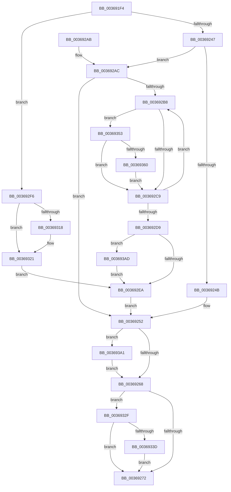

# MiDeleteControlArea

- RVA: `0x003691F4`–`0x003693C2` (길이 `462` bytes)
- VA: `0x00000001403691F4`
- 실행 섹션: `.text`
- PDB 이름 있음: `예`; PDB Function 태그: `아니요`
- unwind 정보 RVA: `0x0007A1B8`
- 디코드: `115`개 명령, `462/462` bytes 표시
- 미해석 바이트: `0` (있으면 어셈블리에 `.byte`로 보존)

> 이 문서는 커널 이미지의 기계어와 PDB 기호를 분석해 생성했습니다. 4번과 5번은 함수 원형과 자료형을 바이너리 사용 방식에서 추정한 C 해석이며 원본 소스 복구 결과는 아닙니다.

## 1. Dependencies

- 직접 호출 지점: **12**; 고유 호출 대상: **11**
- 직접 호출자로 확인된 함수: **5**
- RIP 상대 이미지 참조: **1**

### Outgoing calls
- `0x00369275` → [MiDeleteFileExtents](../../page/A2/MiDeleteFileExtents_function_00A27004.md) (function, `0x00A27004`)
- `0x0036927F` → [ExFreePoolWithTag](../../poolcode/B8/ExFreePoolWithTag_function_00B82870.md) (function, `0x00B82870`)
- `0x00369289` → [ExFreePoolWithTag](../../poolcode/B8/ExFreePoolWithTag_function_00B82870.md) (function, `0x00B82870`)
- `0x003692CC` → [MiDeleteSubsection](MiDeleteSubsection_function_003693C8.md) (function, `0x003693C8`)
- `0x0036931C` → [SeReleaseImageValidationContext](../../page/AB/SeReleaseImageValidationContext_function_00AB0028.md) (function, `0x00AB0028`)
- `0x00369328` → [MiFreeRelocations](../../page/93/MiFreeRelocations_function_0093F08C.md) (function, `0x0093F08C`)
- `0x00369349` → [KeSetEvent](../33/KeSetEvent_function_0033F310.md) (function, `0x0033F310`)
- `0x00369368` → [MiUpdateSubsectionCrossPartitionRefs](../4F/MiUpdateSubsectionCrossPartitionRefs_function_004FB5DC.md) (function, `0x004FB5DC`)
- `0x00369371` → [ExAcquireSpinLockExclusive](../24/ExAcquireSpinLockExclusive_function_00248690.md) (function, `0x00248690`)
- `0x00369381` → [MiDecrementSubsectionViewCount](../29/MiDecrementSubsectionViewCount_function_00298E90.md) (function, `0x00298E90`)
- `0x00369390` → [MiReleaseSpinLockExclusive](../24/MiReleaseSpinLockExclusive_function_002482C0.md) (function, `0x002482C0`)
- `0x003693B8` → [MiReturnCrossPartitionSectionCharges](../4B/MiReturnCrossPartitionSectionCharges_function_004BA61C.md) (function, `0x004BA61C`)

### Direct callers
- [MiPrepareToFlushSubsection](MiPrepareToFlushSubsection_function_00369094.md) at `0x0036913E`
- [MiDereferenceControlAreaProbe](MiDereferenceControlAreaProbe_function_003691C0.md) at `0x003691DE`
- [MiPrivateFixup](MiPrivateFixup_function_003693E8.md) at `0x003698FA`
- [MiWaitForInPageComplete](../38/MiWaitForInPageComplete_function_00380AB8.md) at `0x00380DA0`
- [sub_006F602E](../6F/Unknown_function_006F602E.md) at `0x006F6063`

### Static image references
- `0x00369210` → RVA `0x00E30088` (`.data`; read)

## 2. Other-region calls and transfers

- 다른 실행 섹션으로 향하는 call: **5**
  - `0x00369275` → [MiDeleteFileExtents](../../page/A2/MiDeleteFileExtents_function_00A27004.md) (`.text` → `PAGE`)
  - `0x0036927F` → [ExFreePoolWithTag](../../poolcode/B8/ExFreePoolWithTag_function_00B82870.md) (`.text` → `POOLCODE`)
  - `0x00369289` → [ExFreePoolWithTag](../../poolcode/B8/ExFreePoolWithTag_function_00B82870.md) (`.text` → `POOLCODE`)
  - `0x0036931C` → [SeReleaseImageValidationContext](../../page/AB/SeReleaseImageValidationContext_function_00AB0028.md) (`.text` → `PAGE`)
  - `0x00369328` → [MiFreeRelocations](../../page/93/MiFreeRelocations_function_0093F08C.md) (`.text` → `PAGE`)
- 별도 외부 분기/꼬리 이동을 확인하지 못했습니다.

## 3. Assembly (complete function range)

```asm
003691F4  48 89 5C 24 10                  mov qword ptr [rsp + 0x10], rbx
003691F9  48 89 6C 24 18                  mov qword ptr [rsp + 0x18], rbp
003691FE  48 89 74 24 20                  mov qword ptr [rsp + 0x20], rsi
00369203  57                              push rdi
00369204  41 54                           push r12
00369206  41 55                           push r13
00369208  41 56                           push r14
0036920A  41 57                           push r15
0036920C  48 83 EC 20                     sub rsp, 0x20
00369210  48 8B 05 71 6E AC 00            mov rax, qword ptr [rip + 0xac6e71]
00369217  4C 8B F1                        mov r14, rcx
0036921A  8B 49 38                        mov ecx, dword ptr [rcx + 0x38]
0036921D  45 33 E4                        xor r12d, r12d
00369220  41 0F B7 56 3C                  movzx edx, word ptr [r14 + 0x3c]
00369225  81 E2 FF 03 00 00               and edx, 0x3ff
0036922B  4C 8B 3C D0                     mov r15, qword ptr [rax + rdx*8]
0036922F  49 8D 97 C8 06 00 00            lea rdx, [r15 + 0x6c8]
00369236  48 89 54 24 50                  mov qword ptr [rsp + 0x50], rdx
0036923B  48 8B DA                        mov rbx, rdx
0036923E  F6 C1 20                        test cl, 0x20
00369241  0F 85 AF 00 00 00               jne 0x1403692f6
00369247  84 C9                           test cl, cl
00369249  78 61                           js 0x1403692ac
0036924B  49 8D 9F D0 06 00 00            lea rbx, [r15 + 0x6d0]
00369252  48 83 C8 FF                     or rax, 0xffffffffffffffff
00369256  F0 48 0F C1 03                  lock xadd qword ptr [rbx], rax
0036925B  48 FF C8                        dec rax
0036925E  48 83 F8 FF                     cmp rax, -1
00369262  0F 8E 39 01 00 00               jle 0x1403693a1
00369268  48 83 3A 00                     cmp qword ptr [rdx], 0
0036926C  0F 84 BD 00 00 00               je 0x14036932f
00369272  49 8B CE                        mov rcx, r14
00369275  E8 8A DD 6B 00                  call 0x140a27004
0036927A  49 8B 0E                        mov rcx, qword ptr [r14]
0036927D  33 D2                           xor edx, edx
0036927F  E8 EC 95 81 00                  call 0x140b82870
00369284  33 D2                           xor edx, edx
00369286  49 8B CE                        mov rcx, r14
00369289  E8 E2 95 81 00                  call 0x140b82870
0036928E  48 8B 5C 24 58                  mov rbx, qword ptr [rsp + 0x58]
00369293  48 8B 6C 24 60                  mov rbp, qword ptr [rsp + 0x60]
00369298  48 8B 74 24 68                  mov rsi, qword ptr [rsp + 0x68]
0036929D  48 83 C4 20                     add rsp, 0x20
003692A1  41 5F                           pop r15
003692A3  41 5E                           pop r14
003692A5  41 5D                           pop r13
003692A7  41 5C                           pop r12
003692A9  5F                              pop rdi
003692AA  C3                              ret
003692AB  CC                              int3
003692AC  49 8B AE 90 00 00 00            mov rbp, qword ptr [r14 + 0x90]
003692B3  48 85 ED                        test rbp, rbp
003692B6  74 9A                           je 0x140369252
003692B8  8B 5D 20                        mov ebx, dword ptr [rbp + 0x20]
003692BB  4C 8B 6D 10                     mov r13, qword ptr [rbp + 0x10]
003692BF  0F BA E3 10                     bt ebx, 0x10
003692C3  0F 82 8A 00 00 00               jb 0x140369353
003692C9  48 8B CD                        mov rcx, rbp
003692CC  E8 F7 00 00 00                  call 0x1403693c8
003692D1  49 8B ED                        mov rbp, r13
003692D4  4D 85 ED                        test r13, r13
003692D7  75 DF                           jne 0x1403692b8
003692D9  48 8B 7C 24 50                  mov rdi, qword ptr [rsp + 0x50]
003692DE  48 8B DF                        mov rbx, rdi
003692E1  4D 85 E4                        test r12, r12
003692E4  0F 85 C3 00 00 00               jne 0x1403693ad
003692EA  49 8D 97 C8 06 00 00            lea rdx, [r15 + 0x6c8]
003692F1  E9 5C FF FF FF                  jmp 0x140369252
003692F6  49 8B 7E 60                     mov rdi, qword ptr [r14 + 0x60]
003692FA  48 BA F8 FF FF FF FF FF FF 7F   movabs rdx, 0x7ffffffffffffff8
00369304  48 83 E7 F8                     and rdi, 0xfffffffffffffff8
00369308  48 8B 4F 28                     mov rcx, qword ptr [rdi + 0x28]
0036930C  48 8B C1                        mov rax, rcx
0036930F  48 83 E0 F8                     and rax, 0xfffffffffffffff8
00369313  48 3B C2                        cmp rax, rdx
00369316  76 09                           jbe 0x140369321
00369318  48 83 E1 F8                     and rcx, 0xfffffffffffffff8
0036931C  E8 07 6D 74 00                  call 0x140ab0028
00369321  48 8B 57 20                     mov rdx, qword ptr [rdi + 0x20]
00369325  49 8B CE                        mov rcx, r14
00369328  E8 5F 5D 5D 00                  call 0x14093f08c
0036932D  EB BB                           jmp 0x1403692ea
0036932F  49 83 BF D0 06 00 00 00         cmp qword ptr [r15 + 0x6d0], 0
00369337  0F 85 35 FF FF FF               jne 0x140369272
0036933D  49 8B 8F E0 0A 00 00            mov rcx, qword ptr [r15 + 0xae0]
00369344  45 33 C0                        xor r8d, r8d
00369347  33 D2                           xor edx, edx
00369349  E8 C2 5F FD FF                  call 0x14033f310
0036934E  E9 1F FF FF FF                  jmp 0x140369272
00369353  F7 45 30 FF FF FF 3F            test dword ptr [rbp + 0x30], 0x3fffffff
0036935A  0F 84 69 FF FF FF               je 0x1403692c9
00369360  BA 01 00 00 00                  mov edx, 1
00369365  48 8B CD                        mov rcx, rbp
00369368  E8 6F 22 19 00                  call 0x1404fb5dc
0036936D  49 8D 4E 48                     lea rcx, [r14 + 0x48]
00369371  E8 1A F3 ED FF                  call 0x140248690
00369376  BA 18 00 00 00                  mov edx, 0x18
0036937B  48 8B CD                        mov rcx, rbp
0036937E  40 8A F8                        mov dil, al
00369381  E8 0A FB F2 FF                  call 0x140298e90
00369386  40 8A D7                        mov dl, dil
00369389  49 8D 4E 48                     lea rcx, [r14 + 0x48]
0036938D  4C 03 E0                        add r12, rax
00369390  E8 2B EF ED FF                  call 0x1402482c0
00369395  0F BA F3 10                     btr ebx, 0x10
00369399  89 5D 20                        mov dword ptr [rbp + 0x20], ebx
0036939C  E9 28 FF FF FF                  jmp 0x1403692c9
003693A1  B9 0E 00 00 00                  mov ecx, 0xe
003693A6  CD 29                           int 0x29
003693A8  E9 BB FE FF FF                  jmp 0x140369268
003693AD  4D 8B C4                        mov r8, r12
003693B0  BA 01 00 00 00                  mov edx, 1
003693B5  49 8B CF                        mov rcx, r15
003693B8  E8 5F 12 15 00                  call 0x1404ba61c
003693BD  E9 28 FF FF FF                  jmp 0x1403692ea
```

## 4. C-style interpretation (structured pseudocode)

```c
__int64 __fastcall MiDeleteControlArea(__int64 a1, __int64 a2, int a3)
{
    __int64 result;
    __int64 v_r12;
    __int64 v_rdi;
    __int64 v_rsp;
    unsigned __int64 v_stack_p10;
    unsigned __int64 v_stack_p18;
    unsigned __int64 v_stack_p20;
    unsigned __int64 v_stack_p50;
    unsigned __int64 v_stack_p8;

    v_stack_p10 = v_rbx;
    v_stack_p18 = v_rbp;
    v_stack_p20 = v_rsi;
    v_rsp = (v_rsp) - (32);
    v_r12 = 0;
    a2 = (unsigned int)((*(unsigned __int16 *)(a1 + 60)) & (0x3FFULL));
    v_stack_p8 = *(unsigned __int64 *)(*(unsigned __int64 *)(v_rip + 11300465) + a2 * 8) + 1736;
    if ((((unsigned __int8)((unsigned int)(*(unsigned int *)(a1 + 56)))) & (32)) != 0) goto loc_003692F6;
    if (sign_flag) goto loc_003692AC;
loc_00369252:
    result = (*(unsigned __int64 *)(v_rip + 11300465)) | (-1);
    result = (result) - 1;
    if (result <= -1) goto loc_003693A1;
loc_00369268:
    if ((*(unsigned __int64 *)(*(unsigned __int64 *)(*(unsigned __int64 *)(v_rip + 11300465) + a2 * 8) + 1736)) == 0) goto loc_0036932F;
loc_00369272:
    result = MiDeleteFileExtents(a1, *(unsigned __int64 *)(*(unsigned __int64 *)(v_rip + 11300465) + a2 * 8) + 1736, a3, a4);
    a2 = 0;
    result = ExFreePoolWithTag(*(unsigned __int64 *)(a1), a2, a3, a4);
    a2 = 0;
    result = ExFreePoolWithTag(a1, a2, a3, a4);
    v_rsp = (v_rsp) + (32);
    return result;
loc_003692AC:
    if (*(unsigned __int64 *)(a1 + 144) == 0) goto loc_00369252;
loc_003692B8:
    if (condition_is_below) goto loc_00369353;
loc_003692C9:
    result = MiDeleteSubsection(*(unsigned __int64 *)(a1 + 144), a2, a3, a4);
    if (*(unsigned __int64 *)(*(unsigned __int64 *)(a1 + 144) + 16) != 0) goto loc_003692B8;
    if (0 != 0) goto loc_003693AD;
loc_003692EA:
    goto loc_00369252;
loc_003692F6:
    v_rdi = (*(unsigned __int64 *)(a1 + 96)) & (-8);
    result = (*(unsigned __int64 *)(v_rdi + 40)) & (-8);
    if (result >= = (*(unsigned __int64 *)(*(unsigned __int64 *)(v_rip + 11300465) + a2 * 8) + 1736)) {
        a1 = (*(unsigned __int64 *)(v_rdi + 40)) & (-8);
        result = SeReleaseImageValidationContext(a1, *(unsigned __int64 *)(*(unsigned __int64 *)(v_rip + 11300465) + a2 * 8) + 1736, a3, a4);
    }
    result = MiFreeRelocations(a1, *(unsigned __int64 *)(v_rdi + 32), a3, a4);
    goto loc_003692EA;
loc_0036932F:
    if ((*(unsigned __int64 *)(*(unsigned __int64 *)(*(unsigned __int64 *)(v_rip + 11300465) + a2 * 8) + 1744)) != 0) goto loc_00369272;
    a3 = 0;
    a2 = 0;
    result = KeSetEvent(*(unsigned __int64 *)(*(unsigned __int64 *)(*(unsigned __int64 *)(v_rip + 11300465) + a2 * 8) + 2784), a2, a3, a4);
    goto loc_00369272;
loc_00369353:
    if (((*(unsigned int *)(*(unsigned __int64 *)(*(unsigned __int64 *)(a1 + 144) + 16) + 48)) & (0x3FFFFFFFULL)) == 0) goto loc_003692C9;
    result = MiUpdateSubsectionCrossPartitionRefs(*(unsigned __int64 *)(*(unsigned __int64 *)(a1 + 144) + 16), 1, a3, a4);
    result = ExAcquireSpinLockExclusive(a1 + 72, 1, a3, a4);
    result = MiDecrementSubsectionViewCount(*(unsigned __int64 *)(*(unsigned __int64 *)(a1 + 144) + 16), 24, a3, a4);
    v_r12 = (v_r12) + (result);
    result = MiReleaseSpinLockExclusive(a1 + 72, (unsigned __int8)((unsigned __int8)(result)), a3, a4);
    *(unsigned int *)(*(unsigned __int64 *)(*(unsigned __int64 *)(a1 + 144) + 16) + 32) = (unsigned int)(v_stack_p50);
    goto loc_003692C9;
loc_003693A1:
    goto loc_00369268;
loc_003693AD:
    result = MiReturnCrossPartitionSectionCharges(*(unsigned __int64 *)(*(unsigned __int64 *)(v_rip + 11300465) + a2 * 8), 1, v_r12, a4);
    goto loc_003692EA;
}
```

## 5. (Beta) C Style

```c
int64_t MiDeleteControlArea(void *Arg1, int64_t Arg2, int32_t Arg3)
{
    uint8_t *arg1 = (uint8_t *)Arg1;

    int64_t result;
    int64_t local_r12;
    int64_t local_rdi;
    int64_t local_rsp;
    uint64_t v_stack_p10;
    uint64_t v_stack_p18;
    uint64_t v_stack_p20;
    uint64_t v_stack_p50;
    uint64_t v_stack_p8;

    v_stack_p10 = local_rbx;
    v_stack_p18 = local_rbp;
    v_stack_p20 = local_rsi;
    local_rsp = (local_rsp) - (32);
    local_r12 = 0;
    Arg2 = (uint32_t)((*(uint16_t *)(arg1 + 0x3C)) & (0x3FFULL));
    v_stack_p8 = *(uint64_t *)(*(uint64_t *)(v_rip + 0xAC6E71) + Arg2 * 8) + 1736;
    if ((((uint8_t)((uint32_t)(*(uint32_t *)(arg1 + 0x38)))) & (32)) != 0) goto loc_003692F6;
    if (sign_flag) goto loc_003692AC;
loc_00369252:
    result = (*(uint64_t *)(v_rip + 0xAC6E71)) | (-1);
    result = (result) - 1;
    if (result <= -1) goto loc_003693A1;
loc_00369268:
    if ((*(uint64_t *)(*(uint64_t *)(*(uint64_t *)(v_rip + 0xAC6E71) + Arg2 * 8) + 0x6C8)) == 0) goto loc_0036932F;
loc_00369272:
    result = MiDeleteFileExtents(Arg1, *(uint64_t *)(*(uint64_t *)(v_rip + 0xAC6E71) + Arg2 * 8) + 1736, Arg3, a4);
    Arg2 = 0;
    result = ExFreePoolWithTag(*(uint64_t *)(arg1), Arg2, Arg3, a4);
    Arg2 = 0;
    result = ExFreePoolWithTag(Arg1, Arg2, Arg3, a4);
    local_rsp = (local_rsp) + (32);
    return result;
loc_003692AC:
    if (*(uint64_t *)(arg1 + 0x90) == 0) goto loc_00369252;
loc_003692B8:
    if (condition_is_below) goto loc_00369353;
loc_003692C9:
    result = MiDeleteSubsection(*(uint64_t *)(arg1 + 0x90), Arg2, Arg3, a4);
    if (*(uint64_t *)(*(uint64_t *)(arg1 + 0x90) + 0x10) != 0) goto loc_003692B8;
    if (0 != 0) goto loc_003693AD;
loc_003692EA:
    goto loc_00369252;
loc_003692F6:
    local_rdi = (*(uint64_t *)(arg1 + 0x60)) & (-8);
    result = (*(uint64_t *)(local_rdi + 0x28)) & (-8);
    if (result >= = (*(uint64_t *)(*(uint64_t *)(v_rip + 0xAC6E71) + Arg2 * 8) + 1736)) {
        Arg1 = (*(uint64_t *)(local_rdi + 0x28)) & (-8);
        result = SeReleaseImageValidationContext(Arg1, *(uint64_t *)(*(uint64_t *)(v_rip + 0xAC6E71) + Arg2 * 8) + 1736, Arg3, a4);
    }
    result = MiFreeRelocations(Arg1, *(uint64_t *)(local_rdi + 0x20), Arg3, a4);
    goto loc_003692EA;
loc_0036932F:
    if ((*(uint64_t *)(*(uint64_t *)(*(uint64_t *)(v_rip + 0xAC6E71) + Arg2 * 8) + 0x6D0)) != 0) goto loc_00369272;
    Arg3 = 0;
    Arg2 = 0;
    result = KeSetEvent(*(uint64_t *)(*(uint64_t *)(*(uint64_t *)(v_rip + 0xAC6E71) + Arg2 * 8) + 0xAE0), Arg2, Arg3, a4);
    goto loc_00369272;
loc_00369353:
    if (((*(uint32_t *)(*(uint64_t *)(*(uint64_t *)(arg1 + 0x90) + 0x10) + 0x30)) & (0x3FFFFFFFULL)) == 0) goto loc_003692C9;
    result = MiUpdateSubsectionCrossPartitionRefs(*(uint64_t *)(*(uint64_t *)(arg1 + 0x90) + 0x10), 1, Arg3, a4);
    result = ExAcquireSpinLockExclusive(Arg1 + 72, 1, Arg3, a4);
    result = MiDecrementSubsectionViewCount(*(uint64_t *)(*(uint64_t *)(arg1 + 0x90) + 0x10), 24, Arg3, a4);
    local_r12 = (local_r12) + (result);
    result = MiReleaseSpinLockExclusive(Arg1 + 72, (uint8_t)((uint8_t)(result)), Arg3, a4);
    *(uint32_t *)(*(uint64_t *)(*(uint64_t *)(arg1 + 0x90) + 0x10) + 0x20) = (uint32_t)(v_stack_p50);
    goto loc_003692C9;
loc_003693A1:
    goto loc_00369268;
loc_003693AD:
    result = MiReturnCrossPartitionSectionCharges(*(uint64_t *)(*(uint64_t *)(v_rip + 0xAC6E71) + Arg2 * 8), 1, local_r12, a4);
    goto loc_003692EA;
}
```

### 관측된 메모리 오프셋

구조체 형식이 확인되지 않은 접근은 인자 기준의 오프셋으로만 기록했습니다.

| 기준 인자 | 오프셋 표현 | 폭 (bit) | 접근 |
|---|---:|---:|---|
| `Arg1` | `+ 0x0` | `64` | `R` |
| `Arg1` | `+ 0x38` | `32` | `R` |
| `Arg1` | `+ 0x3C` | `16` | `R` |
| `Arg1` | `+ 0x48` | `64` | `R` |
| `Arg1` | `+ 0x60` | `64` | `R` |
| `Arg1` | `+ 0x90` | `64` | `R` |

## 6. Execution-region graph

[열기: 2D/3D 그래프와 함수 탐색 컨트롤 패널](../../../control-panel.html?section=text&rva=0x003691F4&view=graph)

- 2D 그래프는 위에서 아래로 흐르고, 3D 그래프는 빈 공간을 드래그해 회전합니다. Shift+드래그는 이동, 휠은 확대·축소, 함수 노드 선택은 대상 보고서 이동입니다.

### Static fallback


