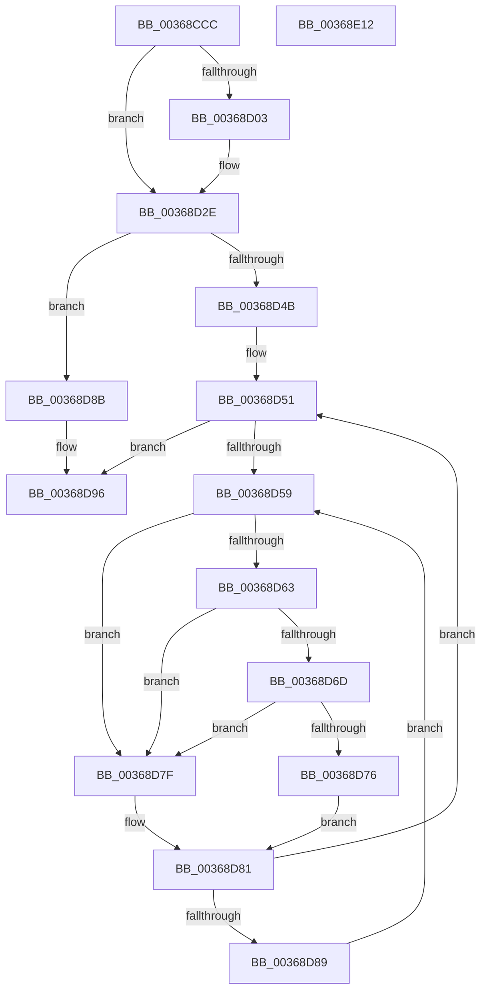

# MiDeleteEnclavePage

- RVA: `0x00368CCC`–`0x00368E13` (길이 `327` bytes)
- VA: `0x0000000140368CCC`
- 실행 섹션: `.text`
- PDB 이름 있음: `예`; PDB Function 태그: `아니요`
- unwind 정보 RVA: `0x0007A168`
- 디코드: `91`개 명령, `327/327` bytes 표시
- 미해석 바이트: `0` (있으면 어셈블리에 `.byte`로 보존)

> 이 문서는 커널 이미지의 기계어와 PDB 기호를 분석해 생성했습니다. 4번과 5번은 함수 원형과 자료형을 바이너리 사용 방식에서 추정한 C 해석이며 원본 소스 복구 결과는 아닙니다.

## 1. Dependencies

- 직접 호출 지점: **7**; 고유 호출 대상: **7**
- 직접 호출자로 확인된 함수: **2**
- RIP 상대 이미지 참조: **3**

### Outgoing calls
- `0x00368D29` → [MiUpdateAwePageTable](MiUpdateAwePageTable_function_00368730.md) (function, `0x00368730`)
- `0x00368D6D` → [KiCheckVpBackingLongSpinWaitHypercall](../30/KiCheckVpBackingLongSpinWaitHypercall_function_0030F490.md) (function, `0x0030F490`)
- `0x00368D78` → [HvlNotifyLongSpinWait](../30/HvlNotifyLongSpinWait_function_0030F460.md) (function, `0x0030F460`)
- `0x00368D8E` → [MiLockPageInline](../31/MiLockPageInline_function_0031A340.md) (function, `0x0031A340`)
- `0x00368DAF` → [MiSetPfnModified](MiSetPfnModified_function_00362960.md) (function, `0x00362960`)
- `0x00368DF1` → [MiInsertPageInFreeOrZeroedList](../33/MiInsertPageInFreeOrZeroedList_function_00334D20.md) (function, `0x00334D20`)
- `0x00368DFC` → [MiUnlockPage](../31/MiUnlockPage_function_0031A3E0.md) (function, `0x0031A3E0`)

### Direct callers
- [MiDecommitHardwareEnclavePages](MiDecommitHardwareEnclavePages_function_003688D4.md) at `0x00368A1D`
- [MiDeleteEnclavePages](../../pagelk/B7/MiDeleteEnclavePages_function_00B7E228.md) at `0x00B7E2D3`

### Static image references
- `0x00368CF5` → RVA `0x00010880` (`.rdata`; read)
- `0x00368D5B` → RVA `0x00FC52AC` (`ALMOSTRO`; reference)
- `0x00368D63` → RVA `0x00FC6AB8` (`ALMOSTRO`; read)

## 2. Other-region calls and transfers

- 다른 실행 섹션으로 향하는 call: **0**
- 별도 외부 분기/꼬리 이동을 확인하지 못했습니다.

## 3. Assembly (complete function range)

```asm
00368CCC  48 89 5C 24 08                  mov qword ptr [rsp + 8], rbx
00368CD1  55                              push rbp
00368CD2  56                              push rsi
00368CD3  57                              push rdi
00368CD4  41 56                           push r14
00368CD6  41 57                           push r15
00368CD8  48 83 EC 20                     sub rsp, 0x20
00368CDC  48 8B 19                        mov rbx, qword ptr [rcx]
00368CDF  48 B8 FF FF FF FF FF 00 00 00   movabs rax, 0xffffffffff
00368CE9  48 C1 EB 0C                     shr rbx, 0xc
00368CED  45 33 FF                        xor r15d, r15d
00368CF0  48 23 D8                        and rbx, rax
00368CF3  8B EA                           mov ebp, edx
00368CF5  48 8B 05 84 7B CA FF            mov rax, qword ptr [rip - 0x35847c]
00368CFC  48 89 01                        mov qword ptr [rcx], rax
00368CFF  85 D2                           test edx, edx
00368D01  74 2B                           je 0x140368d2e
00368D03  48 C1 E9 09                     shr rcx, 9
00368D07  48 B8 F8 FF FF FF 7F 00 00 00   movabs rax, 0x7ffffffff8
00368D11  48 23 C8                        and rcx, rax
00368D14  48 B8 00 00 00 00 80 F6 FF FF   movabs rax, 0xfffff68000000000
00368D1E  48 03 C8                        add rcx, rax
00368D21  41 83 C8 FF                     or r8d, 0xffffffff
00368D25  48 83 CA FF                     or rdx, 0xffffffffffffffff
00368D29  E8 02 FA FF FF                  call 0x140368730
00368D2E  48 8D 3C 5B                     lea rdi, [rbx + rbx*2]
00368D32  48 C1 E7 04                     shl rdi, 4
00368D36  48 B8 00 00 00 00 00 DE FF FF   movabs rax, 0xffffde0000000000
00368D40  48 03 F8                        add rdi, rax
00368D43  48 8D 77 18                     lea rsi, [rdi + 0x18]
00368D47  85 ED                           test ebp, ebp
00368D49  74 40                           je 0x140368d8b
00368D4B  41 B6 11                        mov r14b, 0x11
00368D4E  41 8B EF                        mov ebp, r15d
00368D51  F0 48 0F BA 2E 3F               lock bts qword ptr [rsi], 0x3f
00368D57  73 3D                           jae 0x140368d96
00368D59  FF C5                           inc ebp
00368D5B  85 2D 4B C5 C5 00               test dword ptr [rip + 0xc5c54b], ebp
00368D61  75 1C                           jne 0x140368d7f
00368D63  8B 05 4F DD C5 00               mov eax, dword ptr [rip + 0xc5dd4f]
00368D69  A8 40                           test al, 0x40
00368D6B  74 12                           je 0x140368d7f
00368D6D  E8 1E 67 FA FF                  call 0x14030f490
00368D72  84 C0                           test al, al
00368D74  74 09                           je 0x140368d7f
00368D76  8B CD                           mov ecx, ebp
00368D78  E8 E3 66 FA FF                  call 0x14030f460
00368D7D  EB 02                           jmp 0x140368d81
00368D7F  F3 90                           pause
00368D81  48 8B 06                        mov rax, qword ptr [rsi]
00368D84  48 85 C0                        test rax, rax
00368D87  79 C8                           jns 0x140368d51
00368D89  EB CE                           jmp 0x140368d59
00368D8B  48 8B CF                        mov rcx, rdi
00368D8E  E8 AD 15 FB FF                  call 0x14031a340
00368D93  44 8A F0                        mov r14b, al
00368D96  48 8B 0E                        mov rcx, qword ptr [rsi]
00368D99  48 B8 00 00 00 00 00 00 00 40   movabs rax, 0x4000000000000000
00368DA3  48 0B C8                        or rcx, rax
00368DA6  33 D2                           xor edx, edx
00368DA8  48 89 4F 18                     mov qword ptr [rdi + 0x18], rcx
00368DAC  48 8B CF                        mov rcx, rdi
00368DAF  E8 AC 9B FF FF                  call 0x140362960
00368DB4  48 8B 06                        mov rax, qword ptr [rsi]
00368DB7  48 8B CB                        mov rcx, rbx
00368DBA  48 8D 50 FF                     lea rdx, [rax - 1]
00368DBE  4C 8B C2                        mov r8, rdx
00368DC1  4C 33 C0                        xor r8, rax
00368DC4  48 B8 00 00 00 00 00 00 00 C0   movabs rax, 0xc000000000000000
00368DCE  4C 23 C0                        and r8, rax
00368DD1  4C 33 C2                        xor r8, rdx
00368DD4  BA 00 01 00 00                  mov edx, 0x100
00368DD9  4C 89 47 18                     mov qword ptr [rdi + 0x18], r8
00368DDD  8B 47 20                        mov eax, dword ptr [rdi + 0x20]
00368DE0  89 44 24 58                     mov dword ptr [rsp + 0x58], eax
00368DE4  66 44 89 7C 24 58               mov word ptr [rsp + 0x58], r15w
00368DEA  8B 44 24 58                     mov eax, dword ptr [rsp + 0x58]
00368DEE  89 47 20                        mov dword ptr [rdi + 0x20], eax
00368DF1  E8 2A BF FC FF                  call 0x140334d20
00368DF6  41 8A D6                        mov dl, r14b
00368DF9  48 8B CF                        mov rcx, rdi
00368DFC  E8 DF 15 FB FF                  call 0x14031a3e0
00368E01  48 8B 5C 24 50                  mov rbx, qword ptr [rsp + 0x50]
00368E06  48 83 C4 20                     add rsp, 0x20
00368E0A  41 5F                           pop r15
00368E0C  41 5E                           pop r14
00368E0E  5F                              pop rdi
00368E0F  5E                              pop rsi
00368E10  5D                              pop rbp
00368E11  C3                              ret
00368E12  CC                              int3
```

## 4. C-style interpretation (structured pseudocode)

```c
__int64 __fastcall MiDeleteEnclavePage(__int64 a1, __int64 a2, int a3)
{
    __int64 result;
    __int64 v_r15;
    __int64 v_rbp;
    __int64 v_rbx;
    __int64 v_rdi;
    __int64 v_rsp;
    unsigned int v_stack_p10;
    unsigned __int64 v_stack_p8;

    v_stack_p8 = v_rbx;
    v_rsp = (v_rsp) - (32);
    v_rbx = (*(unsigned __int64 *)(a1)) >> (12);
    v_r15 = 0;
    v_rbx = (v_rbx) & (result);
    *(unsigned __int64 *)(a1) = *(unsigned __int64 *)(v_rip - 3507324);
    result = *(unsigned __int64 *)(v_rip - 3507324);
    if ((unsigned int)(a2) != 0) {
        a1 = (a1) >> (9);
        a1 = (a1) & (*(unsigned __int64 *)(v_rip - 3507324));
        a1 = (a1) + (*(unsigned __int64 *)(v_rip - 3507324));
        a3 = (unsigned int)((a3) | (0xFFFFFFFFULL));
        a2 = (a2) | (-1);
        result = MiUpdateAwePageTable(a1, a2, a3, a4);
    }
    v_rdi = (v_rbx + v_rbx * 2) << (4);
    v_rdi = (v_rdi) + (result);
    if ((unsigned int)((unsigned int)((unsigned int)(a2))) == 0) goto loc_00368D8B;
loc_00368D51:
    if (condition_is_above_or_equal) goto loc_00368D96;
loc_00368D59:
    v_rbp = (unsigned int)((0) + 1);
    if (((*(unsigned int *)(v_rip + 12961099)) & ((unsigned int)(v_rbp))) != 0) goto loc_00368D7F;
    if ((((unsigned __int8)((unsigned int)(*(unsigned int *)(v_rip + 12967247)))) & (64)) == 0) goto loc_00368D7F;
    result = KiCheckVpBackingLongSpinWaitHypercall(a1, a2, a3, a4);
    if ((unsigned __int8)(result) == 0) goto loc_00368D7F;
    result = HvlNotifyLongSpinWait((unsigned int)((unsigned int)(v_rbp)), a2, a3, a4);
    goto loc_00368D81;
loc_00368D7F:
loc_00368D81:
    if (!sign_flag) goto loc_00368D51;
    goto loc_00368D59;
loc_00368D8B:
    result = MiLockPageInline(v_rdi, a2, a3, a4);
loc_00368D96:
    a1 = (*(unsigned __int64 *)(v_rdi + 24)) | (result);
    a2 = 0;
    *(unsigned __int64 *)(v_rdi + 24) = a1;
    result = MiSetPfnModified(v_rdi, a2, a3, a4);
    a3 = (*(unsigned __int64 *)(v_rdi + 24) - 1) ^ (*(unsigned __int64 *)(v_rdi + 24));
    a3 = (a3) & (*(unsigned __int64 *)(v_rdi + 24));
    a3 = (a3) ^ (*(unsigned __int64 *)(v_rdi + 24) - 1);
    *(unsigned __int64 *)(v_rdi + 24) = a3;
    v_stack_p10 = (unsigned int)((unsigned int)(*(unsigned int *)(v_rdi + 32)));
    v_stack_p10 = 0;
    *(unsigned int *)(v_rdi + 32) = (unsigned int)((unsigned int)(v_stack_p10));
    result = MiInsertPageInFreeOrZeroedList(v_rbx, 256, a3, a4);
    result = MiUnlockPage(v_rdi, (unsigned __int8)((unsigned __int8)(result)), a3, a4);
    v_rsp = (v_rsp) + (32);
    return result;
}
```

## 5. (Beta) C Style

```c
int64_t MiDeleteEnclavePage(void *Arg1, int64_t Arg2, int32_t Arg3)
{
    uint8_t *arg1 = (uint8_t *)Arg1;

    int64_t result;
    int64_t local_r15;
    int64_t local_rbp;
    int64_t local_rbx;
    int64_t local_rdi;
    int64_t local_rsp;
    uint32_t v_stack_p10;
    uint64_t v_stack_p8;

    v_stack_p8 = local_rbx;
    local_rsp = (local_rsp) - (32);
    local_rbx = (*(uint64_t *)(arg1)) >> (12);
    local_r15 = 0;
    local_rbx = (local_rbx) & (result);
    *(uint64_t *)(arg1) = *(uint64_t *)(v_rip - 0x35847C);
    result = *(uint64_t *)(v_rip - 0x35847C);
    if ((uint32_t)(Arg2) != 0) {
        Arg1 = (Arg1) >> (9);
        Arg1 = (Arg1) & (*(uint64_t *)(v_rip - 0x35847C));
        Arg1 = (Arg1) + (*(uint64_t *)(v_rip - 0x35847C));
        Arg3 = (uint32_t)((Arg3) | (0xFFFFFFFFULL));
        Arg2 = (Arg2) | (-1);
        result = MiUpdateAwePageTable(Arg1, Arg2, Arg3, a4);
    }
    local_rdi = (local_rbx + local_rbx * 2) << (4);
    local_rdi = (local_rdi) + (result);
    if ((uint32_t)((uint32_t)((uint32_t)(Arg2))) == 0) goto loc_00368D8B;
loc_00368D51:
    if (condition_is_above_or_equal) goto loc_00368D96;
loc_00368D59:
    local_rbp = (uint32_t)((0) + 1);
    if (((*(uint32_t *)(v_rip + 0xC5C54B)) & ((uint32_t)(local_rbp))) != 0) goto loc_00368D7F;
    if ((((uint8_t)((uint32_t)(*(uint32_t *)(v_rip + 0xC5DD4F)))) & (64)) == 0) goto loc_00368D7F;
    result = KiCheckVpBackingLongSpinWaitHypercall(Arg1, Arg2, Arg3, a4);
    if ((uint8_t)(result) == 0) goto loc_00368D7F;
    result = HvlNotifyLongSpinWait((uint32_t)((uint32_t)(local_rbp)), Arg2, Arg3, a4);
    goto loc_00368D81;
loc_00368D7F:
loc_00368D81:
    if (!sign_flag) goto loc_00368D51;
    goto loc_00368D59;
loc_00368D8B:
    result = MiLockPageInline(local_rdi, Arg2, Arg3, a4);
loc_00368D96:
    Arg1 = (*(uint64_t *)(local_rdi + 0x18)) | (result);
    Arg2 = 0;
    *(void **)(local_rdi + 0x18) = Arg1;
    result = MiSetPfnModified(local_rdi, Arg2, Arg3, a4);
    Arg3 = (*(uint64_t *)(local_rdi + 0x18) - 1) ^ (*(uint64_t *)(local_rdi + 0x18));
    Arg3 = (Arg3) & (*(uint64_t *)(local_rdi + 0x18));
    Arg3 = (Arg3) ^ (*(uint64_t *)(local_rdi + 0x18) - 1);
    *(uint64_t *)(local_rdi + 0x18) = Arg3;
    v_stack_p10 = (uint32_t)((uint32_t)(*(uint32_t *)(local_rdi + 0x20)));
    v_stack_p10 = 0;
    *(uint32_t *)(local_rdi + 0x20) = (uint32_t)((uint32_t)(v_stack_p10));
    result = MiInsertPageInFreeOrZeroedList(local_rbx, 256, Arg3, a4);
    result = MiUnlockPage(local_rdi, (uint8_t)((uint8_t)(result)), Arg3, a4);
    local_rsp = (local_rsp) + (32);
    return result;
}
```

### 관측된 메모리 오프셋

구조체 형식이 확인되지 않은 접근은 인자 기준의 오프셋으로만 기록했습니다.

| 기준 인자 | 오프셋 표현 | 폭 (bit) | 접근 |
|---|---:|---:|---|
| `Arg1` | `+ 0x0` | `64` | `R` |
| `Arg1` | `+ 0x0` | `64` | `W` |

## 6. Execution-region graph

[열기: 2D/3D 그래프와 함수 탐색 컨트롤 패널](../../../control-panel.html?section=text&rva=0x00368CCC&view=graph)

- 2D 그래프는 위에서 아래로 흐르고, 3D 그래프는 빈 공간을 드래그해 회전합니다. Shift+드래그는 이동, 휠은 확대·축소, 함수 노드 선택은 대상 보고서 이동입니다.

### Static fallback


