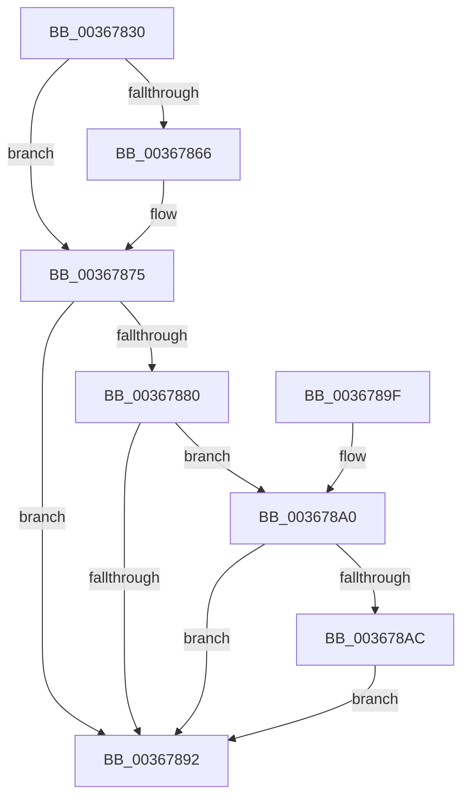

# MiDeleteSystemPageTableTail

- RVA: `0x00367830`–`0x003678DA` (길이 `170` bytes)
- VA: `0x0000000140367830`
- 실행 섹션: `.text`
- PDB 이름 있음: `예`; PDB Function 태그: `아니요`
- unwind 정보 RVA: `0x00079FE8`
- 디코드: `43`개 명령, `170/170` bytes 표시
- 미해석 바이트: `0` (있으면 어셈블리에 `.byte`로 보존)

> 이 문서는 커널 이미지의 기계어와 PDB 기호를 분석해 생성했습니다. 4번과 5번은 함수 원형과 자료형을 바이너리 사용 방식에서 추정한 C 해석이며 원본 소스 복구 결과는 아닙니다.

## 1. Dependencies

- 직접 호출 지점: **4**; 고유 호출 대상: **4**
- 직접 호출자로 확인된 함수: **0**
- RIP 상대 이미지 참조: **2**

### Outgoing calls
- `0x00367866` → [MiFlushTbList](../31/MiFlushTbList_function_00311FC0.md) (function, `0x00311FC0`)
- `0x0036786B` → [MiReleaseProcessorFlushList](../31/MiReleaseProcessorFlushList_function_00313C70.md) (function, `0x00313C70`)
- `0x00367885` → [MiFreeUnmappedPageTables](MiFreeUnmappedPageTables_function_003678E0.md) (function, `0x003678E0`)
- `0x003678D3` → [MiReturnSystemCharges](MiReturnSystemCharges_function_00367A48.md) (function, `0x00367A48`)

### Direct callers
- 이 함수 시작 RVA로 연결되는 직접 call은 확인되지 않았습니다. 간접 호출은 완전히 역산할 수 없습니다.

### Static image references
- `0x003678A0` → RVA `0x00E3D998` (`.data`; read)
- `0x003678B0` → RVA `0x00E30088` (`.data`; read)

## 2. Other-region calls and transfers

- 다른 실행 섹션으로 향하는 call: **0**
- 별도 외부 분기/꼬리 이동을 확인하지 못했습니다.

## 3. Assembly (complete function range)

```asm
00367830  48 89 5C 24 08                  mov qword ptr [rsp + 8], rbx
00367835  57                              push rdi
00367836  48 83 EC 60                     sub rsp, 0x60
0036783A  48 8B 99 B8 00 00 00            mov rbx, qword ptr [rcx + 0xb8]
00367841  0F 57 C0                        xorps xmm0, xmm0
00367844  33 C0                           xor eax, eax
00367846  48 8B F9                        mov rdi, rcx
00367849  0F 11 44 24 20                  movups xmmword ptr [rsp + 0x20], xmm0
0036784E  48 89 44 24 50                  mov qword ptr [rsp + 0x50], rax
00367853  48 8B 4B 20                     mov rcx, qword ptr [rbx + 0x20]
00367857  0F 11 44 24 30                  movups xmmword ptr [rsp + 0x30], xmm0
0036785C  0F 11 44 24 40                  movups xmmword ptr [rsp + 0x40], xmm0
00367861  48 85 C9                        test rcx, rcx
00367864  74 0F                           je 0x140367875
00367866  E8 55 A7 FA FF                  call 0x140311fc0
0036786B  E8 00 C4 FA FF                  call 0x140313c70
00367870  48 83 63 20 00                  and qword ptr [rbx + 0x20], 0
00367875  48 8D 4B 08                     lea rcx, [rbx + 8]
00367879  48 83 79 10 00                  cmp qword ptr [rcx + 0x10], 0
0036787E  74 12                           je 0x140367892
00367880  48 8D 54 24 20                  lea rdx, [rsp + 0x20]
00367885  E8 56 00 00 00                  call 0x1403678e0
0036788A  48 83 7C 24 38 00               cmp qword ptr [rsp + 0x38], 0
00367890  75 0E                           jne 0x1403678a0
00367892  48 8B 5C 24 70                  mov rbx, qword ptr [rsp + 0x70]
00367897  33 C0                           xor eax, eax
00367899  48 83 C4 60                     add rsp, 0x60
0036789D  5F                              pop rdi
0036789E  C3                              ret
0036789F  CC                              int3
003678A0  48 8B 05 F1 60 AD 00            mov rax, qword ptr [rip + 0xad60f1]
003678A7  48 85 C0                        test rax, rax
003678AA  74 E6                           je 0x140367892
003678AC  48 8B 47 20                     mov rax, qword ptr [rdi + 0x20]
003678B0  48 8B 0D D1 87 AC 00            mov rcx, qword ptr [rip + 0xac87d1]
003678B7  48 8B 54 24 38                  mov rdx, qword ptr [rsp + 0x38]
003678BC  44 8B 0B                        mov r9d, dword ptr [rbx]
003678BF  4C 8B C2                        mov r8, rdx
003678C2  44 0F B7 90 AE 00 00 00         movzx r10d, word ptr [rax + 0xae]
003678CA  4C 2B 44 24 28                  sub r8, qword ptr [rsp + 0x28]
003678CF  4A 8B 0C D1                     mov rcx, qword ptr [rcx + r10*8]
003678D3  E8 70 01 00 00                  call 0x140367a48
003678D8  EB B8                           jmp 0x140367892
```

## 4. C-style interpretation (structured pseudocode)

```c
__int64 __fastcall MiDeleteSystemPageTableTail(__int64 a1)
{
    __int64 result;
    __int64 v_rsp;
    unsigned __int64 v_stack_m18;
    unsigned __int64 v_stack_m28;
    unsigned __int64 v_stack_m30;
    unsigned __int64 v_stack_m38;
    unsigned __int64 v_stack_m48;
    unsigned __int64 v_stack_p28;
    unsigned __int64 v_stack_p38;
    unsigned __int64 v_stack_p8;

    v_stack_p8 = v_rbx;
    v_rsp = (v_rsp) - (96);
    result = 0;
    v_stack_m48 = v_xmm0;
    v_stack_m18 = 0;
    v_stack_m38 = v_xmm0;
    v_stack_m28 = v_xmm0;
    if (*(unsigned __int64 *)(*(unsigned __int64 *)(a1 + 184) + 32) != 0) {
        result = MiFlushTbList(*(unsigned __int64 *)(*(unsigned __int64 *)(a1 + 184) + 32), a2, a3, a4);
        result = MiReleaseProcessorFlushList(*(unsigned __int64 *)(*(unsigned __int64 *)(a1 + 184) + 32), a2, a3, a4);
    }
    if ((*(unsigned __int64 *)(*(unsigned __int64 *)(a1 + 184) + 8 + 16)) == 0) goto loc_00367892;
    result = MiFreeUnmappedPageTables(*(unsigned __int64 *)(a1 + 184) + 8, v_stack_m48, a3, a4);
    if (v_stack_m30 != 0) goto loc_003678A0;
loc_00367892:
    result = 0;
    v_rsp = (v_rsp) + (96);
    return result;
loc_003678A0:
    if (*(unsigned __int64 *)(v_rip + 11362545) == 0) goto loc_00367892;
    a3 = (v_stack_p38) - (v_stack_p28);
    result = MiReturnSystemCharges(*(unsigned __int64 *)(*(unsigned __int64 *)(v_rip + 11306961) + *(unsigned __int16 *)(*(unsigned __int64 *)(a1 + 32) + 174) * 8), v_stack_p38, a3, (unsigned int)(*(unsigned int *)(v_stack_p8)));
    goto loc_00367892;
}
```

## 5. (Beta) C Style

```c
int64_t MiDeleteSystemPageTableTail(void *Arg1)
{
    uint8_t *arg1 = (uint8_t *)Arg1;

    int64_t result;
    int64_t local_rsp;
    uint64_t v_stack_m18;
    uint64_t v_stack_m28;
    uint64_t v_stack_m30;
    uint64_t v_stack_m38;
    uint64_t v_stack_m48;
    uint64_t v_stack_p28;
    uint64_t v_stack_p38;
    uint64_t v_stack_p8;

    v_stack_p8 = local_rbx;
    local_rsp = (local_rsp) - (96);
    result = 0;
    v_stack_m48 = v_xmm0;
    v_stack_m18 = 0;
    v_stack_m38 = v_xmm0;
    v_stack_m28 = v_xmm0;
    if (*(uint64_t *)(*(uint64_t *)(arg1 + 0xB8) + 0x20) != 0) {
        result = MiFlushTbList(*(uint64_t *)(*(uint64_t *)(arg1 + 0xB8) + 0x20), a2, a3, a4);
        result = MiReleaseProcessorFlushList(*(uint64_t *)(*(uint64_t *)(arg1 + 0xB8) + 0x20), a2, a3, a4);
    }
    if ((*(uint64_t *)(*(uint64_t *)(arg1 + 0xB8) + 0x8 + 0x10)) == 0) goto loc_00367892;
    result = MiFreeUnmappedPageTables(*(uint64_t *)(arg1 + 0xB8) + 8, v_stack_m48, a3, a4);
    if (v_stack_m30 != 0) goto loc_003678A0;
loc_00367892:
    result = 0;
    local_rsp = (local_rsp) + (96);
    return result;
loc_003678A0:
    if (*(uint64_t *)(v_rip + 0xAD60F1) == 0) goto loc_00367892;
    a3 = (v_stack_p38) - (v_stack_p28);
    result = MiReturnSystemCharges(*(uint64_t *)(*(uint64_t *)(v_rip + 0xAC87D1) + *(uint16_t *)(*(uint64_t *)(arg1 + 0x20) + 0xAE) * 8), v_stack_p38, a3, (uint32_t)(*(uint32_t *)(v_stack_p8)));
    goto loc_00367892;
}
```

### 관측된 메모리 오프셋

구조체 형식이 확인되지 않은 접근은 인자 기준의 오프셋으로만 기록했습니다.

| 기준 인자 | 오프셋 표현 | 폭 (bit) | 접근 |
|---|---:|---:|---|
| `Arg1` | `+ 0x20` | `64` | `R` |
| `Arg1` | `+ 0xB8` | `64` | `R` |

## 6. Execution-region graph

[열기: 2D/3D 그래프와 함수 탐색 컨트롤 패널](../../../control-panel.html?section=text&rva=0x00367830&view=graph)

- 2D 그래프는 위에서 아래로 흐르고, 3D 그래프는 빈 공간을 드래그해 회전합니다. Shift+드래그는 이동, 휠은 확대·축소, 함수 노드 선택은 대상 보고서 이동입니다.

### Static fallback


