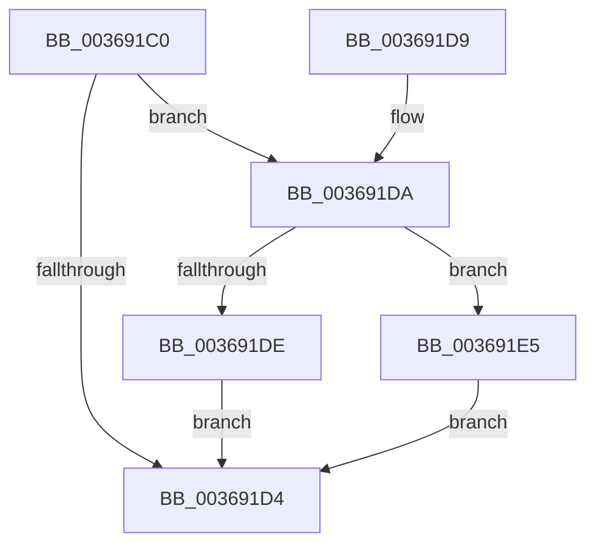

# MiDereferenceControlAreaProbe

- RVA: `0x003691C0`–`0x003691EC` (길이 `44` bytes)
- VA: `0x00000001403691C0`
- 실행 섹션: `.text`
- PDB 이름 있음: `예`; PDB Function 태그: `아니요`
- unwind 정보 RVA: `0x0007A1AC`
- 디코드: `14`개 명령, `44/44` bytes 표시
- 미해석 바이트: `0` (있으면 어셈블리에 `.byte`로 보존)

> 이 문서는 커널 이미지의 기계어와 PDB 기호를 분석해 생성했습니다. 4번과 5번은 함수 원형과 자료형을 바이너리 사용 방식에서 추정한 C 해석이며 원본 소스 복구 결과는 아닙니다.

## 1. Dependencies

- 직접 호출 지점: **2**; 고유 호출 대상: **2**
- 직접 호출자로 확인된 함수: **2**
- RIP 상대 이미지 참조: **0**

### Outgoing calls
- `0x003691DE` → [MiDeleteControlArea](MiDeleteControlArea_function_003691F4.md) (function, `0x003691F4`)
- `0x003691E5` → [MiQueueControlAreaDelete](MiQueueControlAreaDelete_function_00369018.md) (function, `0x00369018`)

### Direct callers
- [MiProbeUnlockPage](../24/MiProbeUnlockPage_function_00243860.md) at `0x00243BC6`
- [MiSegmentDelete](../../page/A1/MiSegmentDelete_function_00A1FBB4.md) at `0x00A1FC6A`

### Static image references
- 디코드된 RIP-relative 메모리 참조가 없습니다.

## 2. Other-region calls and transfers

- 다른 실행 섹션으로 향하는 call: **0**
- 별도 외부 분기/꼬리 이동을 확인하지 못했습니다.

## 3. Assembly (complete function range)

```asm
003691C0  48 83 EC 28                     sub rsp, 0x28
003691C4  48 83 C8 FF                     or rax, 0xffffffffffffffff
003691C8  F0 48 0F C1 41 70               lock xadd qword ptr [rcx + 0x70], rax
003691CE  48 83 F8 01                     cmp rax, 1
003691D2  74 06                           je 0x1403691da
003691D4  48 83 C4 28                     add rsp, 0x28
003691D8  C3                              ret
003691D9  CC                              int3
003691DA  85 D2                           test edx, edx
003691DC  75 07                           jne 0x1403691e5
003691DE  E8 11 00 00 00                  call 0x1403691f4
003691E3  EB EF                           jmp 0x1403691d4
003691E5  E8 2E FE FF FF                  call 0x140369018
003691EA  EB E8                           jmp 0x1403691d4
```

## 4. C-style interpretation (structured pseudocode)

```c
__int64 __fastcall MiDereferenceControlAreaProbe(__int64 a1, int a2)
{
    __int64 result;
    __int64 v_rsp;

    v_rsp = (v_rsp) - (40);
    result = (result) | (-1);
    if (result == 1) goto loc_003691DA;
loc_003691D4:
    v_rsp = (v_rsp) + (40);
    return result;
loc_003691DA:
    if (a2 != 0) goto loc_003691E5;
    result = MiDeleteControlArea(a1, a2, a3, a4);
    goto loc_003691D4;
loc_003691E5:
    result = MiQueueControlAreaDelete(a1, a2, a3, a4);
    goto loc_003691D4;
}
```

## 5. (Beta) C Style

```c
int64_t MiDereferenceControlAreaProbe(void *Arg1, int32_t Arg2)
{
    uint8_t *arg1 = (uint8_t *)Arg1;

    int64_t result;
    int64_t local_rsp;

    local_rsp = (local_rsp) - (40);
    result = (result) | (-1);
    if (result == 1) goto loc_003691DA;
loc_003691D4:
    local_rsp = (local_rsp) + (40);
    return result;
loc_003691DA:
    if (Arg2 != 0) goto loc_003691E5;
    result = MiDeleteControlArea(Arg1, Arg2, a3, a4);
    goto loc_003691D4;
loc_003691E5:
    result = MiQueueControlAreaDelete(Arg1, Arg2, a3, a4);
    goto loc_003691D4;
}
```

### 관측된 메모리 오프셋

구조체 형식이 확인되지 않은 접근은 인자 기준의 오프셋으로만 기록했습니다.

| 기준 인자 | 오프셋 표현 | 폭 (bit) | 접근 |
|---|---:|---:|---|
| `Arg1` | `+ 0x70` | `64` | `R/W` |

## 6. Execution-region graph

[열기: 2D/3D 그래프와 함수 탐색 컨트롤 패널](../../../control-panel.html?section=text&rva=0x003691C0&view=graph)

- 2D 그래프는 위에서 아래로 흐르고, 3D 그래프는 빈 공간을 드래그해 회전합니다. Shift+드래그는 이동, 휠은 확대·축소, 함수 노드 선택은 대상 보고서 이동입니다.

### Static fallback


