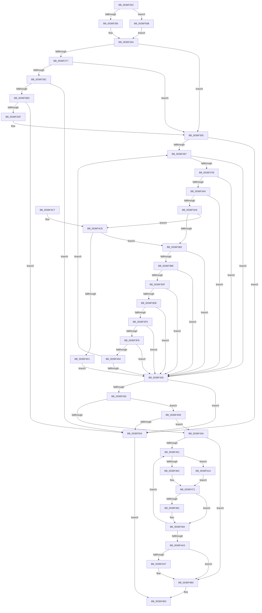

# MiExpandSharedZeroCluster

- RVA: `0x0036F20C`–`0x0036F527` (길이 `795` bytes)
- VA: `0x000000014036F20C`
- 실행 섹션: `.text`
- PDB 이름 있음: `예`; PDB Function 태그: `아니요`
- unwind 정보 RVA: `0x0007A66C`
- 디코드: `206`개 명령, `795/795` bytes 표시
- 미해석 바이트: `0` (있으면 어셈블리에 `.byte`로 보존)

> 이 문서는 커널 이미지의 기계어와 PDB 기호를 분석해 생성했습니다. 4번과 5번은 함수 원형과 자료형을 바이너리 사용 방식에서 추정한 C 해석이며 원본 소스 복구 결과는 아닙니다.

## 1. Dependencies

- 직접 호출 지점: **11**; 고유 호출 대상: **9**
- 직접 호출자로 확인된 함수: **1**
- RIP 상대 이미지 참조: **1**

### Outgoing calls
- `0x0036F232` → [memset](../6C/memset_function_006C6C40.md) (function, `0x006C6C40`)
- `0x0036F31F` → [MiComputeZeroClusterMaximum](../44/MiComputeZeroClusterMaximum_function_0044B15C.md) (function, `0x0044B15C`)
- `0x0036F36E` → [MiIsPteEvaluated](../32/MiIsPteEvaluated_function_0032A36C.md) (function, `0x0032A36C`)
- `0x0036F38A` → [MiGetProtoPteAddress](../32/MiGetProtoPteAddress_function_0032E970.md) (function, `0x0032E970`)
- `0x0036F3E2` → [MI_READ_PTE_LOCK_FREE](../28/MI_READ_PTE_LOCK_FREE_function_002828A0.md) (function, `0x002828A0`)
- `0x0036F3FB` → [MiGetPagingFileOffset](MiGetPagingFileOffset_function_0036F530.md) (function, `0x0036F530`)
- `0x0036F457` → [MI_READ_PTE_LOCK_FREE](../28/MI_READ_PTE_LOCK_FREE_function_002828A0.md) (function, `0x002828A0`)
- `0x0036F46C` → [MiMakePrototypePteVadLookup](../2C/MiMakePrototypePteVadLookup_function_002C3480.md) (function, `0x002C3480`)
- `0x0036F477` → [MI_READ_PTE_LOCK_FREE](../28/MI_READ_PTE_LOCK_FREE_function_002828A0.md) (function, `0x002828A0`)
- `0x0036F4AB` → [MiUpdatePageTableUseCount](../3D/MiUpdatePageTableUseCount_function_003D34F0.md) (function, `0x003D34F0`)
- `0x0036F51D` → [MiMakePrototypePteDirect](../29/MiMakePrototypePteDirect_function_00294DE0.md) (function, `0x00294DE0`)

### Direct callers
- [sub_002B5FA0](../2B/Unknown_function_002B5FA0.md) at `0x002B5FCE`

### Static image references
- `0x0036F27B` → RVA `0x00014578` (`.rdata`; read)

## 2. Other-region calls and transfers

- 다른 실행 섹션으로 향하는 call: **0**
- 별도 외부 분기/꼬리 이동을 확인하지 못했습니다.

## 3. Assembly (complete function range)

```asm
0036F20C  40 55                           push rbp
0036F20E  53                              push rbx
0036F20F  56                              push rsi
0036F210  57                              push rdi
0036F211  41 54                           push r12
0036F213  41 55                           push r13
0036F215  41 56                           push r14
0036F217  41 57                           push r15
0036F219  48 8D 6C 24 E1                  lea rbp, [rsp - 0x1f]
0036F21E  48 81 EC C8 00 00 00            sub rsp, 0xc8
0036F225  33 D2                           xor edx, edx
0036F227  4C 8B E9                        mov r13, rcx
0036F22A  48 8D 4D 97                     lea rcx, [rbp - 0x69]
0036F22E  44 8D 42 78                     lea r8d, [rdx + 0x78]
0036F232  E8 09 7A 35 00                  call 0x1406c6c40
0036F237  49 8B 7D 40                     mov rdi, qword ptr [r13 + 0x40]
0036F23B  45 33 FF                        xor r15d, r15d
0036F23E  49 8B 5D 10                     mov rbx, qword ptr [r13 + 0x10]
0036F242  0F 57 C0                        xorps xmm0, xmm0
0036F245  49 8B 4D 38                     mov rcx, qword ptr [r13 + 0x38]
0036F249  0F 11 45 87                     movups xmmword ptr [rbp - 0x79], xmm0
0036F24D  48 8B 77 78                     mov rsi, qword ptr [rdi + 0x78]
0036F251  4C 89 7D 77                     mov qword ptr [rbp + 0x77], r15
0036F255  44 88 7D 67                     mov byte ptr [rbp + 0x67], r15b
0036F259  48 89 5D 7F                     mov qword ptr [rbp + 0x7f], rbx
0036F25D  48 85 F6                        test rsi, rsi
0036F260  0F 88 A5 02 00 00               js 0x14036f50b
0036F266  48 83 CE FF                     or rsi, 0xffffffffffffffff
0036F26A  8B 47 30                        mov eax, dword ptr [rdi + 0x30]
0036F26D  0F BA E0 15                     bt eax, 0x15
0036F271  0F 82 8E 00 00 00               jb 0x14036f305
0036F277  48 C1 E8 13                     shr rax, 0x13
0036F27B  48 8D 15 F6 52 CA FF            lea rdx, [rip - 0x35ad0a]
0036F282  83 E0 03                        and eax, 3
0036F285  48 83 3C C2 10                  cmp qword ptr [rdx + rax*8], 0x10
0036F28A  75 79                           jne 0x14036f305
0036F28C  48 81 E3 00 00 FF FF            and rbx, 0xffffffffffff0000
0036F293  48 C7 45 8F 00 00 01 00         mov qword ptr [rbp - 0x71], 0x10000
0036F29B  48 89 5D 87                     mov qword ptr [rbp - 0x79], rbx
0036F29F  8B 47 18                        mov eax, dword ptr [rdi + 0x18]
0036F2A2  0F B6 4F 20                     movzx ecx, byte ptr [rdi + 0x20]
0036F2A6  48 C1 E1 20                     shl rcx, 0x20
0036F2AA  48 0B C8                        or rcx, rax
0036F2AD  48 8B C3                        mov rax, rbx
0036F2B0  48 C1 E8 0C                     shr rax, 0xc
0036F2B4  48 3B C1                        cmp rax, rcx
0036F2B7  0F 82 47 02 00 00               jb 0x14036f504
0036F2BD  8B 47 1C                        mov eax, dword ptr [rdi + 0x1c]
0036F2C0  0F B6 4F 21                     movzx ecx, byte ptr [rdi + 0x21]
0036F2C4  48 C1 E1 20                     shl rcx, 0x20
0036F2C8  48 0B C8                        or rcx, rax
0036F2CB  48 8D 83 FF FF 00 00            lea rax, [rbx + 0xffff]
0036F2D2  48 C1 E8 0C                     shr rax, 0xc
0036F2D6  48 3B C1                        cmp rax, rcx
0036F2D9  0F 87 25 02 00 00               ja 0x14036f504
0036F2DF  48 8D 45 87                     lea rax, [rbp - 0x79]
0036F2E3  66 C7 45 97 02 00               mov word ptr [rbp - 0x69], 2
0036F2E9  48 89 45 9F                     mov qword ptr [rbp - 0x61], rax
0036F2ED  48 8D 4D 97                     lea rcx, [rbp - 0x69]
0036F2F1  48 C7 45 A7 01 00 00 00         mov qword ptr [rbp - 0x59], 1
0036F2F9  4C 89 7D AF                     mov qword ptr [rbp - 0x51], r15
0036F2FD  4C 89 7D B7                     mov qword ptr [rbp - 0x49], r15
0036F301  C6 45 67 01                     mov byte ptr [rbp + 0x67], 1
0036F305  65 48 8B 04 25 88 01 00 00      mov rax, qword ptr gs:[0x188]
0036F30E  4C 8B C7                        mov r8, rdi
0036F311  48 8B 90 B8 00 00 00            mov rdx, qword ptr [rax + 0xb8]
0036F318  48 81 C2 00 04 00 00            add rdx, 0x400
0036F31F  E8 38 BE 0D 00                  call 0x14044b15c
0036F324  48 8B C8                        mov rcx, rax
0036F327  48 89 44 24 28                  mov qword ptr [rsp + 0x28], rax
0036F32C  48 8B C3                        mov rax, rbx
0036F32F  4D 8B F7                        mov r14, r15
0036F332  48 C1 E8 0C                     shr rax, 0xc
0036F336  4D 8B E7                        mov r12, r15
0036F339  48 89 45 6F                     mov qword ptr [rbp + 0x6f], rax
0036F33D  48 B8 F8 FF FF FF 7F 00 00 00   movabs rax, 0x7ffffffff8
0036F347  48 C1 EB 09                     shr rbx, 9
0036F34B  48 23 D8                        and rbx, rax
0036F34E  48 B8 00 00 00 00 80 F6 FF FF   movabs rax, 0xfffff68000000000
0036F358  48 8B C0                        mov rax, rax
0036F35B  48 03 D8                        add rbx, rax
0036F35E  48 85 C9                        test rcx, rcx
0036F361  0F 84 9D 01 00 00               je 0x14036f504
0036F367  41 8B 55 20                     mov edx, dword ptr [r13 + 0x20]
0036F36B  48 8B CB                        mov rcx, rbx
0036F36E  E8 F9 AF FB FF                  call 0x14032a36c
0036F373  85 C0                           test eax, eax
0036F375  0F 85 AB 00 00 00               jne 0x14036f426
0036F37B  48 8B 55 6F                     mov rdx, qword ptr [rbp + 0x6f]
0036F37F  4C 8D 4D 77                     lea r9, [rbp + 0x77]
0036F383  44 8D 40 0C                     lea r8d, [rax + 0xc]
0036F387  48 8B CF                        mov rcx, rdi
0036F38A  E8 E1 F5 FB FF                  call 0x14032e970
0036F38F  48 89 44 24 20                  mov qword ptr [rsp + 0x20], rax
0036F394  48 8B D0                        mov rdx, rax
0036F397  48 85 C0                        test rax, rax
0036F39A  0F 84 86 00 00 00               je 0x14036f426
0036F3A0  48 8B 4D 77                     mov rcx, qword ptr [rbp + 0x77]
0036F3A4  48 85 C9                        test rcx, rcx
0036F3A7  74 7D                           je 0x14036f426
0036F3A9  4D 85 E4                        test r12, r12
0036F3AC  0F 85 16 01 00 00               jne 0x14036f4c8
0036F3B2  49 33 45 18                     xor rax, qword ptr [r13 + 0x18]
0036F3B6  48 A9 00 F0 FF FF               test rax, -0x1000
0036F3BC  75 68                           jne 0x14036f426
0036F3BE  8B 47 18                        mov eax, dword ptr [rdi + 0x18]
0036F3C1  4D 85 E4                        test r12, r12
0036F3C4  4C 0F 44 E1                     cmove r12, rcx
0036F3C8  0F B6 4F 20                     movzx ecx, byte ptr [rdi + 0x20]
0036F3CC  48 C1 E1 20                     shl rcx, 0x20
0036F3D0  48 0B C8                        or rcx, rax
0036F3D3  48 8B 45 6F                     mov rax, qword ptr [rbp + 0x6f]
0036F3D7  48 2B C1                        sub rax, rcx
0036F3DA  48 3B C6                        cmp rax, rsi
0036F3DD  77 47                           ja 0x14036f426
0036F3DF  48 8B CA                        mov rcx, rdx
0036F3E2  E8 B9 34 F1 FF                  call 0x1402828a0
0036F3E7  A8 01                           test al, 1
0036F3E9  75 3B                           jne 0x14036f426
0036F3EB  48 85 C0                        test rax, rax
0036F3EE  74 36                           je 0x14036f426
0036F3F0  48 A9 00 0C 00 00               test rax, 0xc00
0036F3F6  75 2E                           jne 0x14036f426
0036F3F8  48 8B C8                        mov rcx, rax
0036F3FB  E8 30 01 00 00                  call 0x14036f530
0036F400  85 C0                           test eax, eax
0036F402  75 22                           jne 0x14036f426
0036F404  45 85 FF                        test r15d, r15d
0036F407  4C 0F 44 74 24 20               cmove r14, qword ptr [rsp + 0x20]
0036F40D  41 FF C7                        inc r15d
0036F410  48 FF 45 6F                     inc qword ptr [rbp + 0x6f]
0036F414  48 83 C3 08                     add rbx, 8
0036F418  41 8B C7                        mov eax, r15d
0036F41B  48 3B 44 24 28                  cmp rax, qword ptr [rsp + 0x28]
0036F420  0F 82 41 FF FF FF               jb 0x14036f367
0036F426  41 83 FF 01                     cmp r15d, 1
0036F42A  0F 86 D4 00 00 00               jbe 0x14036f504
0036F430  80 7D 67 00                     cmp byte ptr [rbp + 0x67], 0
0036F434  0F 85 9C 00 00 00               jne 0x14036f4d6
0036F43A  41 8B C7                        mov eax, r15d
0036F43D  33 D2                           xor edx, edx
0036F43F  48 F7 D8                        neg rax
0036F442  41 8B FF                        mov edi, r15d
0036F445  45 33 FF                        xor r15d, r15d
0036F448  48 8D 34 C3                     lea rsi, [rbx + rax*8]
0036F44C  48 85 FF                        test rdi, rdi
0036F44F  74 5F                           je 0x14036f4b0
0036F451  49 8B CE                        mov rcx, r14
0036F454  44 8B E2                        mov r12d, edx
0036F457  E8 44 34 F1 FF                  call 0x1402828a0
0036F45C  41 8B 4D 20                     mov ecx, dword ptr [r13 + 0x20]
0036F460  81 F9 00 01 00 00               cmp ecx, 0x100
0036F466  0F 84 AE 00 00 00               je 0x14036f51a
0036F46C  E8 0F 40 F5 FF                  call 0x1402c3480
0036F471  48 8B CE                        mov rcx, rsi
0036F474  48 8B D8                        mov rbx, rax
0036F477  E8 24 34 F1 FF                  call 0x1402828a0
0036F47C  48 85 C0                        test rax, rax
0036F47F  75 03                           jne 0x14036f484
0036F481  48 89 1E                        mov qword ptr [rsi], rbx
0036F484  48 85 C0                        test rax, rax
0036F487  41 8D 54 24 01                  lea edx, [r12 + 1]
0036F48C  41 0F 45 D4                     cmovne edx, r12d
0036F490  41 FF C7                        inc r15d
0036F493  41 8B C7                        mov eax, r15d
0036F496  48 83 C6 08                     add rsi, 8
0036F49A  49 83 C6 08                     add r14, 8
0036F49E  48 3B C7                        cmp rax, rdi
0036F4A1  72 AE                           jb 0x14036f451
0036F4A3  85 D2                           test edx, edx
0036F4A5  74 09                           je 0x14036f4b0
0036F4A7  48 8B 4D 7F                     mov rcx, qword ptr [rbp + 0x7f]
0036F4AB  E8 40 40 06 00                  call 0x1403d34f0
0036F4B0  48 8B C7                        mov rax, rdi
0036F4B3  48 81 C4 C8 00 00 00            add rsp, 0xc8
0036F4BA  41 5F                           pop r15
0036F4BC  41 5E                           pop r14
0036F4BE  41 5D                           pop r13
0036F4C0  41 5C                           pop r12
0036F4C2  5F                              pop rdi
0036F4C3  5E                              pop rsi
0036F4C4  5B                              pop rbx
0036F4C5  5D                              pop rbp
0036F4C6  C3                              ret
0036F4C7  CC                              int3
0036F4C8  49 3B CC                        cmp rcx, r12
0036F4CB  0F 84 E1 FE FF FF               je 0x14036f3b2
0036F4D1  E9 50 FF FF FF                  jmp 0x14036f426
0036F4D6  48 8B 4D 7F                     mov rcx, qword ptr [rbp + 0x7f]
0036F4DA  48 B8 F8 FF FF FF 7F 00 00 00   movabs rax, 0x7ffffffff8
0036F4E4  48 C1 E9 09                     shr rcx, 9
0036F4E8  48 23 C8                        and rcx, rax
0036F4EB  48 B8 00 00 00 00 80 F6 FF FF   movabs rax, 0xfffff68000000000
0036F4F5  48 8B C0                        mov rax, rax
0036F4F8  48 03 C8                        add rcx, rax
0036F4FB  48 3B D9                        cmp rbx, rcx
0036F4FE  0F 87 36 FF FF FF               ja 0x14036f43a
0036F504  B8 01 00 00 00                  mov eax, 1
0036F509  EB A8                           jmp 0x14036f4b3
0036F50B  48 8B 36                        mov rsi, qword ptr [rsi]
0036F50E  48 FF CE                        dec rsi
0036F511  48 C1 EE 0C                     shr rsi, 0xc
0036F515  E9 50 FD FF FF                  jmp 0x14036f26a
0036F51A  49 8B CE                        mov rcx, r14
0036F51D  E8 BE 58 F2 FF                  call 0x140294de0
0036F522  E9 4A FF FF FF                  jmp 0x14036f471
```

## 4. C-style interpretation (structured pseudocode)

```c
__int64 __fastcall MiExpandSharedZeroCluster(__int64 a1, int a2)
{
    __int64 result;
    __int64 v_r12;
    __int64 v_r14;
    __int64 v_r15;
    __int64 v_rbx;
    __int64 v_rsi;
    __int64 v_rsp;
    unsigned __int64 v_stack_m5F;
    unsigned __int64 v_stack_mA8;
    unsigned __int64 v_stack_mB0;
    unsigned __int64 v_stack_mB8;
    unsigned __int64 v_stack_mC0;
    unsigned __int64 v_stack_mC8;
    unsigned __int64 v_stack_mD0;
    unsigned __int64 v_stack_mD8;
    unsigned __int64 v_stack_mE0;
    unsigned __int64 v_stack_mE8;
    unsigned __int64 v_stack_p10;
    unsigned __int64 v_stack_p18;
    unsigned __int64 v_stack_p20;
    unsigned __int8 v_stack_p8;

    v_rsp = (v_rsp) - (200);
    a2 = 0;
    result = memset(v_stack_mC8, a2, a2 + 120, a4);
    v_r15 = 0;
    v_stack_mD8 = v_xmm0;
    v_stack_p18 = 0;
    v_stack_p8 = 0;
    v_stack_p20 = *(unsigned __int64 *)(a1 + 16);
    if (sign_flag) goto loc_0036F50B;
    v_rsi = (*(unsigned __int64 *)(*(unsigned __int64 *)(a1 + 64) + 120)) | (-1);
loc_0036F26A:
    if (condition_is_below) goto loc_0036F305;
    result = ((unsigned int)(*(unsigned int *)(*(unsigned __int64 *)(a1 + 64) + 48))) >> (19);
    result = (unsigned int)((result) & (3));
    if ((*(unsigned __int64 *)(v_rip - 3517706 + result * 8)) != 16) goto loc_0036F305;
    v_rbx = (*(unsigned __int64 *)(a1 + 16)) & (0xFFFFFFFFFFFF0000ULL);
    v_stack_mD0 = 0x10000ULL;
    v_stack_mD8 = v_rbx;
    a1 = (*(unsigned __int8 *)(*(unsigned __int64 *)(a1 + 64) + 32)) << (32);
    a1 = (a1) | ((unsigned int)(*(unsigned int *)(*(unsigned __int64 *)(a1 + 64) + 24)));
    result = (v_rbx) >> (12);
    if (result < a1) goto loc_0036F504;
    a1 = (*(unsigned __int8 *)(*(unsigned __int64 *)(a1 + 64) + 33)) << (32);
    a1 = (a1) | ((unsigned int)(*(unsigned int *)(*(unsigned __int64 *)(a1 + 64) + 28)));
    result = (v_rbx + 65535) >> (12);
    if (result > a1) goto loc_0036F504;
    v_stack_mC8 = 2;
    v_stack_mC0 = v_stack_mD8;
    v_stack_mB8 = 1;
    v_stack_mB0 = 0;
    v_stack_mA8 = 0;
    v_stack_p8 = 1;
loc_0036F305:
    a2 = (*(unsigned __int64 *)(*(unsigned __int64 *)(gs_base + (0 + 392)) + 184)) + (0x400ULL);
    result = MiComputeZeroClusterMaximum(v_stack_mC8, a2, *(unsigned __int64 *)(a1 + 64), a4);
    v_stack_mE0 = result;
    result = (v_rbx) >> (12);
    v_stack_p10 = result;
    v_rbx = (v_rbx) >> (9);
    v_rbx = (v_rbx) & (result);
    v_rbx = (v_rbx) + (result);
    if (result == 0) goto loc_0036F504;
loc_0036F367:
    result = MiIsPteEvaluated(v_rbx, (unsigned int)(*(unsigned int *)(a1 + 32)), *(unsigned __int64 *)(a1 + 64), a4);
    if ((unsigned int)(result) != 0) goto loc_0036F426;
    result = MiGetProtoPteAddress(*(unsigned __int64 *)(a1 + 64), v_stack_p10, result + 12, v_stack_p18);
    v_stack_mE8 = result;
    if (result == 0) goto loc_0036F426;
    if (v_stack_p18 == 0) goto loc_0036F426;
    if (0 != 0) goto loc_0036F4C8;
loc_0036F3B2:
    result = (result) ^ (*(unsigned __int64 *)(a1 + 24));
    if (((result) & (0xFFFFFFFFFFFFF000ULL)) != 0) goto loc_0036F426;
    v_r12 = 0;
    if (0 == 0) { v_r12 = v_stack_p18; }
    a1 = (*(unsigned __int8 *)(*(unsigned __int64 *)(a1 + 64) + 32)) << (32);
    a1 = (a1) | ((unsigned int)(*(unsigned int *)(*(unsigned __int64 *)(a1 + 64) + 24)));
    result = (v_stack_p10) - (a1);
    if (result > v_rsi) goto loc_0036F426;
    result = MI_READ_PTE_LOCK_FREE(result, result, result + 12, v_stack_p18);
    if ((((unsigned __int8)(result)) & (1)) != 0) goto loc_0036F426;
    if (result == 0) goto loc_0036F426;
    if (((result) & (0xC00ULL)) != 0) goto loc_0036F426;
    result = MiGetPagingFileOffset(result, result, result + 12, v_stack_p18);
    if ((unsigned int)(result) != 0) goto loc_0036F426;
    v_r14 = 0;
    if (0 == 0) { v_r14 = v_stack_mE8; }
    v_r15 = (unsigned int)((v_r15) + 1);
    v_rbx = (v_rbx) + (8);
    if (((unsigned int)((unsigned int)(v_r15))) < v_stack_mE0) goto loc_0036F367;
loc_0036F426:
    if (((unsigned int)(v_r15)) <= 1) goto loc_0036F504;
    if (v_stack_p8 != 0) goto loc_0036F4D6;
loc_0036F43A:
    a2 = 0;
    result = -((unsigned int)((unsigned int)(v_r15)));
    v_r15 = 0;
    if ((unsigned int)((unsigned int)(v_r15)) == 0) goto loc_0036F4B0;
loc_0036F451:
    result = MI_READ_PTE_LOCK_FREE(v_r14, a2, result + 12, v_stack_p18);
    if (((unsigned int)((unsigned int)(*(unsigned int *)(a1 + 32)))) == 256) goto loc_0036F51A;
    result = MiMakePrototypePteVadLookup((unsigned int)(*(unsigned int *)(a1 + 32)), a2, result + 12, v_stack_p18);
loc_0036F471:
    result = MI_READ_PTE_LOCK_FREE(v_rbx + result * 8, a2, result + 12, v_stack_p18);
    if (result == 0) {
        *(unsigned __int64 *)(v_rbx + result * 8) = result;
    }
    a2 = 0 + 1;
    if (result != 0) { a2 = 0; }
    v_r15 = (unsigned int)((v_r15) + 1);
    v_rsi = (v_rbx + result * 8) + (8);
    v_r14 = (v_r14) + (8);
    if (((unsigned int)((unsigned int)(v_r15))) < ((unsigned int)((unsigned int)(v_r15)))) goto loc_0036F451;
    result = (unsigned int)((unsigned int)(v_r15));
    if (a2 != 0) {
        a1 = v_stack_p20;
        result = MiUpdatePageTableUseCount(a1, a2, result + 12, v_stack_p18);
    }
loc_0036F4B3:
    v_rsp = (v_rsp) + (200);
    return (unsigned int)((unsigned int)(v_r15));
loc_0036F4C8:
    if (a1 == 0) goto loc_0036F3B2;
    goto loc_0036F426;
loc_0036F4D6:
    a1 = (v_stack_p20) >> (9);
    a1 = (a1) & ((unsigned int)((unsigned int)(v_r15)));
    a1 = (a1) + ((unsigned int)((unsigned int)(v_r15)));
    if (result > a1) goto loc_0036F43A;
loc_0036F504:
    goto loc_0036F4B3;
loc_0036F50B:
    v_rsi = (*(unsigned __int64 *)(v_rsi)) - 1;
    v_rsi = (v_rsi) >> (12);
    goto loc_0036F26A;
loc_0036F51A:
    result = MiMakePrototypePteDirect(v_r14, a2, result + 12, v_stack_p18);
    goto loc_0036F471;
}
```

## 5. (Beta) C Style

```c
int64_t MiExpandSharedZeroCluster(void *Arg1, int32_t Arg2)
{
    uint8_t *arg1 = (uint8_t *)Arg1;

    int64_t result;
    int64_t local_r12;
    int64_t local_r14;
    int64_t local_r15;
    int64_t local_rbx;
    int64_t local_rsi;
    int64_t local_rsp;
    uint64_t v_stack_m5F;
    uint64_t v_stack_mA8;
    uint64_t v_stack_mB0;
    uint64_t v_stack_mB8;
    uint64_t v_stack_mC0;
    uint64_t v_stack_mC8;
    uint64_t v_stack_mD0;
    uint64_t v_stack_mD8;
    uint64_t v_stack_mE0;
    uint64_t v_stack_mE8;
    uint64_t v_stack_p10;
    uint64_t v_stack_p18;
    uint64_t v_stack_p20;
    uint8_t v_stack_p8;

    local_rsp = (local_rsp) - (200);
    Arg2 = 0;
    result = memset(v_stack_mC8, Arg2, Arg2 + 120, a4);
    local_r15 = 0;
    v_stack_mD8 = v_xmm0;
    v_stack_p18 = 0;
    v_stack_p8 = 0;
    v_stack_p20 = *(uint64_t *)(arg1 + 0x10);
    if (sign_flag) goto loc_0036F50B;
    local_rsi = (*(uint64_t *)(*(uint64_t *)(arg1 + 0x40) + 0x78)) | (-1);
loc_0036F26A:
    if (condition_is_below) goto loc_0036F305;
    result = ((uint32_t)(*(uint32_t *)(*(uint64_t *)(arg1 + 0x40) + 0x30))) >> (19);
    result = (uint32_t)((result) & (3));
    if ((*(uint64_t *)(v_rip - 0x35AD0A + result * 8)) != 16) goto loc_0036F305;
    local_rbx = (*(uint64_t *)(arg1 + 0x10)) & (0xFFFFFFFFFFFF0000ULL);
    v_stack_mD0 = 0x10000ULL;
    v_stack_mD8 = local_rbx;
    Arg1 = (*(uint8_t *)(*(uint64_t *)(arg1 + 0x40) + 0x20)) << (32);
    Arg1 = (Arg1) | ((uint32_t)(*(uint32_t *)(*(uint64_t *)(arg1 + 0x40) + 0x18)));
    result = (local_rbx) >> (12);
    if (result < Arg1) goto loc_0036F504;
    Arg1 = (*(uint8_t *)(*(uint64_t *)(arg1 + 0x40) + 0x21)) << (32);
    Arg1 = (Arg1) | ((uint32_t)(*(uint32_t *)(*(uint64_t *)(arg1 + 0x40) + 0x1C)));
    result = (local_rbx + 65535) >> (12);
    if (result > Arg1) goto loc_0036F504;
    v_stack_mC8 = 2;
    v_stack_mC0 = v_stack_mD8;
    v_stack_mB8 = 1;
    v_stack_mB0 = 0;
    v_stack_mA8 = 0;
    v_stack_p8 = 1;
loc_0036F305:
    Arg2 = (*(uint64_t *)(*(uint64_t *)(gs_base + (0 + 0x188)) + 0xB8)) + (0x400ULL);
    result = MiComputeZeroClusterMaximum(v_stack_mC8, Arg2, *(uint64_t *)(arg1 + 0x40), a4);
    v_stack_mE0 = result;
    result = (local_rbx) >> (12);
    v_stack_p10 = result;
    local_rbx = (local_rbx) >> (9);
    local_rbx = (local_rbx) & (result);
    local_rbx = (local_rbx) + (result);
    if (result == 0) goto loc_0036F504;
loc_0036F367:
    result = MiIsPteEvaluated(local_rbx, (uint32_t)(*(uint32_t *)(arg1 + 0x20)), *(uint64_t *)(arg1 + 0x40), a4);
    if ((uint32_t)(result) != 0) goto loc_0036F426;
    result = MiGetProtoPteAddress(*(uint64_t *)(arg1 + 0x40), v_stack_p10, result + 12, v_stack_p18);
    v_stack_mE8 = result;
    if (result == 0) goto loc_0036F426;
    if (v_stack_p18 == 0) goto loc_0036F426;
    if (0 != 0) goto loc_0036F4C8;
loc_0036F3B2:
    result = (result) ^ (*(uint64_t *)(arg1 + 0x18));
    if (((result) & (0xFFFFFFFFFFFFF000ULL)) != 0) goto loc_0036F426;
    local_r12 = 0;
    if (0 == 0) { local_r12 = v_stack_p18; }
    Arg1 = (*(uint8_t *)(*(uint64_t *)(arg1 + 0x40) + 0x20)) << (32);
    Arg1 = (Arg1) | ((uint32_t)(*(uint32_t *)(*(uint64_t *)(arg1 + 0x40) + 0x18)));
    result = (v_stack_p10) - (Arg1);
    if (result > local_rsi) goto loc_0036F426;
    result = MI_READ_PTE_LOCK_FREE(result, result, result + 12, v_stack_p18);
    if ((((uint8_t)(result)) & (1)) != 0) goto loc_0036F426;
    if (result == 0) goto loc_0036F426;
    if (((result) & (0xC00ULL)) != 0) goto loc_0036F426;
    result = MiGetPagingFileOffset(result, result, result + 12, v_stack_p18);
    if ((uint32_t)(result) != 0) goto loc_0036F426;
    local_r14 = 0;
    if (0 == 0) { local_r14 = v_stack_mE8; }
    local_r15 = (uint32_t)((local_r15) + 1);
    local_rbx = (local_rbx) + (8);
    if (((uint32_t)((uint32_t)(local_r15))) < v_stack_mE0) goto loc_0036F367;
loc_0036F426:
    if (((uint32_t)(local_r15)) <= 1) goto loc_0036F504;
    if (v_stack_p8 != 0) goto loc_0036F4D6;
loc_0036F43A:
    Arg2 = 0;
    result = -((uint32_t)((uint32_t)(local_r15)));
    local_r15 = 0;
    if ((uint32_t)((uint32_t)(local_r15)) == 0) goto loc_0036F4B0;
loc_0036F451:
    result = MI_READ_PTE_LOCK_FREE(local_r14, Arg2, result + 12, v_stack_p18);
    if (((uint32_t)((uint32_t)(*(uint32_t *)(arg1 + 0x20)))) == 256) goto loc_0036F51A;
    result = MiMakePrototypePteVadLookup((uint32_t)(*(uint32_t *)(arg1 + 0x20)), Arg2, result + 12, v_stack_p18);
loc_0036F471:
    result = MI_READ_PTE_LOCK_FREE(local_rbx + result * 8, Arg2, result + 12, v_stack_p18);
    if (result == 0) {
        *(uint64_t *)(local_rbx + result * 8) = result;
    }
    Arg2 = 0 + 1;
    if (result != 0) { Arg2 = 0; }
    local_r15 = (uint32_t)((local_r15) + 1);
    local_rsi = (local_rbx + result * 8) + (8);
    local_r14 = (local_r14) + (8);
    if (((uint32_t)((uint32_t)(local_r15))) < ((uint32_t)((uint32_t)(local_r15)))) goto loc_0036F451;
    result = (uint32_t)((uint32_t)(local_r15));
    if (Arg2 != 0) {
        Arg1 = v_stack_p20;
        result = MiUpdatePageTableUseCount(Arg1, Arg2, result + 12, v_stack_p18);
    }
loc_0036F4B3:
    local_rsp = (local_rsp) + (200);
    return (uint32_t)((uint32_t)(local_r15));
loc_0036F4C8:
    if (Arg1 == NULL) goto loc_0036F3B2;
    goto loc_0036F426;
loc_0036F4D6:
    Arg1 = (v_stack_p20) >> (9);
    Arg1 = (Arg1) & ((uint32_t)((uint32_t)(local_r15)));
    Arg1 = (Arg1) + ((uint32_t)((uint32_t)(local_r15)));
    if (result > Arg1) goto loc_0036F43A;
loc_0036F504:
    goto loc_0036F4B3;
loc_0036F50B:
    local_rsi = (*(uint64_t *)(local_rsi)) - 1;
    local_rsi = (local_rsi) >> (12);
    goto loc_0036F26A;
loc_0036F51A:
    result = MiMakePrototypePteDirect(local_r14, Arg2, result + 12, v_stack_p18);
    goto loc_0036F471;
}
```

### 관측된 메모리 오프셋

구조체 형식이 확인되지 않은 접근은 인자 기준의 오프셋으로만 기록했습니다.

| 기준 인자 | 오프셋 표현 | 폭 (bit) | 접근 |
|---|---:|---:|---|
| `Arg1` | `+ 0x10` | `64` | `R` |
| `Arg1` | `+ 0x18` | `64` | `R` |
| `Arg1` | `+ 0x20` | `32` | `R` |
| `Arg1` | `+ 0x38` | `64` | `R` |
| `Arg1` | `+ 0x40` | `64` | `R` |

## 6. Execution-region graph

[열기: 2D/3D 그래프와 함수 탐색 컨트롤 패널](../../../control-panel.html?section=text&rva=0x0036F20C&view=graph)

- 2D 그래프는 위에서 아래로 흐르고, 3D 그래프는 빈 공간을 드래그해 회전합니다. Shift+드래그는 이동, 휠은 확대·축소, 함수 노드 선택은 대상 보고서 이동입니다.

### Static fallback


