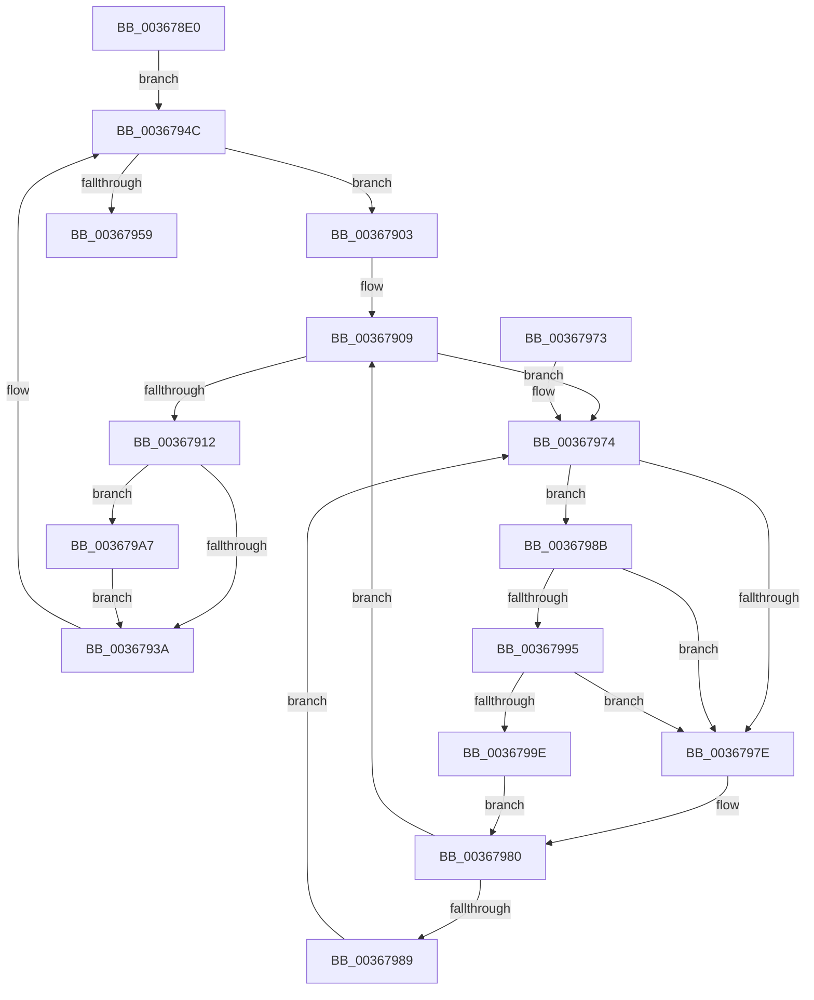

# MiFreeUnmappedPageTables

- RVA: `0x003678E0`–`0x003679AD` (길이 `205` bytes)
- VA: `0x00000001403678E0`
- 실행 섹션: `.text`
- PDB 이름 있음: `예`; PDB Function 태그: `아니요`
- unwind 정보 RVA: `0x00079FF8`
- 디코드: `64`개 명령, `205/205` bytes 표시
- 미해석 바이트: `0` (있으면 어셈블리에 `.byte`로 보존)

> 이 문서는 커널 이미지의 기계어와 PDB 기호를 분석해 생성했습니다. 4번과 5번은 함수 원형과 자료형을 바이너리 사용 방식에서 추정한 C 해석이며 원본 소스 복구 결과는 아닙니다.

## 1. Dependencies

- 직접 호출 지점: **4**; 고유 호출 대상: **4**
- 직접 호출자로 확인된 함수: **1**
- RIP 상대 이미지 참조: **2**

### Outgoing calls
- `0x00367930` → [MiDecrementShareCountEx](../33/MiDecrementShareCountEx_function_00333F70.md) (function, `0x00333F70`)
- `0x0036794C` → [MiUnlinkPageChainHead](MiUnlinkPageChainHead_function_00365C40.md) (function, `0x00365C40`)
- `0x00367995` → [KiCheckVpBackingLongSpinWaitHypercall](../30/KiCheckVpBackingLongSpinWaitHypercall_function_0030F490.md) (function, `0x0030F490`)
- `0x003679A0` → [HvlNotifyLongSpinWait](../30/HvlNotifyLongSpinWait_function_0030F460.md) (function, `0x0030F460`)

### Direct callers
- [MiDeleteSystemPageTableTail](MiDeleteSystemPageTableTail_function_00367830.md) at `0x00367885`

### Static image references
- `0x00367976` → RVA `0x00FC52AC` (`ALMOSTRO`; reference)
- `0x0036798B` → RVA `0x00FC6AB8` (`ALMOSTRO`; read)

## 2. Other-region calls and transfers

- 다른 실행 섹션으로 향하는 call: **0**
- 별도 외부 분기/꼬리 이동을 확인하지 못했습니다.

## 3. Assembly (complete function range)

```asm
003678E0  48 89 5C 24 08                  mov qword ptr [rsp + 8], rbx
003678E5  48 89 6C 24 10                  mov qword ptr [rsp + 0x10], rbp
003678EA  44 89 44 24 18                  mov dword ptr [rsp + 0x18], r8d
003678EF  56                              push rsi
003678F0  57                              push rdi
003678F1  41 56                           push r14
003678F3  48 83 EC 20                     sub rsp, 0x20
003678F7  48 8B 69 10                     mov rbp, qword ptr [rcx + 0x10]
003678FB  48 8B FA                        mov rdi, rdx
003678FE  4C 8B F1                        mov r14, rcx
00367901  EB 49                           jmp 0x14036794c
00367903  48 8B 4B 28                     mov rcx, qword ptr [rbx + 0x28]
00367907  33 F6                           xor esi, esi
00367909  F0 48 0F BA 6B 18 3F            lock bts qword ptr [rbx + 0x18], 0x3f
00367910  72 62                           jb 0x140367974
00367912  8B 43 20                        mov eax, dword ptr [rbx + 0x20]
00367915  33 D2                           xor edx, edx
00367917  89 44 24 50                     mov dword ptr [rsp + 0x50], eax
0036791B  48 8B CB                        mov rcx, rbx
0036791E  C1 E8 10                        shr eax, 0x10
00367921  24 FE                           and al, 0xfe
00367923  0C 06                           or al, 6
00367925  88 44 24 52                     mov byte ptr [rsp + 0x52], al
00367929  8B 44 24 50                     mov eax, dword ptr [rsp + 0x50]
0036792D  89 43 20                        mov dword ptr [rbx + 0x20], eax
00367930  E8 3B C6 FC FF                  call 0x140333f70
00367935  83 F8 03                        cmp eax, 3
00367938  74 6D                           je 0x1403679a7
0036793A  48 B8 FF FF FF FF FF FF FF 7F   movabs rax, 0x7fffffffffffffff
00367944  F0 48 21 43 18                  lock and qword ptr [rbx + 0x18], rax
00367949  49 8B CE                        mov rcx, r14
0036794C  E8 EF E2 FF FF                  call 0x140365c40
00367951  48 8B D8                        mov rbx, rax
00367954  48 85 C0                        test rax, rax
00367957  75 AA                           jne 0x140367903
00367959  48 01 6F 18                     add qword ptr [rdi + 0x18], rbp
0036795D  48 01 2F                        add qword ptr [rdi], rbp
00367960  48 8B 6C 24 48                  mov rbp, qword ptr [rsp + 0x48]
00367965  48 8B 5C 24 40                  mov rbx, qword ptr [rsp + 0x40]
0036796A  48 83 C4 20                     add rsp, 0x20
0036796E  41 5E                           pop r14
00367970  5F                              pop rdi
00367971  5E                              pop rsi
00367972  C3                              ret
00367973  CC                              int3
00367974  FF C6                           inc esi
00367976  85 35 30 D9 C5 00               test dword ptr [rip + 0xc5d930], esi
0036797C  74 0D                           je 0x14036798b
0036797E  F3 90                           pause
00367980  48 8B 43 18                     mov rax, qword ptr [rbx + 0x18]
00367984  48 85 C0                        test rax, rax
00367987  79 80                           jns 0x140367909
00367989  EB E9                           jmp 0x140367974
0036798B  8B 05 27 F1 C5 00               mov eax, dword ptr [rip + 0xc5f127]
00367991  A8 40                           test al, 0x40
00367993  74 E9                           je 0x14036797e
00367995  E8 F6 7A FA FF                  call 0x14030f490
0036799A  84 C0                           test al, al
0036799C  74 E0                           je 0x14036797e
0036799E  8B CE                           mov ecx, esi
003679A0  E8 BB 7A FA FF                  call 0x14030f460
003679A5  EB D9                           jmp 0x140367980
003679A7  48 FF 47 08                     inc qword ptr [rdi + 8]
003679AB  EB 8D                           jmp 0x14036793a
```

## 4. C-style interpretation (structured pseudocode)

```c
__int64 __fastcall MiFreeUnmappedPageTables(__int64 a1, __int64 a2, int a3)
{
    __int64 result;
    __int64 v_rsi;
    __int64 v_rsp;
    unsigned __int64 v_stack_p10;
    unsigned int v_stack_p18;
    unsigned __int8 v_stack_p1A;
    unsigned __int64 v_stack_p8;

    v_stack_p8 = v_rbx;
    v_stack_p10 = v_rbp;
    v_stack_p18 = a3;
    v_rsp = (v_rsp) - (32);
    goto loc_0036794C;
loc_00367903:
    v_rsi = 0;
loc_00367909:
    if (condition_is_below) goto loc_00367974;
    a2 = 0;
    v_stack_p18 = (unsigned int)((unsigned int)(*(unsigned int *)(v_rbx + 32)));
    result = (unsigned int)(((unsigned int)(*(unsigned int *)(v_rbx + 32))) >> (16));
    result = (unsigned __int8)((result) & (254));
    result = (unsigned __int8)((result) | (6));
    v_stack_p1A = (unsigned __int8)(result);
    *(unsigned int *)(v_rbx + 32) = (unsigned int)((unsigned int)(v_stack_p18));
    result = MiDecrementShareCountEx(v_rbx, a2, a3, a4);
    if (((unsigned int)(result)) == 3) goto loc_003679A7;
loc_0036793A:
loc_0036794C:
    result = MiUnlinkPageChainHead(a1, a2, a3, a4);
    if (result != 0) goto loc_00367903;
    v_rsp = (v_rsp) + (32);
    return result;
loc_00367974:
    v_rsi = (unsigned int)((v_rsi) + 1);
    if (((*(unsigned int *)(v_rip + 12966192)) & ((unsigned int)(v_rsi))) == 0) goto loc_0036798B;
loc_0036797E:
loc_00367980:
    if (!sign_flag) goto loc_00367909;
    goto loc_00367974;
loc_0036798B:
    if ((((unsigned __int8)((unsigned int)(*(unsigned int *)(v_rip + 12972327)))) & (64)) == 0) goto loc_0036797E;
    result = KiCheckVpBackingLongSpinWaitHypercall(a1, a2, a3, a4);
    if ((unsigned __int8)(result) == 0) goto loc_0036797E;
    result = HvlNotifyLongSpinWait((unsigned int)((unsigned int)(v_rsi)), a2, a3, a4);
    goto loc_00367980;
loc_003679A7:
    goto loc_0036793A;
}
```

## 5. (Beta) C Style

```c
int64_t MiFreeUnmappedPageTables(void *Arg1, void *Arg2, int32_t Arg3)
{
    uint8_t *arg1 = (uint8_t *)Arg1;
    uint8_t *arg2 = (uint8_t *)Arg2;

    int64_t result;
    int64_t local_rsi;
    int64_t local_rsp;
    uint64_t v_stack_p10;
    uint32_t v_stack_p18;
    uint8_t v_stack_p1A;
    uint64_t v_stack_p8;

    v_stack_p8 = local_rbx;
    v_stack_p10 = local_rbp;
    v_stack_p18 = Arg3;
    local_rsp = (local_rsp) - (32);
    goto loc_0036794C;
loc_00367903:
    local_rsi = 0;
loc_00367909:
    if (condition_is_below) goto loc_00367974;
    Arg2 = 0;
    v_stack_p18 = (uint32_t)((uint32_t)(*(uint32_t *)(local_rbx + 0x20)));
    result = (uint32_t)(((uint32_t)(*(uint32_t *)(local_rbx + 0x20))) >> (16));
    result = (uint8_t)((result) & (254));
    result = (uint8_t)((result) | (6));
    v_stack_p1A = (uint8_t)(result);
    *(uint32_t *)(local_rbx + 0x20) = (uint32_t)((uint32_t)(v_stack_p18));
    result = MiDecrementShareCountEx(local_rbx, Arg2, Arg3, a4);
    if (((uint32_t)(result)) == 3) goto loc_003679A7;
loc_0036793A:
loc_0036794C:
    result = MiUnlinkPageChainHead(Arg1, Arg2, Arg3, a4);
    if (result != 0) goto loc_00367903;
    local_rsp = (local_rsp) + (32);
    return result;
loc_00367974:
    local_rsi = (uint32_t)((local_rsi) + 1);
    if (((*(uint32_t *)(v_rip + 0xC5D930)) & ((uint32_t)(local_rsi))) == 0) goto loc_0036798B;
loc_0036797E:
loc_00367980:
    if (!sign_flag) goto loc_00367909;
    goto loc_00367974;
loc_0036798B:
    if ((((uint8_t)((uint32_t)(*(uint32_t *)(v_rip + 0xC5F127)))) & (64)) == 0) goto loc_0036797E;
    result = KiCheckVpBackingLongSpinWaitHypercall(Arg1, Arg2, Arg3, a4);
    if ((uint8_t)(result) == 0) goto loc_0036797E;
    result = HvlNotifyLongSpinWait((uint32_t)((uint32_t)(local_rsi)), Arg2, Arg3, a4);
    goto loc_00367980;
loc_003679A7:
    goto loc_0036793A;
}
```

### 관측된 메모리 오프셋

구조체 형식이 확인되지 않은 접근은 인자 기준의 오프셋으로만 기록했습니다.

| 기준 인자 | 오프셋 표현 | 폭 (bit) | 접근 |
|---|---:|---:|---|
| `Arg1` | `+ 0x10` | `64` | `R` |
| `Arg2` | `+ 0x0` | `64` | `R/W` |
| `Arg2` | `+ 0x8` | `64` | `R/W` |
| `Arg2` | `+ 0x18` | `64` | `R/W` |

## 6. Execution-region graph

[열기: 2D/3D 그래프와 함수 탐색 컨트롤 패널](../../../control-panel.html?section=text&rva=0x003678E0&view=graph)

- 2D 그래프는 위에서 아래로 흐르고, 3D 그래프는 빈 공간을 드래그해 회전합니다. Shift+드래그는 이동, 휠은 확대·축소, 함수 노드 선택은 대상 보고서 이동입니다.

### Static fallback


